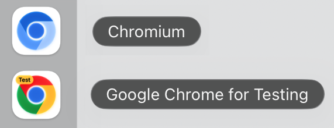

import Tabs from '@theme/Tabs';
import TabItem from '@theme/TabItem';
import HTMLCard from '@site/src/components/HTMLCard';

import LiteYouTube from '@site/src/components/LiteYouTube';

## Версия 1.65

### 🧾 Код локатора на C#

Локатор, полученный с помощью [Locator.NormalizeAsync()](/api/class-locator.mdx#locator-normalize), теперь преобразуется в строку с кодом на C#. Используйте его вместе с [Page.GetByRef()](/api/class-page.mdx#page-get-by-ref), чтобы преобразовать элемент, выбранный агентом из снимка [Page.AriaSnapshotAsync()](/api/class-page.mdx#page-aria-snapshot) в режиме `"ai"`, в код для вашего теста:

```csharp
var normalized = await page.GetByRef("e2").NormalizeAsync();
Console.WriteLine(normalized.ToString());
// GetByRole(AriaRole.Button, new() { Name = "Submit" })
```

### Новые API
- Новый параметр [Timeout](/api/class-cdpsession.mdx#cdp-session-send-option-timeout) в [CdpSession.SendAsync()](/api/class-cdpsession.mdx#cdp-session-send).

### Критические изменения ⚠️
- Такие действия, как [Locator.ClickAsync()](/api/class-locator.mdx#locator-click), [Locator.CheckAsync()](/api/class-locator.mdx#locator-check), [Locator.TapAsync()](/api/class-locator.mdx#locator-tap), [Locator.FillAsync()](/api/class-locator.mdx#locator-fill), [Locator.ClearAsync()](/api/class-locator.mdx#locator-clear) и [Locator.SelectOptionAsync()](/api/class-locator.mdx#locator-select-option), теперь ожидают, пока элемент [перестанет быть инертным](./actionability.mdx#not-inert). Действие над элементом с атрибутом `inert` или над элементом внутри него теперь завершается по тайм-ауту, если элемент остаётся инертным.
- Сопоставление файлов cookie теперь соответствует RFC 6265. При указании URL методы [BrowserContext.CookiesAsync()](/api/class-browsercontext.mdx#browser-context-cookies) и [ApiRequestContext.CookiesAsync()](/api/class-apirequestcontext.mdx#api-request-context-cookies) больше не возвращают файлы cookie, предназначенные только для конкретного хоста, для его поддоменов, а файлы cookie с `Path=/api` — для `/apiv2`; файл cookie с `Path=/foo/` не соответствует `/foo`. [APIRequestContext] отправляет файл cookie без имени как `Cookie: x`, а не `Cookie: =x`, и сохраняет `Set-Cookie: token` как файл cookie без имени.
- Учётные данные прокси больше не отправляются веб-сайтам. Учётные данные из параметра [Proxy](/api/class-browsertype.mdx#browser-type-launch-option-proxy) теперь используются только в ответ на запросы аутентификации от прокси. Для аутентификации на веб-сайте используйте [HttpCredentials|HttpCredentialsList](/api/class-browser.mdx#browser-new-context-option-http-credentials).
- Текст, который браузер не отображает, например текст, не назначенный слоту, или текст непосредственно внутри закрытого `<details>`, больше не включается в доступные имена и снимки ARIA. Это может изменить результаты [Page.GetByRole()](/api/class-page.mdx#page-get-by-role) с указанием имени, [Locator.AriaSnapshotAsync()](/api/class-locator.mdx#locator-aria-snapshot) и [Expect(Locator).ToMatchAriaSnapshotAsync()](/api/class-locatorassertions.mdx#locator-assertions-to-match-aria-snapshot).
- Параметр `ParamsString` в запросах [APIRequestContext] теперь добавляется к уже существующей строке запроса URL, а не заменяет её.

### Версии браузеров
- Chromium 158.0.8127.18
- Mozilla Firefox 159.0
- WebKit 27.2

Эта версия также протестирована со следующими стабильными каналами:
- Google Chrome 157
- Microsoft Edge 156

## Версия 1.64

### 🧰 WebMCP

Новые [Page.Webmcp](/api/class-page.mdx#page-webmcp) и [Frame.Webmcp](/api/class-frame.mdx#frame-webmcp) предоставляют доступ к инструментам, которые страница регистрирует через экспериментальный браузерный API [WebMCP](https://webmachinelearning.github.io/webmcp/), позволяя тестировать их так же, как любую другую часть приложения:

```csharp
var browser = await playwright.Chromium.LaunchAsync(new() { Args = new[] { "--enable-features=WebMCP" } });
var page = await browser.NewPageAsync();
await page.GotoAsync("https://example.com");

foreach (var tool in await page.Webmcp.ToolsAsync())
    Console.WriteLine($"{tool.Name}: {tool.Description}");

var result = await page.Webmcp.CallToolAsync("add", new { a = 2, b = 40 });
Console.WriteLine(result?.GetProperty("content")[0].GetProperty("text")); // "42"
```

[Playwright MCP](./getting-started-mcp.mdx) также поддерживает WebMCP по умолчанию: инструменты, определённые страницей, предоставляются агенту под именами `webmcp_<tool>`. Чтобы отключить эту возможность, передайте `--no-webmcp`.

[`playwright-cli`](./getting-started-cli.mdx) также предоставляет к ним доступ:

```bash
playwright-cli webmcp-list
playwright-cli webmcp-call search_catalog --params '{"query":"cats"}'
```

### 🎬 Улучшенная запись видео

Теперь видео можно записывать с пользовательской частотой кадров, а визуальное оформление действий настраивается с помощью обычного CSS:

```csharp
await page.Screencast.StartAsync(new()
{
    Path = "video.webm",
    Size = new() { Width = 1920, Height = 1080 },
    Fps = 60,
});
await page.Screencast.ShowActionsAsync(new()
{
    Style = new()
    {
        Point = "width: 20px; height: 20px; border-radius: 50%; background: red",
        Highlight = "outline: 2px solid #333; background: rgba(0, 128, 255, .15)",
        Title = "font-size: 16px",
    },
});
```

- Новый параметр [RecordVideoFps](/api/class-browser.mdx#browser-new-context-option-record-video-fps) и новый параметр [Fps](/api/class-screencast.mdx#screencast-start-option-fps) в [Screencast.StartAsync()](/api/class-screencast.mdx#screencast-start). Firefox и WebKit в настоящее время записывают до 25 кадров в секунду.
- Новый параметр [Style](/api/class-screencast.mdx#screencast-show-actions-option-style) принимает CSS-объявления для маркера `point`, подсветки целевого элемента `highlight` и заголовка действия `title`. Он заменяет параметр `FontSize`, который теперь объявлен устаревшим.
- Курсор остаётся видимым в точке последнего действия, сохраняется при переходах между страницами и перемещается по естественной траектории с плавным ускорением и замедлением.
- Видео кодируются с помощью VP9 вместо VP8, что снижает нагрузку на процессор и создаёт файлы меньшего размера с таким же или лучшим качеством.
- Все параметры видео также доступны в [Playwright MCP](./getting-started-mcp.mdx) и [`playwright-cli`](./getting-started-cli.mdx).

### 🪆 Locator.within()

Новый метод [Locator.Within()](/api/class-locator.mdx#locator-within) объединяет два уже имеющихся локатора, сохраняя естественный порядок чтения — «эта кнопка внутри того диалогового окна»:

```csharp
var saveButton = page.GetByRole(AriaRole.Button, new() { Name = "Save" });
var dialog = page.GetByTestId("settings-dialog");

await saveButton.Within(dialog).ClickAsync();
```

Относительные локаторы, такие как [Locator.Nth()](/api/class-locator.mdx#locator-nth) или [Locator.First](/api/class-locator.mdx#locator-first), разрешаются отдельно внутри каждого родительского элемента, что упрощает запросы для выбора столбцов:

```csharp
// Третья ячейка каждой строки, а не третья ячейка таблицы.
var thirdColumn = page.GetByRole(AriaRole.Cell).Nth(2).Within(page.GetByRole(AriaRole.Row));
await Expect(thirdColumn).ToHaveTextAsync(new[] { "Apple", "Banana", "Cherry" });
```

### Новые API
- Новый метод [Page.GetByRef()](/api/class-page.mdx#page-get-by-ref) находит элемент по его ссылке ARIA, например `e2`, возвращаемой [Page.AriaSnapshotAsync()](/api/class-page.mdx#page-aria-snapshot) в режиме `"ai"`.
- Новый параметр [IncludeShadow](/api/class-page.mdx#page-content-option-include-shadow) в [Page.ContentAsync()](/api/class-page.mdx#page-content) и [Frame.ContentAsync()](/api/class-frame.mdx#frame-content) сериализует открытые теневые корни в виде [декларативного теневого DOM](https://developer.mozilla.org/en-US/docs/Web/API/Web_components/Using_shadow_DOM#declaratively_with_html).
- Новый параметр [SignCount](/api/class-credentials.mdx#credentials-create-option-sign-count) задаёт начальное значение счётчика подписей для виртуальных учётных данных. [Credentials.CreateAsync()](/api/class-credentials.mdx#credentials-create) и [Credentials.GetAsync()](/api/class-credentials.mdx#credentials-get) возвращают текущее значение `SignCount`, которое сохраняется и восстанавливается вместе с учётными данными в состоянии хранилища.
- Новые методы [ApiRequestContext.AddCookiesAsync()](/api/class-apirequestcontext.mdx#api-request-context-add-cookies), [ApiRequestContext.CookiesAsync()](/api/class-apirequestcontext.mdx#api-request-context-cookies) и [ApiRequestContext.ClearCookiesAsync()](/api/class-apirequestcontext.mdx#api-request-context-clear-cookies) управляют файлами cookie контекста запросов, аналогично методам [BrowserContext]:
  
  ```csharp
  await request.AddCookiesAsync(new[]
  {
      new Cookie { Name = "session-id", Value = "42", Url = "https://example.com" },
  });
  Console.WriteLine(await request.CookiesAsync("https://example.com"));
  await request.ClearCookiesAsync(new() { Name = "session-id" });
  ```
  
### Критические изменения ⚠️
- Элементы внутри скрытых iframe считаются скрытыми. Элементы внутри невидимого iframe, например с `visibility: hidden`, теперь считаются скрытыми при выполнении действий, а также методами [Locator.IsVisibleAsync()](/api/class-locator.mdx#locator-is-visible) и [Expect(Locator).ToBeVisibleAsync()](/api/class-locatorassertions.mdx#locator-assertions-to-be-visible).

### Версии браузеров
- Chromium 156.0.8078.4
- Mozilla Firefox 157.0
- WebKit 27.2

Эта версия также протестирована со следующими стабильными каналами:
- Google Chrome 155
- Microsoft Edge 155

## Версия 1.63

### 🪟 Поиск элементов в разных фреймах

Методы [Page.FrameLocator()](/api/class-page.mdx#page-frame-locator) и [Frame.FrameLocator()](/api/class-frame.mdx#frame-frame-locator), вызванные без селектора, выполняют поиск в любом фрейме поддерева, поэтому предварительно находить iframe больше не требуется:

```csharp
// Находит кнопку в любом фрейме на странице.
await page.FrameLocator().GetByRole(AriaRole.Button).ClickAsync();
```

Оставшаяся часть локатора разрешается внутри одного фрейма, как и обычный локатор; если подходящие элементы найдены в нескольких фреймах, возникает ошибка.

### 👁️ Локаторы только для видимых элементов

Новое свойство [Locator.Visible](/api/class-locator.mdx#locator-visible) возвращает локатор, соответствующий только видимым элементам. Его рекомендуется использовать вместо CSS-псевдокласса `:visible`:

```csharp
await page.Locator("button").Visible.ClickAsync();
```

### 🖼️ Снимки ARIA и экрана в трассировках

Новые параметры [AriaSnapshots](/api/class-tracing.mdx#tracing-start-option-aria-snapshots) и [ScreenSnapshots](/api/class-tracing.mdx#tracing-start-option-screen-snapshots) метода [Tracing.StartAsync()](/api/class-tracing.mdx#tracing-start) сохраняют снимок ARIA и скриншот страницы при каждом действии:

```csharp
await context.Tracing.StartAsync(new()
{
  Snapshots = true,
  AriaSnapshots = true,
  ScreenSnapshots = true
});
```

Если снимки ARIA и экрана записаны, новый режим **Display Aria** в просмотрщике трассировок отображает скриншот действия рядом со снимком ARIA, а при наведении на узел ARIA подсвечивает его на скриншоте.

### Новые API

#### Браузер и контекст
- Параметр [HttpCredentials|HttpCredentialsList](/api/class-browser.mdx#browser-new-context-option-http-credentials) теперь также принимает массив учётных данных. Используется первая запись, соответствующая источнику запроса; записи без указания источника соответствуют любому запросу.
- Новый параметр [Opfs](/api/class-browsercontext.mdx#browser-context-storage-state-option-opfs) включает [приватную файловую систему источника](https://developer.mozilla.org/en-US/docs/Web/API/File_System_API/Origin_private_file_system) в состояние хранилища, позволяя сохранять её и восстанавливать в последующих контекстах.
- Новые события [Page.DialogClosed](/api/class-page.mdx#page-event-dialog-closed) и [BrowserContext.DialogClosed](/api/class-browsercontext.mdx#browser-context-event-dialog-closed) возникают, когда диалоговое окно JavaScript подтверждено, отклонено или закрыто пользователем.

#### Командная строка
- `pwsh bin/Debug/netX/playwright.ps1 install --no-remove` сохраняет браузеры других установок Playwright вместо их удаления.
- `pwsh bin/Debug/netX/playwright.ps1 codegen --http-credentials` записывает действия на страницах, защищённых HTTP-аутентификацией.

### Объявления
* ⚠️ Ubuntu 20.04 больше не поддерживается.
* 🐧 На Linux arm64 Playwright теперь загружает сборку Chromium [Chrome for Testing](https://developer.chrome.com/blog/chrome-for-testing) — ту же сборку, которая используется на всех остальных платформах.

### Версии браузеров
- Chromium 153.0.8010.12
- Mozilla Firefox 155.0
- WebKit 26.6

Эта версия также протестирована со следующими стабильными каналами:
- Google Chrome 153
- Microsoft Edge 153

## Версия 1.62

### 🖼️ Скриншоты WebP

Методы [Page.ScreenshotAsync()](/api/class-page.mdx#page-screenshot) и [Locator.ScreenshotAsync()](/api/class-locator.mdx#locator-screenshot) теперь позволяют делать скриншоты в формате WebP — Playwright определяет формат по расширению файла `.webp`, либо его можно явно задать с помощью `type`. При качестве `100` (по умолчанию) используется сжатие без потерь, а при меньших значениях — сжатие с потерями:

```csharp
await page.ScreenshotAsync(new() { Path = "homepage.webp", Quality = 50 });
```

### Новые API
- Новый параметр `scroll` (`"auto"` | `"none"`) для действий позволяет отключить автоматическую прокрутку Playwright, помещающую элемент в область видимости.
- Новый метод [Locator.WaitForFunctionAsync()](/api/class-locator.mdx#locator-wait-for-function) ожидает, пока функция, вызываемая с соответствующим элементом, не вернёт истинностное значение.
- Новое свойство [ApiResponse.Timing](/api/class-apiresponse.mdx#api-response-timing) возвращает информацию о временных характеристиках загрузки ресурса для ответа API.

### Объявления
* 📋 Буфер обмена теперь изолирован от операционной системы в режиме headless, поэтому тесты, использующие `navigator.clipboard`, больше не читают и не перезаписывают буфер обмена компьютера, на котором выполняются.
* ⚠️ Debian 11 больше не поддерживается.

### Версии браузеров
- Chromium 151.0.7922.34
- Mozilla Firefox 153.0
- WebKit 26.5

Эта версия также протестирована со следующими стабильными каналами:
- Google Chrome 151
- Microsoft Edge 151

## Версия 1.61

### 🔑 Ключи доступа WebAuthn

Новый виртуальный аутентификатор [Credentials], доступный через [BrowserContext.Credentials](/api/class-browsercontext.mdx#browser-context-credentials), позволяет тестам регистрировать ключи доступа и отвечать на процедуры `navigator.credentials.create()` / `navigator.credentials.get()` на странице — без настоящего аппаратного ключа и во всех браузерах:

```csharp
var context = await browser.NewContextAsync();

// Добавляем ключ доступа, подготовленный серверной частью для тестового пользователя.
await context.Credentials.CreateAsync("example.com", new()
{
    Id = credentialId,
    UserHandle = userHandle,
    PrivateKey = privateKey,
    PublicKey = publicKey,
});
await context.Credentials.InstallAsync();

var page = await context.NewPageAsync();
await page.GotoAsync("https://example.com/login");
// Вызов navigator.credentials.get() на странице получает добавленный ключ доступа.
```

Также можно позволить приложению один раз зарегистрировать ключ доступа в подготовительном тесте, прочитать его с помощью [Credentials.GetAsync()](/api/class-credentials.mdx#credentials-get) и добавить в последующие тесты — подробности см. в [Credentials].

### 🗃️ Веб-хранилище

Новый API [WebStorage], доступный через [Page.LocalStorage](/api/class-page.mdx#page-local-storage) и [Page.SessionStorage](/api/class-page.mdx#page-session-storage), позволяет читать и записывать данные хранилища страницы для текущего источника:

```csharp
await page.LocalStorage.SetItemAsync("token", "abc");
var token = await page.LocalStorage.GetItemAsync("token");
var items = await page.SessionStorage.ItemsAsync();
```

### Новые API
- Методы [ApiResponse.SecurityDetailsAsync()](/api/class-apiresponse.mdx#api-response-security-details) и [ApiResponse.ServerAddrAsync()](/api/class-apiresponse.mdx#api-response-server-addr) аналогичны браузерным методам [Response.SecurityDetailsAsync()](/api/class-response.mdx#response-security-details) и [Response.ServerAddrAsync()](/api/class-response.mdx#response-server-addr).
- Новый параметр `ArtifactsDir` в [BrowserType.ConnectOverCDPAsync()](/api/class-browsertype.mdx#browser-type-connect-over-cdp) определяет, где сохраняются артефакты, такие как трассировки и загрузки, при подключении к уже запущенному браузеру.
- Новый параметр `Cursor` в [Screencast.ShowActionsAsync()](/api/class-screencast.mdx#screencast-show-actions) управляет визуальным оформлением курсора для действий с указателем.
- Обратный вызов `OnFrame` в [Screencast.StartAsync()](/api/class-screencast.mdx#screencast-start) теперь получает `Timestamp` — временную метку момента, когда браузер отобразил кадр.

### 🛠️ Другие улучшения
- Playwright теперь поддерживает Ubuntu 26.04.
- Записи HAR и трассировок теперь включают запросы WebSocket.

### Версии браузеров
- Chromium 149.0.7827.55
- Mozilla Firefox 151.0
- WebKit 26.5

Эта версия также протестирована со следующими стабильными каналами:
- Google Chrome 149
- Microsoft Edge 149

## Версия 1.60

### 🌐 Запись HAR через Tracing

Методы [Tracing.StartHarAsync()](/api/class-tracing.mdx#tracing-start-har) / [Tracing.StopHarAsync()](/api/class-tracing.mdx#tracing-stop-har) предоставляют запись HAR как полноценную часть API трассировки с теми же параметрами `Content`, `Mode` и `UrlFilter`, что и у `RecordHar`:

```csharp
await context.Tracing.StartHarAsync("trace.har");
var page = await context.NewPageAsync();
await page.GotoAsync("https://playwright.dev");
await context.Tracing.StopHarAsync();
```

### 🪝 API Drop

Новый метод [Locator.DropAsync()](/api/class-locator.mdx#locator-drop) имитирует внешнее перетаскивание файлов или данных, подобных содержимому буфера обмена, на элемент. Playwright отправляет события `dragenter`, `dragover` и `drop` с синтетическим [DataTransfer] в контексте страницы — это работает во всех браузерах и отлично подходит для тестирования областей загрузки файлов:

```csharp
await page.Locator("#dropzone").DropAsync(new() {
    Files = new FilePayload() {
        Name = "note.txt",
        MimeType = "text/plain",
        Buffer = Encoding.UTF8.GetBytes("hello"),
    },
});

await page.Locator("#dropzone").DropAsync(new() {
    Data = new Dictionary<string, string> {
        ["text/plain"] = "hello world",
        ["text/uri-list"] = "https://example.com",
    },
});
```

### 🎯 Снимки ARIA
- Метод [Expect(Page).ToMatchAriaSnapshotAsync()](/api/class-pageassertions.mdx#page-assertions-to-match-aria-snapshot) теперь работает с [Page], а не только с [Locator], что эквивалентно проверке для `Page.Locator("body")`.
- Новый параметр `Boxes` в [Locator.AriaSnapshotAsync()](/api/class-locator.mdx#locator-aria-snapshot) / [Page.AriaSnapshotAsync()](/api/class-page.mdx#page-aria-snapshot) добавляет ограничивающий прямоугольник каждого элемента в формате `[box=x,y,width,height]`, что полезно при обработке с помощью ИИ.

### Новые API

#### Браузер, контекст и страница
- Событие [Browser.Context](/api/class-browser.mdx#browser-event-context) возникает при создании нового контекста в браузере.
- [BrowserContext] теперь также передаёт события жизненного цикла своих страниц: [BrowserContext.Download](/api/class-browsercontext.mdx#browser-context-event-download), [BrowserContext.FrameAttached](/api/class-browsercontext.mdx#browser-context-event-frame-attached), [BrowserContext.FrameDetached](/api/class-browsercontext.mdx#browser-context-event-frame-detached), [BrowserContext.FrameNavigated](/api/class-browsercontext.mdx#browser-context-event-frame-navigated), [BrowserContext.PageClose](/api/class-browsercontext.mdx#browser-context-event-page-close), [BrowserContext.PageLoad](/api/class-browsercontext.mdx#browser-context-event-page-load).

#### Локаторы и проверки
- Новый параметр `Description` в [Page.GetByRole()](/api/class-page.mdx#page-get-by-role) / [Locator.GetByRole()](/api/class-locator.mdx#locator-get-by-role) / [Frame.GetByRole()](/api/class-frame.mdx#frame-get-by-role) / [FrameLocator.GetByRole()](/api/class-framelocator.mdx#frame-locator-get-by-role) для сопоставления по [доступному описанию](https://www.w3.org/TR/wai-aria-1.2/#dfn-accessible-description).
- Новый параметр `Pseudo` в [Expect(Locator).ToHaveCSSAsync()](/api/class-locatorassertions.mdx#locator-assertions-to-have-css) позволяет читать вычисленные стили `::before` или `::after`.
- Новый параметр `Style` в [Locator.HighlightAsync()](/api/class-locator.mdx#locator-highlight) применяет дополнительные встроенные CSS-стили к слою подсветки; новый метод [Page.HideHighlightAsync()](/api/class-page.mdx#page-hide-highlight) убирает всю подсветку.

#### Сеть
- Свойство [WebSocketRoute.Protocols](/api/class-websocketroute.mdx#web-socket-route-protocols) возвращает подпротоколы WebSocket, запрошенные страницей.
- Новый параметр `NoDefaults` в [BrowserType.ConnectOverCDPAsync()](/api/class-browsertype.mdx#browser-type-connect-over-cdp) отключает стандартные переопределения Playwright для контекста по умолчанию (поведение загрузок, эмуляцию фокуса, эмуляцию медиа), чтобы подключение к браузеру, которым пользователь пользуется повседневно, не нарушало его состояние.

#### Ошибки
- Новое свойство [WebError.Location](/api/class-weberror.mdx#web-error-location) аналогично [ConsoleMessage.Location](/api/class-consolemessage.mdx#console-message-location).

### 🛠️ Другие улучшения
- В просмотрщике трассировок на панели сведений о сети добавлен переключатель форматирования тел запросов и ответов в формате JSON или данных форм.

### Критические изменения ⚠️
- Удалён давно объявленный устаревшим параметр `Handle` в `BrowserContext.ExposeBindingAsync` и `Page.ExposeBindingAsync`.

### Версии браузеров
- Chromium 148.0.7778.96
- Mozilla Firefox 150.0.2
- WebKit 26.4

Эта версия также протестирована со следующими стабильными каналами:
- Google Chrome 147
- Microsoft Edge 147

## Версия 1.59

### 🎬 Запись экрана

Новый API [Page.Screencast](/api/class-page.mdx#page-screencast) предоставляет единый интерфейс для захвата содержимого страницы со следующими возможностями:
- Запись видео с экрана
- Аннотации действий
- Визуальные наложения
- Захват кадров в реальном времени
- Видеоотчёты о работе агентов

<center>


</center>

**Запись видео с экрана** — записывайте видео с точным управлением запуском и остановкой в качестве альтернативы параметру [RecordVideoDir](/api/class-browser.mdx#browser-new-context-option-record-video-dir):

```csharp
await page.Screencast.StartAsync(new() { Path = "video.webm" });
// ... выполняем действия ...
await page.Screencast.StopAsync();
```

**Аннотации действий** — включайте встроенные визуальные аннотации, которые подсвечивают элементы, с которыми выполняется взаимодействие, и отображают заголовки действий во время записи:

```csharp
await page.Screencast.ShowActionsAsync(new() { Position = "top-right" });
```

Метод `ShowActionsAsync` принимает параметры `Position` (`"top-left"`, `"top"`, `"top-right"`, `"bottom-left"`, `"bottom"`, `"bottom-right"`), `Duration` (мс на аннотацию) и `FontSize` (пиксели). Он возвращает объект, освобождение которого прекращает отображение действий.

**Визуальные наложения** — добавляйте заголовки глав и пользовательские HTML-наложения поверх страницы, чтобы сделать пояснения более наглядными:

```csharp
await page.Screencast.ShowChapterAsync("Adding TODOs", new() {
    Description = "Type and press enter for each TODO",
    Duration = 1000,
});

await page.Screencast.ShowOverlayAsync("<div style=\"color: red\">Recording</div>");
```

**Захват кадров в реальном времени** — передавайте поток кадров в формате JPEG для пользовательской обработки: создания миниатюр, предварительного просмотра в реальном времени, анализа изображений с помощью ИИ и многого другого:

```csharp
await page.Screencast.StartAsync(new() {
    OnFrame = frame => SendToVisionModel(frame.Data),
});
```

**Видеоотчёты о работе агентов** — агенты программирования могут создавать видеоподтверждения своей работы. Завершив задачу, агент может записать демонстрационное видео с подробными аннотациями для проверки человеком:

```csharp
await page.Screencast.StartAsync(new() { Path = "receipt.webm" });
await page.Screencast.ShowActionsAsync(new() { Position = "top-right" });

await page.Screencast.ShowChapterAsync("Verifying checkout flow", new() {
    Description = "Added coupon code support per ticket #1234",
});

// Агент выполняет шаги проверки...
await page.Locator("#coupon").FillAsync("SAVE20");
await page.Locator("#apply-coupon").ClickAsync();
await Expect(page.Locator(".discount")).ToContainTextAsync("20%");

await page.Screencast.ShowChapterAsync("Done", new() {
    Description = "Coupon applied, discount reflected in total",
});

await page.Screencast.StopAsync();
```

Полученное видео служит подтверждением выполнения работы: заголовки глав дают контекст, аннотации действий выделяют каждое взаимодействие, а просмотр наглядной демонстрации занимает меньше времени, чем чтение текстовых журналов.

### 🔍 Снимки и локаторы
- Метод [Page.AriaSnapshotAsync()](/api/class-page.mdx#page-aria-snapshot) для создания снимка ARIA страницы — эквивалент `Page.Locator("body").AriaSnapshotAsync()`.
- Параметры `Depth` и `Mode` в [Locator.AriaSnapshotAsync()](/api/class-locator.mdx#locator-aria-snapshot).
- Метод [Locator.NormalizeAsync()](/api/class-locator.mdx#locator-normalize) преобразует локатор в соответствии с рекомендуемыми практиками, например с использованием тестовых идентификаторов и ролей ARIA.
- Метод [Page.PickLocatorAsync()](/api/class-page.mdx#page-pick-locator) включает интерактивный режим, в котором наведение на элементы подсвечивает их и показывает соответствующий локатор. Нажмите на элемент, чтобы получить его [Locator]. Для отмены используйте [Page.CancelPickLocatorAsync()](/api/class-page.mdx#page-cancel-pick-locator).

### Новые API

#### Запись экрана
- [Page.Screencast](/api/class-page.mdx#page-screencast) предоставляет запись видео, потоковую передачу кадров в реальном времени и управление наложениями.
- Методы [Screencast.StartAsync()](/api/class-screencast.mdx#screencast-start) и [Screencast.StopAsync()](/api/class-screencast.mdx#screencast-stop) для записи видео и захвата кадров.
- Методы [Screencast.ShowActionsAsync()](/api/class-screencast.mdx#screencast-show-actions) и [Screencast.HideActionsAsync()](/api/class-screencast.mdx#screencast-hide-actions) для аннотаций действий.
- Методы [Screencast.ShowChapterAsync()](/api/class-screencast.mdx#screencast-show-chapter) и [Screencast.ShowOverlayAsync()](/api/class-screencast.mdx#screencast-show-overlay) для визуальных наложений.
- Методы [Screencast.ShowOverlaysAsync()](/api/class-screencast.mdx#screencast-show-overlays) и [Screencast.HideOverlaysAsync()](/api/class-screencast.mdx#screencast-hide-overlays) для управления видимостью наложений.

#### Хранилище, консоль и ошибки
- Метод [BrowserContext.SetStorageStateAsync()](/api/class-browsercontext.mdx#browser-context-set-storage-state) очищает существующие файлы cookie, локальное хранилище и IndexedDB для всех источников и устанавливает новое состояние хранилища — без необходимости создавать новый контекст.
- Методы [Page.ClearConsoleMessagesAsync()](/api/class-page.mdx#page-clear-console-messages) и [Page.ClearPageErrorsAsync()](/api/class-page.mdx#page-clear-page-errors) для очистки сохранённых сообщений и ошибок.
- Параметр `Filter` в [Page.ConsoleMessagesAsync()](/api/class-page.mdx#page-console-messages) и [Page.PageErrorsAsync()](/api/class-page.mdx#page-page-errors) определяет, какие сообщения возвращаются.
- Метод [ConsoleMessage.Timestamp](/api/class-consolemessage.mdx#console-message-timestamp).

#### Прочее
- [BrowserContext.Debugger](/api/class-browsercontext.mdx#browser-context-debugger) предоставляет программное управление отладчиком Playwright.
- Метод [BrowserContext.IsClosed](/api/class-browsercontext.mdx#browser-context-is-closed).
- Метод [Request.ExistingResponse](/api/class-request.mdx#request-existing-response) возвращает ответ без ожидания.
- Метод [Response.HttpVersionAsync()](/api/class-response.mdx#response-http-version) возвращает версию HTTP, используемую в ответе.
- Параметр `Live` в [Tracing.StartAsync()](/api/class-tracing.mdx#tracing-start) для обновления трассировки в реальном времени.
- Параметр `ArtifactsDir` в [BrowserType.LaunchAsync()](/api/class-browsertype.mdx#browser-type-launch) для настройки каталога артефактов.

### 🔗 Совместная работа с другими инструментами

Новый API [Browser.BindAsync()](/api/class-browser.mdx#browser-bind) делает запущенный браузер доступным для подключения из `playwright-cli`, `@playwright/mcp` и других клиентов.

**Привязка браузера** — запустите браузер и выполните привязку, чтобы другие клиенты могли подключаться:

```csharp
var serverInfo = await browser.BindAsync("my-session", new() {
    WorkspaceDir = "/my/project",
});
```

**Подключение из playwright-cli** — подключитесь к работающему браузеру из вашего любимого агента программирования.

```bash
playwright-cli attach my-session
playwright-cli -s my-session snapshot
```

**Подключение из @playwright/mcp** — или укажите вашему MCP-серверу работающий браузер.

```bash
@playwright/mcp --endpoint=my-session
```

**Подключение из клиента Playwright** — используйте API для подключения к браузеру. Поддерживается одновременное подключение нескольких клиентов!

```csharp
var browser = await chromium.ConnectAsync(serverInfo.Endpoint);
```

Передайте параметры `Host` и `Port`, чтобы выполнить привязку через WebSocket вместо именованного канала:

```csharp
var serverInfo = await browser.BindAsync("my-session", new() {
    Host = "localhost",
    Port = 0,
});
// serverInfo.Endpoint — это URL вида ws://
```

Вызовите [Browser.UnbindAsync()](/api/class-browser.mdx#browser-unbind), чтобы прекратить приём новых подключений.

### 📊 Наблюдаемость

Выполните `playwright-cli show`, чтобы открыть панель управления, которая отображает все привязанные браузеры, их состояния и позволяет взаимодействовать с ними:
- Наблюдайте за тем, что ваш агент делает в фоновых браузерах
- Открывайте сеансы для ручного вмешательства
- Открывайте DevTools для исследования страниц в фоновых браузерах.

<center>


</center>
- `playwright-cli` автоматически привязывает все свои браузеры, чтобы вы могли наблюдать за действиями агентов.
- Задайте переменную окружения `PLAYWRIGHT_DASHBOARD=1`, чтобы видеть все браузеры `@playwright/test` на панели управления.

### Критические изменения ⚠️
- Удалена поддержка macOS 14 для WebKit. Рекомендуем обновить версию macOS или продолжить использовать более старую версию Playwright.

### Версии браузеров
- Chromium 147.0.7727.15
- Mozilla Firefox 148.0.2
- WebKit 26.4

Эта версия также протестирована со следующими стабильными каналами:
- Google Chrome 146
- Microsoft Edge 146

## Версия 1.58

### Улучшения режима UI и просмотрщика трассировок
- Новый вариант темы 'system' следует настройке тёмного или светлого режима вашей ОС
- В редакторах кода теперь доступен поиск (Cmd/Ctrl+F)
- Панель сведений о сети реорганизована для большего удобства использования
- Ответы JSON теперь автоматически форматируются для удобства чтения

Спасибо [@cpAdm](https://github.com/cpAdm) за вклад в эти улучшения!

### Прочее

Метод [BrowserType.ConnectOverCDPAsync()](/api/class-browsertype.mdx#browser-type-connect-over-cdp) теперь принимает параметр `IsLocal`. Если он установлен в `true`, это сообщает Playwright, что он работает на том же хосте, что и сервер CDP, и позволяет включить оптимизации файловой системы.

### Критические изменения ⚠️
- Удалены селекторы `_react` и `_vue`. Альтернативы см. в [руководстве по локаторам](./locators.mdx).
- Удалён суффикс движка селекторов `:light`. Вместо него используйте стандартные CSS-селекторы.
- Удалён параметр `Devtools` из [BrowserType.LaunchAsync()](/api/class-browsertype.mdx#browser-type-launch). Вместо него используйте `Args = new[] { "--auto-open-devtools-for-tabs" }`.
- Удалена поддержка macOS 13 для WebKit. Рекомендуем обновить версию macOS или продолжить использовать более старую версию Playwright.

### Версии браузеров
- Chromium 145.0.7632.6
- Mozilla Firefox 146.0.1
- WebKit 26.0

Эта версия также протестирована со следующими стабильными каналами:
- Google Chrome 144
- Microsoft Edge 144

## Версия 1.57

### Chrome for Testing

Playwright теперь работает на сборках [Chrome for Testing](https://googlechromelabs.github.io/chrome-for-testing/), а не Chromium. В режиме с графическим интерфейсом используется `chrome`, а в режиме headless — `chrome-headless-shell`. Существующие тесты должны продолжить успешно проходить после обновления до версии 1.57.

Мы не ожидаем функциональных изменений в результате этого перехода. Самое заметное изменение — новые значок и заголовок на панели инструментов.



Если вы всё же заметите неожиданное изменение поведения, пожалуйста, [создайте issue](https://github.com/microsoft/playwright/issues/new).

На Arm64 Linux Playwright продолжает использовать Chromium.

### Критическое изменение

Спустя 3 года после объявления устаревшим мы удалили `Page.Accessibility` из нашего API. Если вам нужно тестировать доступность страниц, используйте другие библиотеки, например [Axe](https://www.deque.com/axe/). Интеграция с Axe описана в нашем [руководстве](https://playwright.dev/docs/accessibility-testing) для Node.js.

### Новые API
- Событие [Worker.Console](/api/class-worker.mdx#worker-event-console) возникает, когда JavaScript внутри worker вызывает один из методов API консоли, например console.log или console.dir.
- Свойство [Locator.Description](/api/class-locator.mdx#locator-description) возвращает описание локатора, ранее заданное с помощью [Locator.Describe()](/api/class-locator.mdx#locator-describe).
- Новый параметр [Steps](/api/class-locator.mdx#locator-click-option-steps) в [Locator.ClickAsync()](/api/class-locator.mdx#locator-click) и [Locator.DragToAsync()](/api/class-locator.mdx#locator-drag-to) задаёт количество событий `mousemove`, отправляемых при перемещении указателя мыши к целевому элементу.

### Версии браузеров
- Chromium 143.0.7499.4
- Mozilla Firefox 144.0.2
- WebKit 26.0

## Версия 1.56 {/* #version-156 */}

### Новые API {#new-apis}
- Новые методы [Page.ConsoleMessagesAsync()](/api/class-page.mdx#page-console-messages) и [Page.PageErrorsAsync()](/api/class-page.mdx#page-page-errors) для получения самых последних сообщений консоли со страницы
- Новый метод [Page.RequestsAsync()](/api/class-page.mdx#page-requests) для получения самых последних сетевых запросов со страницы

### Критические изменения {#breaking-changes}
- Событие [BrowserContext.BackgroundPage](/api/class-browsercontext.mdx#browser-context-event-background-page) объявлено устаревшим и больше не будет испускаться. Метод [BrowserContext.BackgroundPages](/api/class-browsercontext.mdx#browser-context-background-pages) будет возвращать пустой список

### Разное {#miscellaneous}
- Aria-снимки отображают и сравнивают `input` `placeholder`

### Версии браузеров {#browser-versions}
- Chromium 141.0.7390.37
- Mozilla Firefox 142.0.1
- WebKit 26.0

## Версия 1.55 {#version-155}

### Codegen {#codegen}
- Автоматические проверки `ToBeVisibleAsync()`: Codegen теперь может генерировать автоматические проверки `ToBeVisibleAsync()` для распространённых UI-взаимодействий. Эту функцию можно включить в интерфейсе настроек Codegen.

### Критические изменения {#breaking-changes-1}
- ⚠️ Прекращена поддержка манифеста расширений Chromium v2.

### Разное {#miscellaneous-1}
- Добавлена поддержка Debian 13 "Trixie".
- Добавлена поддержка Xunit v3 в составе [`Microsoft.Playwright.Xunit.v3`](https://www.nuget.org/packages/Microsoft.Playwright.Xunit.v3)
- Добавлена поддержка MSTest v4 в составе [`Microsoft.Playwright.MSTest.v4`](https://www.nuget.org/packages/Microsoft.Playwright.MSTest.v4)

### Версии браузеров {#browser-versions-1}
- Chromium 140.0.7339.16
- Mozilla Firefox 141.0
- WebKit 26.0

Эта версия также была протестирована со следующими стабильными каналами:
- Google Chrome 139
- Microsoft Edge 139

## Версия 1.54 {#version-154}

### Основные моменты {#highlights}
- Новое свойство cookie `PartitionKey` в [BrowserContext.CookiesAsync()](/api/class-browsercontext.mdx#browser-context-cookies) и [BrowserContext.AddCookiesAsync()](/api/class-browsercontext.mdx#browser-context-add-cookies). Это свойство позволяет сохранять и восстанавливать разделённые cookies. Подробнее см. статью [CHIPS MDN](https://developer.mozilla.org/en-US/docs/Web/Privacy/Guides/Privacy_sandbox/Partitioned_cookies). Обратите внимание, что браузеры имеют различную поддержку и настройки по умолчанию для разделения cookies.
- Новая опция `--user-data-dir` в нескольких командах. Вы можете указать один и тот же каталог пользовательских данных, чтобы повторно использовать состояние браузера, например аутентификацию, между сессиями.
  
  ```bash
  pwsh bin/Debug/netX/playwright.ps1 codegen --user-data-dir=./user-data
  ```
  
- `pwsh bin/Debug/netX/playwright.ps1 open` больше не открывает рекордер тестов. Вместо этого используйте `pwsh bin/Debug/netX/playwright.ps1 codegen`.

### Версии браузеров {#browser-versions-2}
- Chromium 139.0.7258.5
- Mozilla Firefox 140.0.2
- WebKit 26.0

Эта версия также была протестирована со следующими стабильными каналами:
- Google Chrome 140
- Microsoft Edge 140

## Версия 1.53 {#version-153}

### Обновления просмотрщика трассировок и HTML-отчёта
- Новые шаги в просмотрщике трассировок:
  
  
- Новый метод [Locator.Describe()](/api/class-locator.mdx#locator-describe) для описания локатора. Используется в просмотрщике трассировок.
  
  ```csharp
  var button = Page.GetByTestId("btn-sub").Describe("Subscribe button");
  await button.ClickAsync();
  ```
  
- `pwsh bin/Debug/netX/playwright.ps1 install --list` теперь выводит список всех установленных браузеров, их версий и расположений.

### Версии браузеров {#browser-versions-3}
- Chromium 138.0.7204.4
- Mozilla Firefox 139.0
- WebKit 18.5

Эта версия также была протестирована со следующими стабильными каналами:
- Google Chrome 137
- Microsoft Edge 137

## Версия 1.52 {#version-152}

### Основные изменения {#highlights-1}
- Новый метод [Expect(Locator).ToContainClassAsync()](/api/class-locatorassertions.mdx#locator-assertions-to-contain-class) для удобной проверки отдельных имён классов у элемента.
  
  ```csharp
    await Expect(Page.GetByRole(AriaRole.Listitem, new() { Name = "Ship v1.52" })).ToContainClassAsync("done");
  ```
  
- В [ARIA-снимках](./aria-snapshots.mdx) появились два новых свойства: [`/children`](./aria-snapshots.mdx#strict-matching) для строгого сопоставления и [`/url`](./aria-snapshots.mdx#links) для ссылок.
  
  ```csharp
  await Expect(locator).ToMatchAriaSnapshotAsync(@"
    - list
      - /children: equal
      - listitem: Feature A
      - listitem:
        - link ""Feature B"":
          - /url: ""https://playwright.dev""
  ");
  ```
  
### Разное {#miscellaneous-2}
- Новая опция [MaxRedirects](/api/class-apirequest.mdx#api-request-new-context-option-max-redirects) в [ApiRequest.NewContextAsync()](/api/class-apirequest.mdx#api-request-new-context) для управления максимальным количеством перенаправлений.

### Критические изменения {#breaking-changes-2}
- Шаблоны URL с glob в методах вроде [Page.RouteAsync()](/api/class-page.mdx#page-route) больше не поддерживают `?` и `[]`. Мы рекомендуем вместо этого использовать регулярные выражения.
- Метод [Route.ContinueAsync()](/api/class-route.mdx#route-continue) больше не позволяет переопределять заголовок `Cookie`. Если заголовок `Cookie` указан, он будет проигнорирован, и cookie будут загружены из хранилища cookies браузера. Для установки пользовательских cookies используйте [BrowserContext.AddCookiesAsync()](/api/class-browsercontext.mdx#browser-context-add-cookies).
- macOS 13 теперь объявлена устаревшей и больше не будет получать обновления WebKit. Пожалуйста, обновитесь до более новой версии macOS, чтобы продолжать получать преимущества последних улучшений WebKit.

### Версии браузеров {#browser-versions-4}
- Chromium 136.0.7103.25
- Mozilla Firefox 137.0
- WebKit 18.4

Эта версия также была протестирована со следующими стабильными каналами:
- Google Chrome 135
- Microsoft Edge 135

## Версия 1.51 {#version-151}

### Основные моменты {#highlights-2}
* Новая опция [IndexedDB](/api/class-browsercontext.mdx#browser-context-storage-state-option-indexed-db) для [BrowserContext.StorageStateAsync()](/api/class-browsercontext.mdx#browser-context-storage-state) позволяет сохранять и восстанавливать содержимое IndexedDB. Полезно, когда ваше приложение использует [IndexedDB API](https://developer.mozilla.org/en-US/docs/Web/API/IndexedDB_API) для хранения токенов аутентификации, таких как Firebase Authentication.
  
  Вот пример, следующий [руководству по аутентификации](./auth.mdx#reusing-signed-in-state):
  
  ```csharp
  // Сохраните состояние хранилища в файл. Убедитесь, что IndexedDB включен.
  await context.StorageStateAsync(new()
  {
      Path = "../../../playwright/.auth/state.json",
      IndexedDB = true
  });
  
  // Создайте новый контекст с сохраненным состоянием хранилища.
  var context = await browser.NewContextAsync(new()
  {
      StorageStatePath = "../../../playwright/.auth/state.json"
  });
  ```
  
* Новая опция [Visible](/api/class-locator.mdx#locator-filter-option-visible) для [Locator.Filter()](/api/class-locator.mdx#locator-filter) позволяет выбирать только видимые элементы.
  
  ```csharp
  // Игнорировать невидимые элементы списка дел.
  var todoItems = Page.GetByTestId("todo-item").Filter(new() { Visible = true });
  // Убедитесь, что их ровно 3 видимых.
  await Expect(todoItems).ToHaveCountAsync(3);
  ```
  
* Новая опция `Contrast` для методов [Page.EmulateMediaAsync()](/api/class-page.mdx#page-emulate-media) и [Browser.NewContextAsync()](/api/class-browser.mdx#browser-new-context) позволяет эмулировать медиа-функцию `prefers-contrast`.
* Новая опция [FailOnStatusCode](/api/class-apirequest.mdx#api-request-new-context-option-fail-on-status-code) заставляет все запросы, выполненные через [APIRequestContext], выбрасывать исключение при кодах ответа, отличных от 2xx и 3xx.

### Версии браузеров {#browser-versions-5}
* Chromium 134.0.6998.35
* Mozilla Firefox 135.0
* WebKit 18.4

Эта версия также была протестирована на следующих стабильных каналах:
* Google Chrome 133
* Microsoft Edge 133

## Версия 1.50 {#version-150}

### Поддержка Xunit {#support-for-xunit}
* Поддержка xUnit 2.8+ через [Microsoft.Playwright.Xunit](https://www.nuget.org/packages/Microsoft.Playwright.Xunit). Следуйте нашему [руководству по началу работы](./intro.mdx), чтобы узнать больше.

### Разное {#miscellaneous-3}
* Добавлен метод [Expect(Locator).ToHaveAccessibleErrorMessageAsync()](/api/class-locatorassertions.mdx#locator-assertions-to-have-accessible-error-message) для проверки, что Locator указывает на элемент с заданным [aria errormessage](https://w3c.github.io/aria/#aria-errormessage).

### Обновления интерфейса {#ui-updates}
* Новая кнопка в Codegen для выбора элементов для создания снимков aria.
* Дополнительные детали (например, нажатые клавиши) теперь отображаются вместе с вызовами API действий в трассах.
* Отображение содержимого `canvas` в трассах является ошибочным. Отображение теперь отключено по умолчанию и может быть включено через настройку интерфейса `Display canvas content`.
* Панели `Call` и `Network` теперь отображают дополнительную информацию о времени.

### Изменения {#breaking}
* [Expect(Locator).ToBeEditableAsync()](/api/class-locatorassertions.mdx#locator-assertions-to-be-editable) и [Locator.IsEditableAsync()](/api/class-locator.mdx#locator-is-editable) теперь выбрасывают исключение, если целевой элемент не является `<input>`, `<select>` или другим редактируемым элементом.

### Версии браузеров {#browser-versions-6}
* Chromium 133.0.6943.16
* Mozilla Firefox 134.0
* WebKit 18.2

Эта версия также была протестирована на следующих стабильных каналах:
* Google Chrome 132
* Microsoft Edge 132

## Версия 1.49 {#version-149}

### Снимки Aria {#aria-snapshots}

Новая проверка [Expect(Locator).ToMatchAriaSnapshotAsync()](/api/class-locatorassertions.mdx#locator-assertions-to-match-aria-snapshot) проверяет структуру страницы, сравнивая с ожидаемым деревом доступности, представленным в формате YAML.

```csharp
await page.GotoAsync("https://playwright.dev");
await Expect(page.Locator("body")).ToMatchAriaSnapshotAsync(@"
  - banner:
    - heading /Playwright enables reliable/ [level=1]
    - link ""Get started""
    - link ""Star microsoft/playwright on GitHub""
  - main:
    - img ""Browsers (Chromium, Firefox, WebKit)""
    - heading ""Any browser • Any platform • One API""
");
```

Вы можете сгенерировать эту проверку с помощью [Генератора тестов](./codegen) или вызвав [Locator.AriaSnapshotAsync()](/api/class-locator.mdx#locator-aria-snapshot).

Узнайте больше в [руководстве по снимкам aria](./aria-snapshots).

### Группы трассировки {#tracing-groups}

Новый метод [Tracing.GroupAsync()](/api/class-tracing.mdx#tracing-group) позволяет визуально группировать действия в просмотрщике трассировки.

```csharp
// Все действия между GroupAsync и GroupEndAsync
// будут показаны в просмотрщике трассировки как группа.
await Page.Context.Tracing.GroupAsync("Open Playwright.dev > API");
await Page.GotoAsync("https://playwright.dev/");
await Page.GetByRole(AriaRole.Link, new() { Name = "API" }).ClickAsync();
await Page.Context.Tracing.GroupEndAsync();
```

### Изменения: каналы `chrome` и `msedge` переключаются на новый режим без головы {#breaking-chrome-and-msedge-channels-switch-to-new-headless-mode}

Это изменение затрагивает вас, если вы используете один из следующих каналов в вашем `playwright.config.ts`:
- `chrome`, `chrome-dev`, `chrome-beta` или `chrome-canary`
- `msedge`, `msedge-dev`, `msedge-beta` или `msedge-canary`

После обновления до Playwright v1.49 запустите ваш тестовый набор. Если он все еще проходит, вы в порядке. Если нет, вам, вероятно, потребуется обновить ваши снимки и адаптировать часть вашего тестового кода вокруг просмотрщиков PDF и расширений. См. [вопрос #33566](https://github.com/microsoft/playwright/issues/33566) для получения более подробной информации.

### Попробуйте новый режим без головы в Chromium {#try-new-chromium-headless}

Вы можете включить новый режим без головы, используя канал `'chromium'`. Как говорится в [официальной документации Chrome](https://developer.chrome.com/blog/chrome-headless-shell):

> Новый Headless, с другой стороны, это настоящий браузер Chrome, и поэтому он более аутентичен, надежен и предлагает больше функций. Это делает его более подходящим для высокоточных тестов веб-приложений от конца до конца или тестирования расширений браузера.

См. [вопрос #33566](https://github.com/microsoft/playwright/issues/33566) для списка возможных нарушений, с которыми вы можете столкнуться, и более подробной информации о режиме без головы в Chromium. Пожалуйста, создайте вопрос, если вы заметите какие-либо проблемы после включения.

```xml title="runsettings.xml"
<?xml version="1.0" encoding="utf-8"?>
<RunSettings>
  <Playwright>
    <BrowserName>chromium</BrowserName>
    <LaunchOptions>
      <Channel>chromium</Channel>
    </LaunchOptions>
  </Playwright>
</RunSettings>
```

```bash
dotnet test -- Playwright.BrowserName=chromium Playwright.LaunchOptions.Channel=chromium
```

### Разное {#miscellaneous-4}
- Больше не будет обновлений для WebKit на Ubuntu 20.04 и Debian 11. Мы рекомендуем обновить вашу ОС до более поздней версии.
- Элементы `<canvas>` внутри снимка теперь отображают предварительный просмотр.

### Версии браузеров {#browser-versions-7}
- Chromium 131.0.6778.33
- Mozilla Firefox 132.0
- WebKit 18.2

Эта версия также была протестирована на следующих стабильных каналах:
- Google Chrome 130
- Microsoft Edge 130

## Версия 1.48 {#version-148}

### Маршрутизация WebSocket {#websocket-routing}

Новые методы [Page.RouteWebSocketAsync()](/api/class-page.mdx#page-route-web-socket) и [BrowserContext.RouteWebSocketAsync()](/api/class-browsercontext.mdx#browser-context-route-web-socket) позволяют перехватывать, изменять и имитировать соединения WebSocket, инициированные на странице. Ниже приведен простой пример, который имитирует общение по WebSocket, отвечая на `"request"` с `"response"`.

```csharp
await page.RouteWebSocketAsync("/ws", ws => {
  ws.OnMessage(frame => {
    if (frame.Text == "request")
      ws.Send("response");
  });
});
```

См. [WebSocketRoute] для получения более подробной информации.

### Обновления интерфейса {#ui-updates-1}
- Новые кнопки "копировать" для аннотаций и местоположения теста в HTML-отчете.
- Вызовы методов маршрута, таких как [Route.FulfillAsync()](/api/class-route.mdx#route-fulfill), больше не отображаются в отчете и просмотрщике трассировки. Вы можете увидеть, какие сетевые запросы были маршрутизированы, на вкладке сети.
- Новые кнопки "Копировать как cURL" и "Копировать как fetch" для запросов на вкладке сети.

### Разное {#miscellaneous-5}
- Новый метод [Page.RequestGCAsync()](/api/class-page.mdx#page-request-gc) может помочь обнаружить утечки памяти.
- Запросы, выполненные [APIRequestContext], теперь записывают подробную информацию о времени и безопасности в HAR.

### Версии браузеров {#browser-versions-8}
- Chromium 130.0.6723.19
- Mozilla Firefox 130.0
- WebKit 18.0

Эта версия также была протестирована на следующих стабильных каналах:
- Google Chrome 129
- Microsoft Edge 129

## Версия 1.47 {#version-147}

### Улучшения вкладки сети {#network-tab-improvements}

Вкладка сети в просмотрщике трассировки получила несколько приятных улучшений:
- фильтрация по типу ресурса и URL
- лучшее отображение параметров строки запроса
- предварительный просмотр шрифтовых ресурсов


### Разное {#miscellaneous-6}
- `mcr.microsoft.com/playwright/dotnet:v1.47.0` теперь предоставляет образ Playwright на основе Ubuntu 24.04 Noble. Чтобы использовать образ на основе 22.04 jammy, используйте `mcr.microsoft.com/playwright/dotnet:v1.47.0-jammy`.
- Теги `:latest`/`:focal`/`:jammy` для образов Playwright Docker больше не публикуются. Закрепите на конкретной версии для лучшей стабильности и воспроизводимости.
- Клиентские сертификаты TLS теперь могут передаваться из памяти, передавая [ClientCertificates.Cert](/api/class-browser.mdx#browser-new-context-option-client-certificates) и [ClientCertificates.Key](/api/class-browser.mdx#browser-new-context-option-client-certificates) в виде массивов байтов вместо путей к файлам.
- [NoWaitAfter](/api/class-locator.mdx#locator-select-option-option-no-wait-after) в [Locator.SelectOptionAsync()](/api/class-locator.mdx#locator-select-option) был устаревшим.
- Мы видели сообщения о неправильной работе WebGL в Webkit на GitHub Actions `macos-13`. Мы рекомендуем обновить GitHub Actions до `macos-14`.

### Версии браузеров {#browser-versions-9}
- Chromium 129.0.6668.29
- Mozilla Firefox 130.0
- WebKit 18.0

Эта версия также была протестирована на следующих стабильных каналах:
- Google Chrome 128
- Microsoft Edge 128

## Версия 1.46 {#version-146}

### Клиентские сертификаты TLS {#tls-client-certificates}

Playwright теперь позволяет предоставлять клиентские сертификаты, чтобы сервер мог их проверить, как это указано в аутентификации клиента TLS.

Вы можете предоставить клиентские сертификаты в качестве параметра [Browser.NewContextAsync()](/api/class-browser.mdx#browser-new-context) и [ApiRequest.NewContextAsync()](/api/class-apirequest.mdx#api-request-new-context). Следующий фрагмент кода настраивает клиентский сертификат для `https://example.com`:

```csharp
var context = await Browser.NewContextAsync(new() {
  ClientCertificates = [
    new() {
      Origin = "https://example.com",
      CertPath = "client-certificates/cert.pem",
      KeyPath = "client-certificates/key.pem",
    }
  ]
});
```

### Обновления просмотрщика трассировки {#trace-viewer-updates}
- Содержимое текстовых вложений теперь отображается в строке в панели вложений.
- Новая настройка для отображения/скрытия действий маршрутизации, таких как [Route.ContinueAsync()](/api/class-route.mdx#route-continue).
- Метод и статус запроса отображаются на вкладке сетевых деталей.
- Новая кнопка для копирования местоположения исходного файла в буфер обмена.
- Панель метаданных теперь отображает `BaseURL`.

### Разное {#miscellaneous-7}
- Новая опция `maxRetries` в [ApiRequestContext.FetchAsync()](/api/class-apirequestcontext.mdx#api-request-context-fetch), которая повторяет попытки при сетевой ошибке `ECONNRESET`.

### Версии браузеров {#browser-versions-10}
- Chromium 128.0.6613.18
- Mozilla Firefox 128.0
- WebKit 18.0

Эта версия также была протестирована на следующих стабильных каналах:
- Google Chrome 127
- Microsoft Edge 127

## Версия 1.45 {#version-145}

### Часы {#clock}

Использование нового API [Clock] позволяет манипулировать и контролировать время в тестах для проверки поведения, связанного со временем. Этот API охватывает многие распространенные сценарии, включая:
* тестирование с предопределенным временем;
* поддержание согласованного времени и таймеров;
* мониторинг бездействия;
* ручное продвижение времени.

```csharp
// Инициализируйте часы с некоторым временем до времени теста и позвольте странице загружаться естественным образом.
// `Date.now` будет прогрессировать по мере срабатывания таймеров.
await Page.Clock.InstallAsync(new()
{
  TimeDate = new DateTime(2024, 2, 2, 8, 0, 0)
});
await Page.GotoAsync("http://localhost:3333");

// Предположим, что пользователь закрыл крышку ноутбука и снова открыл ее в 10 утра.
// Приостановите время, как только достигнете этой точки.
await Page.Clock.PauseAtAsync(new DateTime(2024, 2, 2, 10, 0, 0));

// Проверьте состояние страницы.
await Expect(Page.GetByTestId("current-time")).ToHaveTextAsync("2/2/2024, 10:00:00 AM");

// Снова закройте крышку ноутбука и откройте ее в 10:30 утра.
await Page.Clock.FastForwardAsync("30:00");
await Expect(Page.GetByTestId("current-time")).ToHaveTextAsync("2/2/2024, 10:30:00 AM");
```

См. [руководство по часам](./clock.mdx) для получения более подробной информации.

### Разное {#miscellaneous-8}
- Метод [Locator.SetInputFilesAsync()](/api/class-locator.mdx#locator-set-input-files) теперь поддерживает загрузку каталога для элементов `<input type=file webkitdirectory>`.
  
  ```csharp
  await page.GetByLabel("Upload directory").SetInputFilesAsync("mydir");
  ```
  
- Несколько методов, таких как [Locator.ClickAsync()](/api/class-locator.mdx#locator-click) или [Locator.PressAsync()](/api/class-locator.mdx#locator-press), теперь поддерживают модификаторную клавишу `ControlOrMeta`. Эта клавиша сопоставляется с `Meta` на macOS и с `Control` на Windows и Linux.
  
  ```csharp
  // Нажмите общую комбинацию клавиш Control+S или Meta+S, чтобы вызвать операцию "Сохранить".
  await page.Keyboard.PressAsync("ControlOrMeta+S");
  ```
  
- Новое свойство `httpCredentials.send` в [ApiRequest.NewContextAsync()](/api/class-apirequest.mdx#api-request-new-context), которое позволяет либо всегда отправлять заголовок `Authorization`, либо отправлять его только в ответ на `401 Unauthorized`.
- Playwright теперь поддерживает Chromium, Firefox и WebKit на Ubuntu 24.04.
- v1.45 - это последний выпуск, который получит обновление WebKit для macOS 12 Monterey. Пожалуйста, обновите macOS, чтобы продолжать использовать последний WebKit.

### Версии браузеров {#browser-versions-11}
* Chromium 127.0.6533.5
* Mozilla Firefox 127.0
* WebKit 17.4

Эта версия также была протестирована на следующих стабильных каналах:
* Google Chrome 126
* Microsoft Edge 126

## Версия 1.44 {#version-144}

### Новые API {#new-apis-1}

**Проверки доступности**
- [Expect(Locator).ToHaveAccessibleNameAsync()](/api/class-locatorassertions.mdx#locator-assertions-to-have-accessible-name) проверяет, имеет ли элемент указанное доступное имя:
  
  ```csharp
  var locator = Page.GetByRole(AriaRole.Button);
  await Expect(locator).ToHaveAccessibleNameAsync("Submit");
  ```
  
- [Expect(Locator).ToHaveAccessibleDescriptionAsync()](/api/class-locatorassertions.mdx#locator-assertions-to-have-accessible-description) проверяет, имеет ли элемент указанное доступное описание:
  
  ```csharp
  var locator = Page.GetByRole(AriaRole.Button);
  await Expect(locator).ToHaveAccessibleDescriptionAsync("Upload a photo");
  ```
  
- [Expect(Locator).ToHaveRoleAsync()](/api/class-locatorassertions.mdx#locator-assertions-to-have-role) проверяет, имеет ли элемент указанную роль ARIA:
  
  ```csharp
  var locator = Page.GetByTestId("save-button");
  await Expect(locator).ToHaveRoleAsync(AriaRole.Button);
  ```
  
**Обработчик локаторов**
- После выполнения обработчика, добавленного с помощью [Page.AddLocatorHandlerAsync()](/api/class-page.mdx#page-add-locator-handler), Playwright теперь будет ждать, пока оверлей, вызвавший обработчик, больше не будет виден. Вы можете отказаться от этого поведения с помощью новой опции `NoWaitAfter`.
- Вы можете использовать новую опцию `Times` в [Page.AddLocatorHandlerAsync()](/api/class-page.mdx#page-add-locator-handler), чтобы указать максимальное количество раз, которое обработчик должен быть выполнен.
- Обработчик в [Page.AddLocatorHandlerAsync()](/api/class-page.mdx#page-add-locator-handler) теперь принимает локатор в качестве аргумента.
- Новый метод [Page.RemoveLocatorHandlerAsync()](/api/class-page.mdx#page-remove-locator-handler) для удаления ранее добавленных обработчиков локаторов.

```csharp
var locator = Page.GetByText("This interstitial covers the button");
await Page.AddLocatorHandlerAsync(locator, async (overlay) =>
{
    await overlay.Locator("#close").ClickAsync();
}, new() { Times = 3, NoWaitAfter = true });
// Запустите ваши тесты, которые могут быть прерваны оверлеем.
// ...
await Page.RemoveLocatorHandlerAsync(locator);
```

**Разные опции**
- Новый метод [FormData.Append()](/api/class-formdata.mdx#form-data-append) позволяет указывать повторяющиеся поля с одинаковым именем в опции [`Multipart`](./api/class-apirequestcontext#api-request-context-fetch-option-multipart) в `APIRequestContext.FetchAsync()`:
  
  ```csharp
  var formData = Context.APIRequest.CreateFormData();
  formData.Append("file", new FilePayload()
  {
      Name = "f1.js",
      MimeType = "text/javascript",
      Buffer = System.Text.Encoding.UTF8.GetBytes("var x = 2024;")
  });
  formData.Append("file", new FilePayload()
  {
      Name = "f2.txt",
      MimeType = "text/plain",
      Buffer = System.Text.Encoding.UTF8.GetBytes("hello")
  });
  var response = await Context.APIRequest.PostAsync("https://example.com/uploadFiles", new() { Multipart = formData });
  ```
  
- [Expect(Page).ToHaveURLAsync()](/api/class-pageassertions.mdx#page-assertions-to-have-url) теперь поддерживает опцию `IgnoreCase` [option](./api/class-pageassertions#page-assertions-to-have-url-option-ignore-case).

### Версии браузеров {#browser-versions-12}
* Chromium 125.0.6422.14
* Mozilla Firefox 125.0.1
* WebKit 17.4

Эта версия также была протестирована на следующих стабильных каналах:
* Google Chrome 124
* Microsoft Edge 124

## Версия 1.43 {#version-143}

### Новые API {#new-apis-2}
- Метод [BrowserContext.ClearCookiesAsync()](/api/class-browsercontext.mdx#browser-context-clear-cookies) теперь поддерживает фильтры для удаления только некоторых файлов cookie.
  
  ```csharp
  // Очистить все файлы cookie.
  await Context.ClearCookiesAsync();
  // Новое: очистить файлы cookie с определенным именем.
  await Context.ClearCookiesAsync(new() { Name = "session-id" });
  // Новое: очистить файлы cookie для определенного домена.
  await Context.ClearCookiesAsync(new() { Domain = "my-origin.com" });
  ```
  
- Новое свойство [Locator.ContentFrame](/api/class-locator.mdx#locator-content-frame) преобразует объект [Locator] в [FrameLocator]. Это может быть полезно, когда у вас есть объект [Locator], полученный где-то, и позже вы хотите взаимодействовать с содержимым внутри фрейма.
  
  ```csharp
  var locator = Page.Locator("iframe[name='embedded']");
  // ...
  var frameLocator = locator.ContentFrame;
  await frameLocator.GetByRole(AriaRole.Button).ClickAsync();
  ```
  
- Новое свойство [FrameLocator.Owner](/api/class-framelocator.mdx#frame-locator-owner) преобразует объект [FrameLocator] в [Locator]. Это может быть полезно, когда у вас есть объект [FrameLocator], полученный где-то, и позже вы хотите взаимодействовать с элементом `iframe`.
  
  ```csharp
  var frameLocator = page.FrameLocator("iframe[name='embedded']");
  // ...
  var locator = frameLocator.Owner;
  await Expect(locator).ToBeVisibleAsync();
  ```
  
### Версии браузеров {#browser-versions-13}
* Chromium 124.0.6367.8
* Mozilla Firefox 124.0
* WebKit 17.4

Эта версия также была протестирована на следующих стабильных каналах:
* Google Chrome 123
* Microsoft Edge 123

## Версия 1.42 {#version-142}

### Новый обработчик локаторов {#new-locator-handler}

Новый метод [Page.AddLocatorHandlerAsync()](/api/class-page.mdx#page-add-locator-handler) регистрирует обратный вызов, который будет вызван, когда указанный элемент станет видимым и может блокировать действия Playwright. Обратный вызов может избавиться от оверлея. Вот пример, который закрывает диалоговое окно cookie, когда оно появляется.

```csharp
// Настройте обработчик.
await Page.AddLocatorHandlerAsync(
    Page.GetByRole(AriaRole.Heading, new() { Name = "Hej! You are in control of your cookies." }),
    async () =>
    {
        await Page.GetByRole(AriaRole.Button, new() { Name = "Accept all" }).ClickAsync();
    });
// Напишите тест как обычно.
await Page.GotoAsync("https://www.ikea.com/");
await Page.GetByRole(AriaRole.Link, new() { Name = "Collection of blue and white" }).ClickAsync();
await Expect(Page.GetByRole(AriaRole.Heading, new() { Name = "Light and easy" })).ToBeVisibleAsync();
```

### Новые API {#new-apis-3}
- [Page.PdfAsync()](/api/class-page.mdx#page-pdf) принимает две новые опции [Tagged](/api/class-page.mdx#page-pdf-option-tagged) и [Outline](/api/class-page.mdx#page-pdf-option-outline).

### Объявления {#announcements}
* ⚠️ Ubuntu 18 больше не поддерживается.

### Версии браузеров {#browser-versions-14}
* Chromium 123.0.6312.4
* Mozilla Firefox 123.0
* WebKit 17.4

Эта версия также была протестирована на следующих стабильных каналах:
* Google Chrome 122
* Microsoft Edge 123

## Версия 1.41 {#version-141}

### Новые API {#new-apis-4}
- Новый метод [Page.UnrouteAllAsync()](/api/class-page.mdx#page-unroute-all) удаляет все маршруты, зарегистрированные с помощью [Page.RouteAsync()](/api/class-page.mdx#page-route) и [Page.RouteFromHARAsync()](/api/class-page.mdx#page-route-from-har). Опционально позволяет дождаться завершения текущих маршрутов или игнорировать любые ошибки от них.
- Новый метод [BrowserContext.UnrouteAllAsync()](/api/class-browsercontext.mdx#browser-context-unroute-all) удаляет все маршруты, зарегистрированные с помощью [BrowserContext.RouteAsync()](/api/class-browsercontext.mdx#browser-context-route) и [BrowserContext.RouteFromHARAsync()](/api/class-browsercontext.mdx#browser-context-route-from-har). Опционально позволяет дождаться завершения текущих маршрутов или игнорировать любые ошибки от них.
- Новые опции [Style](/api/class-page.mdx#page-screenshot-option-style) в [Page.ScreenshotAsync()](/api/class-page.mdx#page-screenshot) и [Style](/api/class-locator.mdx#locator-screenshot-option-style) в [Locator.ScreenshotAsync()](/api/class-locator.mdx#locator-screenshot) для добавления пользовательского CSS на страницу перед созданием снимка экрана.

### Версии браузеров {#browser-versions-15}
* Chromium 121.0.6167.57
* Mozilla Firefox 121.0
* WebKit 17.4

Эта версия также была протестирована на следующих стабильных каналах:
* Google Chrome 120
* Microsoft Edge 120

## Версия 1.40 {#version-140}

### Обновление генератора тестов {#test-generator-update}


Новые инструменты для генерации проверок:
- Инструмент "Assert visibility" генерирует [Expect(Locator).ToBeVisibleAsync()](/api/class-locatorassertions.mdx#locator-assertions-to-be-visible).
- Инструмент "Assert value" генерирует [Expect(Locator).ToHaveValueAsync()](/api/class-locatorassertions.mdx#locator-assertions-to-have-value).
- Инструмент "Assert text" генерирует [Expect(Locator).ToContainTextAsync()](/api/class-locatorassertions.mdx#locator-assertions-to-contain-text).

Вот пример сгенерированного теста с проверками:

```csharp
await Page.GotoAsync("https://playwright.dev/");
await Page.GetByRole(AriaRole.Link, new() { Name = "Get started" }).ClickAsync();
await Expect(Page.GetByLabel("Breadcrumbs").GetByRole(AriaRole.List)).ToContainTextAsync("Installation");
await Expect(Page.GetByLabel("Search")).ToBeVisibleAsync();
await Page.GetByLabel("Search").ClickAsync();
await Page.GetByPlaceholder("Search docs").FillAsync("locator");
await Expect(Page.GetByPlaceholder("Search docs")).ToHaveValueAsync("locator");
```

### Новые API {#new-apis-5}
- Опции [Reason](/api/class-page.mdx#page-close-option-reason) в [Page.CloseAsync()](/api/class-page.mdx#page-close), [Reason](/api/class-browsercontext.mdx#browser-context-close-option-reason) в [BrowserContext.CloseAsync()](/api/class-browsercontext.mdx#browser-context-close) и [Reason](/api/class-browser.mdx#browser-close-option-reason) в [Browser.CloseAsync()](/api/class-browser.mdx#browser-close). Причина закрытия сообщается для всех операций, прерванных закрытием.
- Опция [FirefoxUserPrefs](/api/class-browsertype.mdx#browser-type-launch-persistent-context-option-firefox-user-prefs) в [BrowserType.LaunchPersistentContextAsync()](/api/class-browsertype.mdx#browser-type-launch-persistent-context).

### Другие изменения {#other-changes}
- Методы [Download.PathAsync()](/api/class-download.mdx#download-path) и [Download.CreateReadStreamAsync()](/api/class-download.mdx#download-create-read-stream) выбрасывают ошибку для неудачных и отмененных загрузок.
- Образ Playwright [docker image](./docker.mdx) теперь поставляется с .NET 8 (новый LTS).

### Версии браузеров {#browser-versions-16}
* Chromium 120.0.6099.28
* Mozilla Firefox 119.0
* WebKit 17.4

Эта версия также была протестирована на следующих стабильных каналах:
* Google Chrome 119
* Microsoft Edge 119

## Версия 1.39 {#version-139}

Обновление evergreen браузеров.

### Версии браузеров {#browser-versions-17}
* Chromium 119.0.6045.9
* Mozilla Firefox 118.0.1
* WebKit 17.4

Эта версия также была протестирована на следующих стабильных каналах:
* Google Chrome 118
* Microsoft Edge 118

## Версия 1.38 {#version-138}

### Обновления Trace Viewer {#trace-viewer-updates-1}


1. Увеличение масштаба выбранного временного диапазона.
1. Обновлённый дизайн панели сетевых запросов.

### Новые API {#new-apis-6}
- [BrowserContext.WebError](/api/class-browsercontext.mdx#browser-context-event-web-error)
- [Locator.PressSequentiallyAsync()](/api/class-locator.mdx#locator-press-sequentially)

### Устаревшие функции {#deprecations}
* Следующие методы были устаревшими: [Page.TypeAsync()](/api/class-page.mdx#page-type), [Frame.TypeAsync()](/api/class-frame.mdx#frame-type), [Locator.TypeAsync()](/api/class-locator.mdx#locator-type) и [ElementHandle.TypeAsync()](/api/class-elementhandle.mdx#element-handle-type). Пожалуйста, используйте [Locator.FillAsync()](/api/class-locator.mdx#locator-fill), который работает намного быстрее. Используйте [Locator.PressSequentiallyAsync()](/api/class-locator.mdx#locator-press-sequentially) только в случае, если на странице есть специальная обработка клавиатуры, и вам нужно нажимать клавиши по одной.

### Версии браузеров {#browser-versions-18}
* Chromium 117.0.5938.62
* Mozilla Firefox 117.0
* WebKit 17.0

Эта версия также была протестирована на следующих стабильных каналах:
* Google Chrome 116
* Microsoft Edge 116

## Версия 1.37 {#version-137}

### 📚 Поддержка Debian 12 Bookworm {#debian-12-bookworm-support}

Playwright теперь поддерживает Debian 12 Bookworm на x86_64 и arm64 для Chromium, Firefox и WebKit. Сообщите нам, если у вас возникнут какие-либо проблемы!

Поддержка Linux выглядит следующим образом:

|          | Ubuntu 20.04 | Ubuntu 22.04 | Debian 11 | Debian 12 |
| :--- | :---: | :---: | :---: | :---: |
| Chromium | ✅ | ✅ | ✅ | ✅ |
| WebKit | ✅ | ✅ | ✅ | ✅ |
| Firefox | ✅ | ✅ | ✅ | ✅ |

### Версии браузеров {#browser-versions-19}
* Chromium 116.0.5845.82
* Mozilla Firefox 115.0
* WebKit 17.0

Эта версия также была протестирована на следующих стабильных каналах:
* Google Chrome 115
* Microsoft Edge 115

## Версия 1.36 {#version-136}

🏝️ Летний выпуск по техническому обслуживанию.

### Версии браузеров {#browser-versions-20}
* Chromium 115.0.5790.75
* Mozilla Firefox 115.0
* WebKit 17.0

Эта версия также была протестирована на следующих стабильных каналах:
* Google Chrome 114
* Microsoft Edge 114

## Версия 1.35 {#version-135}

### Основные моменты {#highlights-3}
* Новая опция `MaskColor` для методов [Page.ScreenshotAsync()](/api/class-page.mdx#page-screenshot) и [Locator.ScreenshotAsync()](/api/class-locator.mdx#locator-screenshot) для изменения цвета маски по умолчанию.
* Новая команда CLI `uninstall` для удаления бинарных файлов браузера:
  
  ```bash
  $ pwsh bin/Debug/netX/playwright.ps1 uninstall # удалить браузеры, установленные этой установкой
  $ pwsh bin/Debug/netX/playwright.ps1 uninstall --all # удалить все когда-либо установленные браузеры Playwright
  ```
  
### Версии браузеров {#browser-versions-21}
* Chromium 115.0.5790.13
* Mozilla Firefox 113.0
* WebKit 16.4

Эта версия также была протестирована на следующих стабильных каналах:
* Google Chrome 114
* Microsoft Edge 114

## Версия 1.34 {#version-134}

### Основные моменты {#highlights-4}
* Новый [Locator.And()](/api/class-locator.mdx#locator-and) для создания локатора, который соответствует обоим локаторам.
  
  ```csharp
  var button = page.GetByRole(AriaRole.BUTTON).And(page.GetByTitle("Subscribe"));
  ```
  
* Новые события [BrowserContext.Console](/api/class-browsercontext.mdx#browser-context-event-console) и [BrowserContext.Dialog](/api/class-browsercontext.mdx#browser-context-event-dialog) для подписки на любые диалоги и сообщения консоли с любой страницы из данного контекста браузера. Используйте новые методы [ConsoleMessage.Page](/api/class-consolemessage.mdx#console-message-page) и [Dialog.Page](/api/class-dialog.mdx#dialog-page) для определения источника события.

### Версии браузеров {#browser-versions-22}
* Chromium 114.0.5735.26
* Mozilla Firefox 113.0
* WebKit 16.4

Эта версия также была протестирована на следующих стабильных каналах:
* Google Chrome 113
* Microsoft Edge 113

## Версия 1.33 {#version-133}

### Обновление локаторов {#locators-update}
* Используйте [Locator.Or()](/api/class-locator.mdx#locator-or) для создания локатора, который соответствует любому из двух локаторов. Рассмотрите сценарий, когда вы хотите нажать кнопку "Новое письмо", но иногда вместо этого появляется диалоговое окно настроек безопасности. В этом случае вы можете ожидать либо кнопку "Новое письмо", либо диалоговое окно и действовать соответственно:
  
  ```csharp
  var newEmail = Page.GetByRole(AriaRole.Button, new() { Name = "New email" });
  var dialog = Page.GetByText("Confirm security settings");
  await Expect(newEmail.Or(dialog)).ToBeVisibleAsync();
  if (await dialog.IsVisibleAsync())
    await Page.GetByRole(AriaRole.Button, new() { Name = "Dismiss" }).ClickAsync();
  await newEmail.ClickAsync();
  ```
  
* Используйте новые опции [HasNot](/api/class-locator.mdx#locator-filter-option-has-not) и [HasNotText|HasNotTextRegex](/api/class-locator.mdx#locator-filter-option-has-not-text) в [Locator.Filter()](/api/class-locator.mdx#locator-filter) для поиска элементов, которые **не соответствуют** определенным условиям.
  
  ```csharp
  var rowLocator = Page.Locator("tr");
  await rowLocator
      .Filter(new() { HasNotText = "text in column 1" })
      .Filter(new() { HasNot = Page.GetByRole(AriaRole.Button, new() { Name = "column 2 button" })})
      .ScreenshotAsync();
  ```
  
* Используйте новое утверждение [Expect(Locator).ToBeAttachedAsync()](/api/class-locatorassertions.mdx#locator-assertions-to-be-attached), чтобы убедиться, что элемент присутствует в DOM страницы. Не путайте с [Expect(Locator).ToBeVisibleAsync()](/api/class-locatorassertions.mdx#locator-assertions-to-be-visible), которое гарантирует, что элемент как прикреплен, так и видим.

### Новые API {#new-apis-7}
- [Locator.Or()](/api/class-locator.mdx#locator-or)
- Новая опция [HasNot](/api/class-locator.mdx#locator-filter-option-has-not) в [Locator.Filter()](/api/class-locator.mdx#locator-filter)
- Новая опция [HasNotText|HasNotTextRegex](/api/class-locator.mdx#locator-filter-option-has-not-text) в [Locator.Filter()](/api/class-locator.mdx#locator-filter)
- [Expect(Locator).ToBeAttachedAsync()](/api/class-locatorassertions.mdx#locator-assertions-to-be-attached)
- Новая опция [Timeout](/api/class-route.mdx#route-fetch-option-timeout) в [Route.FetchAsync()](/api/class-route.mdx#route-fetch)

### ⚠️ Изменение, нарушающее совместимость {#breaking-change}
* `mcr.microsoft.com/playwright/dotnet:v1.33.0` теперь предоставляет образ Playwright на основе Ubuntu Jammy. Чтобы использовать образ на основе focal, используйте `mcr.microsoft.com/playwright/dotnet:v1.33.0-focal`.

### Версии браузеров {#browser-versions-23}
* Chromium 113.0.5672.53
* Mozilla Firefox 112.0
* WebKit 16.4

Эта версия также была протестирована на следующих стабильных каналах:
* Google Chrome 112
* Microsoft Edge 112

## Версия 1.32 {#version-132}

### Новые API {#new-apis-8}
- Новые опции [UpdateMode](/api/class-page.mdx#page-route-from-har-option-update-mode) и [UpdateContent](/api/class-page.mdx#page-route-from-har-option-update-content) в [Page.RouteFromHARAsync()](/api/class-page.mdx#page-route-from-har) и [BrowserContext.RouteFromHARAsync()](/api/class-browsercontext.mdx#browser-context-route-from-har).
- Связывание существующих объектов локаторов, см. [документацию по локаторам](./locators.mdx#matching-inside-a-locator) для подробностей.
- Новая опция [Name](/api/class-tracing.mdx#tracing-start-chunk-option-name) в методе [Tracing.StartChunkAsync()](/api/class-tracing.mdx#tracing-start-chunk).

### Версии браузеров {#browser-versions-24}
* Chromium 112.0.5615.29
* Mozilla Firefox 111.0
* WebKit 16.4

Эта версия также была протестирована на следующих стабильных каналах:
* Google Chrome 111
* Microsoft Edge 111

## Версия 1.31 {#version-131}

### Новые API {#new-apis-9}
- Новое утверждение [Expect(Locator).ToBeInViewportAsync()](/api/class-locatorassertions.mdx#locator-assertions-to-be-in-viewport) гарантирует, что локатор указывает на элемент, который пересекается с областью просмотра, в соответствии с [API наблюдателя пересечений](https://developer.mozilla.org/en-US/docs/Web/API/Intersection_Observer_API).
  
  ```csharp
  var locator = Page.GetByRole(AriaRole.Button);
  
  // Убедитесь, что хотя бы часть элемента пересекается с областью просмотра.
  await Expect(locator).ToBeInViewportAsync();
  
  // Убедитесь, что элемент полностью вне области просмотра.
  await Expect(locator).Not.ToBeInViewportAsync();
  
  // Убедитесь, что хотя бы половина элемента пересекается с областью просмотра.
  await Expect(locator).ToBeInViewportAsync(new() { Ratio = 0.5 });
  ```
  
- Новые методы [BrowserContext.NewCDPSessionAsync()](/api/class-browsercontext.mdx#browser-context-new-cdp-session) и [Browser.NewBrowserCDPSessionAsync()](/api/class-browser.mdx#browser-new-browser-cdp-session) создают сессию [Chrome DevTools Protocol](https://chromedevtools.github.io/devtools-protocol/) для страницы и браузера соответственно.

### Разное {#miscellaneous-9}
- Снимки DOM в trace viewer теперь можно открывать в отдельном окне.
- Новая опция [MaxRedirects](/api/class-route.mdx#route-fetch-option-max-redirects) для метода [Route.FetchAsync()](/api/class-route.mdx#route-fetch).
- Playwright теперь поддерживает Debian 11 arm64.
- Официальные [docker образы](./docker.mdx) теперь включают Node 18 вместо Node 16.

### Версии браузеров {#browser-versions-25}
* Chromium 111.0.5563.19
* Mozilla Firefox 109.0
* WebKit 16.4

Эта версия также была протестирована на следующих стабильных каналах:
* Google Chrome 110
* Microsoft Edge 110

## Версия 1.30 {#version-130}

### Версии браузеров {#browser-versions-26}
* Chromium 110.0.5481.38
* Mozilla Firefox 108.0.2
* WebKit 16.4

Эта версия также была протестирована на следующих стабильных каналах:
* Google Chrome 109
* Microsoft Edge 109

## Версия 1.29 {#version-129}

### Новые API {#new-apis-10}
- Новый метод [Route.FetchAsync()](/api/class-route.mdx#route-fetch) и новая опция `Json` для [Route.FulfillAsync()](/api/class-route.mdx#route-fulfill):
  
  ```csharp
  await Page.RouteAsync("**/api/settings", async route => {
    // Получить оригинальные настройки.
    var response = await route.FetchAsync();
  
    // Установить тему настроек в предопределенное значение.
    var json = await response.JsonAsync<MyDataType>();
    json.Theme = "Solarized";
  
    // Выполнить с измененными данными.
    await route.FulfillAsync(new() {
      Json = json
    });
  });
  ```
  
- Новый метод [Locator.AllAsync()](/api/class-locator.mdx#locator-all) для итерации по всем соответствующим элементам:
  
  ```csharp
  // Отметить все флажки!
  var checkboxes = Page.GetByRole(AriaRole.Checkbox);
  foreach (var checkbox in await checkboxes.AllAsync())
    await checkbox.CheckAsync();
  ```
  
- [Locator.SelectOptionAsync()](/api/class-locator.mdx#locator-select-option) теперь соответствует по значению или метке:
  
  ```html
  <select multiple>
    <option value="red">Red</option>
    <option value="green">Green</option>
    <option value="blue">Blue</option>
  </select>
  ```
  
  ```csharp
  await element.SelectOptionAsync("Red");
  ```
  
### Версии браузеров {#browser-versions-27}
* Chromium 109.0.5414.46
* Mozilla Firefox 107.0
* WebKit 16.4

Эта версия также была протестирована на следующих стабильных каналах:
* Google Chrome 108
* Microsoft Edge 108

## Версия 1.28 {#version-128}

### Инструменты Playwright {#playwright-tools}
* **Живые локаторы в CodeGen.** Генерируйте локатор для любого элемента на странице с помощью инструмента "Explore".


### Новые API {#new-apis-11}
- [Locator.BlurAsync()](/api/class-locator.mdx#locator-blur)
- [Locator.ClearAsync()](/api/class-locator.mdx#locator-clear)

### Версии браузеров {#browser-versions-28}
* Chromium 108.0.5359.29
* Mozilla Firefox 106.0
* WebKit 16.4

Эта версия также была протестирована на следующих стабильных каналах:
* Google Chrome 107
* Microsoft Edge 107

## Версия 1.27 {#version-127}

### Локаторы {#locators}

С этими новыми API написание локаторов становится удовольствием:
- [Page.GetByText()](/api/class-page.mdx#page-get-by-text) для поиска по текстовому содержимому.
- [Page.GetByRole()](/api/class-page.mdx#page-get-by-role) для поиска по [роли ARIA](https://www.w3.org/TR/wai-aria-1.2/#roles), [атрибутам ARIA](https://www.w3.org/TR/wai-aria-1.2/#aria-attributes) и [доступному имени](https://w3c.github.io/accname/#dfn-accessible-name).
- [Page.GetByLabel()](/api/class-page.mdx#page-get-by-label) для поиска элемента управления формой по тексту связанной метки.
- [Page.GetByTestId()](/api/class-page.mdx#page-get-by-test-id) для поиска элемента на основе его атрибута `data-testid` (другой атрибут может быть настроен).
- [Page.GetByPlaceholder()](/api/class-page.mdx#page-get-by-placeholder) для поиска ввода по заполнителю.
- [Page.GetByAltText()](/api/class-page.mdx#page-get-by-alt-text) для поиска элемента, обычно изображения, по его текстовой альтернативе.
- [Page.GetByTitle()](/api/class-page.mdx#page-get-by-title) для поиска элемента по его заголовку.

```csharp
await page.GetByLabel("User Name").FillAsync("John");

await page.GetByLabel("Password").FillAsync("secret-password");

await page.GetByRole(AriaRole.Button, new() { NameString = "Sign in" }).ClickAsync();

await Expect(Page.GetByText("Welcome, John!")).ToBeVisibleAsync();
```

Все те же методы также доступны в классах [Locator], [FrameLocator] и [Frame].

### Другие основные моменты {#other-highlights}
- Как было объявлено в версии 1.25, Ubuntu 18 не будет поддерживаться с декабря 2022 года. В дополнение к этому, не будет обновлений WebKit на Ubuntu 18, начиная со следующего выпуска Playwright.

### Изменения в поведении {#behavior-changes}
- [Expect(Locator).ToHaveAttributeAsync()](/api/class-locatorassertions.mdx#locator-assertions-to-have-attribute) с пустым значением больше не соответствует отсутствующему атрибуту. Например, следующий фрагмент будет успешным, когда у `button` **нет** атрибута `disabled`.
  
  ```csharp
  await Expect(Page.GetByRole(AriaRole.Button)).ToHaveAttributeAsync("disabled", "");
  ```
  
### Версии браузеров {#browser-versions-29}
* Chromium 107.0.5304.18
* Mozilla Firefox 105.0.1
* WebKit 16.0

Эта версия также была протестирована на следующих стабильных каналах:
* Google Chrome 106
* Microsoft Edge 106

## Версия 1.26 {#version-126}

### Утверждения {#assertions}
- Новая опция `Enabled` для [Expect(Locator).ToBeEnabledAsync()](/api/class-locatorassertions.mdx#locator-assertions-to-be-enabled).
- [Expect(Locator).ToHaveTextAsync()](/api/class-locatorassertions.mdx#locator-assertions-to-have-text) теперь проникает в открытые теневые корни.
- Новая опция `Editable` для [Expect(Locator).ToBeEditableAsync()](/api/class-locatorassertions.mdx#locator-assertions-to-be-editable).
- Новая опция `Visible` для [Expect(Locator).ToBeVisibleAsync()](/api/class-locatorassertions.mdx#locator-assertions-to-be-visible).
- [Expect(Response).ToBeOKAsync()](/api/class-apiresponseassertions.mdx#api-response-assertions-to-be-ok) теперь доступно.

### Другие основные моменты {#other-highlights-1}
- Новая опция `MaxRedirects` для [ApiRequestContext.GetAsync()](/api/class-apirequestcontext.mdx#api-request-context-get) и других для ограничения количества перенаправлений.
- Codegen теперь поддерживает фреймворки MSTest и NUnit.
- ASP .NET теперь поддерживается.

### Изменение поведения {#behavior-change}

Множество API Playwright уже поддерживают опцию `WaitUntil: WaitUntilState.DOMContentLoaded`. Например:

```csharp
await Page.GotoAsync("https://playwright.dev", new() { WaitUntil = WaitUntilState.DOMContentLoaded });
```

До версии 1.26 это ожидало, пока все фреймы не сгенерируют событие `DOMContentLoaded`.

Чтобы соответствовать веб-спецификации, значение `WaitUntilState.DOMContentLoaded` теперь ожидает, пока целевой фрейм не сгенерирует событие `'DOMContentLoaded'`. Используйте `WaitUntil: WaitUntilState.Load`, чтобы дождаться всех фреймов.

### Версии браузеров {#browser-versions-30}
* Chromium 106.0.5249.30
* Mozilla Firefox 104.0
* WebKit 16.0

Эта версия также была протестирована на следующих стабильных каналах:
* Google Chrome 105
* Microsoft Edge 105

## Версия 1.25 {#version-125}

### Новая поддержка файла .runsettings {#new-runsettings-file-support}

`Microsoft.Playwright.NUnit` и `Microsoft.Playwright.MSTest` теперь будут учитывать файл `.runsettings` и переданные настройки через CLI при запуске end-to-end тестов. См. в [документации](./test-runners) полный список поддерживаемых настроек.

Теперь это работает:

```xml
<?xml version="1.0" encoding="utf-8"?>
<RunSettings>
  <!-- Playwright -->
  <Playwright>
    <BrowserName>chromium</BrowserName>
    <ExpectTimeout>5000</ExpectTimeout>
    <LaunchOptions>
      <Headless>true</Headless>
      <Channel>msedge</Channel>
    </LaunchOptions>
  </Playwright>
  <!-- Общая конфигурация запуска -->
  <RunConfiguration>
    <EnvironmentVariables>
      <!-- Для отладки селекторов рекомендуется установить следующую переменную окружения -->
      <DEBUG>pw:api</DEBUG>
    </EnvironmentVariables>
  </RunConfiguration>
</RunSettings>
```

### Объявления {#announcements-1}
* 🪦 Это последний выпуск с поддержкой macOS 10.15 (устарел с версии 1.21).
* ⚠️ Ubuntu 18 теперь устарел и не будет поддерживаться с декабря 2022 года.

### Версии браузеров {#browser-versions-31}
* Chromium 105.0.5195.19
* Mozilla Firefox 103.0
* WebKit 16.0

Эта версия также была протестирована на следующих стабильных каналах:
* Google Chrome 104
* Microsoft Edge 104

## Версия 1.24 {#version-124}

<LiteYouTube id="9F05o1shxcY" title="Playwright 1.24" />

### 🐂 Поддержка Debian 11 Bullseye {#debian-11-bullseye-support}

Playwright теперь поддерживает Debian 11 Bullseye на x86_64 для Chromium, Firefox и WebKit. Сообщите нам, если у вас возникнут какие-либо проблемы!

Поддержка Linux выглядит следующим образом:

|          | Ubuntu 20.04 | Ubuntu 22.04 | Debian 11
| :--- | :---: | :---: | :---: | :---: |
| Chromium | ✅ | ✅ | ✅ |
| WebKit | ✅ | ✅ | ✅ |
| Firefox | ✅ | ✅ | ✅ |

### Новые вводные документы {#new-introduction-docs}

Мы переписали наши документы по началу работы, чтобы они были более ориентированы на end-to-end тестирование. Ознакомьтесь с ними на [playwright.dev](./intro).

## Версия 1.23 {#version-123}

### Тестирование API {#api-testing}

Playwright для .NET 1.23 представляет новое [тестирование API](./api/class-apirequestcontext), которое позволяет отправлять запросы на сервер непосредственно из .NET! Теперь вы можете:
- тестировать ваш серверный API
- подготавливать состояние сервера перед посещением веб-приложения в тесте
- проверять серверные пост-условия после выполнения некоторых действий в браузере

Чтобы сделать запрос от имени страницы Playwright, используйте **новый [Page.APIRequest](/api/class-page.mdx#page-request) API**:

```csharp
// Выполнить GET-запрос от имени страницы
var response = await Page.APIRequest.GetAsync("http://example.com/foo.json");
Console.WriteLine(response.Status);
Console.WriteLine(response.StatusText);
Console.WriteLine(response.Ok);
Console.WriteLine(response.Headers["Content-Type"]);
Console.WriteLine(await response.TextAsync());
Console.WriteLine((await response.JsonAsync())?.GetProperty("foo").GetString());
```

Подробнее об этом читайте в нашем [руководстве по тестированию API](./api-testing).

### Воспроизведение сети {#network-replay}

Теперь вы можете записывать сетевой трафик в файл HAR и повторно использовать этот трафик в ваших тестах.

Чтобы записать сеть в файл HAR:

```bash
pwsh bin/Debug/netX/playwright.ps1 open --save-har=example.har --save-har-glob="**/api/**" https://example.com
```

Кроме того, вы можете записать HAR программно:

```csharp
var context = await browser.NewContextAsync(new()
{
  RecordHarPath = harPath,
  RecordHarUrlFilterString = "**/api/**",
});

// ... Выполнить действия ...

// Закрыть контекст, чтобы убедиться, что HAR сохранен на диск.
context.CloseAsync();
```

Используйте новые методы [Page.RouteFromHARAsync()](/api/class-page.mdx#page-route-from-har) или [BrowserContext.RouteFromHARAsync()](/api/class-browsercontext.mdx#browser-context-route-from-har), чтобы обслуживать соответствующие ответы из файла [HAR](http://www.softwareishard.com/blog/har-12-spec/):

```csharp
await context.RouteFromHARAsync("example.har");
```

Подробнее читайте в [нашей документации](./mock.mdx#mocking-with-har-files).

### Расширенная маршрутизация {#advanced-routing}

Теперь вы можете использовать [Route.FallbackAsync()](/api/class-route.mdx#route-fallback) для передачи маршрутизации другим обработчикам.

Рассмотрите следующий пример:

```csharp
// Удалить заголовок из всех запросов.
await page.RouteAsync("**/*", async route =>
{
    var headers = route.Request.Headers;
    headers.Remove("X-Secret");
    await route.ContinueAsync(new() { Headers = headers });
});

// Прервать все изображения.
await page.RouteAsync("**/*", async route =>
{
    if (route.Request.ResourceType == "image")
    {
        await route.AbortAsync();
    }
    else
    {
        await route.FallbackAsync();
    }
});
```

Обратите внимание, что новые методы [Page.RouteFromHARAsync()](/api/class-page.mdx#page-route-from-har) и [BrowserContext.RouteFromHARAsync()](/api/class-browsercontext.mdx#browser-context-route-from-har) также участвуют в маршрутизации и могут быть переданы.

### Обновление Web-First Assertions {#web-first-assertions-update}
* Новый метод [Expect(Locator).ToHaveValuesAsync()](/api/class-locatorassertions.mdx#locator-assertions-to-have-values), который проверяет все выбранные значения элемента `<select multiple>`.
* Методы [Expect(Locator).ToContainTextAsync()](/api/class-locatorassertions.mdx#locator-assertions-to-contain-text) и [Expect(Locator).ToHaveTextAsync()](/api/class-locatorassertions.mdx#locator-assertions-to-have-text) теперь принимают опцию `ignoreCase`.

### Разное {#miscellaneous-10}
* Если вам мешает service worker, теперь вы можете легко отключить его с помощью новой опции контекста `serviceWorkers`:
  
  ```csharp
  var context = await Browser.NewContextAsync(new()
  {
      ServiceWorkers = ServiceWorkerPolicy.Block
  });
  ```
  
* Использование пути `.zip` для опции контекста `recordHar` автоматически архивирует полученный HAR:
  
  ```csharp
  var context = await Browser.NewContextAsync(new() { RecordHarPath = "example.har.zip" });
  ```
  
* Если вы планируете редактировать HAR вручную, рассмотрите возможность использования режима записи HAR `"minimal"`, который записывает только информацию, необходимую для воспроизведения:
  
  ```csharp
  var context = await Browser.NewContextAsync(new() { RecordHarPath = "example.har", RecordHarMode = HarMode.Minimal });
  ```
  
* Playwright теперь работает на Ubuntu 22 amd64 и Ubuntu 22 arm64.
* Playwright для .NET теперь поддерживает **linux-arm64** и предоставляет **arm64 Ubuntu 20.04 Docker image** для него.

## Версия 1.22 {#version-122}

### Основные моменты {#highlights-5}
- Селекторы ролей, которые позволяют выбирать элементы по их [ARIA роли](https://www.w3.org/TR/wai-aria-1.2/#roles), [ARIA атрибутам](https://www.w3.org/TR/wai-aria-1.2/#aria-attributes) и [доступному имени](https://w3c.github.io/accname/#dfn-accessible-name).
  
  ```csharp
  // Нажмите кнопку с доступным именем "log in"
  await page.Locator("role=button[name='log in']").ClickAsync();
  ```
  
  Подробнее читайте в [нашей документации](./locators.mdx#locate-by-role).
- Новый API [Locator.Filter()](/api/class-locator.mdx#locator-filter) для фильтрации существующего локатора
  
  ```csharp
  var buttons = page.Locator("role=button");
  // ...
  var submitLocator = buttons.Filter(new() { HasText = "Sign up" });
  await submitLocator.ClickAsync();
  ```

## Версия 1.21 {#version-121}

### Основные моменты {#highlights-6}
- Новые селекторы ролей, которые позволяют выбирать элементы по их [ARIA роли](https://www.w3.org/TR/wai-aria-1.2/#roles), [ARIA атрибутам](https://www.w3.org/TR/wai-aria-1.2/#aria-attributes) и [доступному имени](https://w3c.github.io/accname/#dfn-accessible-name).
  
  ```csharp
  // Нажмите кнопку с доступным именем "log in"
  await page.Locator("role=button[name='log in']").ClickAsync();
  ```
  
  Подробнее читайте в [нашей документации](./locators.mdx#locate-by-role).
- Новая опция `scale` в [Page.ScreenshotAsync()](/api/class-page.mdx#page-screenshot) для уменьшения размера скриншотов.
- Новая опция `caret` в [Page.ScreenshotAsync()](/api/class-page.mdx#page-screenshot) для управления текстовым курсором. По умолчанию `"hide"`.
- Теперь мы поставляем специальный .NET docker image `mcr.microsoft.com/playwright/dotnet`. Подробнее читайте в [нашей документации](./docker).

### Изменения в поведении {#behavior-changes-1}
- Playwright теперь поддерживает загрузку больших файлов (сотни МБ) через API [Locator.SetInputFilesAsync()](/api/class-locator.mdx#locator-set-input-files).

### Версии браузеров {#browser-versions-32}
- Chromium 101.0.4951.26
- Mozilla Firefox 98.0.2
- WebKit 15.4

Эта версия также была протестирована на следующих стабильных каналах:
- Google Chrome 100
- Microsoft Edge 100

## Версия 1.20 {#version-120}

### Web-First Assertions {#web-first-assertions}

Playwright для .NET 1.20 представляет [Web-First Assertions](./test-assertions).

Рассмотрим следующий пример:

```csharp
using System.Threading.Tasks;
using Microsoft.Playwright.NUnit;
using NUnit.Framework;

namespace PlaywrightTests;

[TestFixture]
public class ExampleTests : PageTest
{
    [Test]
    public async Task StatusBecomesSubmitted()
    {
        await Expect(Page.Locator(".status")).ToHaveTextAsync("Submitted");
    }
}
```

Playwright будет повторно тестировать узел с селектором `.status`, пока извлеченный узел не будет содержать текст `"Submitted"`. Он будет повторно извлекать узел и проверять его снова и снова, пока условие не будет выполнено или не истечет время ожидания. Вы можете передать это время ожидания в качестве опции.

Подробнее читайте в [нашей документации](./test-assertions).

### Другие обновления {#other-updates}
- Новые опции для методов [Page.ScreenshotAsync()](/api/class-page.mdx#page-screenshot), [Locator.ScreenshotAsync()](/api/class-locator.mdx#locator-screenshot) и [ElementHandle.ScreenshotAsync()](/api/class-elementhandle.mdx#element-handle-screenshot):
  * Опция `ScreenshotAnimations.Disabled` перематывает все CSS-анимации и переходы в согласованное состояние
  * Опция `mask: Locator[]` маскирует указанные элементы, накладывая на них розовые `#FF00FF` блоки.
- [Locator.HighlightAsync()](/api/class-locator.mdx#locator-highlight) визуально выделяет элемент(ы) для упрощения отладки.

### Объявления {#announcements-2}
- v1.20 — это последний выпуск, который получит обновление WebKit для macOS 10.15 Catalina. Пожалуйста, обновите macOS, чтобы продолжать использовать последние и лучшие версии WebKit!

### Версии браузеров {#browser-versions-33}
- Chromium 101.0.4921.0
- Mozilla Firefox 97.0.1
- WebKit 15.4

Эта версия также была протестирована на следующих стабильных каналах:
- Google Chrome 99
- Microsoft Edge 99

## Версия 1.19 {#version-119}

### Основные моменты {#highlights-7}
- Локатор теперь поддерживает опцию `has`, которая гарантирует, что он содержит другой локатор внутри:
  
  ```csharp
  await Page.Locator("article", new() { Has = Page.Locator(".highlight") }).ClickAsync();
  ```
  
  Подробнее читайте в [документации по локаторам](./api/class-locator#locator-locator)
- Новый [Locator.Page](/api/class-locator.mdx#locator-page)
- [Page.ScreenshotAsync()](/api/class-page.mdx#page-screenshot) и [Locator.ScreenshotAsync()](/api/class-locator.mdx#locator-screenshot) теперь автоматически скрывают мигающий курсор
- Playwright Codegen теперь генерирует локаторы и локаторы фреймов

### Версии браузеров {#browser-versions-34}
- Chromium 100.0.4863.0
- Mozilla Firefox 96.0.1
- WebKit 15.4

Эта версия также была протестирована на следующих стабильных каналах:
- Google Chrome 98
- Microsoft Edge 98

## Версия 1.18 {#version-118}

### Улучшения локаторов {#locator-improvements}
- [Locator.DragToAsync()](/api/class-locator.mdx#locator-drag-to)
- Каждый локатор теперь может быть дополнительно отфильтрован по тексту, который он содержит:
  
  ```csharp
  await Page.Locator("li", new() { HasTextString = "My Item" })
            .Locator("button").click();
  ```
  
  Подробнее читайте в [документации по локаторам](./api/class-locator#locator-locator)

### Новые API и изменения {#new-apis-changes}
- Опция [`AcceptDownloads`](./api/class-browser#browser-new-context-option-accept-downloads) теперь по умолчанию установлена в `true`.
- Опция [`Sources`](./api/class-tracing#tracing-start-option-sources) для встраивания источников в трассировки.

### Версии браузеров {#browser-versions-35}
- Chromium 99.0.4812.0
- Mozilla Firefox 95.0
- WebKit 15.4

Эта версия также была протестирована на следующих стабильных каналах:
- Google Chrome 97
- Microsoft Edge 97

## Версия 1.17 {#version-117}

### Локаторы фреймов {#frame-locators}

Playwright 1.17 представляет [локаторы фреймов](./api/class-framelocator) - локатор для iframe на странице. Локаторы фреймов захватывают логику, достаточную для получения `iframe`, а затем нахождения элементов в этом iframe. Локаторы фреймов по умолчанию строгие, будут ждать появления `iframe` и могут использоваться в Web-First утверждениях.


Локаторы фреймов могут быть созданы с помощью методов [Page.FrameLocator()](/api/class-page.mdx#page-frame-locator) или [Locator.FrameLocator()](/api/class-locator.mdx#locator-frame-locator).

```csharp
var locator = page.FrameLocator("#my-frame").Locator("text=Submit");
await locator.ClickAsync();
```

Подробнее читайте в [нашей документации](./api/class-framelocator).

### Обновление Trace Viewer {#trace-viewer-update}

Playwright Trace Viewer теперь **доступен онлайн** по адресу https://trace.playwright.dev! Просто перетащите ваш `trace.zip` файл, чтобы просмотреть его содержимое.

> **ПРИМЕЧАНИЕ**: файлы трассировки никуда не загружаются; [trace.playwright.dev](https://trace.playwright.dev) — это [прогрессивное веб-приложение](https://web.dev/progressive-web-apps/), которое обрабатывает трассировки локально.
- Трассировки Playwright Test теперь по умолчанию включают источники (их можно отключить с помощью опции трассировки)
- Trace Viewer теперь показывает имя теста
- Новая вкладка метаданных трассировки с деталями браузера
- Снимки теперь имеют адресную строку


### Обновление HTML отчета {#html-report-update}
- HTML отчет теперь поддерживает динамическую фильтрацию
- Отчет теперь представляет собой **один статический HTML файл**, который можно отправить по электронной почте или в виде вложения в Slack.


### Поддержка Ubuntu ARM64 и многое другое {#ubuntu-arm64-support-more}
- Playwright теперь поддерживает **Ubuntu 20.04 ARM64**. Теперь вы можете запускать тесты Playwright внутри Docker на Apple M1 и Raspberry Pi.
- Теперь вы можете использовать Playwright для установки стабильной версии Edge на Linux:
  
  ```bash
  pwsh bin/Debug/netX/playwright.ps1 install msedge
  ```
  
### Новые API {#new-apis-12}
- Трассировка теперь поддерживает опцию [`'title'`](./api/class-tracing#tracing-start-option-title)
- Навигация по страницам поддерживает новую опцию ожидания [`'commit'`](./api/class-page#page-goto)

## Версия 1.16 {#version-116}

### 🎭 Библиотека Playwright {#playwright-library}

#### Locator.WaitForAsync {#locatorwaitforasync}

Ожидание разрешения локатора на один элемент с заданным состоянием. По умолчанию `state: 'visible'`.

```csharp
var orderSent = page.Locator("#order-sent");
orderSent.WaitForAsync();
```

Подробнее о [Locator.WaitForAsync()](/api/class-locator.mdx#locator-wait-for).

### 🎭 Playwright Trace Viewer {#playwright-trace-viewer}
- запустите просмотрщик трассировок с помощью `pwsh bin/Debug/netX/playwright.ps1 show-trace` и перетащите файлы трассировок в PWA просмотрщика трассировок
- лучшее визуальное отображение целей действий

Подробнее о [Trace Viewer](./trace-viewer).

### Версии браузеров {#browser-versions-36}
- Chromium 97.0.4666.0
- Mozilla Firefox 93.0
- WebKit 15.4

Эта версия Playwright также была протестирована на следующих стабильных каналах:
- Google Chrome 94
- Microsoft Edge 94

## Версия 1.15 {#version-115}

### 🖱️ Колесо мыши {#mouse-wheel}

С помощью [Mouse.WheelAsync()](/api/class-mouse.mdx#mouse-wheel) теперь можно прокручивать вертикально или горизонтально.

### 📜 Новый API заголовков {#new-headers-api}

Ранее было невозможно получить несколько значений заголовков ответа. Теперь это возможно, и доступны дополнительные вспомогательные функции:
- [Request.AllHeadersAsync()](/api/class-request.mdx#request-all-headers)
- [Request.HeadersArrayAsync()](/api/class-request.mdx#request-headers-array)
- [Request.HeaderValueAsync()](/api/class-request.mdx#request-header-value)
- [Response.AllHeadersAsync()](/api/class-response.mdx#response-all-headers)
- [Response.HeadersArrayAsync()](/api/class-response.mdx#response-headers-array)
- [Response.HeaderValueAsync()](/api/class-response.mdx#response-header-value)
- [Response.HeaderValuesAsync()](/api/class-response.mdx#response-header-values)

### 🌈 Эмуляция Forced-Colors {#forced-colors-emulation}

Теперь можно эмулировать CSS-медиафичу `forced-colors`, передав ее в [Browser.NewContextAsync()](/api/class-browser.mdx#browser-new-context) или вызвав [Page.EmulateMediaAsync()](/api/class-page.mdx#page-emulate-media).

### Новые API {#new-apis-13}
- [Page.RouteAsync()](/api/class-page.mdx#page-route) принимает новую опцию `times`, чтобы указать, сколько раз этот маршрут должен быть сопоставлен.
- [Page.SetCheckedAsync()](/api/class-page.mdx#page-set-checked) и [Locator.SetCheckedAsync()](/api/class-locator.mdx#locator-set-checked) были введены для установки состояния флажка.
- [Request.SizesAsync()](/api/class-request.mdx#request-sizes) Возвращает информацию о размере ресурса для данного HTTP-запроса.
- [Tracing.StartChunkAsync()](/api/class-tracing.mdx#tracing-start-chunk) - Начать новый фрагмент трассировки.
- [Tracing.StopChunkAsync()](/api/class-tracing.mdx#tracing-stop-chunk) - Остановить новый фрагмент трассировки.

### Важно ⚠ {#important}
* ⬆ Приложения .NET Core 2.1 **больше не** поддерживаются для нашего CLI-инструментария. С 31 августа 2021 года .NET Core 2.1 больше не [поддерживается](https://devblogs.microsoft.com/dotnet/net-core-2-1-will-reach-end-of-support-on-august-21-2021/) и не будет получать обновления безопасности. Мы решили продвинуть CLI вперед и требовать .NET Core 3.1 как минимум.

### Версии браузеров {#browser-versions-37}
- Chromium 96.0.4641.0
- Mozilla Firefox 92.0
- WebKit 15.0

## Версия 1.14 {#version-114}

#### ⚡️ Новый "строгий" режим {#new-strict-mode}

Неоднозначность селекторов является распространенной проблемой в автоматизированном тестировании. **"Строгий" режим** гарантирует, что ваш селектор указывает на один элемент и выдает ошибку в противном случае.

Установите `setStrict(true)` в ваших вызовах действий, чтобы включить его.

```csharp
// Это вызовет ошибку, если у вас больше одной кнопки!
await page.Locator("button", new() { Strict = true });
```

#### 📍 Новый [**API локаторов**](./api/class-locator) {#new-locators-api}

Локатор представляет собой представление элемента(ов) на странице. Он захватывает логику, достаточную для получения элемента в любой момент времени.

Разница между [Locator](./api/class-locator) и [ElementHandle](./api/class-elementhandle) заключается в том, что последний указывает на конкретный элемент, в то время как [Locator](./api/class-locator) захватывает логику, как получить этот элемент.

Кроме того, локаторы по умолчанию **"строгие"**!

```csharp
var locator = page.Locator("button");
await locator.ClickAsync();
```

Узнайте больше в [документации](./api/class-locator).

#### 🧩 Экспериментальные движки селекторов для [**React**](./other-locators.mdx) и [**Vue**](./other-locators.mdx)

Селекторы React и Vue позволяют выбирать элементы по имени их компонента и/или значениям свойств. Синтаксис очень похож на [селекторы атрибутов](https://developer.mozilla.org/en-US/docs/Web/CSS/Attribute_selectors) и поддерживает все операторы селекторов атрибутов.

```csharp
await page.Locator("_react=SubmitButton[enabled=true]").ClickAsync();
await page.Locator("_vue=submit-button[enabled=true]").ClickAsync();
```

Подробнее см. в [документации по React-селекторам](./other-locators.mdx) и [документации по Vue-селекторам](./other-locators.mdx).

#### ✨ Новые селекторные движки [**`nth`**](./other-locators.mdx#n-th-element-locator) и [**`visible`**](./other-locators.mdx#css-matching-only-visible-elements) {#new-nth-and-visible-selector-engines}
- [`nth`](./other-locators.mdx#n-th-element-locator) селекторный движок эквивалентен псевдоклассу `:nth-match`, но может быть объединен с другими селекторными движками.
- [`visible`](./other-locators.mdx#css-matching-only-visible-elements) селекторный движок эквивалентен псевдоклассу `:visible`, но может быть объединен с другими селекторными движками.

```csharp
// выберите первую кнопку среди всех кнопок
await button.ClickAsync("button >> nth=0");
// или если вы используете локаторы, вы можете использовать First, Nth() и Last
await page.Locator("button").First.ClickAsync();

// нажмите видимую кнопку
await button.ClickAsync("button >> visible=true");
```

### Версии браузеров {#browser-versions-38}
- Chromium 94.0.4595.0
- Mozilla Firefox 91.0
- WebKit 15.0

## Версия 1.13 {#version-113}

#### Playwright {#playwright}
- **🖖 Программная поддержка drag-and-drop** через API [Page.DragAndDropAsync()](/api/class-page.mdx#page-drag-and-drop).
- **🔎 Улучшенный HAR** с размерами тел для запросов и ответов. Используйте через опцию `recordHar` в [Browser.NewContextAsync()](/api/class-browser.mdx#browser-new-context).

#### Инструменты {#tools}
- Playwright Trace Viewer теперь показывает параметры, возвращаемые значения и вызовы `console.log()`.

#### Новые и переработанные руководства {#new-and-overhauled-guides}
- [Введение](./intro.mdx)
- [Аутентификация](./auth.mdx)

#### Версии браузеров {#browser-versions-39}
- Chromium 93.0.4576.0
- Mozilla Firefox 90.0
- WebKit 14.2

#### Новые API Playwright {#new-playwright-apis}
- новая опция `baseURL` в [Browser.NewContextAsync()](/api/class-browser.mdx#browser-new-context) и [Browser.NewPageAsync()](/api/class-browser.mdx#browser-new-page)
- [Response.SecurityDetailsAsync()](/api/class-response.mdx#response-security-details) и [Response.ServerAddrAsync()](/api/class-response.mdx#response-server-addr)
- [Page.DragAndDropAsync()](/api/class-page.mdx#page-drag-and-drop) и [Frame.DragAndDropAsync()](/api/class-frame.mdx#frame-drag-and-drop)
- [Download.CancelAsync()](/api/class-download.mdx#download-cancel)
- [Page.InputValueAsync()](/api/class-page.mdx#page-input-value), [Frame.InputValueAsync()](/api/class-frame.mdx#frame-input-value) и [ElementHandle.InputValueAsync()](/api/class-elementhandle.mdx#element-handle-input-value)
- новая опция `force` в [Page.FillAsync()](/api/class-page.mdx#page-fill), [Frame.FillAsync()](/api/class-frame.mdx#frame-fill) и [ElementHandle.FillAsync()](/api/class-elementhandle.mdx#element-handle-fill)
- новая опция `force` в [Page.SelectOptionAsync()](/api/class-page.mdx#page-select-option), [Frame.SelectOptionAsync()](/api/class-frame.mdx#frame-select-option) и [ElementHandle.SelectOptionAsync()](/api/class-elementhandle.mdx#element-handle-select-option)

## Версия 1.12 {#version-112}

#### Основные моменты {#highlights-8}
- Playwright для .NET v1.12 теперь стабилен!
- Поставляется с инструментами [codegen](./codegen.mdx) и [trace viewer](./trace-viewer.mdx) из коробки

#### Версии браузеров {#browser-versions-40}
- Chromium 93.0.4530.0
- Mozilla Firefox 89.0
- WebKit 14.2

Эта версия Playwright также была протестирована на следующих стабильных каналах:
- Google Chrome 91
- Microsoft Edge 91


[APIRequest]: /api/class-apirequest.mdx "APIRequest"
[APIRequestContext]: /api/class-apirequestcontext.mdx "APIRequestContext"
[APIResponse]: /api/class-apiresponse.mdx "APIResponse"
[APIResponseAssertions]: /api/class-apiresponseassertions.mdx "APIResponseAssertions"
[Browser]: /api/class-browser.mdx "Browser"
[BrowserContext]: /api/class-browsercontext.mdx "BrowserContext"
[BrowserType]: /api/class-browsertype.mdx "BrowserType"
[CDPSession]: /api/class-cdpsession.mdx "CDPSession"
[CDPSessionEvent]: /api/class-cdpsessionevent.mdx "CDPSessionEvent"
[Clock]: /api/class-clock.mdx "Clock"
[ConsoleMessage]: /api/class-consolemessage.mdx "ConsoleMessage"
[Credentials]: /api/class-credentials.mdx "Credentials"
[Debugger]: /api/class-debugger.mdx "Debugger"
[Dialog]: /api/class-dialog.mdx "Dialog"
[Download]: /api/class-download.mdx "Download"
[ElementHandle]: /api/class-elementhandle.mdx "ElementHandle"
[FileChooser]: /api/class-filechooser.mdx "FileChooser"
[FormData]: /api/class-formdata.mdx "FormData"
[Frame]: /api/class-frame.mdx "Frame"
[FrameLocator]: /api/class-framelocator.mdx "FrameLocator"
[JSHandle]: /api/class-jshandle.mdx "JSHandle"
[Keyboard]: /api/class-keyboard.mdx "Keyboard"
[Locator]: /api/class-locator.mdx "Locator"
[LocatorAssertions]: /api/class-locatorassertions.mdx "LocatorAssertions"
[Mouse]: /api/class-mouse.mdx "Mouse"
[Page]: /api/class-page.mdx "Page"
[PageAssertions]: /api/class-pageassertions.mdx "PageAssertions"
[Playwright]: /api/class-playwright.mdx "Playwright"
[PlaywrightAssertions]: /api/class-playwrightassertions.mdx "PlaywrightAssertions"
[Request]: /api/class-request.mdx "Request"
[Response]: /api/class-response.mdx "Response"
[Route]: /api/class-route.mdx "Route"
[Screencast]: /api/class-screencast.mdx "Screencast"
[Selectors]: /api/class-selectors.mdx "Selectors"
[TimeoutError]: /api/class-timeouterror.mdx "TimeoutError"
[Touchscreen]: /api/class-touchscreen.mdx "Touchscreen"
[Tracing]: /api/class-tracing.mdx "Tracing"
[Video]: /api/class-video.mdx "Video"
[WebError]: /api/class-weberror.mdx "WebError"
[WebMCP]: /api/class-webmcp.mdx "WebMCP"
[WebSocket]: /api/class-websocket.mdx "WebSocket"
[WebSocketFrame]: /api/class-websocketframe.mdx "WebSocketFrame"
[WebSocketRoute]: /api/class-websocketroute.mdx "WebSocketRoute"
[WebStorage]: /api/class-webstorage.mdx "WebStorage"
[Worker]: /api/class-worker.mdx "Worker"
[Element]: https://developer.mozilla.org/en-US/docs/Web/API/element "Element"
[EvaluationArgument]: /evaluating.mdx#evaluation-argument "EvaluationArgument"
[Promise]: https://developer.mozilla.org/en-US/docs/Web/JavaScript/Reference/Global_Objects/Promise "Promise"
[iterator]: https://developer.mozilla.org/en-US/docs/Web/JavaScript/Reference/Iteration_protocols "Iterator"
[origin]: https://developer.mozilla.org/en-US/docs/Glossary/Origin "Origin"
[selector]: https://developer.mozilla.org/en-US/docs/Web/CSS/CSS_Selectors "selector"
[Serializable]: https://developer.mozilla.org/en-US/docs/Web/JavaScript/Reference/Global_Objects/JSON/stringify#Description "Serializable"
[UIEvent.detail]: https://developer.mozilla.org/en-US/docs/Web/API/UIEvent/detail "UIEvent.detail"
[UnixTime]: https://en.wikipedia.org/wiki/Unix_time "Unix Time"
[xpath]: https://developer.mozilla.org/en-US/docs/Web/XPath "xpath"

[bool]: https://docs.microsoft.com/en-us/dotnet/api/system.boolean "bool"
[Date]: https://learn.microsoft.com/en-us/dotnet/api/system.datetime "DateTime"
[double]: https://docs.microsoft.com/en-us/dotnet/api/system.double "double"
[byte]: https://docs.microsoft.com/en-us/dotnet/api/system.byte "byte"
[int]: https://docs.microsoft.com/en-us/dotnet/api/system.int32 "int"
[long]: https://docs.microsoft.com/en-us/dotnet/api/system.int64 "long"
[void]: https://docs.microsoft.com/en-us/dotnet/csharp/language-reference/builtin-types/void "void"
[string]: https://docs.microsoft.com/en-us/dotnet/api/system.string "string"
[URL]: https://nodejs.org/api/url.html "URL"
[Regex]: https://docs.microsoft.com/en-us/dotnet/api/system.text.regularexpressions.regex "Regex"

[Action]: https://docs.microsoft.com/en-us/dotnet/api/system.action-1 "Action"
[Func]: https://docs.microsoft.com/en-us/dotnet/api/system.func-2 "Func"
[IEnumerable]: https://docs.microsoft.com/en-us/dotnet/api/system.collections.ienumerable "IEnumerable"
[IReadOnlyList]: https://learn.microsoft.com/en-us/dotnet/api/system.collections.generic.ireadonlylist-1?view=net-9.0 "IReadOnlyList"
[IDictionary]: https://docs.microsoft.com/en-us/dotnet/api/system.collections.idictionary "IDictionary"
[Task]: https://docs.microsoft.com/en-us/dotnet/api/system.threading.tasks.task?view=net-5.0 "Task"
[IReadOnlyDictionary]: https://docs.microsoft.com/en-us/dotnet/api/system.collections.generic.ireadonlydictionary-2 "IReadOnlyDictionary"
[JsonElement]: https://docs.microsoft.com/en-us/dotnet/api/system.text.json.jsonelement "JsonElement"

[все доступные теги образов]: https://mcr.microsoft.com/en-us/product/playwright/dotnet/about "все доступные теги образов"
[Microsoft Artifact Registry]: https://mcr.microsoft.com/en-us/product/playwright/dotnet/about "Microsoft Artifact Registry"
[Dockerfile.noble]: https://github.com/microsoft/playwright-dotnet/blob/main/utils/docker/Dockerfile.noble "Dockerfile.noble"
