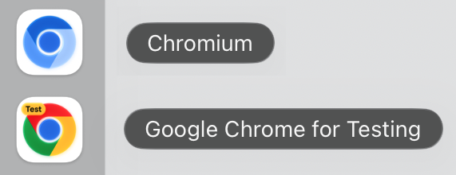

import Tabs from '@theme/Tabs';
import TabItem from '@theme/TabItem';
import HTMLCard from '@site/src/components/HTMLCard';

import LiteYouTube from '@site/src/components/LiteYouTube';

## Версия 1.65

### 🧾 Код локатора на Java

Локатор, полученный с помощью [Locator.normalize()](/api/class-locator.mdx#locator-normalize), теперь преобразуется в строку с кодом на Java. Используйте его вместе с [Page.getByRef()](/api/class-page.mdx#page-get-by-ref), чтобы превратить элемент, выбранный агентом из снимка [Page.ariaSnapshot()](/api/class-page.mdx#page-aria-snapshot) в режиме `"ai"`, в код для вашего теста:

```java
Locator normalized = page.getByRef("e2").normalize();
System.out.println(normalized.toString());
// getByRole(AriaRole.BUTTON, new Page.GetByRoleOptions().setName("Submit"))
```

### Новые API
- Новая опция [setTimeout](/api/class-cdpsession.mdx#cdp-session-send-option-timeout) в [CDPSession.send()](/api/class-cdpsession.mdx#cdp-session-send).

### Несовместимые изменения ⚠️
- Действия, такие как [Locator.click()](/api/class-locator.mdx#locator-click), [Locator.check()](/api/class-locator.mdx#locator-check), [Locator.tap()](/api/class-locator.mdx#locator-tap), [Locator.fill()](/api/class-locator.mdx#locator-fill), [Locator.clear()](/api/class-locator.mdx#locator-clear) и [Locator.selectOption()](/api/class-locator.mdx#locator-select-option), теперь ожидают, пока элемент [перестанет быть инертным](./actionability.mdx#not-inert). Действие над элементом с атрибутом `inert` или внутри такого элемента теперь завершается по тайм-ауту, если элемент остаётся инертным.
- Сопоставление cookie теперь соответствует RFC 6265. При указании URL методы [BrowserContext.cookies()](/api/class-browsercontext.mdx#browser-context-cookies) и [APIRequestContext.cookies()](/api/class-apirequestcontext.mdx#api-request-context-cookies) больше не возвращают cookie, привязанные только к хосту, для поддоменов или cookie с `Path=/api` для `/apiv2`, а cookie с `Path=/foo/` не соответствует `/foo`. [APIRequestContext] отправляет cookie без имени как `Cookie: x` вместо `Cookie: =x` и сохраняет `Set-Cookie: token` как cookie без имени.
- Учётные данные прокси больше не отправляются веб-сайтам. Учётные данные в опции [setProxy](/api/class-browsertype.mdx#browser-type-launch-option-proxy) теперь используются только для ответа на запросы аутентификации прокси. Для аутентификации на веб-сайте используйте [setHttpCredentials](/api/class-browser.mdx#browser-new-context-option-http-credentials).
- Текст, который браузер не отображает, например текст, не назначенный слоту, или текст непосредственно внутри закрытого `<details>`, больше не включается в доступные имена и ARIA-снимки. Это может изменить результаты [Page.getByRole()](/api/class-page.mdx#page-get-by-role) с указанием имени, [Locator.ariaSnapshot()](/api/class-locator.mdx#locator-aria-snapshot) и [assertThat(locator).matchesAriaSnapshot()](/api/class-locatorassertions.mdx#locator-assertions-to-match-aria-snapshot).

### Версии браузеров
- Chromium 158.0.8127.18
- Mozilla Firefox 159.0
- WebKit 27.2

Эта версия также была протестирована со следующими стабильными каналами:
- Google Chrome 157
- Microsoft Edge 156

## Версия 1.64

### 🧰 WebMCP

Новые методы [Page.webmcp()](/api/class-page.mdx#page-webmcp) и [Frame.webmcp()](/api/class-frame.mdx#frame-webmcp) предоставляют доступ к инструментам, которые страница регистрирует через экспериментальный браузерный API [WebMCP](https://webmachinelearning.github.io/webmcp/), чтобы вы могли тестировать их, как любую другую часть приложения:

```java
Browser browser = chromium.launch(new BrowserType.LaunchOptions()
    .setArgs(Arrays.asList("--enable-features=WebMCP")));
Page page = browser.newPage();
page.navigate("https://example.com");

for (WebMCPTool tool : page.webmcp().tools())
  System.out.println(tool.name + ": " + tool.description);

Object result = page.webmcp().callTool("add", Map.of("a", 2, "b", 40));
System.out.println(result); // {content=[{type=text, text=42}]}
```

[Playwright MCP](./getting-started-mcp.mdx) также поддерживает WebMCP по умолчанию: определённые страницей инструменты предоставляются агенту под именами `webmcp_<tool>`. Передайте `--no-webmcp`, чтобы отключить эту возможность.

[`playwright-cli`](./getting-started-cli.mdx) также предоставляет к ним доступ:

```bash
playwright-cli webmcp-list
playwright-cli webmcp-call search_catalog --params '{"query":"cats"}'
```

### 🎬 Улучшенная запись видео

Теперь видео можно записывать с заданной частотой кадров, а визуальные обозначения действий оформлять с помощью обычного CSS:

```java
page.screencast().start(new Screencast.StartOptions()
    .setPath(Paths.get("video.webm"))
    .setSize(1920, 1080)
    .setFps(60));
page.screencast().showActions(new Screencast.ShowActionsOptions()
    .setStyle(new ScreencastActionStyle()
        .setPoint("width: 20px; height: 20px; border-radius: 50%; background: red")
        .setHighlight("outline: 2px solid #333; background: rgba(0, 128, 255, .15)")
        .setTitle("font-size: 16px")));
```

- Новая опция [setRecordVideoFps](/api/class-browser.mdx#browser-new-context-option-record-video-fps) и новая опция [setFps](/api/class-screencast.mdx#screencast-start-option-fps) в [Screencast.start()](/api/class-screencast.mdx#screencast-start). Firefox и WebKit в настоящее время захватывают до 25 кадров в секунду.
- Новая опция [setStyle](/api/class-screencast.mdx#screencast-show-actions-option-style) принимает CSS-объявления для маркера `point`, подсветки целевого элемента `highlight` и заголовка действия `title`. Она заменяет опцию `fontSize`, которая теперь считается устаревшей.
- Курсор остаётся видимым в точке последнего действия, сохраняется при навигации и перемещается по естественной траектории с плавным ускорением и замедлением.
- Видео кодируются с помощью VP9 вместо VP8, что снижает нагрузку на процессор и создаёт файлы меньшего размера при том же или более высоком качестве.
- Все опции видео также доступны в [Playwright MCP](./getting-started-mcp.mdx) и [`playwright-cli`](./getting-started-cli.mdx).

### 🪆 Locator.within()

Новый метод [Locator.within()](/api/class-locator.mdx#locator-within) объединяет два уже имеющихся локатора в естественном порядке чтения — «эта кнопка внутри того диалогового окна»:

```java
Locator saveButton = page.getByRole(AriaRole.BUTTON, new Page.GetByRoleOptions().setName("Save"));
Locator dialog = page.getByTestId("settings-dialog");

saveButton.within(dialog).click();
```

Относительные локаторы, такие как [Locator.nth()](/api/class-locator.mdx#locator-nth) или [Locator.first()](/api/class-locator.mdx#locator-first), разрешаются внутри каждого родительского элемента отдельно, что упрощает запросы для выбора столбцов:

```java
// Третья ячейка каждой строки, а не третья ячейка в таблице.
Locator thirdColumn = page.getByRole(AriaRole.CELL).nth(2).within(page.getByRole(AriaRole.ROW));
assertThat(thirdColumn).hasText(new String[] {"Apple", "Banana", "Cherry"});
```

### Новые API
- Новый метод [Page.getByRef()](/api/class-page.mdx#page-get-by-ref) находит элемент по его ARIA-ссылке, например `e2`, которую возвращает [Page.ariaSnapshot()](/api/class-page.mdx#page-aria-snapshot) в режиме `"ai"`.
- Новая опция [setIncludeShadow](/api/class-page.mdx#page-content-option-include-shadow) в [Page.content()](/api/class-page.mdx#page-content) и [Frame.content()](/api/class-frame.mdx#frame-content) сериализует открытые теневые корни в виде [декларативного Shadow DOM](https://developer.mozilla.org/en-US/docs/Web/API/Web_components/Using_shadow_DOM#declaratively_with_html).
- Новая опция [setSignCount](/api/class-credentials.mdx#credentials-create-option-sign-count) задаёт начальное значение счётчика подписей виртуальных учётных данных. [Credentials.create()](/api/class-credentials.mdx#credentials-create) и [Credentials.get()](/api/class-credentials.mdx#credentials-get) возвращают текущее значение `signCount`, которое сохраняется и восстанавливается вместе с учётными данными в состоянии хранилища.
- Новые методы [APIRequestContext.addCookies()](/api/class-apirequestcontext.mdx#api-request-context-add-cookies), [APIRequestContext.cookies()](/api/class-apirequestcontext.mdx#api-request-context-cookies) и [APIRequestContext.clearCookies()](/api/class-apirequestcontext.mdx#api-request-context-clear-cookies) управляют cookie контекста запросов, аналогично методам [BrowserContext]:
  
  ```java
  request.addCookies(Arrays.asList(
      new Cookie("session-id", "42").setUrl("https://example.com")));
  System.out.println(request.cookies("https://example.com"));
  request.clearCookies(new APIRequestContext.ClearCookiesOptions().setName("session-id"));
  ```
  
### Несовместимые изменения ⚠️
- Элементы внутри скрытых iframe считаются скрытыми. Элементы внутри невидимого iframe, например с `visibility: hidden`, теперь считаются скрытыми при выполнении действий, а также методами [Locator.isVisible()](/api/class-locator.mdx#locator-is-visible) и [assertThat(locator).isVisible()](/api/class-locatorassertions.mdx#locator-assertions-to-be-visible).

### Версии браузеров
- Chromium 156.0.8078.4
- Mozilla Firefox 157.0
- WebKit 27.2

Эта версия также была протестирована со следующими стабильными каналами:
- Google Chrome 155
- Microsoft Edge 155

## Версия 1.63

### 🪟 Поиск элементов во всех фреймах

Методы [Page.frameLocator()](/api/class-page.mdx#page-frame-locator) и [Frame.frameLocator()](/api/class-frame.mdx#frame-frame-locator), вызванные без селектора, выполняют поиск в любом фрейме поддерева, поэтому предварительно находить iframe больше не требуется:

```java
// Находит кнопку в любом фрейме на странице.
page.frameLocator().getByRole(AriaRole.BUTTON).click();
```

Оставшаяся часть локатора разрешается внутри одного фрейма, как и обычный локатор; если совпадения найдены в нескольких фреймах, возникает ошибка.

### 👁️ Локаторы только для видимых элементов

Новый метод [Locator.visible()](/api/class-locator.mdx#locator-visible) возвращает локатор, соответствующий только видимым элементам. Его рекомендуется использовать вместо CSS-псевдокласса `:visible`:

```java
page.locator("button").visible().click();
```

### 🖼️ ARIA-снимки и снимки экрана в трассировках

Новые опции [setAriaSnapshots](/api/class-tracing.mdx#tracing-start-option-aria-snapshots) и [setScreenSnapshots](/api/class-tracing.mdx#tracing-start-option-screen-snapshots) метода [Tracing.start()](/api/class-tracing.mdx#tracing-start) сохраняют ARIA-снимок и снимок экрана страницы при каждом действии:

```java
context.tracing().start(new Tracing.StartOptions()
  .setSnapshots(true)
  .setAriaSnapshots(true)
  .setScreenSnapshots(true));
```

Если ARIA-снимки и снимки экрана записаны, новый режим **Display Aria** в просмотрщике трассировок показывает снимок экрана действия рядом с ARIA-снимком, а при наведении на ARIA-узел он подсвечивается на снимке экрана.

### ☕ Аннотации допустимости null

В публичный API теперь добавлены аннотации допустимости null из [JSpecify](https://jspecify.dev). Пакеты `com.microsoft.playwright`, `com.microsoft.playwright.options` и `com.microsoft.playwright.assertions` помечены аннотацией `@NullMarked`, а значения, которые могут отсутствовать, — аннотацией `@Nullable`. Благодаря этому инструменты проверки null, такие как NullAway, а также код на Kotlin могут обнаруживать пропущенные проверки на null во время компиляции.

### Новые API

#### Браузер и контекст
- [setHttpCredentials](/api/class-browser.mdx#browser-new-context-option-http-credentials) теперь также принимает массив учётных данных. Используется первая запись, соответствующая источнику запроса, а записи без указания источника соответствуют любому запросу.
- Новая опция [setOpfs](/api/class-browsercontext.mdx#browser-context-storage-state-option-opfs) включает [приватную файловую систему источника](https://developer.mozilla.org/en-US/docs/Web/API/File_System_API/Origin_private_file_system) в состояние хранилища, чтобы её можно было сохранить и восстановить в последующих контекстах.
- Новые события [Page.onDialogClosed(handler)](/api/class-page.mdx#page-event-dialog-closed) и [BrowserContext.onDialogClosed(handler)](/api/class-browsercontext.mdx#browser-context-event-dialog-closed) генерируются, когда диалоговое окно JavaScript подтверждено, отклонено или закрыто пользователем.

#### Командная строка
- `mvn exec:java -e -D exec.mainClass=com.microsoft.playwright.CLI -D exec.args="install --no-remove"` сохраняет браузеры других установок Playwright вместо их удаления.
- `mvn exec:java -e -D exec.mainClass=com.microsoft.playwright.CLI -D exec.args="codegen --http-credentials"` записывает действия на страницах с HTTP-аутентификацией.

### Объявления
* ⚠️ Ubuntu 20.04 больше не поддерживается.
* 🐧 В Linux arm64 Playwright теперь загружает сборку Chromium из [Chrome for Testing](https://developer.chrome.com/blog/chrome-for-testing) — ту же сборку, которая используется на всех остальных платформах.

### Версии браузеров
- Chromium 153.0.8010.12
- Mozilla Firefox 155.0
- WebKit 26.6

Эта версия также была протестирована со следующими стабильными каналами:
- Google Chrome 153
- Microsoft Edge 153

## Версия 1.62

### 🖼️ Снимки экрана в формате WebP

Методы [Page.screenshot()](/api/class-page.mdx#page-screenshot) и [Locator.screenshot()](/api/class-locator.mdx#locator-screenshot) теперь позволяют делать снимки экрана в формате WebP — Playwright определяет формат по расширению файла `.webp`, либо вы можете явно задать `type`. Качество `100` (по умолчанию) обеспечивает сжатие без потерь, а более низкие значения используют сжатие с потерями:

```java
page.screenshot(new Page.ScreenshotOptions()
    .setPath(Paths.get("homepage.webp"))
    .setQuality(50));
```

### Новые API
- Новая опция `scroll` (`"auto"` | `"none"`) у действий позволяет отключить автоматическую прокрутку Playwright для отображения элемента в области просмотра.
- Новый метод [Locator.waitForFunction()](/api/class-locator.mdx#locator-wait-for-function) ожидает, пока функция, вызываемая с найденным элементом, не вернёт истинное (truthy) значение.
- Новый метод [APIResponse.timing()](/api/class-apiresponse.mdx#api-response-timing) возвращает временные характеристики загрузки ресурса для ответа API.

### Объявления
* 📋 В режиме headless буфер обмена теперь изолирован от операционной системы, поэтому тесты, использующие `navigator.clipboard`, больше не читают и не перезаписывают буфер обмена машины, на которой они выполняются.
* ⚠️ Debian 11 больше не поддерживается.

### Версии браузеров
- Chromium 151.0.7922.34
- Mozilla Firefox 153.0
- WebKit 26.5

Эта версия также была протестирована со следующими стабильными каналами:
- Google Chrome 151
- Microsoft Edge 151

## Версия 1.61

### 🔑 Ключи доступа WebAuthn

Новый виртуальный аутентификатор [Credentials], доступный через [BrowserContext.credentials()](/api/class-browsercontext.mdx#browser-context-credentials), позволяет тестам регистрировать ключи доступа (passkeys) и отвечать на запросы `navigator.credentials.create()` / `navigator.credentials.get()` на странице — без настоящего аппаратного ключа и во всех браузерах:

```java
BrowserContext context = browser.newContext();

// Добавьте ключ доступа, подготовленный серверной частью для тестового пользователя.
context.credentials().create("example.com", new Credentials.CreateOptions()
    .setId(credentialId)
    .setUserHandle(userHandle)
    .setPrivateKey(privateKey)
    .setPublicKey(publicKey));
context.credentials().install();

Page page = context.newPage();
page.navigate("https://example.com/login");
// На вызов navigator.credentials.get() страницы возвращается добавленный ключ доступа.
```

Вы также можете позволить приложению один раз зарегистрировать ключ доступа в подготовительном тесте, прочитать его с помощью [Credentials.get()](/api/class-credentials.mdx#credentials-get) и добавить в последующие тесты — подробности см. в [Credentials].

### 🗃️ Web Storage

Новый API [WebStorage], доступный через [Page.localStorage()](/api/class-page.mdx#page-local-storage) и [Page.sessionStorage()](/api/class-page.mdx#page-session-storage), позволяет читать и записывать данные хранилища страницы для текущего источника:

```java
page.localStorage().setItem("token", "abc");
String token = page.localStorage().getItem("token");
List<NameValue> items = page.sessionStorage().items();
```

### Новые API
- Методы [APIResponse.securityDetails()](/api/class-apiresponse.mdx#api-response-security-details) и [APIResponse.serverAddr()](/api/class-apiresponse.mdx#api-response-server-addr) аналогичны браузерным методам [Response.securityDetails()](/api/class-response.mdx#response-security-details) и [Response.serverAddr()](/api/class-response.mdx#response-server-addr).
- Новая опция `artifactsDir` в [BrowserType.connectOverCDP()](/api/class-browsertype.mdx#browser-type-connect-over-cdp) определяет, где сохраняются артефакты, такие как трассировки и загруженные файлы, при подключении к уже запущенному браузеру.
- Новая опция `cursor` в [Screencast.showActions()](/api/class-screencast.mdx#screencast-show-actions) управляет визуальным обозначением курсора для действий указателя.
- Обработчик `onFrame` в [Screencast.start()](/api/class-screencast.mdx#screencast-start) теперь получает `timestamp` — временную метку момента, когда браузер отобразил кадр.

### 🛠️ Другие улучшения
- Playwright теперь поддерживает Ubuntu 26.04.
- Записи HAR и трассировки теперь включают запросы WebSocket.

### Версии браузеров
- Chromium 149.0.7827.55
- Mozilla Firefox 151.0
- WebKit 26.5

Эта версия также была протестирована со следующими стабильными каналами:
- Google Chrome 149
- Microsoft Edge 149

## Версия 1.60

### 🌐 Запись HAR через Tracing

Методы [Tracing.startHar()](/api/class-tracing.mdx#tracing-start-har) / [Tracing.stopHar()](/api/class-tracing.mdx#tracing-stop-har) предоставляют запись HAR как полноценную часть API трассировки с теми же опциями `content`, `mode` и `urlFilter`, что и у `recordHar`:

```java
context.tracing().startHar(Paths.get("trace.har"));
Page page = context.newPage();
page.navigate("https://playwright.dev");
context.tracing().stopHar();
```

### 🪝 API Drop

Новый метод [Locator.drop()](/api/class-locator.mdx#locator-drop) имитирует внешнее перетаскивание файлов или данных, подобных содержимому буфера обмена, на элемент. Playwright отправляет события `dragenter`, `dragover` и `drop` с синтетическим объектом [DataTransfer] в контексте страницы — это работает во всех браузерах и отлично подходит для тестирования зон загрузки файлов:

```java
page.locator("#dropzone").drop(new Locator.DropPayload()
    .setFiles(new FilePayload("note.txt", "text/plain", "hello".getBytes(StandardCharsets.UTF_8))));

page.locator("#dropzone").drop(new Locator.DropPayload()
    .setData(Map.of(
        "text/plain", "hello world",
        "text/uri-list", "https://example.com")));
```

### 🎯 ARIA-снимки
- [assertThat(page).matchesAriaSnapshot()](/api/class-pageassertions.mdx#page-assertions-to-match-aria-snapshot) теперь работает с [Page], а не только с [Locator] — это эквивалентно проверке для `page.locator("body")`.
- Новая опция `boxes` в [Locator.ariaSnapshot()](/api/class-locator.mdx#locator-aria-snapshot) / [Page.ariaSnapshot()](/api/class-page.mdx#page-aria-snapshot) добавляет ограничивающий прямоугольник каждого элемента в виде `[box=x,y,width,height]`, что полезно для обработки средствами ИИ.

### Новые API

#### Браузер, контекст и страница
- Событие [Browser.onContext(handler)](/api/class-browser.mdx#browser-event-context) — генерируется при создании нового контекста в браузере.
- [BrowserContext] теперь транслирует события жизненного цикла своих страниц: [BrowserContext.onDownload(handler)](/api/class-browsercontext.mdx#browser-context-event-download), [BrowserContext.onFrameAttached(handler)](/api/class-browsercontext.mdx#browser-context-event-frame-attached), [BrowserContext.onFrameDetached(handler)](/api/class-browsercontext.mdx#browser-context-event-frame-detached), [BrowserContext.onFrameNavigated(handler)](/api/class-browsercontext.mdx#browser-context-event-frame-navigated), [BrowserContext.onPageClose(handler)](/api/class-browsercontext.mdx#browser-context-event-page-close), [BrowserContext.onPageLoad(handler)](/api/class-browsercontext.mdx#browser-context-event-page-load).

#### Локаторы и проверки
- Новая опция `description` в [Page.getByRole()](/api/class-page.mdx#page-get-by-role) / [Locator.getByRole()](/api/class-locator.mdx#locator-get-by-role) / [Frame.getByRole()](/api/class-frame.mdx#frame-get-by-role) / [FrameLocator.getByRole()](/api/class-framelocator.mdx#frame-locator-get-by-role) для сопоставления по [доступному описанию](https://www.w3.org/TR/wai-aria-1.2/#dfn-accessible-description).
- Новая опция `pseudo` в [assertThat(locator).hasCSS()](/api/class-locatorassertions.mdx#locator-assertions-to-have-css) считывает вычисленные стили из `::before` или `::after`.
- Новая опция `style` в [Locator.highlight()](/api/class-locator.mdx#locator-highlight) применяет дополнительные встроенные CSS-стили к слою подсветки, а новый метод [Page.hideHighlight()](/api/class-page.mdx#page-hide-highlight) убирает всю подсветку.

#### Сеть
- [WebSocketRoute.protocols()](/api/class-websocketroute.mdx#web-socket-route-protocols) возвращает подпротоколы WebSocket, запрошенные страницей.
- Новая опция `noDefaults` в [BrowserType.connectOverCDP()](/api/class-browsertype.mdx#browser-type-connect-over-cdp) отключает стандартные переопределения Playwright в контексте по умолчанию (поведение загрузок, эмуляцию фокуса, эмуляцию медиа), чтобы подключение к повседневному браузеру пользователя не нарушало его состояние.

#### Ошибки
- Новый метод [WebError.location()](/api/class-weberror.mdx#web-error-location) аналогичен [ConsoleMessage.location()](/api/class-consolemessage.mdx#console-message-location).

### 🛠️ Другие улучшения
- В Trace Viewer добавлен переключатель форматирования тел запросов и ответов в формате JSON / данных форм на панели сведений о сети.

### Несовместимые изменения ⚠️
- Удалена давно устаревшая опция `handle` у `BrowserContext.exposeBinding` и `Page.exposeBinding`.

### Версии браузеров
- Chromium 148.0.7778.96
- Mozilla Firefox 150.0.2
- WebKit 26.4

Эта версия также была протестирована со следующими стабильными каналами:
- Google Chrome 147
- Microsoft Edge 147

## Версия 1.59

### 🎬 Скринкаст

Новый API [Page.screencast()](/api/class-page.mdx#page-screencast) предоставляет единый интерфейс для захвата содержимого страницы со следующими возможностями:
- Запись скринкастов
- Аннотации действий
- Визуальные наложения
- Захват кадров в реальном времени
- Видеоотчёты о работе агентов

<center>


</center>

**Запись скринкаста** — записывайте видео с точным управлением началом и остановкой записи в качестве альтернативы опции [setRecordVideoDir](/api/class-browser.mdx#browser-new-context-option-record-video-dir):

```java
page.screencast().start(new Screencast.StartOptions().setPath(Paths.get("video.webm")));
// ... выполните действия ...
page.screencast().stop();
```

**Аннотации действий** — включите встроенные визуальные аннотации, которые подсвечивают элементы, с которыми происходит взаимодействие, и отображают названия действий во время записи:

```java
page.screencast().showActions(new Screencast.ShowActionsOptions().setPosition("top-right"));
```

[Screencast.showActions()](/api/class-screencast.mdx#screencast-show-actions) принимает `position` (`"top-left"`, `"top"`, `"top-right"`, `"bottom-left"`, `"bottom"`, `"bottom-right"`), `duration` (мс на аннотацию) и `fontSize` (пиксели). Возвращает освобождаемый объект, позволяющий прекратить отображение действий.

**Визуальные наложения** — добавляйте заголовки глав и произвольные HTML-наложения поверх страницы, чтобы сделать пояснения более наглядными:

```java
page.screencast().showChapter("Adding TODOs",
    new Screencast.ShowChapterOptions()
        .setDescription("Type and press enter for each TODO")
        .setDuration(1000));

page.screencast().showOverlay("<div style=\"color: red\">Recording</div>");
```

**Захват кадров в реальном времени** — передавайте поток кадров в формате JPEG для собственной обработки: создания миниатюр, предпросмотра в реальном времени, анализа средствами компьютерного зрения на основе ИИ и других задач:

```java
page.screencast().start(new Screencast.StartOptions()
    .setOnFrame(frame -> sendToVisionModel(frame.data)));
```

**Видеоотчёты о работе агентов** — агенты программирования могут создавать видеоподтверждения своей работы. После выполнения задачи агент может записать демонстрационное видео с подробными аннотациями для проверки человеком:

```java
page.screencast().start(new Screencast.StartOptions()
    .setPath(Paths.get("receipt.webm")));
page.screencast().showActions(new Screencast.ShowActionsOptions().setPosition("top-right"));

page.screencast().showChapter("Verifying checkout flow",
    new Screencast.ShowChapterOptions()
        .setDescription("Added coupon code support per ticket #1234"));

// Агент выполняет шаги проверки...
page.locator("#coupon").fill("SAVE20");
page.locator("#apply-coupon").click();
assertThat(page.locator(".discount")).containsText("20%");

page.screencast().showChapter("Done",
    new Screencast.ShowChapterOptions()
        .setDescription("Coupon applied, discount reflected in total"));

page.screencast().stop();
```

Полученное видео служит подтверждением выполненной работы: заголовки глав задают контекст, аннотации действий выделяют каждое взаимодействие, а просмотр наглядной демонстрации занимает меньше времени, чем изучение текстовых журналов.

### 🔍 Снимки и локаторы
- Метод [Page.ariaSnapshot()](/api/class-page.mdx#page-aria-snapshot) для создания ARIA-снимка страницы — эквивалентен `page.locator("body").ariaSnapshot()`.
- Опции `depth` и `mode` в [Locator.ariaSnapshot()](/api/class-locator.mdx#locator-aria-snapshot).
- Метод [Locator.normalize()](/api/class-locator.mdx#locator-normalize) преобразует локатор в соответствии с рекомендуемыми практиками, такими как использование тестовых идентификаторов и ARIA-ролей.
- Метод [Page.pickLocator()](/api/class-page.mdx#page-pick-locator) включает интерактивный режим, в котором наведение на элементы подсвечивает их и показывает соответствующий локатор. Щёлкните по элементу, чтобы получить его [Locator]. Для отмены используйте [Page.cancelPickLocator()](/api/class-page.mdx#page-cancel-pick-locator).

### Новые API

#### Скринкаст
- [Page.screencast()](/api/class-page.mdx#page-screencast) предоставляет запись видео, потоковую передачу кадров в реальном времени и управление наложениями.
- Методы [Screencast.start()](/api/class-screencast.mdx#screencast-start) и [Screencast.stop()](/api/class-screencast.mdx#screencast-stop) для записи и захвата кадров.
- Методы [Screencast.showActions()](/api/class-screencast.mdx#screencast-show-actions) и [Screencast.hideActions()](/api/class-screencast.mdx#screencast-hide-actions) для аннотаций действий.
- Методы [Screencast.showChapter()](/api/class-screencast.mdx#screencast-show-chapter) и [Screencast.showOverlay()](/api/class-screencast.mdx#screencast-show-overlay) для визуальных наложений.
- Методы [Screencast.showOverlays()](/api/class-screencast.mdx#screencast-show-overlays) и [Screencast.hideOverlays()](/api/class-screencast.mdx#screencast-hide-overlays) для управления видимостью наложений.

#### Хранилище, консоль и ошибки
- Метод [BrowserContext.setStorageState()](/api/class-browsercontext.mdx#browser-context-set-storage-state) очищает существующие cookie, локальное хранилище и IndexedDB для всех источников и задаёт новое состояние хранилища — создавать новый контекст не требуется.
- Методы [Page.clearConsoleMessages()](/api/class-page.mdx#page-clear-console-messages) и [Page.clearPageErrors()](/api/class-page.mdx#page-clear-page-errors) для очистки сохранённых сообщений и ошибок.
- Опция `filter` в [Page.consoleMessages()](/api/class-page.mdx#page-console-messages) и [Page.pageErrors()](/api/class-page.mdx#page-page-errors) определяет, какие сообщения возвращаются.
- Метод [ConsoleMessage.timestamp()](/api/class-consolemessage.mdx#console-message-timestamp).

#### Разное
- [BrowserContext.debugger()](/api/class-browsercontext.mdx#browser-context-debugger) предоставляет программное управление отладчиком Playwright.
- Метод [BrowserContext.isClosed()](/api/class-browsercontext.mdx#browser-context-is-closed).
- Метод [Request.existingResponse()](/api/class-request.mdx#request-existing-response) возвращает ответ без ожидания.
- Метод [Response.httpVersion()](/api/class-response.mdx#response-http-version) возвращает версию HTTP, используемую в ответе.
- Опция `live` в [Tracing.start()](/api/class-tracing.mdx#tracing-start) для обновления трассировки в реальном времени.
- Опция `artifactsDir` в [BrowserType.launch()](/api/class-browsertype.mdx#browser-type-launch) для настройки каталога артефактов.

### 🔗 Взаимодействие с другими инструментами

Новый API [Browser.bind()](/api/class-browser.mdx#browser-bind) делает запущенный браузер доступным для подключения из `playwright-cli`, `@playwright/mcp` и других клиентов.

**Предоставление доступа к браузеру** — запустите браузер и привяжите его, чтобы другие клиенты могли подключаться:

```java
Browser.BindResult serverInfo = browser.bind("my-session",
    new Browser.BindOptions().setWorkspaceDir("/my/project"));
```

**Подключение из playwright-cli** — подключитесь к запущенному браузеру из вашего любимого агента программирования.

```bash
playwright-cli attach my-session
playwright-cli -s my-session snapshot
```

**Подключение из @playwright/mcp** — либо укажите запущенный браузер вашему MCP-серверу.

```bash
@playwright/mcp --endpoint=my-session
```

**Подключение из клиента Playwright** — используйте API для подключения к браузеру. Поддерживается одновременное подключение нескольких клиентов!

```java
Browser browser = chromium.connect(serverInfo.endpoint);
```

Передайте опции `host` и `port`, чтобы использовать WebSocket вместо именованного канала:

```java
Browser.BindResult serverInfo = browser.bind("my-session",
    new Browser.BindOptions().setHost("localhost").setPort(0));
// serverInfo.endpoint — это URL с протоколом ws://
```

Вызовите [Browser.unbind()](/api/class-browser.mdx#browser-unbind), чтобы прекратить приём новых подключений.

### 📊 Наблюдаемость

Выполните `playwright-cli show`, чтобы открыть панель управления со списком всех привязанных браузеров, их статусами и возможностью взаимодействовать с ними:
- Наблюдайте за действиями агента в фоновых браузерах
- Открывайте сеансы для ручного вмешательства
- Открывайте DevTools для исследования страниц фоновых браузеров.

<center>


</center>
- `playwright-cli` автоматически привязывает все свои браузеры, чтобы вы могли видеть, что делают ваши агенты.
- Передайте переменную окружения `PLAYWRIGHT_DASHBOARD=1`, чтобы видеть все браузеры `@playwright/test` на панели управления.

### Несовместимые изменения ⚠️
- Удалена поддержка macOS 14 для WebKit. Рекомендуем обновить версию macOS или продолжить использовать более старую версию Playwright.

### Версии браузеров
- Chromium 147.0.7727.15
- Mozilla Firefox 148.0.2
- WebKit 26.4

Эта версия также была протестирована со следующими стабильными каналами:
- Google Chrome 146
- Microsoft Edge 146

## Версия 1.58

### Улучшения режима UI и Trace Viewer
- Новая опция темы 'system' следует настройке тёмного/светлого режима вашей ОС
- В редакторах кода теперь доступен поиск (Cmd/Ctrl+F)
- Панель сведений о сети реорганизована для большего удобства использования
- Ответы JSON теперь автоматически форматируются для удобства чтения

Спасибо [@cpAdm](https://github.com/cpAdm) за вклад в эти улучшения!

### Разное

[BrowserType.connectOverCDP()](/api/class-browsertype.mdx#browser-type-connect-over-cdp) теперь принимает опцию `isLocal`. Если она установлена в `true`, это сообщает Playwright, что он работает на том же хосте, что и CDP-сервер, и позволяет применять оптимизации работы с файловой системой.

### Несовместимые изменения ⚠️
- Удалены селекторы `_react` и `_vue`. Альтернативы см. в [руководстве по локаторам](./locators.mdx).
- Удалён суффикс движка селекторов `:light`. Вместо него используйте стандартные CSS-селекторы.
- Опция `devtools` метода [BrowserType.launch()](/api/class-browsertype.mdx#browser-type-launch) удалена. Вместо неё используйте `setArgs(Arrays.asList("--auto-open-devtools-for-tabs"))`.
- Удалена поддержка macOS 13 для WebKit. Рекомендуем обновить версию macOS или продолжить использовать более старую версию Playwright.

### Версии браузеров
- Chromium 145.0.7632.6
- Mozilla Firefox 146.0.1
- WebKit 26.0

Эта версия также была протестирована со следующими стабильными каналами:
- Google Chrome 144
- Microsoft Edge 144

## Версия 1.57

### Chrome for Testing

Playwright теперь использует сборки [Chrome for Testing](https://googlechromelabs.github.io/chrome-for-testing/) вместо Chromium. В режиме с графическим интерфейсом используется `chrome`, а в режиме headless — `chrome-headless-shell`. Существующие тесты должны продолжать проходить после обновления до v1.57.

Мы не ожидаем функциональных изменений в результате этого перехода. Самое заметное изменение — новый значок и название на панели инструментов.



Если вы всё же заметите неожиданное изменение поведения, пожалуйста, [создайте issue](https://github.com/microsoft/playwright/issues/new).

В Linux Arm64 Playwright продолжает использовать Chromium.

### Несовместимое изменение

Спустя 3 года после объявления устаревшим мы удалили `page.accessibility()` из нашего API. Если вам нужно тестировать доступность страниц, используйте другие библиотеки, например [Axe](https://www.deque.com/axe/). Информацию об интеграции с Axe см. в нашем [руководстве](https://playwright.dev/docs/accessibility-testing) для Node.js.

### Новые API
- Событие [Worker.onConsole(handler)](/api/class-worker.mdx#worker-event-console) генерируется, когда JavaScript внутри воркера вызывает один из методов API консоли, например console.log или console.dir. Для ожидания этого события можно использовать [Worker.waitForConsoleMessage()](/api/class-worker.mdx#worker-wait-for-console-message).
- [Locator.description()](/api/class-locator.mdx#locator-description) возвращает описание локатора, ранее заданное с помощью [Locator.describe()](/api/class-locator.mdx#locator-describe).
- Новая опция [setSteps](/api/class-locator.mdx#locator-click-option-steps) в [Locator.click()](/api/class-locator.mdx#locator-click) и [Locator.dragTo()](/api/class-locator.mdx#locator-drag-to) задаёт количество событий `mousemove`, генерируемых при перемещении указателя мыши к целевому элементу.

### Версии браузеров
- Chromium 143.0.7499.4
- Mozilla Firefox 144.0.2
- WebKit 26.0

## Версия 1.56 {/* #version-156 */}

### Новые API {#new-apis}
- Новые методы [Page.consoleMessages()](/api/class-page.mdx#page-console-messages) и [Page.pageErrors()](/api/class-page.mdx#page-page-errors) для получения последних сообщений консоли со страницы
- Новый метод [Page.requests()](/api/class-page.mdx#page-requests) для получения последних сетевых запросов со страницы

### Критические изменения {#breaking-changes}
- Событие [BrowserContext.onBackgroundPage(handler)](/api/class-browsercontext.mdx#browser-context-event-background-page) объявлено устаревшим и больше не будет испускаться. Метод [BrowserContext.backgroundPages()](/api/class-browsercontext.mdx#browser-context-background-pages) будет возвращать пустой список

### Прочее {#miscellaneous}
- ARIA-снимки отображают и сравнивают `placeholder` у `input`

### Версии браузеров {#browser-versions}
- Chromium 141.0.7390.37
- Mozilla Firefox 142.0.1
- WebKit 26.0

## Версия 1.55 {#version-155}

### Codegen {#codegen}
- Автоматические проверки `isVisible()`: Codegen теперь может генерировать автоматические проверки `isVisible()` для распространённых UI-взаимодействий. Эту функцию можно включить в UI настроек Codegen.

### Критические изменения {#breaking-changes-1}
- ⚠️ Прекращена поддержка манифеста расширений Chromium v2.

### Прочее {#miscellaneous-1}
- Добавлена поддержка Debian 13 «Trixie».

### Версии браузеров {#browser-versions-1}
- Chromium 140.0.7339.16
- Mozilla Firefox 141.0
- WebKit 26.0

Эта версия также была протестирована со следующими стабильными каналами:
- Google Chrome 139
- Microsoft Edge 139

## Версия 1.54 {#version-154}

### Основные изменения {#highlights}
- Новое свойство cookie `partitionKey` в [BrowserContext.cookies()](/api/class-browsercontext.mdx#browser-context-cookies) и [BrowserContext.addCookies()](/api/class-browsercontext.mdx#browser-context-add-cookies). Это свойство позволяет сохранять и восстанавливать разделённые cookies. Подробнее см. [статью CHIPS на MDN](https://developer.mozilla.org/en-US/docs/Web/Privacy/Guides/Privacy_sandbox/Partitioned_cookies). Обратите внимание, что поддержка и значения по умолчанию для разделения cookies различаются в разных браузерах.
- Новый параметр `--user-data-dir` в нескольких командах. Вы можете указать один и тот же каталог данных пользователя, чтобы повторно использовать состояние браузера (например, аутентификацию) между сессиями.

  ```bash
  mvn exec:java -e -D exec.mainClass=com.microsoft.playwright.CLI -D exec.args="codegen --user-data-dir=./user-data"
  ```
  
- Команда `mvn exec:java -e -D exec.mainClass=com.microsoft.playwright.CLI -D exec.args=open` больше не открывает запись тестов. Вместо неё используйте `mvn exec:java -e -D exec.mainClass=com.microsoft.playwright.CLI -D exec.args=codegen`.

### Версии браузеров {#browser-versions-2}
- Chromium 139.0.7258.5
- Mozilla Firefox 140.0.2
- WebKit 26.0

Эта версия также была протестирована со следующими стабильными каналами:
- Google Chrome 140
- Microsoft Edge 140

## Версия 1.53 {#version-153}

### Обновления Trace Viewer и HTML Reporter {#trace-viewer-and-html-reporter-updates}
- Новые шаги в Trace Viewer: 
- Новый метод [Locator.describe()](/api/class-locator.mdx#locator-describe) для описания локатора. Используется в Trace Viewer.

### Обновления Trace Viewer и HTML-отчёта
- Новые шаги в Trace Viewer:
  
  
- Новый метод [Locator.describe()](/api/class-locator.mdx#locator-describe) для добавления описания локатора. Это описание используется в Trace Viewer.
  ```java
  Locator button = page.getByTestId("btn-sub").describe("Subscribe button");
  button.click();
  ```
  
- `mvn exec:java -e -D exec.mainClass=com.microsoft.playwright.CLI -D exec.args="install --list"` теперь выводит список всех установленных браузеров, их версий и расположений.

### Версии браузеров {#browser-versions-3}
- Chromium 138.0.7204.4
- Mozilla Firefox 139.0
- WebKit 18.5

Эта версия также была протестирована со следующими стабильными каналами:
- Google Chrome 137
- Microsoft Edge 137

## Версия 1.52 {#version-152}

### Основные изменения {#highlights-1}
- Новый метод [assertThat(locator).containsClass()](/api/class-locatorassertions.mdx#locator-assertions-to-contain-class), чтобы удобнее проверять отдельные имена классов у элемента.

  ```java
    assertThat(page.getByRole(AriaRole.LISTITEM, new Page.GetByRoleOptions().setName("Ship v1.52"))).containsClass("done");
  ```
  
- В [Aria-снимках](./aria-snapshots.mdx) появились два новых свойства: [`/children`](./aria-snapshots.mdx#strict-matching) для строгого сопоставления и [`/url`](./aria-snapshots.mdx#links) для ссылок.
  ```java
  assertThat(locator).toMatchAriaSnapshot("""
    - list
      - /children: equal
      - listitem: Feature A
      - listitem:
        - link "Feature B":
          - /url: "https://playwright.dev"
  """);
  ```
  
### Прочее {#miscellaneous-2}
- Новый параметр [setMaxRedirects](/api/class-apirequest.mdx#api-request-new-context-option-max-redirects) в [APIRequest.newContext()](/api/class-apirequest.mdx#api-request-new-context) для управления максимальным количеством редиректов.

### Критические изменения {#breaking-changes-2}
- Glob-паттерны URL в методах вроде [Page.route()](/api/class-page.mdx#page-route) больше не поддерживают `?` и `[]`. Рекомендуем вместо этого использовать регулярные выражения.
- Метод [Route.resume()](/api/class-route.mdx#route-continue) больше не позволяет переопределять заголовок `Cookie`. Если заголовок `Cookie` указан, он будет проигнорирован, а cookies будут загружены из хранилища cookies браузера. Чтобы задать свои cookies, используйте [BrowserContext.addCookies()](/api/class-browsercontext.mdx#browser-context-add-cookies).
- macOS 13 теперь объявлена устаревшей и больше не будет получать обновления WebKit. Обновитесь до более свежей версии macOS, чтобы продолжать получать преимущества последних улучшений WebKit.

### Версии браузеров {#browser-versions-4}
- Chromium 136.0.7103.25
- Mozilla Firefox 137.0
- WebKit 18.4

Эта версия также была протестирована со следующими стабильными каналами:
- Google Chrome 135
- Microsoft Edge 135

## Версия 1.51 {#version-151}

### Основные моменты {#highlights-2}
* Новая опция [setIndexedDB](/api/class-browsercontext.mdx#browser-context-storage-state-option-indexed-db) для [BrowserContext.storageState()](/api/class-browsercontext.mdx#browser-context-storage-state) позволяет сохранять и восстанавливать содержимое IndexedDB. Полезно, когда ваше приложение использует [IndexedDB API](https://developer.mozilla.org/en-US/docs/Web/API/IndexedDB_API) для хранения токенов аутентификации, таких как Firebase Authentication.
  
  Вот пример, следующий [руководству по аутентификации](./auth.mdx#reusing-signed-in-state):
  
  ```java
  // Сохраните состояние хранилища в файл. Убедитесь, что IndexedDB включен.
  context.storageState(new BrowserContext.StorageStateOptions()
      .setPath(Paths.get("state.json"))
      .setIndexedDB(true));
  
  // Создайте новый контекст с сохраненным состоянием хранилища.
  BrowserContext context = browser.newContext(new Browser.NewContextOptions()
      .setStorageStatePath(Paths.get("state.json")));
  ```
  
* Новая опция [setVisible](/api/class-locator.mdx#locator-filter-option-visible) для [Locator.filter()](/api/class-locator.mdx#locator-filter) позволяет сопоставлять только видимые элементы.
  
  ```java
  // Игнорировать невидимые элементы списка дел.
  Locator todoItems = page.getByTestId("todo-item")
      .filter(new Locator.FilterOptions().setVisible(true));
  // Убедитесь, что их ровно 3 видимых.
  assertThat(todoItems).hasCount(3);
  ```
  
* Новая опция `setContrast` для методов [Page.emulateMedia()](/api/class-page.mdx#page-emulate-media) и [Browser.newContext()](/api/class-browser.mdx#browser-new-context) позволяет эмулировать медиа-функцию `prefers-contrast`.
* Новая опция [setFailOnStatusCode](/api/class-apirequest.mdx#api-request-new-context-option-fail-on-status-code) заставляет все запросы fetch, выполненные через [APIRequestContext], выбрасывать исключение при кодах ответа, отличных от 2xx и 3xx.

### Версии браузеров {#browser-versions-5}
* Chromium 134.0.6998.35
* Mozilla Firefox 135.0
* WebKit 18.4

Эта версия также была протестирована на следующих стабильных каналах:
* Google Chrome 133
* Microsoft Edge 133

## Версия 1.50 {#version-150}

### Разное {#miscellaneous-3}
* Добавлен метод [assertThat(locator).hasAccessibleErrorMessage()](/api/class-locatorassertions.mdx#locator-assertions-to-have-accessible-error-message) для утверждения, что Локатор указывает на элемент с заданным [aria errormessage](https://w3c.github.io/aria/#aria-errormessage).

### Обновления интерфейса {#ui-updates}
* Новая кнопка в Codegen для выбора элементов для создания снимков aria.
* Дополнительные детали (например, нажатые клавиши) теперь отображаются вместе с вызовами API действий в трассах.
* Отображение содержимого `canvas` в трассах является ошибочным. Отображение теперь отключено по умолчанию и может быть включено через настройку интерфейса `Display canvas content`.
* Панели `Call` и `Network` теперь отображают дополнительную информацию о времени.

### Изменения {#breaking}
* [assertThat(locator).isEditable()](/api/class-locatorassertions.mdx#locator-assertions-to-be-editable) и [Locator.isEditable()](/api/class-locator.mdx#locator-is-editable) теперь выбрасывают исключение, если целевой элемент не является `<input>`, `<select>` или другим редактируемым элементом.

### Версии браузеров {#browser-versions-6}
* Chromium 133.0.6943.16
* Mozilla Firefox 134.0
* WebKit 18.2

Эта версия также была протестирована на следующих стабильных каналах:
* Google Chrome 132
* Microsoft Edge 132

## Версия 1.49 {#version-149}

### Снимки Aria {#aria-snapshots}

Новое утверждение [assertThat(locator).matchesAriaSnapshot()](/api/class-locatorassertions.mdx#locator-assertions-to-match-aria-snapshot) проверяет структуру страницы, сравнивая с ожидаемым деревом доступности, представленным в формате YAML.

```java
page.navigate("https://playwright.dev");
assertThat(page.locator("body")).matchesAriaSnapshot("""
  - banner:
    - heading /Playwright enables reliable/ [level=1]
    - link "Get started"
    - link "Star microsoft/playwright on GitHub"
  - main:
    - img "Browsers (Chromium, Firefox, WebKit)"
    - heading "Any browser • Any platform • One API"
""");
```

Вы можете сгенерировать это утверждение с помощью [Test Generator](./codegen) или вызвав [Locator.ariaSnapshot()](/api/class-locator.mdx#locator-aria-snapshot).

Узнайте больше в [руководстве по снимкам aria](./aria-snapshots).

### Группы трассировки {#tracing-groups}

Новый метод [Tracing.group()](/api/class-tracing.mdx#tracing-group) позволяет визуально группировать действия в просмотрщике трасс.

```java
// Все действия между group и groupEnd
// будут показаны в просмотрщике трасс как группа.
page.context().tracing().group("Open Playwright.dev > API");
page.navigate("https://playwright.dev/");
page.getByRole(AriaRole.LINK, new Page.GetByRoleOptions().setName("API")).click();
page.context().tracing().groupEnd();
```

### Изменения: каналы `chrome` и `msedge` переключаются на новый режим без головы {#breaking-chrome-and-msedge-channels-switch-to-new-headless-mode}

Это изменение затрагивает вас, если вы используете один из следующих каналов в вашем `playwright.config.ts`:
- `chrome`, `chrome-dev`, `chrome-beta` или `chrome-canary`
- `msedge`, `msedge-dev`, `msedge-beta` или `msedge-canary`

После обновления до Playwright v1.49 запустите ваш тестовый набор. Если он все еще проходит, вы в порядке. Если нет, вам, вероятно, потребуется обновить ваши снимки и адаптировать часть вашего тестового кода вокруг просмотрщиков PDF и расширений. См. [вопрос #33566](https://github.com/microsoft/playwright/issues/33566) для получения более подробной информации.

### Попробуйте новый режим без головы в Chromium {#try-new-chromium-headless}

Вы можете включить новый режим без головы, используя канал `'chromium'`. Как говорится в [официальной документации Chrome](https://developer.chrome.com/blog/chrome-headless-shell):

> Новый Headless, с другой стороны, это настоящий браузер Chrome, и поэтому он более аутентичен, надежен и предлагает больше функций. Это делает его более подходящим для высокоточных тестов веб-приложений от начала до конца или тестирования расширений браузера.

См. [вопрос #33566](https://github.com/microsoft/playwright/issues/33566) для списка возможных нарушений, с которыми вы можете столкнуться, и более подробной информации о Chromium headless. Пожалуйста, создайте вопрос, если вы заметите какие-либо проблемы после включения.

```java
Browser browser = playwright.chromium().launch(new BrowserType.LaunchOptions().setChannel("chromium"));
```

### Разное {#miscellaneous-4}
- Больше не будет обновлений для WebKit на Ubuntu 20.04 и Debian 11. Мы рекомендуем обновить вашу ОС до более поздней версии.
- Элементы `<canvas>` внутри снимка теперь отображают предварительный просмотр.

### Версии браузеров {#browser-versions-7}
- Chromium 131.0.6778.33
- Mozilla Firefox 132.0
- WebKit 18.2

Эта версия также была протестирована на следующих стабильных каналах:
- Google Chrome 130
- Microsoft Edge 130

## Версия 1.48 {#version-148}

### Маршрутизация WebSocket {#websocket-routing}

Новые методы [Page.routeWebSocket()](/api/class-page.mdx#page-route-web-socket) и [BrowserContext.routeWebSocket()](/api/class-browsercontext.mdx#browser-context-route-web-socket) позволяют перехватывать, изменять и имитировать соединения WebSocket, инициированные на странице. Ниже приведен простой пример, который имитирует общение по WebSocket, отвечая на `"request"` с `"response"`.

```java
page.routeWebSocket("/ws", ws -> {
  ws.onMessage(frame -> {
    if ("request".equals(frame.text()))
      ws.send("response");
  });
});
```

См. [WebSocketRoute] для получения более подробной информации.

### Обновления интерфейса {#ui-updates-1}
- Новые кнопки "копировать" для аннотаций и местоположения теста в HTML-отчете.
- Вызовы методов маршрутизации, таких как [Route.fulfill()](/api/class-route.mdx#route-fulfill), больше не отображаются в отчете и просмотрщике трасс. Вы можете увидеть, какие сетевые запросы были маршрутизированы, на вкладке сети.
- Новые кнопки "Копировать как cURL" и "Копировать как fetch" для запросов на вкладке сети.

### Разное {#miscellaneous-5}
- Новый метод [Page.requestGC()](/api/class-page.mdx#page-request-gc) может помочь обнаружить утечки памяти.
- Запросы, выполненные [APIRequestContext], теперь записывают подробную информацию о времени и безопасности в HAR.

### Версии браузеров {#browser-versions-8}
- Chromium 130.0.6723.19
- Mozilla Firefox 130.0
- WebKit 18.0

Эта версия также была протестирована на следующих стабильных каналах:
- Google Chrome 129
- Microsoft Edge 129

## Версия 1.47 {#version-147}

### Улучшения вкладки сети {#network-tab-improvements}

Вкладка сети в просмотрщике трасс получила несколько приятных улучшений:
- фильтрация по типу ресурса и URL
- лучшее отображение параметров строки запроса
- предварительный просмотр шрифтовых ресурсов


### Разное {#miscellaneous-6}
- `mcr.microsoft.com/playwright/java:v1.47.0` теперь предоставляет образ Playwright на основе Ubuntu 24.04 Noble. Чтобы использовать образ на основе 22.02 jammy, используйте `mcr.microsoft.com/playwright/java:v1.47.0-jammy`.
- Теги `:latest`/`:focal`/`:jammy` для образов Playwright Docker больше не публикуются. Закрепите на конкретной версии для лучшей стабильности и воспроизводимости.
- Клиентские сертификаты TLS теперь могут передаваться из памяти, передавая [setClientCertificates.setCert](/api/class-browser.mdx#browser-new-context-option-client-certificates) и [setClientCertificates.setKey](/api/class-browser.mdx#browser-new-context-option-client-certificates) в виде массивов байтов вместо путей к файлам.
- [setNoWaitAfter](/api/class-locator.mdx#locator-select-option-option-no-wait-after) в [Locator.selectOption()](/api/class-locator.mdx#locator-select-option) был устаревшим.
- Мы видели сообщения о неправильной работе WebGL в Webkit на GitHub Actions `macos-13`. Мы рекомендуем обновить GitHub Actions до `macos-14`.

### Версии браузеров {#browser-versions-9}
- Chromium 129.0.6668.29
- Mozilla Firefox 130.0
- WebKit 18.0

Эта версия также была протестирована на следующих стабильных каналах:
- Google Chrome 128
- Microsoft Edge 128

## Версия 1.46 {#version-146}

### Клиентские сертификаты TLS {#tls-client-certificates}

Playwright теперь позволяет предоставлять клиентские сертификаты, чтобы сервер мог их проверить, как это указано в аутентификации клиента TLS.

Вы можете предоставить клиентские сертификаты в качестве параметра [Browser.newContext()](/api/class-browser.mdx#browser-new-context) и [APIRequest.newContext()](/api/class-apirequest.mdx#api-request-new-context). Следующий фрагмент кода настраивает клиентский сертификат для `https://example.com`:

```java
BrowserContext context = browser.newContext(new Browser.NewContextOptions()
    .setClientCertificates(asList(new ClientCertificate("https://example.com")
          .setCertPath(Paths.get("client-certificates/cert.pem"))
          .setKeyPath(Paths.get("client-certificates/key.pem")))));
```

### Обновления просмотрщика трасс {#trace-viewer-updates}
- Содержимое текстовых вложений теперь отображается в строку в панели вложений.
- Новая настройка для отображения/скрытия действий маршрутизации, таких как [Route.resume()](/api/class-route.mdx#route-continue).
- Метод запроса и статус отображаются на вкладке сведений о сети.
- Новая кнопка для копирования местоположения исходного файла в буфер обмена.
- Панель метаданных теперь отображает `baseURL`.

### Разное {#miscellaneous-7}
- Новая опция `maxRetries` в [APIRequestContext.fetch()](/api/class-apirequestcontext.mdx#api-request-context-fetch), которая повторяет попытки при сетевой ошибке `ECONNRESET`.

### Версии браузеров {#browser-versions-10}
- Chromium 128.0.6613.18
- Mozilla Firefox 128.0
- WebKit 18.0

Эта версия также была протестирована на следующих стабильных каналах:
- Google Chrome 127
- Microsoft Edge 127

## Версия 1.45 {#version-145}

### Часы {#clock}

Использование нового API [Clock] позволяет манипулировать и контролировать время в тестах для проверки поведения, связанного со временем. Этот API охватывает многие распространенные сценарии, включая:
* тестирование с предопределенным временем;
* поддержание согласованного времени и таймеров;
* мониторинг бездействия;
* ручное продвижение времени.

```java
// Инициализируйте часы с некоторым временем до тестового времени и дайте странице загрузиться
// естественным образом. `Date.now` будет прогрессировать по мере срабатывания таймеров.
page.clock().install(new Clock.InstallOptions().setTime("2024-02-02T08:00:00"));
page.navigate("http://localhost:3333");
Locator locator = page.getByTestId("current-time");

// Предположим, что пользователь закрыл крышку ноутбука и снова открыл ее в 10 утра.
// Приостановите время, как только оно достигнет этой точки.
page.clock().pauseAt("2024-02-02T10:00:00");

// Утвердите состояние страницы.
assertThat(locator).hasText("2/2/2024, 10:00:00 AM");

// Снова закройте крышку ноутбука и откройте ее в 10:30 утра.
page.clock().fastForward("30:00");
assertThat(locator).hasText("2/2/2024, 10:30:00 AM");
```

См. [руководство по часам](./clock.mdx) для получения более подробной информации.

### Разное {#miscellaneous-8}
- Метод [Locator.setInputFiles()](/api/class-locator.mdx#locator-set-input-files) теперь поддерживает загрузку каталога для элементов `<input type=file webkitdirectory>`.
  
  ```java
  page.getByLabel("Upload directory").setInputFiles(Paths.get("mydir"));
  ```
  
- Несколько методов, таких как [Locator.click()](/api/class-locator.mdx#locator-click) или [Locator.press()](/api/class-locator.mdx#locator-press), теперь поддерживают модификатор клавиши `ControlOrMeta`. Эта клавиша сопоставляется с `Meta` на macOS и сопоставляется с `Control` на Windows и Linux.
  
  ```java
  // Нажмите общую комбинацию клавиш Control+S или Meta+S, чтобы вызвать операцию "Сохранить".
  page.keyboard.press("ControlOrMeta+S");
  ```
  
- Новое свойство `httpCredentials.send` в [APIRequest.newContext()](/api/class-apirequest.mdx#api-request-new-context), которое позволяет либо всегда отправлять заголовок `Authorization`, либо отправлять его только в ответ на `401 Unauthorized`.
- Playwright теперь поддерживает Chromium, Firefox и WebKit на Ubuntu 24.04.
- v1.45 - это последний выпуск, который получит обновление WebKit для macOS 12 Monterey. Пожалуйста, обновите macOS, чтобы продолжать использовать последний WebKit.

### Версии браузеров {#browser-versions-11}
* Chromium 127.0.6533.5
* Mozilla Firefox 127.0
* WebKit 17.4

Эта версия также была протестирована на следующих стабильных каналах:
* Google Chrome 126
* Microsoft Edge 126

## Версия 1.44 {#version-144}

### Новые API {#new-apis-1}

**Проверки доступности**
- [assertThat(locator).hasAccessibleName()](/api/class-locatorassertions.mdx#locator-assertions-to-have-accessible-name) проверяет, имеет ли элемент указанное доступное имя:
  
  ```java
  Locator locator = page.getByRole(AriaRole.BUTTON);
  assertThat(locator).hasAccessibleName("Submit");
  ```
  
- [assertThat(locator).hasAccessibleDescription()](/api/class-locatorassertions.mdx#locator-assertions-to-have-accessible-description) проверяет, имеет ли элемент указанное доступное описание:
  
  ```java
  Locator locator = page.getByRole(AriaRole.BUTTON);
  assertThat(locator).hasAccessibleDescription("Upload a photo");
  ```
  
- [assertThat(locator).hasRole()](/api/class-locatorassertions.mdx#locator-assertions-to-have-role) проверяет, имеет ли элемент указанную роль ARIA:
  
  ```java
  Locator locator = page.getByTestId("save-button");
  assertThat(locator).hasRole(AriaRole.BUTTON);
  ```
  
**Обработчик локаторов**
- После выполнения обработчика, добавленного с помощью [Page.addLocatorHandler()](/api/class-page.mdx#page-add-locator-handler), Playwright теперь будет ждать, пока оверлей, вызвавший обработчик, не станет невидимым. Вы можете отказаться от этого поведения с помощью новой опции `setNoWaitAfter`.
- Вы можете использовать новую опцию `setTimes` в [Page.addLocatorHandler()](/api/class-page.mdx#page-add-locator-handler), чтобы указать максимальное количество раз, которое обработчик должен быть выполнен.
- Обработчик в [Page.addLocatorHandler()](/api/class-page.mdx#page-add-locator-handler) теперь принимает локатор в качестве аргумента.
- Новый метод [Page.removeLocatorHandler()](/api/class-page.mdx#page-remove-locator-handler) для удаления ранее добавленных обработчиков локаторов.

```java
Locator locator = page.getByText("This interstitial covers the button");
page.addLocatorHandler(locator, overlay -> {
  overlay.locator("#close").click();
}, new Page.AddLocatorHandlerOptions().setTimes(3).setNoWaitAfter(true));
// Запустите ваши тесты, которые могут быть прерваны оверлеем.
// ...
page.removeLocatorHandler(locator);
```

**Разные опции**
- Новый метод [FormData.append()](/api/class-formdata.mdx#form-data-append) позволяет указывать повторяющиеся поля с одинаковым именем в опции [`setMultipart`](./api/class-requestoptions#request-options-set-multipart) в `RequestOptions`:
  
  ```java
  FormData formData = FormData.create();
  formData.append("file", new FilePayload("f1.js", "text/javascript",
  "var x = 2024;".getBytes(StandardCharsets.UTF_8)));
  formData.append("file", new FilePayload("f2.txt", "text/plain",
    "hello".getBytes(StandardCharsets.UTF_8)));
  APIResponse response = context.request().post("https://example.com/uploadFile", RequestOptions.create().setMultipart(formData));
  ```
  
- `expect(page).toHaveURL(url)` теперь поддерживает опцию `setIgnoreCase` [option](./api/class-pageassertions#page-assertions-to-have-url-option-ignore-case).

### Версии браузеров {#browser-versions-12}
* Chromium 125.0.6422.14
* Mozilla Firefox 125.0.1
* WebKit 17.4

Эта версия также была протестирована на следующих стабильных каналах:
* Google Chrome 124
* Microsoft Edge 124

## Версия 1.43 {#version-143}

### Новые API {#new-apis-2}
- Метод [BrowserContext.clearCookies()](/api/class-browsercontext.mdx#browser-context-clear-cookies) теперь поддерживает фильтры для удаления только некоторых файлов cookie.
  
  ```java
  // Очистить все файлы cookie.
  context.clearCookies();
  // Новое: очистить файлы cookie с определенным именем.
  context.clearCookies(new BrowserContext.ClearCookiesOptions().setName("session-id"));
  // Новое: очистить файлы cookie для определенного домена.
  context.clearCookies(new BrowserContext.ClearCookiesOptions().setDomain("my-origin.com"));
  ```
  
- Новый метод [Locator.contentFrame()](/api/class-locator.mdx#locator-content-frame) преобразует объект [Locator] в [FrameLocator]. Это может быть полезно, когда у вас есть объект [Locator], полученный где-то, и позже вы хотите взаимодействовать с содержимым внутри фрейма.
  
  ```java
  Locator locator = page.locator("iframe[name='embedded']");
  // ...
  FrameLocator frameLocator = locator.contentFrame();
  frameLocator.getByRole(AriaRole.BUTTON).click();
  ```
  
- Новый метод [FrameLocator.owner()](/api/class-framelocator.mdx#frame-locator-owner) преобразует объект [FrameLocator] в [Locator]. Это может быть полезно, когда у вас есть объект [FrameLocator], полученный где-то, и позже вы хотите взаимодействовать с элементом `iframe`.
  
  ```java
  FrameLocator frameLocator = page.frameLocator("iframe[name='embedded']");
  // ...
  Locator locator = frameLocator.owner();
  assertThat(locator).isVisible();
  ```
  
### Версии браузеров {#browser-versions-13}
* Chromium 124.0.6367.8
* Mozilla Firefox 124.0
* WebKit 17.4

Эта версия также была протестирована на следующих стабильных каналах:
* Google Chrome 123
* Microsoft Edge 123

## Версия 1.42 {#version-142}

### Экспериментальная интеграция с JUnit {#experimental-junit-integration}

Добавьте новую аннотацию [`@UsePlaywright`](./junit.mdx) к вашим тестовым классам, чтобы начать использовать фикстуры Playwright для [Page], [BrowserContext], [Browser], [APIRequestContext] и [Playwright] в тестовых методах.

```java
package org.example;

import com.microsoft.playwright.Page;
import com.microsoft.playwright.junit.UsePlaywright;
import org.junit.jupiter.api.Test;

import static com.microsoft.playwright.assertions.PlaywrightAssertions.assertThat;
import static org.junit.jupiter.api.Assertions.assertEquals;

@UsePlaywright
public class TestExample {
  void shouldNavigateToInstallationGuide(Page page) {
    page.navigate("https://playwright.dev/java/");
    page.getByRole(AriaRole.LINK, new Page.GetByRoleOptions().setName("Docs")).click();
    assertThat(page.getByRole(AriaRole.HEADING, new Page.GetByRoleOptions().setName("Installation"))).isVisible();
  }

  @Test
  void shouldCheckTheBox(Page page) {
    page.setContent("<input id='checkbox' type='checkbox'></input>");
    page.locator("input").check();
    assertEquals(true, page.evaluate("window['checkbox'].checked"));
  }

  @Test
  void shouldSearchWiki(Page page) {
    page.navigate("https://www.wikipedia.org/");
    page.locator("input[name=\"search\"]").click();
    page.locator("input[name=\"search\"]").fill("playwright");
    page.locator("input[name=\"search\"]").press("Enter");
    assertThat(page).hasURL("https://en.wikipedia.org/wiki/Playwright");
  }
}
```

В приведенном выше примере все три тестовых метода используют один и тот же [Browser]. Каждый тест использует свой собственный [BrowserContext] и [Page].

**Пользовательские опции**

Реализуйте свой собственный `OptionsFactory`, чтобы инициализировать фикстуры с пользовательской конфигурацией.

```java
import com.microsoft.playwright.junit.Options;
import com.microsoft.playwright.junit.OptionsFactory;
import com.microsoft.playwright.junit.UsePlaywright;

@UsePlaywright(MyTest.CustomOptions.class)
public class MyTest {

  public static class CustomOptions implements OptionsFactory {
    @Override
    public Options getOptions() {
      return new Options()
          .setHeadless(false)
          .setContextOption(new Browser.NewContextOptions()
              .setBaseURL("https://github.com"))
          .setApiRequestOptions(new APIRequest.NewContextOptions()
              .setBaseURL("https://playwright.dev"));
    }
  }

  @Test
  public void testWithCustomOptions(Page page, APIRequestContext request) {
    page.navigate("/");
    assertThat(page).hasURL(Pattern.compile("github"));

    APIResponse response = request.get("/");
    assertTrue(response.text().contains("Playwright"));
  }
}
```

Узнайте больше о фикстурах в нашем [руководстве по JUnit](./junit.mdx).

### Новый обработчик локаторов {#new-locator-handler}

Новый метод [Page.addLocatorHandler()](/api/class-page.mdx#page-add-locator-handler) регистрирует обратный вызов, который будет вызван, когда указанный элемент станет видимым и может блокировать действия Playwright. Обратный вызов может избавиться от оверлея. Вот пример, который закрывает диалоговое окно с файлами cookie, когда оно появляется.

```java
// Настройте обработчик.
page.addLocatorHandler(
    page.getByRole(AriaRole.BUTTON, new Page.GetByRoleOptions().setName("Hej! You are in control of your cookies.")),
    () -> {
        page.getByRole(AriaRole.BUTTON, new Page.GetByRoleOptions().setName("Accept all")).click();
    });
// Напишите тест как обычно.
page.navigate("https://www.ikea.com/");
page.getByRole(AriaRole.LINK, new Page.GetByRoleOptions().setName("Collection of blue and white")).click();
assertThat(page.getByRole(AriaRole.HEADING, new Page.GetByRoleOptions().setName("Light and easy"))).isVisible();
```

### Новые API {#new-apis-3}
- [Page.pdf()](/api/class-page.mdx#page-pdf) принимает две новые опции [setTagged](/api/class-page.mdx#page-pdf-option-tagged) и [setOutline](/api/class-page.mdx#page-pdf-option-outline).

### Объявления {#announcements}
* ⚠️ Ubuntu 18 больше не поддерживается.

### Версии браузеров {#browser-versions-14}
* Chromium 123.0.6312.4
* Mozilla Firefox 123.0
* WebKit 17.4

Эта версия также была протестирована на следующих стабильных каналах:
* Google Chrome 122
* Microsoft Edge 123

## Версия 1.41 {#version-141}

### Новые API {#new-apis-4}
- Новый метод [Page.unrouteAll()](/api/class-page.mdx#page-unroute-all) удаляет все маршруты, зарегистрированные с помощью [Page.route()](/api/class-page.mdx#page-route) и [Page.routeFromHAR()](/api/class-page.mdx#page-route-from-har).
- Новый метод [BrowserContext.unrouteAll()](/api/class-browsercontext.mdx#browser-context-unroute-all) удаляет все маршруты, зарегистрированные с помощью [BrowserContext.route()](/api/class-browsercontext.mdx#browser-context-route) и [BrowserContext.routeFromHAR()](/api/class-browsercontext.mdx#browser-context-route-from-har).
- Новые опции [setStyle](/api/class-page.mdx#page-screenshot-option-style) в [Page.screenshot()](/api/class-page.mdx#page-screenshot) и [setStyle](/api/class-locator.mdx#locator-screenshot-option-style) в [Locator.screenshot()](/api/class-locator.mdx#locator-screenshot) для добавления пользовательского CSS на страницу перед созданием скриншота.

### Версии браузеров {#browser-versions-15}
* Chromium 121.0.6167.57
* Mozilla Firefox 121.0
* WebKit 17.4

Эта версия также была протестирована на следующих стабильных каналах:
* Google Chrome 120
* Microsoft Edge 120

## Версия 1.40 {#version-140}

### Обновление генератора тестов {#test-generator-update}


Новые инструменты для генерации утверждений:
- Инструмент "Assert visibility" генерирует [assertThat(locator).isVisible()](/api/class-locatorassertions.mdx#locator-assertions-to-be-visible).
- Инструмент "Assert value" генерирует [assertThat(locator).hasValue()](/api/class-locatorassertions.mdx#locator-assertions-to-have-value).
- Инструмент "Assert text" генерирует [assertThat(locator).containsText()](/api/class-locatorassertions.mdx#locator-assertions-to-contain-text).

Вот пример сгенерированного теста с утверждениями:

```java
page.navigate("https://playwright.dev/");
page.getByRole(AriaRole.LINK, new Page.GetByRoleOptions().setName("Get started")).click();
assertThat(page.getByLabel("Breadcrumbs").getByRole(AriaRole.LIST)).containsText("Installation");
assertThat(page.getByLabel("Search")).isVisible();
page.getByLabel("Search").click();
page.getByPlaceholder("Search docs").fill("locator");
assertThat(page.getByPlaceholder("Search docs")).hasValue("locator");
```

### Новые API {#new-apis-5}
- Опции [setReason](/api/class-page.mdx#page-close-option-reason) в [Page.close()](/api/class-page.mdx#page-close), [setReason](/api/class-browsercontext.mdx#browser-context-close-option-reason) в [BrowserContext.close()](/api/class-browsercontext.mdx#browser-context-close) и [setReason](/api/class-browser.mdx#browser-close-option-reason) в [Browser.close()](/api/class-browser.mdx#browser-close). Причина закрытия сообщается для всех операций, прерванных закрытием.
- Опция [setFirefoxUserPrefs](/api/class-browsertype.mdx#browser-type-launch-persistent-context-option-firefox-user-prefs) в [BrowserType.launchPersistentContext()](/api/class-browsertype.mdx#browser-type-launch-persistent-context).

### Другие изменения {#other-changes}
- Методы [Download.path()](/api/class-download.mdx#download-path) и [Download.createReadStream()](/api/class-download.mdx#download-create-read-stream) выдают ошибку для неудачных и отмененных загрузок.

### Версии браузеров {#browser-versions-16}
* Chromium 120.0.6099.28
* Mozilla Firefox 119.0
* WebKit 17.4

Эта версия также была протестирована на следующих стабильных каналах:
* Google Chrome 119
* Microsoft Edge 119

## Версия 1.39 {#version-139}

Обновление evergreen-браузеров.

### Версии браузеров {#browser-versions-17}
* Chromium 119.0.6045.9
* Mozilla Firefox 118.0.1
* WebKit 17.4

Эта версия также была протестирована на следующих стабильных каналах:
* Google Chrome 118
* Microsoft Edge 118

## Версия 1.38 {#version-138}

### Обновления Trace Viewer {#trace-viewer-updates-1}


1. Увеличение масштаба выбранного временного диапазона.
1. Обновлённый дизайн панели сетевых запросов.

### Новые API {#new-apis-6}
- [BrowserContext.onWebError(handler)](/api/class-browsercontext.mdx#browser-context-event-web-error)
- [Locator.pressSequentially()](/api/class-locator.mdx#locator-press-sequentially)

### Устаревшие функции {#deprecations}
* Следующие методы были устаревшими: [Page.type()](/api/class-page.mdx#page-type), [Frame.type()](/api/class-frame.mdx#frame-type), [Locator.type()](/api/class-locator.mdx#locator-type) и [ElementHandle.type()](/api/class-elementhandle.mdx#element-handle-type). Пожалуйста, используйте [Locator.fill()](/api/class-locator.mdx#locator-fill), который работает намного быстрее. Используйте [Locator.pressSequentially()](/api/class-locator.mdx#locator-press-sequentially) только в случае, если на странице есть специальная обработка клавиатуры, и вам нужно нажимать клавиши по одной.

### Версии браузеров {#browser-versions-18}
* Chromium 117.0.5938.62
* Mozilla Firefox 117.0
* WebKit 17.0

Эта версия также была протестирована на следующих стабильных каналах:
* Google Chrome 116
* Microsoft Edge 116

## Версия 1.37 {#version-137}

### Новые API {#new-apis-7}
- Новые методы [BrowserContext.newCDPSession()](/api/class-browsercontext.mdx#browser-context-new-cdp-session) и [Browser.newBrowserCDPSession()](/api/class-browser.mdx#browser-new-browser-cdp-session) создают сессию [Chrome DevTools Protocol](https://chromedevtools.github.io/devtools-protocol/) для страницы и браузера соответственно.
  
  ```java
  CDPSession cdpSession = page.context().newCDPSession(page);
  cdpSession.send("Runtime.enable");
  
  JsonObject params = new JsonObject();
  params.addProperty("expression", "window.foo = 'bar'");
  cdpSession.send("Runtime.evaluate", params);
  
  Object foo = page.evaluate("window['foo']");
  assertEquals("bar", foo);
  ```
  
### 📚 Поддержка Debian 12 Bookworm {#debian-12-bookworm-support}

Playwright теперь поддерживает Debian 12 Bookworm на x86_64 и arm64 для Chromium, Firefox и WebKit. Сообщите нам, если у вас возникнут какие-либо проблемы!

Поддержка Linux выглядит следующим образом:

|          | Ubuntu 20.04 | Ubuntu 22.04 | Debian 11 | Debian 12 |
| :--- | :---: | :---: | :---: | :---: |
| Chromium | ✅ | ✅ | ✅ | ✅ |
| WebKit | ✅ | ✅ | ✅ | ✅ |
| Firefox | ✅ | ✅ | ✅ | ✅ |

### Версии браузеров {#browser-versions-19}
* Chromium 116.0.5845.82
* Mozilla Firefox 115.0
* WebKit 17.0

Эта версия также была протестирована на следующих стабильных каналах:
* Google Chrome 115
* Microsoft Edge 115

## Версия 1.36 {#version-136}

🏝️ Летний выпуск по техническому обслуживанию.

### Версии браузеров {#browser-versions-20}
* Chromium 115.0.5790.75
* Mozilla Firefox 115.0
* WebKit 17.0

Эта версия также была протестирована на следующих стабильных каналах:
* Google Chrome 114
* Microsoft Edge 114

## Версия 1.35 {#version-135}

### Основные моменты {#highlights-3}
* Новая опция `maskColor` для методов [Page.screenshot()](/api/class-page.mdx#page-screenshot) и [Locator.screenshot()](/api/class-locator.mdx#locator-screenshot) для изменения цвета маски по умолчанию.
* Новая команда CLI `uninstall` для удаления бинарных файлов браузера:
  
  ```bash
  $ mvn exec:java -e -D exec.mainClass=com.microsoft.playwright.CLI -D exec.args="uninstall" # удалить браузеры, установленные этой установкой
  $ mvn exec:java -e -D exec.mainClass=com.microsoft.playwright.CLI -D exec.args="uninstall --all" # удалить все когда-либо установленные браузеры Playwright
  ```
  
### Версии браузеров {#browser-versions-21}
* Chromium 115.0.5790.13
* Mozilla Firefox 113.0
* WebKit 16.4

Эта версия также была протестирована на следующих стабильных каналах:
* Google Chrome 114
* Microsoft Edge 114

## Версия 1.34 {#version-134}

### Основные моменты {#highlights-4}
* Новый [Locator.and()](/api/class-locator.mdx#locator-and) для создания локатора, который соответствует обоим локаторам.
  
  ```java
  Locator button = page.getByRole(AriaRole.BUTTON).and(page.getByTitle("Subscribe"));
  ```
  
* Новые события [BrowserContext.onConsoleMessage(handler)](/api/class-browsercontext.mdx#browser-context-event-console) и [BrowserContext.onDialog(handler)](/api/class-browsercontext.mdx#browser-context-event-dialog) для подписки на любые диалоги и сообщения консоли с любой страницы из данного контекста браузера. Используйте новые методы [ConsoleMessage.page()](/api/class-consolemessage.mdx#console-message-page) и [Dialog.page()](/api/class-dialog.mdx#dialog-page) для определения источника события.

### Версии браузеров {#browser-versions-22}
* Chromium 114.0.5735.26
* Mozilla Firefox 113.0
* WebKit 16.4

Эта версия также была протестирована на следующих стабильных каналах:
* Google Chrome 113
* Microsoft Edge 113

## Версия 1.33 {#version-133}

### Обновление локаторов {#locators-update}
* Используйте [Locator.or()](/api/class-locator.mdx#locator-or) для создания локатора, который соответствует любому из двух локаторов. Рассмотрим сценарий, когда вы хотите нажать кнопку "Новое письмо", но иногда вместо этого появляется диалоговое окно настроек безопасности. В этом случае вы можете ждать либо кнопку "Новое письмо", либо диалог и действовать соответственно:
  
  ```java
  Locator newEmail = page.getByRole(AriaRole.BUTTON, new Page.GetByRoleOptions().setName("New email"));
  Locator dialog = page.getByText("Confirm security settings");
  assertThat(newEmail.or(dialog)).isVisible();
  if (dialog.isVisible())
    page.getByRole(AriaRole.BUTTON, new Page.GetByRoleOptions().setName("Dismiss")).click();
  newEmail.click();
  ```
  
* Используйте новые опции [setHasNot](/api/class-locator.mdx#locator-filter-option-has-not) и [setHasNotText](/api/class-locator.mdx#locator-filter-option-has-not-text) в [Locator.filter()](/api/class-locator.mdx#locator-filter) для поиска элементов, которые **не соответствуют** определенным условиям.
  
  ```java
  Locator rowLocator = page.locator("tr");
  rowLocator
      .filter(new Locator.FilterOptions().setHasNotText("text in column 1"))
      .filter(new Locator.FilterOptions().setHasNot(
        page.getByRole(AriaRole.BUTTON,
          new Page.GetByRoleOptions().setName("column 2 button" ))))
      .screenshot();
  ```
  
* Используйте новое утверждение web-first [assertThat(locator).isAttached()](/api/class-locatorassertions.mdx#locator-assertions-to-be-attached) для обеспечения того, что элемент присутствует в DOM страницы. Не путайте с [assertThat(locator).isVisible()](/api/class-locatorassertions.mdx#locator-assertions-to-be-visible), которое гарантирует, что элемент как прикреплен, так и видим.

### Новые API {#new-apis-8}
- [Locator.or()](/api/class-locator.mdx#locator-or)
- Новая опция [setHasNot](/api/class-locator.mdx#locator-filter-option-has-not) в [Locator.filter()](/api/class-locator.mdx#locator-filter)
- Новая опция [setHasNotText](/api/class-locator.mdx#locator-filter-option-has-not-text) в [Locator.filter()](/api/class-locator.mdx#locator-filter)
- [assertThat(locator).isAttached()](/api/class-locatorassertions.mdx#locator-assertions-to-be-attached)
- Новая опция [setTimeout](/api/class-route.mdx#route-fetch-option-timeout) в [Route.fetch()](/api/class-route.mdx#route-fetch)

### Другие основные моменты {#other-highlights}
- Нативная поддержка Apple Silicon - Playwright теперь работает без Rosetta
- Добавлен образ Docker для Ubuntu 22.04 (Jammy)

### ⚠️ Изменение, нарушающее совместимость {#breaking-change}
* `mcr.microsoft.com/playwright/java:v1.33.0` теперь предоставляет образ Playwright на основе Ubuntu Jammy. Чтобы использовать образ на основе focal, используйте `mcr.microsoft.com/playwright/java:v1.33.0-focal`.

### Версии браузеров {#browser-versions-23}
* Chromium 113.0.5672.53
* Mozilla Firefox 112.0
* WebKit 16.4

Эта версия также была протестирована на следующих стабильных каналах:
* Google Chrome 112
* Microsoft Edge 112

## Версия 1.32 {#version-132}

### Новые API {#new-apis-9}
- Новые опции [setUpdateMode](/api/class-page.mdx#page-route-from-har-option-update-mode) и [setUpdateContent](/api/class-page.mdx#page-route-from-har-option-update-content) в [Page.routeFromHAR()](/api/class-page.mdx#page-route-from-har) и [BrowserContext.routeFromHAR()](/api/class-browsercontext.mdx#browser-context-route-from-har).
- Цепочка существующих объектов локаторов, см. [документацию по локаторам](./locators.mdx#matching-inside-a-locator) для подробностей.
- Новая опция [setName](/api/class-tracing.mdx#tracing-start-chunk-option-name) в методе [Tracing.startChunk()](/api/class-tracing.mdx#tracing-start-chunk).

### Версии браузеров {#browser-versions-24}
* Chromium 112.0.5615.29
* Mozilla Firefox 111.0
* WebKit 16.4

Эта версия также была протестирована на следующих стабильных каналах:
* Google Chrome 111
* Microsoft Edge 111

## Версия 1.31 {#version-131}

### Новые API {#new-apis-10}
- Новое утверждение [assertThat(locator).isInViewport()](/api/class-locatorassertions.mdx#locator-assertions-to-be-in-viewport) гарантирует, что локатор указывает на элемент, который пересекает область просмотра, в соответствии с [API наблюдателя пересечений](https://developer.mozilla.org/en-US/docs/Web/API/Intersection_Observer_API).
  
  ```java
  Locator locator = page.getByRole(AriaRole.BUTTON);
  
  // Убедитесь, что хотя бы часть элемента пересекает область просмотра.
  assertThat(locator).isInViewport();
  
  // Убедитесь, что элемент полностью вне области просмотра.
  assertThat(locator).not().isInViewport();
  
  // Убедитесь, что хотя бы половина элемента пересекает область просмотра.
  assertThat(locator).isInViewport(new LocatorAssertions.IsInViewportOptions().setRatio(0.5));
  ```
  
### Разное {#miscellaneous-9}
- Снимки DOM в trace viewer теперь можно открывать в отдельном окне.
- Новая опция [setMaxRedirects](/api/class-route.mdx#route-fetch-option-max-redirects) для метода [Route.fetch()](/api/class-route.mdx#route-fetch).
- Playwright теперь поддерживает Debian 11 arm64.
- Официальные [образы Docker](./docker.mdx) теперь включают Node 18 вместо Node 16.

### Версии браузеров {#browser-versions-25}
* Chromium 111.0.5563.19
* Mozilla Firefox 109.0
* WebKit 16.4

Эта версия также была протестирована на следующих стабильных каналах:
* Google Chrome 110
* Microsoft Edge 110

## Версия 1.30 {#version-130}

### Версии браузеров {#browser-versions-26}
* Chromium 110.0.5481.38
* Mozilla Firefox 108.0.2
* WebKit 16.4

Эта версия также была протестирована на следующих стабильных каналах:
* Google Chrome 109
* Microsoft Edge 109

## Версия 1.29 {#version-129}
 
### Новые API {#new-apis-11}
- Новый метод [Route.fetch()](/api/class-route.mdx#route-fetch):
  
  ```java
  page.route("**/api/settings", route -> {
    // Получить оригинальные настройки.
    APIResponse response = route.fetch();
    // Принудительно установить тему настроек на предопределенное значение.
    String body = response.text().replace("\"theme\":\"default\"",
      "\"theme\":\"Solorized\"");
    // Выполнить с измененными данными.
    route.fulfill(new Route.FulfillOptions().setResponse(response).setBody(body));
  });
  ```
  
- Новый метод [Locator.all()](/api/class-locator.mdx#locator-all) для итерации по всем совпадающим элементам:
  
  ```java
  // Отметить все флажки!
  Locator checkboxes = page.getByRole(AriaRole.CHECKBOX);
  for (Locator checkbox : checkboxes.all())
    checkbox.check();
  ```
  
- [Locator.selectOption()](/api/class-locator.mdx#locator-select-option) теперь соответствует по значению или метке:
  
  ```html
  <select multiple>
    <option value="red">Red</option>
    <option value="green">Green</option>
    <option value="blue">Blue</option>
  </select>
  ```
  
  ```java
  element.selectOption("Red");
  ```
  
### Версии браузеров {#browser-versions-27}
* Chromium 109.0.5414.46
* Mozilla Firefox 107.0
* WebKit 16.4

Эта версия также была протестирована на следующих стабильных каналах:
* Google Chrome 108
* Microsoft Edge 108

## Версия 1.28 {#version-128}

### Инструменты Playwright {#playwright-tools}
* **Живые локаторы в CodeGen.** Генерируйте локатор для любого элемента на странице с помощью инструмента "Explore".


### Новые API {#new-apis-12}
- [Locator.blur()](/api/class-locator.mdx#locator-blur)
- [Locator.clear()](/api/class-locator.mdx#locator-clear)

### Версии браузеров {#browser-versions-28}
* Chromium 108.0.5359.29
* Mozilla Firefox 106.0
* WebKit 16.4

Эта версия также была протестирована на следующих стабильных каналах:
* Google Chrome 107
* Microsoft Edge 107

## Версия 1.27 {#version-127}

### Локаторы {#locators}

С этими новыми API писать локаторы - одно удовольствие:
- [Page.getByText()](/api/class-page.mdx#page-get-by-text) для поиска по текстовому содержимому.
- [Page.getByRole()](/api/class-page.mdx#page-get-by-role) для поиска по [роли ARIA](https://www.w3.org/TR/wai-aria-1.2/#roles), [атрибутам ARIA](https://www.w3.org/TR/wai-aria-1.2/#aria-attributes) и [доступному имени](https://w3c.github.io/accname/#dfn-accessible-name).
- [Page.getByLabel()](/api/class-page.mdx#page-get-by-label) для поиска элемента управления формой по тексту связанной метки.
- [Page.getByTestId()](/api/class-page.mdx#page-get-by-test-id) для поиска элемента на основе его атрибута `data-testid` (можно настроить другой атрибут).
- [Page.getByPlaceholder()](/api/class-page.mdx#page-get-by-placeholder) для поиска ввода по заполнителю.
- [Page.getByAltText()](/api/class-page.mdx#page-get-by-alt-text) для поиска элемента, обычно изображения, по его текстовой альтернативе.
- [Page.getByTitle()](/api/class-page.mdx#page-get-by-title) для поиска элемента по его заголовку.

```java
page.getByLabel("User Name").fill("John");

page.getByLabel("Password").fill("secret-password");

page.getByRole(AriaRole.BUTTON, new Page.GetByRoleOptions().setName("Sign in")).click();

assertThat(page.getByText("Welcome, John!")).isVisible();
```

Все те же методы также доступны в классах [Locator], [FrameLocator] и [Frame].

### Другие важные изменения {#other-highlights-1}
- Как было объявлено в версии 1.25, Ubuntu 18 не будет поддерживаться с декабря 2022 года. Кроме того, обновления WebKit для Ubuntu 18 не будут доступны начиная со следующего выпуска Playwright.

### Изменения в поведении {#behavior-changes}
- [assertThat(locator).hasAttribute()](/api/class-locatorassertions.mdx#locator-assertions-to-have-attribute) с пустым значением больше не соответствует отсутствующему атрибуту. Например, следующий фрагмент будет успешным, когда у `button` **нет** атрибута `disabled`.
  
  ```java
  assertThat(page.getByRole(AriaRole.BUTTON)).hasAttribute("disabled", "");
  ```
  
### Версии браузеров {#browser-versions-29}
* Chromium 107.0.5304.18
* Mozilla Firefox 105.0.1
* WebKit 16.0

Эта версия также была протестирована на следующих стабильных каналах:
* Google Chrome 106
* Microsoft Edge 106

## Версия 1.26 {#version-126}

### Утверждения {#assertions}
- Новая опция `enabled` для [assertThat(locator).isEnabled()](/api/class-locatorassertions.mdx#locator-assertions-to-be-enabled).
- [assertThat(locator).hasText()](/api/class-locatorassertions.mdx#locator-assertions-to-have-text) теперь проникает в открытые теневые корни.
- Новая опция `editable` для [assertThat(locator).isEditable()](/api/class-locatorassertions.mdx#locator-assertions-to-be-editable).
- Новая опция `visible` для [assertThat(locator).isVisible()](/api/class-locatorassertions.mdx#locator-assertions-to-be-visible).

### Другие важные изменения {#other-highlights-2}
- Новая опция `setMaxRedirects` для [APIRequestContext.get()](/api/class-apirequestcontext.mdx#api-request-context-get) и других для ограничения количества перенаправлений.
- Docker-образы теперь используют OpenJDK 17.

### Изменение поведения {#behavior-change}

Множество API Playwright уже поддерживают опцию `setWaitUntil(WaitUntilState.DOMCONTENTLOADED)`. Например:

```java
page.navigate("https://playwright.dev", new Page.NavigateOptions().setWaitUntil(WaitUntilState.DOMCONTENTLOADED));
```

До версии 1.26 это ожидало, пока все фреймы не вызовут событие `DOMContentLoaded`.

Чтобы соответствовать веб-спецификации, значение `WaitUntilState.DOMCONTENTLOADED` теперь ожидает, пока целевой фрейм не вызовет событие `'DOMContentLoaded'`. Используйте `setWaitUntil(WaitUntilState.LOAD)`, чтобы дождаться всех фреймов.

### Версии браузеров {#browser-versions-30}
* Chromium 106.0.5249.30
* Mozilla Firefox 104.0
* WebKit 16.0

Эта версия также была протестирована на следующих стабильных каналах:
* Google Chrome 105
* Microsoft Edge 105

## Версия 1.25 {#version-125}

### Новые API и изменения {#new-apis-changes}
- Тайм-аут утверждений по умолчанию теперь можно изменить с помощью [`setDefaultAssertionTimeout`](./api/class-playwrightassertions#playwright-assertions-set-default-assertion-timeout).

### Объявления {#announcements-1}
* 🪦 Это последний выпуск с поддержкой macOS 10.15 (устарела с версии 1.21).
* ⚠️ Ubuntu 18 теперь устарела и не будет поддерживаться с декабря 2022 года.

### Версии браузеров {#browser-versions-31}
* Chromium 105.0.5195.19
* Mozilla Firefox 103.0
* WebKit 16.0

Эта версия также была протестирована на следующих стабильных каналах:
* Google Chrome 104
* Microsoft Edge 104

## Версия 1.24 {#version-124}

<LiteYouTube id="9F05o1shxcY" title="Playwright 1.24" />

### 🐂 Поддержка Debian 11 Bullseye {#debian-11-bullseye-support}

Playwright теперь поддерживает Debian 11 Bullseye на x86_64 для Chromium, Firefox и WebKit. Сообщите нам, если у вас возникнут какие-либо проблемы!

Поддержка Linux выглядит следующим образом:

|          | Ubuntu 20.04 | Ubuntu 22.04 | Debian 11
| :--- | :---: | :---: | :---: | :---: |
| Chromium | ✅ | ✅ | ✅ |
| WebKit | ✅ | ✅ | ✅ |
| Firefox | ✅ | ✅ | ✅ |

## Версия 1.23 {#version-123}

### Повторное воспроизведение сети {#network-replay}

Теперь вы можете записывать сетевой трафик в файл HAR и повторно использовать этот трафик в ваших тестах.

Чтобы записать сеть в файл HAR:

```bash
mvn exec:java -e -D exec.mainClass=com.microsoft.playwright.CLI -D exec.args="open --save-har=example.har --save-har-glob='**/api/**' https://example.com"
```

Кроме того, вы можете записать HAR программно:

```java
BrowserContext context = browser.newContext(new Browser.NewContextOptions()
    .setRecordHarPath(Paths.get("example.har"))
    .setRecordHarUrlFilter("**/api/**"));

// ... Выполните действия ...

// Закройте контекст, чтобы убедиться, что HAR сохранен на диск.
context.close();
```

Используйте новые методы [Page.routeFromHAR()](/api/class-page.mdx#page-route-from-har) или [BrowserContext.routeFromHAR()](/api/class-browsercontext.mdx#browser-context-route-from-har), чтобы обслуживать соответствующие ответы из файла [HAR](http://www.softwareishard.com/blog/har-12-spec/):

```java
context.routeFromHAR(Paths.get("example.har"));
```

Подробнее читайте в [нашей документации](./mock.mdx#mocking-with-har-files).

### Расширенная маршрутизация {#advanced-routing}

Теперь вы можете использовать [Route.fallback()](/api/class-route.mdx#route-fallback) для передачи маршрутизации другим обработчикам.

Рассмотрим следующий пример:

```java
// Удалите заголовок из всех запросов.
page.route("**/*", route -> {
  Map<String, String> headers = new HashMap<>(route.request().headers());
  headers.remove("X-Secret");
  route.resume(new Route.ResumeOptions().setHeaders(headers));
});

// Прервать все изображения.
page.route("**/*", route -> {
  if ("image".equals(route.request().resourceType()))
    route.abort();
  else
    route.fallback();
});
```

Обратите внимание, что новые методы [Page.routeFromHAR()](/api/class-page.mdx#page-route-from-har) и [BrowserContext.routeFromHAR()](/api/class-browsercontext.mdx#browser-context-route-from-har) также участвуют в маршрутизации и могут быть переданы.

### Обновление веб-утверждений {#web-first-assertions-update}
* Новый метод [assertThat(locator).hasValues()](/api/class-locatorassertions.mdx#locator-assertions-to-have-values), который утверждает все выбранные значения элемента `<select multiple>`.
* Методы [assertThat(locator).containsText()](/api/class-locatorassertions.mdx#locator-assertions-to-contain-text) и [assertThat(locator).hasText()](/api/class-locatorassertions.mdx#locator-assertions-to-have-text) теперь принимают опцию `ignoreCase`.

### Разное {#miscellaneous-10}
* Если вам мешает сервисный работник, теперь вы можете легко отключить его с помощью новой опции контекста `serviceWorkers`:
  
  ```java
  BrowserContext context = browser.newContext(new Browser.NewContextOptions()
      .setServiceWorkers(ServiceWorkerPolicy.BLOCK));
  ```
  
* Использование пути `.zip` для опции контекста `recordHar` автоматически архивирует полученный HAR:
  
  ```java
  BrowserContext context = browser.newContext(new Browser.NewContextOptions()
      .setRecordHarPath(Paths.get("example.har.zip")));
  ```
  
* Если вы собираетесь редактировать HAR вручную, рассмотрите возможность использования режима записи HAR `"minimal"`, который записывает только информацию, необходимую для воспроизведения:
  
  ```java
  BrowserContext context = browser.newContext(new Browser.NewContextOptions()
      .setRecordHarPath(Paths.get("example.har"))
      .setRecordHarMode(HarMode.MINIMAL));
  ```
  
* Playwright теперь работает на Ubuntu 22 amd64 и Ubuntu 22 arm64.

## Версия 1.22 {#version-122}

### Основные моменты {#highlights-5}
- Селекторы ролей, которые позволяют выбирать элементы по их [роли ARIA](https://www.w3.org/TR/wai-aria-1.2/#roles), [атрибутам ARIA](https://www.w3.org/TR/wai-aria-1.2/#aria-attributes) и [доступному имени](https://w3c.github.io/accname/#dfn-accessible-name).
  
  ```java
  // Нажмите кнопку с доступным именем "log in"
  page.locator("role=button[name='log in']").click();
  ```
  
  Подробнее читайте в [нашей документации](./locators.mdx#locate-by-role).
- Новый API [Locator.filter()](/api/class-locator.mdx#locator-filter) для фильтрации существующего локатора
  
  ```java
  Locator buttonsLocator = page.locator("role=button");
  // ...
  Locator submitButton = buttonsLocator.filter(new Locator.FilterOptions().setHasText("Submit"));
  submitButton.click();
  ```
  
- Playwright для Java теперь поддерживает **Ubuntu 20.04 ARM64** и **Apple M1**. Теперь вы можете запускать тесты Playwright для Java на Apple M1, внутри Docker на Apple M1 и на Raspberry Pi.

## Версия 1.21 {#version-121}

### Основные моменты {#highlights-6}
- Новые селекторы ролей, которые позволяют выбирать элементы по их [роли ARIA](https://www.w3.org/TR/wai-aria-1.2/#roles), [атрибутам ARIA](https://www.w3.org/TR/wai-aria-1.2/#aria-attributes) и [доступному имени](https://w3c.github.io/accname/#dfn-accessible-name).
  
  ```java
  // Нажмите кнопку с доступным именем "log in"
  page.locator("role=button[name='log in']").click();
  ```
  
  Подробнее читайте в [нашей документации](./locators.mdx#locate-by-role).
- Новая опция `scale` в [Page.screenshot()](/api/class-page.mdx#page-screenshot) для уменьшения размера скриншотов.
- Новая опция `caret` в [Page.screenshot()](/api/class-page.mdx#page-screenshot) для управления текстовым курсором. По умолчанию `"hide"`.

### Изменения в поведении {#behavior-changes-1}
- Playwright теперь поддерживает загрузку больших файлов (сотни МБ) через API [Locator.setInputFiles()](/api/class-locator.mdx#locator-set-input-files).

### Версии браузеров {#browser-versions-32}
- Chromium 101.0.4951.26
- Mozilla Firefox 98.0.2
- WebKit 15.4

Эта версия также была протестирована на следующих стабильных каналах:
- Google Chrome 100
- Microsoft Edge 100

## Версия 1.20 {#version-120}

### Основные моменты {#highlights-7}
- Новые опции для методов [Page.screenshot()](/api/class-page.mdx#page-screenshot), [Locator.screenshot()](/api/class-locator.mdx#locator-screenshot) и [ElementHandle.screenshot()](/api/class-elementhandle.mdx#element-handle-screenshot):
  * Опция `ScreenshotAnimations.DISABLED` перематывает все CSS-анимации и переходы в согласованное состояние
  * Опция `mask: Locator[]` маскирует указанные элементы, накладывая на них розовые блоки `#FF00FF`.
- [Trace Viewer](./trace-viewer) теперь показывает [запросы тестирования API](./api-testing).
- [Locator.highlight()](/api/class-locator.mdx#locator-highlight) визуально выделяет элемент(ы) для упрощения отладки.

### Объявления {#announcements-2}
- Версия 1.20 - это последний выпуск, который получит обновление WebKit для macOS 10.15 Catalina. Пожалуйста, обновите macOS, чтобы продолжать использовать последние и лучшие версии WebKit!

### Версии браузеров {#browser-versions-33}
- Chromium 101.0.4921.0
- Mozilla Firefox 97.0.1
- WebKit 15.4

Эта версия также была протестирована на следующих стабильных каналах:
- Google Chrome 99
- Microsoft Edge 99

## Версия 1.19 {#version-119}

### Основные моменты {#highlights-8}
- Локатор теперь поддерживает опцию `has`, которая гарантирует, что он содержит другой локатор внутри:

  ```java
  page.locator("article", new Page.LocatorOptions().setHas(page.locator(".highlight"))).click();
  ```

  Подробнее читайте в [документации по локаторам](./api/class-locator#locator-locator)
- Новый [Locator.page()](/api/class-locator.mdx#locator-page)
- [Page.screenshot()](/api/class-page.mdx#page-screenshot) и [Locator.screenshot()](/api/class-locator.mdx#locator-screenshot) теперь автоматически скрывают мигающий курсор
- Playwright Codegen теперь генерирует локаторы и локаторы фреймов

### Версии браузеров {#browser-versions-34}
- Chromium 100.0.4863.0
- Mozilla Firefox 96.0.1
- WebKit 15.4

Эта версия также была протестирована на следующих стабильных каналах:
- Google Chrome 98
- Microsoft Edge 98

## Версия 1.18 {#version-118}

### Тестирование API {#api-testing}

Playwright для Java 1.18 представляет новое [тестирование API](./api/class-apirequestcontext), которое позволяет отправлять запросы на сервер напрямую из Java! Теперь вы можете:
- тестировать ваш серверный API
- подготавливать состояние на стороне сервера перед посещением веб-приложения в тесте
- проверять пост-условия на стороне сервера после выполнения некоторых действий в браузере

Чтобы сделать запрос от имени страницы Playwright, используйте **новый API [Page.request()](/api/class-page.mdx#page-request)**:

```java
// Выполнить GET-запрос от имени страницы
APIResponse res = page.request().get("http://example.com/foo.json");
```

Подробнее об этом читайте в нашем [руководстве по тестированию API](./api-testing).

### Утверждения, ориентированные на веб {#web-first-assertions}

Playwright для Java 1.18 представляет [утверждения, ориентированные на веб](./test-assertions).

Рассмотрим следующий пример:

```java
import static com.microsoft.playwright.assertions.PlaywrightAssertions.assertThat;

public class TestExample {
  @Test
  void statusBecomesSubmitted() {
    // ...
    page.locator("#submit-button").click();
    assertThat(page.locator(".status")).hasText("Submitted");
  }
}
```

Playwright будет повторно тестировать узел с селектором `.status`, пока извлеченный узел не будет содержать текст `"Submitted"`. Он будет повторно извлекать узел и проверять его снова и снова, пока условие не будет выполнено или не истечет время ожидания. Вы можете передать это время ожидания в качестве опции.

Подробнее читайте в [нашей документации](./test-assertions).

### Улучшения локаторов {#locator-improvements}
- [Locator.dragTo()](/api/class-locator.mdx#locator-drag-to)
- Каждый локатор теперь может быть дополнительно отфильтрован по тексту, который он содержит:

  ```java
  page.locator("li", new Page.LocatorOptions().setHasText("my item"))
      .locator("button").click();
  ```

  Подробнее читайте в [документации по локаторам](./api/class-locator#locator-locator)

### Улучшения трассировки {#tracing-improvements}

[Трассировка](./api/class-tracing.mdx) теперь может встраивать исходные коды Java в записанные трассы, используя новую опцию [`setSources`](./api/class-tracing#tracing-start-option-sources).


### Новые API и изменения {#new-apis-changes-1}
- Опция [`acceptDownloads`](./api/class-browser#browser-new-context-option-accept-downloads) теперь по умолчанию установлена в `true`.

### Версии браузеров {#browser-versions-35}
- Chromium 99.0.4812.0
- Mozilla Firefox 95.0
- WebKit 15.4

Эта версия также была протестирована на следующих стабильных каналах:
- Google Chrome 97
- Microsoft Edge 97

## Версия 1.17 {#version-117}

### Локаторы фреймов {#frame-locators}

Playwright 1.17 представляет [локаторы фреймов](./api/class-framelocator) - локатор для iframe на странице. Локаторы фреймов захватывают логику, достаточную для получения `iframe`, а затем нахождения элементов в этом iframe. Локаторы фреймов по умолчанию строгие, будут ждать появления `iframe` и могут использоваться в утверждениях, ориентированных на веб.


Локаторы фреймов могут быть созданы с помощью метода [Page.frameLocator()](/api/class-page.mdx#page-frame-locator) или [Locator.frameLocator()](/api/class-locator.mdx#locator-frame-locator).

```java
Locator locator = page.frameLocator("#my-frame").locator("text=Submit");
locator.click();
```

Подробнее читайте в [нашей документации](./api/class-framelocator).

### Обновление Trace Viewer {#trace-viewer-update}

Playwright Trace Viewer теперь **доступен онлайн** по адресу https://trace.playwright.dev! Просто перетащите ваш файл `trace.zip`, чтобы просмотреть его содержимое.

> **ПРИМЕЧАНИЕ**: файлы трассировки не загружаются никуда; [trace.playwright.dev](https://trace.playwright.dev) - это [прогрессивное веб-приложение](https://web.dev/progressive-web-apps/), которое обрабатывает трассы локально.
- Трассы Playwright Test теперь по умолчанию включают исходные коды (их можно отключить с помощью опции трассировки)
- Trace Viewer теперь показывает имя теста
- Новая вкладка метаданных трассы с деталями браузера
- Снимки теперь имеют адресную строку


### Обновление HTML отчета {#html-report-update}
- HTML отчет теперь поддерживает динамическую фильтрацию
- Отчет теперь представляет собой **один статический HTML файл**, который можно отправить по электронной почте или в виде вложения в Slack.


### Поддержка Ubuntu ARM64 и многое другое {#ubuntu-arm64-support-more}
- Playwright теперь поддерживает **Ubuntu 20.04 ARM64**. Теперь вы можете запускать тесты Playwright внутри Docker на Apple M1 и Raspberry Pi.
- Теперь вы можете использовать Playwright для установки стабильной версии Edge на Linux:

  ```bash
  mvn exec:java -e -D exec.mainClass=com.microsoft.playwright.CLI -D exec.args="install msedge"
  ```

### Новые API {#new-apis-13}
- Трассировка теперь поддерживает опцию [`'title'`](./api/class-tracing#tracing-start-option-title)
- Навигация по страницам поддерживает новую опцию ожидания [`'commit'`](./api/class-page#page-goto)

## Версия 1.16 {#version-116}

### 🎭 Библиотека Playwright {#playwright-library}

#### Locator.waitFor {#locatorwaitfor}

Ожидание, пока локатор разрешится в один элемент с заданным состоянием. По умолчанию `state: 'visible'`.

```java
Locator orderSent = page.locator("#order-sent");
orderSent.waitFor();
```

Подробнее о [Locator.waitFor()](/api/class-locator.mdx#locator-wait-for).

### 🎭 Playwright Trace Viewer {#playwright-trace-viewer}
- запустите просмотрщик трасс с помощью `mvn exec:java -e -D exec.mainClass=com.microsoft.playwright.CLI -D exec.args="show-trace"` и перетащите файлы трасс в PWA просмотрщика трасс
- лучшее визуальное отображение целей действий

Подробнее о [Trace Viewer](./trace-viewer).

### Версии браузеров {#browser-versions-36}
- Chromium 97.0.4666.0
- Mozilla Firefox 93.0
- WebKit 15.4

Эта версия Playwright также была протестирована на следующих стабильных каналах:
- Google Chrome 94
- Microsoft Edge 94

## Версия 1.15 {#version-115}

### 🖱️ Колесо мыши {#mouse-wheel}

С помощью [Mouse.wheel()](/api/class-mouse.mdx#mouse-wheel) теперь можно прокручивать вертикально или горизонтально.

### 📜 Новый API заголовков {#new-headers-api}

Ранее было невозможно получить несколько значений заголовков ответа. Теперь это возможно, и доступны дополнительные вспомогательные функции:
- [Request.allHeaders()](/api/class-request.mdx#request-all-headers)
- [Request.headersArray()](/api/class-request.mdx#request-headers-array)
- [Request.headerValue()](/api/class-request.mdx#request-header-value)
- [Response.allHeaders()](/api/class-response.mdx#response-all-headers)
- [Response.headersArray()](/api/class-response.mdx#response-headers-array)
- [Response.headerValue()](/api/class-response.mdx#response-header-value)
- [Response.headerValues()](/api/class-response.mdx#response-header-values)

### 🌈 Эмуляция принудительных цветов {#forced-colors-emulation}

Теперь можно эмулировать CSS-медиафункцию `forced-colors`, передавая ее в [Browser.newContext()](/api/class-browser.mdx#browser-new-context) или вызывая [Page.emulateMedia()](/api/class-page.mdx#page-emulate-media).

### Новые API {#new-apis-14}
- [Page.route()](/api/class-page.mdx#page-route) принимает новую опцию `times`, чтобы указать, сколько раз этот маршрут должен быть сопоставлен.
- [Page.setChecked()](/api/class-page.mdx#page-set-checked) и [Locator.setChecked()](/api/class-locator.mdx#locator-set-checked) были введены для установки состояния флажка.
- [Request.sizes()](/api/class-request.mdx#request-sizes) Возвращает информацию о размере ресурса для данного HTTP-запроса.
- [Tracing.startChunk()](/api/class-tracing.mdx#tracing-start-chunk) - Начать новый фрагмент трассировки.
- [Tracing.stopChunk()](/api/class-tracing.mdx#tracing-stop-chunk) - Остановить новый фрагмент трассировки.

### Версии браузеров {#browser-versions-37}
- Chromium 96.0.4641.0
- Mozilla Firefox 92.0
- WebKit 15.0

## Версия 1.14 {#version-114}

#### ⚡️ Новый "строгий" режим {#new-strict-mode}

Неоднозначность селекторов - это распространенная проблема в автоматизированном тестировании. **"Строгий" режим** гарантирует, что ваш селектор указывает на один элемент и выбрасывает исключение в противном случае.

Установите `setStrict(true)` в ваших вызовах действий, чтобы включить его.

```java
// Это выбросит исключение, если у вас больше одной кнопки!
page.click("button", new Page.ClickOptions().setStrict(true));
```

#### 📍 Новый [**API локаторов**](./api/class-locator) {#new-locators-api}

Локатор представляет собой представление элемента(ов) на странице. Он захватывает логику, достаточную для получения элемента в любой момент времени.

Разница между [Locator](./api/class-locator) и [ElementHandle](./api/class-elementhandle) заключается в том, что последний указывает на конкретный элемент, в то время как [Locator](./api/class-locator) захватывает логику того, как получить этот элемент.

Кроме того, локаторы по умолчанию **"строгие"**!

```java
Locator locator = page.locator("button");
locator.click();
```

Узнайте больше в [документации](./api/class-locator).

#### 🧩 Экспериментальные движки селекторов [**React**](./other-locators.mdx) и [**Vue**](./other-locators.mdx)

Селекторы React и Vue позволяют выбирать элементы по имени компонента и/или значениям свойств. Синтаксис очень похож на [селекторы атрибутов](https://developer.mozilla.org/en-US/docs/Web/CSS/Attribute_selectors) и поддерживает все операторы селекторов атрибутов.

```java
page.locator("_react=SubmitButton[enabled=true]").click();
page.locator("_vue=submit-button[enabled=true]").click();
```

Подробнее см. в [документации по React-селекторам](./other-locators.mdx) и [документации по Vue-селекторам](./other-locators.mdx).

#### ✨ Новые селекторные движки [**`nth`**](./other-locators.mdx#n-th-element-locator) и [**`visible`**](./other-locators.mdx#css-matching-only-visible-elements) {#new-nth-and-visible-selector-engines}
- Селекторный движок [`nth`](./other-locators.mdx#n-th-element-locator) эквивалентен псевдоклассу `:nth-match`, но может быть объединен с другими селекторными движками.
- Селекторный движок [`visible`](./other-locators.mdx#css-matching-only-visible-elements) эквивалентен псевдоклассу `:visible`, но может быть объединен с другими селекторными движками.

```java
// выбрать первую кнопку среди всех кнопок
button.click("button >> nth=0");
// или если вы используете локаторы, вы можете использовать first(), nth() и last()
page.locator("button").first().click();

// нажать на видимую кнопку
button.click("button >> visible=true");
```

### Версии браузеров {#browser-versions-38}
- Chromium 94.0.4595.0
- Mozilla Firefox 91.0
- WebKit 15.0

## Версия 1.13 {#version-113}

#### Playwright {#playwright}
- **🖖 Программная поддержка drag-and-drop** через API [Page.dragAndDrop()](/api/class-page.mdx#page-drag-and-drop).
- **🔎 Улучшенный HAR** с размерами тел для запросов и ответов. Используйте через опцию `recordHar` в [Browser.newContext()](/api/class-browser.mdx#browser-new-context).

#### Инструменты {#tools}
- Playwright Trace Viewer теперь показывает параметры, возвращаемые значения и вызовы `console.log()`.

#### Новые и переработанные руководства {#new-and-overhauled-guides}
- [Введение](./intro.mdx)
- [Аутентификация](./auth.mdx)

#### Версии браузеров {#browser-versions-39}
- Chromium 93.0.4576.0
- Mozilla Firefox 90.0
- WebKit 14.2

#### Новые API Playwright {#new-playwright-apis}
- новая опция `baseURL` в [Browser.newContext()](/api/class-browser.mdx#browser-new-context) и [Browser.newPage()](/api/class-browser.mdx#browser-new-page)
- [Response.securityDetails()](/api/class-response.mdx#response-security-details) и [Response.serverAddr()](/api/class-response.mdx#response-server-addr)
- [Page.dragAndDrop()](/api/class-page.mdx#page-drag-and-drop) и [Frame.dragAndDrop()](/api/class-frame.mdx#frame-drag-and-drop)
- [Download.cancel()](/api/class-download.mdx#download-cancel)
- [Page.inputValue()](/api/class-page.mdx#page-input-value), [Frame.inputValue()](/api/class-frame.mdx#frame-input-value) и [ElementHandle.inputValue()](/api/class-elementhandle.mdx#element-handle-input-value)
- новая опция `force` в [Page.fill()](/api/class-page.mdx#page-fill), [Frame.fill()](/api/class-frame.mdx#frame-fill), и [ElementHandle.fill()](/api/class-elementhandle.mdx#element-handle-fill)
- новая опция `force` в [Page.selectOption()](/api/class-page.mdx#page-select-option), [Frame.selectOption()](/api/class-frame.mdx#frame-select-option), и [ElementHandle.selectOption()](/api/class-elementhandle.mdx#element-handle-select-option)

## Версия 1.12 {#version-112}

#### 🧟‍♂️ Представляем Playwright Trace Viewer {#introducing-playwright-trace-viewer}

[Playwright Trace Viewer](./trace-viewer.mdx) — это новый инструмент с графическим интерфейсом, который помогает исследовать записанные трассы Playwright после выполнения скрипта. Трассы Playwright позволяют вам изучать:
- DOM страницы до и после каждого действия Playwright
- рендеринг страницы до и после каждого действия Playwright
- сетевую активность браузера во время выполнения скрипта

Трассы записываются с использованием нового API [BrowserContext.tracing()](/api/class-browsercontext.mdx#browser-context-tracing):

```java
Browser browser = playwright.chromium().launch();
BrowserContext context = browser.newContext();

// Начать запись трассы перед созданием/переходом на страницу.
context.tracing().start(new Tracing.StartOptions()
  .setScreenshots(true)
  .setSnapshots(true));

Page page = context.newPage();
page.navigate("https://playwright.dev");

// Остановить запись трассы и экспортировать её в zip-архив.
context.tracing().stop(new Tracing.StopOptions()
  .setPath(Paths.get("trace.zip")));
```

Трассы исследуются позже с помощью Playwright CLI:

```sh
mvn exec:java -e -D exec.mainClass=com.microsoft.playwright.CLI -D exec.args="show-trace trace.zip"
```

Это откроет следующий графический интерфейс:


👉 Подробнее читайте в [документации по trace viewer](./trace-viewer.mdx).

#### Версии браузеров {#browser-versions-40}
- Chromium 93.0.4530.0
- Mozilla Firefox 89.0
- WebKit 14.2

Эта версия Playwright также была протестирована на следующих стабильных каналах:
- Google Chrome 91
- Microsoft Edge 91

#### Новые API {#new-apis-15}
- опция `reducedMotion` в [Page.emulateMedia()](/api/class-page.mdx#page-emulate-media), [BrowserType.launchPersistentContext()](/api/class-browsertype.mdx#browser-type-launch-persistent-context), [Browser.newContext()](/api/class-browser.mdx#browser-new-context) и [Browser.newPage()](/api/class-browser.mdx#browser-new-page)
- [BrowserContext.onRequest(handler)](/api/class-browsercontext.mdx#browser-context-event-request)
- [BrowserContext.onRequestFailed(handler)](/api/class-browsercontext.mdx#browser-context-event-request-failed)
- [BrowserContext.onRequestFinished(handler)](/api/class-browsercontext.mdx#browser-context-event-request-finished)
- [BrowserContext.onResponse(handler)](/api/class-browsercontext.mdx#browser-context-event-response)
- опция `tracesDir` в [BrowserType.launch()](/api/class-browsertype.mdx#browser-type-launch) и [BrowserType.launchPersistentContext()](/api/class-browsertype.mdx#browser-type-launch-persistent-context)
- новый API namespace [BrowserContext.tracing()](/api/class-browsercontext.mdx#browser-context-tracing)
- новый метод [Download.page()](/api/class-download.mdx#download-page)

## Версия 1.11 {#version-111}

🎥  Новое видео: [Playwright: A New Test Automation Framework for the Modern Web](https://youtu.be/_Jla6DyuEu4) ([презентация](https://docs.google.com/presentation/d/1xFhZIJrdHkVe2CuMKOrni92HoG2SWslo0DhJJQMR1DI/edit?usp=sharing))
- Мы говорили о Playwright
- Показали инженерную работу за кулисами
- Провели живые демонстрации с новыми функциями ✨
- **Особая благодарность** [applitools](http://applitools.com/) за проведение мероприятия и приглашение нас!

#### Версии браузеров {#browser-versions-41}
- Chromium 92.0.4498.0
- Mozilla Firefox 89.0b6
- WebKit 14.2

#### Новые API {#new-apis-16}
- поддержка **асинхронных предикатов** в методах, таких как [Page.waitForRequest()](/api/class-page.mdx#page-wait-for-request) и других
- новые **устройства эмуляции**: Galaxy S8, Galaxy S9+, Galaxy Tab S4, Pixel 3, Pixel 4
- новые методы:
  * [Page.waitForURL()](/api/class-page.mdx#page-wait-for-url) для ожидания переходов на URL
  * [Video.delete()](/api/class-video.mdx#video-delete) и [Video.saveAs()](/api/class-video.mdx#video-save-as) для управления записью экрана
- новые опции:
  * опция `screen` в методе [Browser.newContext()](/api/class-browser.mdx#browser-new-context) для эмуляции размеров `window.screen`
  * опция `position` в методах [Page.check()](/api/class-page.mdx#page-check) и [Page.uncheck()](/api/class-page.mdx#page-uncheck)
  * опция `trial` для пробного выполнения действий в [Page.check()](/api/class-page.mdx#page-check), [Page.uncheck()](/api/class-page.mdx#page-uncheck), [Page.click()](/api/class-page.mdx#page-click), [Page.dblclick()](/api/class-page.mdx#page-dblclick), [Page.hover()](/api/class-page.mdx#page-hover) и [Page.tap()](/api/class-page.mdx#page-tap)

## Версия 1.10 {#version-110}
- [Playwright for Java v1.10](https://github.com/microsoft/playwright-java) теперь **стабильна**!
- Запускайте Playwright на **Google Chrome** и **Microsoft Edge** стабильных каналах с [новым API каналов](./browsers).
- Скриншоты Chromium **быстрые** на Mac и Windows.

#### Встроенные версии браузеров {#bundled-browser-versions}
- Chromium 90.0.4430.0
- Mozilla Firefox 87.0b10
- WebKit 14.2

Эта версия Playwright также была протестирована на следующих стабильных каналах:
- Google Chrome 89
- Microsoft Edge 89

#### Новые API {#new-apis-17}
- [BrowserType.launch()](/api/class-browsertype.mdx#browser-type-launch) теперь принимает новую опцию `'channel'`. Подробнее читайте в [нашей документации](./browsers).

## Версия 1.9 {#version-19}
- [Playwright Inspector](./debug.mdx) — это **новый инструмент с графическим интерфейсом** для создания и отладки ваших тестов.
  - **Пошаговая отладка** ваших скриптов Playwright с возможностью воспроизведения, паузы и пошагового выполнения.
  - Создание новых скриптов путем **записи действий пользователя**.
  - **Генерация селекторов элементов** для вашего скрипта путем наведения курсора на элементы.
  - Установите переменную окружения `PWDEBUG=1`, чтобы запустить Inspector
- **Приостановка выполнения скрипта** с помощью [Page.pause()](/api/class-page.mdx#page-pause) в режиме с заголовком. Приостановка страницы запускает [Playwright Inspector](./debug.mdx) для отладки.
- **Новый псевдокласс has-text** для CSS-селекторов. `:has-text("example")` соответствует любому элементу, содержащему `"example"` где-либо внутри, возможно, в дочернем или потомке элемента. Смотрите [больше примеров](./other-locators.mdx#css-matching-by-text).
- **Диалоги страницы теперь автоматически отклоняются** во время выполнения, если не настроен слушатель для события `dialog`. [Узнайте больше](./dialogs.mdx) об этом.
- [Playwright for Python](https://github.com/microsoft/playwright-python) теперь **стабильна** с идиоматическим API в стиле snake case и предустановленным [образом Docker](./docker.mdx) для запуска тестов в CI/CD.

#### Версии браузеров {#browser-versions-42}
- Chromium 90.0.4421.0
- Mozilla Firefox 86.0b10
- WebKit 14.1

#### Новые API {#new-apis-18}
- [Page.pause()](/api/class-page.mdx#page-pause).

## Версия 1.8 {#version-18}
- [Выбор элементов на основе расположения](./other-locators.mdx#css-matching-elements-based-on-layout) с помощью `:left-of()`, `:right-of()`, `:above()` и `:below()`.
- Playwright теперь включает интерфейс командной строки, бывший playwright-cli.
  
  ```bash
  mvn exec:java -e -D exec.mainClass=com.microsoft.playwright.CLI -D exec.args="--help"
  ```
  
- [Page.selectOption()](/api/class-page.mdx#page-select-option) теперь ожидает, пока опции будут доступны.
- Новые методы для [проверки состояния элемента](./actionability#assertions), такие как [Page.isEditable()](/api/class-page.mdx#page-is-editable).

#### Новые API {#new-apis-19}
- [ElementHandle.isChecked()](/api/class-elementhandle.mdx#element-handle-is-checked).
- [ElementHandle.isDisabled()](/api/class-elementhandle.mdx#element-handle-is-disabled).
- [ElementHandle.isEditable()](/api/class-elementhandle.mdx#element-handle-is-editable).
- [ElementHandle.isEnabled()](/api/class-elementhandle.mdx#element-handle-is-enabled).
- [ElementHandle.isHidden()](/api/class-elementhandle.mdx#element-handle-is-hidden).
- [ElementHandle.isVisible()](/api/class-elementhandle.mdx#element-handle-is-visible).
- [Page.isChecked()](/api/class-page.mdx#page-is-checked).
- [Page.isDisabled()](/api/class-page.mdx#page-is-disabled).
- [Page.isEditable()](/api/class-page.mdx#page-is-editable).
- [Page.isEnabled()](/api/class-page.mdx#page-is-enabled).
- [Page.isHidden()](/api/class-page.mdx#page-is-hidden).
- [Page.isVisible()](/api/class-page.mdx#page-is-visible).
- Новая опция `'editable'` в [ElementHandle.waitForElementState()](/api/class-elementhandle.mdx#element-handle-wait-for-element-state).

#### Версии браузеров {#browser-versions-43}
- Chromium 90.0.4392.0
- Mozilla Firefox 85.0b5
- WebKit 14.1

## Версия 1.7 {#version-17}
- **Новый Java SDK**: [Playwright for Java](https://github.com/microsoft/playwright-java) теперь наравне с [JavaScript](https://github.com/microsoft/playwright), [Python](https://github.com/microsoft/playwright-python) и [.NET bindings](https://github.com/microsoft/playwright-dotnet).
- **API хранения браузера**: Новые удобные API для сохранения и загрузки состояния хранения браузера (куки, локальное хранилище) для упрощения сценариев автоматизации с аутентификацией.
- **Новые CSS-селекторы**: Мы услышали ваши отзывы о более гибких селекторах и обновили реализацию селекторов. Playwright 1.7 представляет [новые расширения CSS](./other-locators.mdx#css-locator), и скоро будет больше.
- **Новый сайт**: Документация на сайте [playwright.dev](https://playwright.dev/) обновлена и теперь построена с использованием [Docusaurus](https://v2.docusaurus.io/).
- **Поддержка Apple Silicon**: Бинарные файлы браузеров Playwright для WebKit и Chromium теперь собраны для Apple Silicon.

#### Новые API {#new-apis-20}
- [BrowserContext.storageState()](/api/class-browsercontext.mdx#browser-context-storage-state) для получения текущего состояния для последующего использования.
- опция `storageState` в [Browser.newContext()](/api/class-browser.mdx#browser-new-context) и [Browser.newPage()](/api/class-browser.mdx#browser-new-page) для настройки состояния контекста браузера.

#### Версии браузеров {#browser-versions-44}
- Chromium 89.0.4344.0
- Mozilla Firefox 84.0b9
- WebKit 14.1


[APIRequest]: /api/class-apirequest.mdx "APIRequest"
[APIRequestContext]: /api/class-apirequestcontext.mdx "APIRequestContext"
[APIResponse]: /api/class-apiresponse.mdx "APIResponse"
[APIResponseAssertions]: /api/class-apiresponseassertions.mdx "APIResponseAssertions"
[Browser]: /api/class-browser.mdx "Browser"
[BrowserContext]: /api/class-browsercontext.mdx "BrowserContext"
[BrowserType]: /api/class-browsertype.mdx "BrowserType"
[CDPSession]: /api/class-cdpsession.mdx "CDPSession"
[Clock]: /api/class-clock.mdx "Clock"
[ConsoleMessage]: /api/class-consolemessage.mdx "ConsoleMessage"
[Credentials]: /api/class-credentials.mdx "Credentials"
[Debugger]: /api/class-debugger.mdx "Debugger"
[Dialog]: /api/class-dialog.mdx "Dialog"
[Download]: /api/class-download.mdx "Download"
[ElementHandle]: /api/class-elementhandle.mdx "ElementHandle"
[FileChooser]: /api/class-filechooser.mdx "FileChooser"
[FormData]: /api/class-formdata.mdx "FormData"
[Frame]: /api/class-frame.mdx "Frame"
[FrameLocator]: /api/class-framelocator.mdx "FrameLocator"
[JSHandle]: /api/class-jshandle.mdx "JSHandle"
[Keyboard]: /api/class-keyboard.mdx "Keyboard"
[Locator]: /api/class-locator.mdx "Locator"
[LocatorAssertions]: /api/class-locatorassertions.mdx "LocatorAssertions"
[Mouse]: /api/class-mouse.mdx "Mouse"
[Page]: /api/class-page.mdx "Page"
[PageAssertions]: /api/class-pageassertions.mdx "PageAssertions"
[Playwright]: /api/class-playwright.mdx "Playwright"
[PlaywrightAssertions]: /api/class-playwrightassertions.mdx "PlaywrightAssertions"
[PlaywrightException]: /api/class-playwrightexception.mdx "PlaywrightException"
[Request]: /api/class-request.mdx "Request"
[RequestOptions]: /api/class-requestoptions.mdx "RequestOptions"
[Response]: /api/class-response.mdx "Response"
[Route]: /api/class-route.mdx "Route"
[Screencast]: /api/class-screencast.mdx "Screencast"
[Selectors]: /api/class-selectors.mdx "Selectors"
[TimeoutError]: /api/class-timeouterror.mdx "TimeoutError"
[Touchscreen]: /api/class-touchscreen.mdx "Touchscreen"
[Tracing]: /api/class-tracing.mdx "Tracing"
[Video]: /api/class-video.mdx "Video"
[WebError]: /api/class-weberror.mdx "WebError"
[WebMCP]: /api/class-webmcp.mdx "WebMCP"
[WebSocket]: /api/class-websocket.mdx "WebSocket"
[WebSocketFrame]: /api/class-websocketframe.mdx "WebSocketFrame"
[WebSocketRoute]: /api/class-websocketroute.mdx "WebSocketRoute"
[WebStorage]: /api/class-webstorage.mdx "WebStorage"
[Worker]: /api/class-worker.mdx "Worker"
[Element]: https://developer.mozilla.org/en-US/docs/Web/API/element "Element"
[EvaluationArgument]: /evaluating.mdx#evaluation-argument "EvaluationArgument"
[Promise]: https://developer.mozilla.org/en-US/docs/Web/JavaScript/Reference/Global_Objects/Promise "Promise"
[iterator]: https://developer.mozilla.org/en-US/docs/Web/JavaScript/Reference/Iteration_protocols "Iterator"
[origin]: https://developer.mozilla.org/en-US/docs/Glossary/Origin "Origin"
[selector]: https://developer.mozilla.org/en-US/docs/Web/CSS/CSS_Selectors "selector"
[Serializable]: https://developer.mozilla.org/en-US/docs/Web/JavaScript/Reference/Global_Objects/JSON/stringify#Description "Serializable"
[UIEvent.detail]: https://developer.mozilla.org/en-US/docs/Web/API/UIEvent/detail "UIEvent.detail"
[UnixTime]: https://en.wikipedia.org/wiki/Unix_time "Unix Time"
[xpath]: https://developer.mozilla.org/en-US/docs/Web/XPath "xpath"

[BiConsumer]: https://docs.oracle.com/javase/8/docs/api/java/util/function/BiConsumer.html "BiConsumer"
[boolean]: https://docs.oracle.com/javase/tutorial/java/nutsandbolts/datatypes.html "boolean"
[byte&#91;&#93;]: https://docs.oracle.com/javase/tutorial/java/nutsandbolts/datatypes.html "byte[]"
[Consumer]: https://docs.oracle.com/javase/8/docs/api/java/util/function/Consumer.html "Consumer"
[Date]: https://docs.oracle.com/javase/8/docs/api/java/util/Date.html "Date"
[double]: https://docs.oracle.com/javase/tutorial/java/nutsandbolts/datatypes.html "double"
[InputStream]: https://docs.oracle.com/javase/8/docs/api/java/io/InputStream.html "InputStream"
[int]: https://docs.oracle.com/javase/tutorial/java/nutsandbolts/datatypes.html "int"
[Integer]: https://docs.oracle.com/javase/8/docs/api/java/lang/Integer.html "Integer"
[long]: https://docs.oracle.com/javase/tutorial/java/nutsandbolts/datatypes.html "long"
[JsonObject]: https://www.javadoc.io/doc/com.google.code.gson/gson/latest/com.google.gson/com/google/gson/JsonObject.html "JsonObject"
[List]: https://docs.oracle.com/javase/8/docs/api/java/util/List.html "List"
[Map]: https://docs.oracle.com/javase/8/docs/api/java/util/Map.html "Map"
[null]: https://docs.oracle.com/javase/specs/jls/se8/html/jls-3.html#jls-3.10.7 "null"
[Object]: https://docs.oracle.com/javase/8/docs/api/java/lang/Object.html "Object"
[Path]: https://docs.oracle.com/javase/8/docs/api/java/nio/file/Path.html "Path"
[Pattern]: https://docs.oracle.com/javase/8/docs/api/java/util/regex/Pattern.html "Pattern"
[Predicate]: https://docs.oracle.com/javase/8/docs/api/java/util/function/Predicate.html "Predicate"
[void]: https://docs.oracle.com/javase/tutorial/java/javaOO/methods.html "void"
[Runnable]: https://docs.oracle.com/javase/8/docs/api/java/lang/Runnable.html "Runnable"
[RuntimeException]: https://docs.oracle.com/javase/8/docs/api/java/lang/RuntimeException.html "RuntimeException"
[String]: https://docs.oracle.com/javase/8/docs/api/java/lang/String.html "String"

[все доступные теги образов]: https://mcr.microsoft.com/en-us/product/playwright/java/about "все доступные теги образов"
[Microsoft Artifact Registry]: https://mcr.microsoft.com/en-us/product/playwright/java/about "Microsoft Artifact Registry"
[Dockerfile.noble]: https://github.com/microsoft/playwright-java/blob/main/utils/docker/Dockerfile.noble "Dockerfile.noble"
