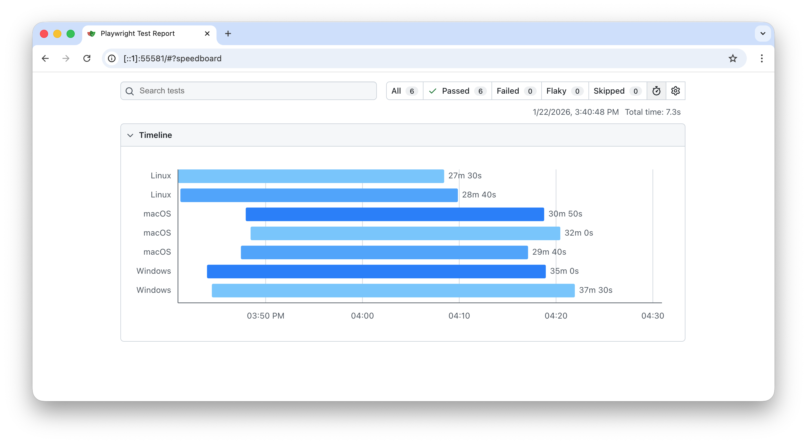
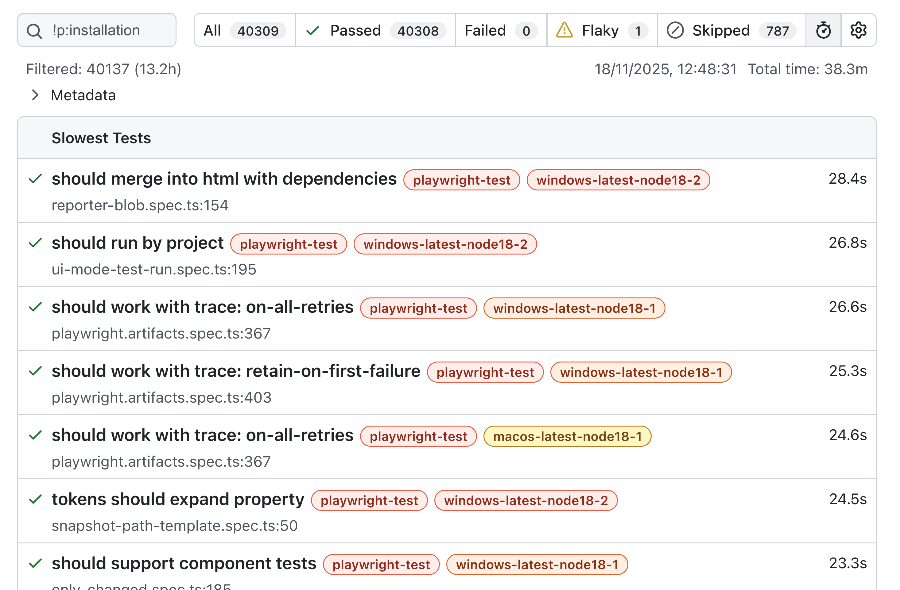
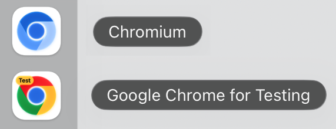

import Tabs from '@theme/Tabs';
import TabItem from '@theme/TabItem';
import HTMLCard from '@site/src/components/HTMLCard';

import LiteYouTube from '@site/src/components/LiteYouTube';

## Версия 1.65

### 🥟 Запуск тестов с Bun

Средство запуска тестов теперь работает под [Bun](https://bun.com). Bun самостоятельно транспилирует файлы тестов на TypeScript, поэтому Playwright не использует Babel и его кеш компиляции. Передавайте флаг `--bun`, поскольку без него команда `bunx playwright test` выполняется в Node.js:

```bash
bunx --bun playwright test
```

В нашей CI тесты средства запуска тестов выполняются под Bun 1.4.3 в Linux. Некоторые возможности под Bun работают иначе:
- Режим наблюдения отсутствует. В режиме UI тесты не запускаются повторно при изменении файлов, а `--only-changed` не отслеживает импорты.
- Bun самостоятельно загружает модули, поэтому `--tsconfig` и параметры JSX в `tsconfig.json` не действуют, а пользовательские загрузчики ESM не поддерживаются.
- Трассировки стека не включают асинхронные кадры, а имена API не содержат имя класса: `click` вместо `locator.click`. Из-за этого меняются некоторые позиции шагов в исходном коде, заголовки шагов и сообщения об ошибках.
- Консольный вывод теста не попадает в трассировку и режим UI.

### 🚨 Отчёты только с неудачными тестами

Новый репортёр [`failures`](./test-reporters.mdx#failures-reporter) выводит неудачные тесты и успешные повторные попытки по мере их выполнения, а затем итоговую сводку, без вывода информации о ходе выполнения.

Новый параметр `onlyFailures` репортёров HTML, JSON и JUnit [оставляет только](./test-reporters.mdx#report-only-failures) тесты с неожиданными результатами, нестабильные тесты и прерванные тесты:

```js title="playwright.config.ts"
import { defineConfig } from '@playwright/test';

export default defineConfig({
  reporter: [
    ['failures'],
    ['html', { onlyFailures: true }],
  ],
});
```

### 🎯 Средство запуска тестов
- Новая встроенная [блокировка тестов](./test-parallel.mdx#test-locks) `-exclusive-` запускает тест только тогда, когда никакие другие тесты не выполняются. Все остальные тесты по-прежнему выполняются параллельно друг с другом:
  
  ```js
  test('restart the server', { lock: '-exclusive-' }, async () => {
    // Пока выполняется этот тест, никакие другие тесты не запускаются.
  });
  ```
  
- [test.skip()](/api/class-test.mdx#test-skip), [test.fixme()](/api/class-test.mdx#test-fixme), [test.fail()](/api/class-test.mdx#test-fail) и [test.slow()](/api/class-test.mdx#test-slow) теперь можно вызывать, передавая только описание. Оно записывается в аннотацию теста:
  
  ```js
  test('upload a file', async ({ page }) => {
    test.skip('Not implemented yet');
  });
  ```
  
- Новая переменная окружения `PLAYWRIGHT_TRANSFORM_CACHE_DIR` задаёт каталог для транспилированных файлов тестов, например на компьютере с Linux, которым пользуются несколько пользователей.

### Новые API
- Новые параметры [timeout](/api/class-cdpsession.mdx#cdp-session-send-option-timeout) и [signal](/api/class-cdpsession.mdx#cdp-session-send-option-signal) в [cdpSession.send()](/api/class-cdpsession.mdx#cdp-session-send).
- Новый метод [testRun.mode()](/api/class-testrun.mdx#test-run-mode) возвращает режим выполнения набора тестов во время [reporter.preprocess()](/api/class-reporter.mdx#reporter-preprocess).

### Изменения, нарушающие обратную совместимость ⚠️
- Поля классов TypeScript теперь учитывают [`useDefineForClassFields`](./test-typescript.mdx#tsconfig-class-fields) из вашего `tsconfig.json`, как и `tsc`. Этот параметр включён для целевых версий `ES2022` и новее, а также когда `target` не указан. Инициализатор поля, который обращается к свойству, объявленному в параметрах конструктора, теперь вызывает ошибку, поскольку инициализатор выполняется первым:
  
  ```js
  class LoginPage {
    // TypeError: Cannot read properties of undefined (reading 'getByRole')
    readonly submit = this.page.getByRole('button', { name: 'Submit' });
  
    constructor(private readonly page: Page) {}
  }
  ```
  
  Перенесите инициализацию в конструктор или задайте `"useDefineForClassFields": false` в вашем `tsconfig.json`.
- Такие действия, как [locator.click()](/api/class-locator.mdx#locator-click), [locator.check()](/api/class-locator.mdx#locator-check), [locator.tap()](/api/class-locator.mdx#locator-tap), [locator.fill()](/api/class-locator.mdx#locator-fill), [locator.clear()](/api/class-locator.mdx#locator-clear) и [locator.selectOption()](/api/class-locator.mdx#locator-select-option), теперь ожидают, пока элемент станет [неинертным](./actionability.mdx#not-inert). Действие над элементом с атрибутом `inert` или над элементом внутри него теперь завершается по тайм-ауту, если элемент остаётся инертным.
- Запуск с разделением на шарды теперь завершается ошибкой "No tests found", если ни в одном шарде нет подходящих тестов. Чтобы разрешить такой запуск, передайте `--pass-with-no-tests`. Пустой шард по-прежнему завершается успешно, если в других шардах есть тесты.
- Сопоставление cookie теперь соответствует RFC 6265. При передаче URL методы [browserContext.cookies()](/api/class-browsercontext.mdx#browser-context-cookies) и [apiRequestContext.cookies()](/api/class-apirequestcontext.mdx#api-request-context-cookies) больше не возвращают cookie, ограниченные конкретным хостом, для поддоменов, а также cookie с `Path=/api` для `/apiv2`; cookie с `Path=/foo/` не соответствует `/foo`. [APIRequestContext] отправляет cookie без имени как `Cookie: x`, а не `Cookie: =x`, и сохраняет `Set-Cookie: token` как cookie без имени.
- Учётные данные прокси больше не отправляются веб-сайтам. Учётные данные в параметре [proxy](/api/class-browsertype.mdx#browser-type-launch-option-proxy) теперь используются только в ответ на запросы аутентификации от прокси. Для аутентификации на веб-сайте используйте [httpCredentials](/api/class-browser.mdx#browser-new-context-option-http-credentials).
- Текст, который браузер не отображает, например текст, не назначенный слоту, или текст непосредственно внутри закрытого `<details>`, больше не включается в доступные имена и снимки aria. Это может изменить результаты [page.getByRole()](/api/class-page.mdx#page-get-by-role) с указанием имени, [locator.ariaSnapshot()](/api/class-locator.mdx#locator-aria-snapshot) и [expect(locator).toMatchAriaSnapshot()](/api/class-locatorassertions.mdx#locator-assertions-to-match-aria-snapshot).
- Строковые значения и значения `URLSearchParams` параметра `params` в запросах [APIRequestContext] теперь добавляются к уже имеющейся в URL строке запроса, а не заменяют её.
- Импорты `.css`, `.less` и `.scss` в файлах тестов теперь загружаются как пустые модули, а не удаляются, поэтому импортируемый файл должен существовать.
- Репортёр blob снова удаляет содержимое своего выходного каталога перед записью отчёта. Playwright 1.64 сохранял отчёты с другими именами.
- Позиции тестов в исходном коде для импортированных вызовов, таких как `test(`, в выводе CommonJS теперь указывают на начало вызываемого выражения, например `a.spec.ts:3:7` вместо `a.spec.ts:3:11`. Это соответствует поведению ESM.

### Объявления
* ⚠️ Playwright больше не тестируется на Node.js 20. Используйте Node.js 22, 24 или 26, как указано в [системных требованиях](./intro.mdx#system-requirements).
* 🐳 [Образы Docker](./docker.mdx) теперь включают Node.js 26 вместо Node.js 24, а также последнюю патч-версию Chromium из той же ветки.

### Версии браузеров
- Chromium 158.0.8127.18
- Mozilla Firefox 159.0
- WebKit 27.2

Эта версия также была протестирована со следующими стабильными каналами:
- Google Chrome 157
- Microsoft Edge 156

## Версия 1.64

### 🧰 WebMCP

Новые [page.webmcp](/api/class-page.mdx#page-webmcp) и [frame.webmcp](/api/class-frame.mdx#frame-webmcp) предоставляют доступ к инструментам, которые страница регистрирует через экспериментальный браузерный API [WebMCP](https://webmachinelearning.github.io/webmcp/), чтобы вы могли тестировать их, как любую другую часть приложения:

```js
const browser = await chromium.launch({ args: ['--enable-features=WebMCP'] });
const page = await browser.newPage();
await page.goto('https://example.com');

for (const tool of await page.webmcp.tools())
  console.log(tool.name, tool.description);

const result = await page.webmcp.callTool('add', { a: 2, b: 40 });
console.log(result.content[0].text); // "42"
```

[Playwright MCP](./getting-started-mcp.mdx) также по умолчанию поддерживает WebMCP: определённые страницей инструменты предоставляются агенту под именами `webmcp_<tool>`. Чтобы отключить эту возможность, передайте `--no-webmcp`.

[`playwright-cli`](./getting-started-cli.mdx) также предоставляет доступ к этим инструментам:

```bash
playwright-cli webmcp-list
playwright-cli webmcp-call search_catalog --params '{"query":"cats"}'
```

### 🎬 Улучшенные видеозаписи

Теперь видео можно записывать с заданной частотой кадров, а оформление действий настраивается с помощью обычного CSS:

```js title="playwright.config.ts"
import { defineConfig } from '@playwright/test';

export default defineConfig({
  use: {
    video: {
      mode: 'on',
      size: { width: 1920, height: 1080 },
      fps: 60,
      show: {
        actions: {
          style: {
            point: 'width: 20px; height: 20px; border-radius: 50%; background: red',
            highlight: 'outline: 2px solid #333; background: rgba(0, 128, 255, .15)',
            title: 'font-size: 16px',
          },
        },
      },
    },
  },
});
```

- Новый параметр `fps` в [testOptions.video](/api/class-testoptions.mdx#test-options-video), [recordVideo](/api/class-browser.mdx#browser-new-context-option-record-video) и [screencast.start()](/api/class-screencast.mdx#screencast-start). Firefox и WebKit в настоящее время захватывают до 25 кадров в секунду.
- Новый параметр [style](/api/class-screencast.mdx#screencast-show-actions-option-style) принимает CSS-объявления для маркера `point`, подсветки целевого элемента `highlight` и заголовка действия `title`. Он заменяет параметр `fontSize`, который теперь считается устаревшим.
- Курсор остаётся видимым в точке последнего действия, сохраняется при переходах между страницами и перемещается по естественной траектории с плавным ускорением и замедлением.
- Видео кодируются с помощью VP9 вместо VP8, что снижает нагрузку на процессор и позволяет получать файлы меньшего размера с тем же или лучшим качеством.
- Все параметры видео также доступны в [Playwright MCP](./getting-started-mcp.mdx) и [`playwright-cli`](./getting-started-cli.mdx).

### 🎯 Средство запуска тестов
- Новый параметр [testProject.default](/api/class-testproject.mdx#test-project-default) позволяет оставить проект в конфигурации, не запуская его по умолчанию. Вы можете настроить все интересующие вас браузеры, а обычная команда `npx playwright test` будет запускать только предпочитаемый:
  
  ```js title="playwright.config.ts"
  import { defineConfig, devices } from '@playwright/test';
  
  export default defineConfig({
    projects: [
      { name: 'chromium', use: devices['Desktop Chrome'] },
      { name: 'firefox', use: devices['Desktop Firefox'], default: false },
      { name: 'webkit', use: devices['Desktop Safari'], default: false },
    ],
  });
  ```
  
  ```bash
  npx playwright test                     # запускает только chromium
  npx playwright test --project=firefox   # запускает firefox
  npx playwright test --project="*"       # запускает все три, например в CI
  ```
  
- Новый параметр командной строки `--shuffle` задаёт случайный порядок выполнения тестов, что помогает находить тесты, случайно зависящие друг от друга.
  
  ```bash
  npx playwright test --shuffle
  # Running 42 tests using 4 workers, shuffle seed 271828182
  # ...
  
  # Передайте начальное значение генератора, чтобы воспроизвести тот же порядок.
  npx playwright test --shuffle 271828182
  ```
  
- Новый параметр `lock` в [test.describe.configure()](/api/class-test.mdx#test-describe-configure) добавляет [блокировки тестов](./test-parallel.mdx#test-locks) ко всем тестам в файле или группе:
  
  ```js
  test.describe.configure({ lock: 'user-settings' });
  ```
  
- Новый параметр `type` для `toHaveScreenshot` в [testConfig.expect](/api/class-testconfig.mdx#test-config-expect) сохраняет все снимки экрана без явно заданного имени в формате WebP:
  
  ```js title="playwright.config.ts"
  export default defineConfig({
    expect: {
      toHaveScreenshot: { type: 'webp' },
    },
  });
  ```
  
### 🪆 Locator.within()

Новый метод [locator.within()](/api/class-locator.mdx#locator-within) объединяет два уже имеющихся локатора в естественном порядке чтения — «эта кнопка внутри того диалога»:

```js
const saveButton = page.getByRole('button', { name: 'Save' });
const dialog = page.getByTestId('settings-dialog');

await saveButton.within(dialog).click();
```

Относительные локаторы, такие как [locator.nth()](/api/class-locator.mdx#locator-nth) или [locator.first()](/api/class-locator.mdx#locator-first), разрешаются отдельно внутри каждого родительского элемента, что упрощает запросы для выбора столбцов:

```js
// Третья ячейка каждой строки, а не третья ячейка таблицы.
const thirdColumn = page.getByRole('cell').nth(2).within(page.getByRole('row'));
await expect(thirdColumn).toHaveText(['Apple', 'Banana', 'Cherry']);
```

### Новые API
- Новый метод [page.getByRef()](/api/class-page.mdx#page-get-by-ref) находит элемент по его aria ref, например `e2`, который возвращает [page.ariaSnapshot()](/api/class-page.mdx#page-aria-snapshot) в режиме `'ai'`.
- Новый параметр [includeShadow](/api/class-page.mdx#page-content-option-include-shadow) в [page.content()](/api/class-page.mdx#page-content) и [frame.content()](/api/class-frame.mdx#frame-content) сериализует открытые теневые корни в виде [декларативного теневого DOM](https://developer.mozilla.org/en-US/docs/Web/API/Web_components/Using_shadow_DOM#declaratively_with_html).
- Новый параметр [signCount](/api/class-credentials.mdx#credentials-create-option-sign-count) задаёт начальное значение счётчика подписей виртуальных учётных данных. [credentials.create()](/api/class-credentials.mdx#credentials-create) и [credentials.get()](/api/class-credentials.mdx#credentials-get) возвращают текущее значение `signCount`, которое сохраняется и восстанавливается вместе с учётными данными в состоянии хранилища.
- Новое свойство [fullConfig.filteredProjects](/api/class-fullconfig.mdx#full-config-filtered-projects) содержит список проектов, выбранных для запуска после применения фильтра `--project`. Оно доступно в глобальной настройке и репортёрах.
- Новые методы [apiRequestContext.addCookies()](/api/class-apirequestcontext.mdx#api-request-context-add-cookies), [apiRequestContext.cookies()](/api/class-apirequestcontext.mdx#api-request-context-cookies) и [apiRequestContext.clearCookies()](/api/class-apirequestcontext.mdx#api-request-context-clear-cookies) управляют cookie контекста запросов аналогично методам [BrowserContext]:
  
  ```js
  await request.addCookies([{ name: 'session-id', value: '42', url: 'https://example.com' }]);
  console.log(await request.cookies('https://example.com'));
  await request.clearCookies({ name: 'session-id' });
  ```
  
### Изменения, нарушающие обратную совместимость ⚠️
- Свойство `screen` теперь передаётся из [дескрипторов устройств](./emulation.mdx#devices). Если вы используете `...devices['Desktop Chrome']` и подобные конструкции, `window.screen` и медиазапросы теперь учитывают эмулируемый размер экрана. Это поведение можно отключить, явно задав для `screen` значение `undefined`:
  
  ```js title="playwright.config.ts"
  export default defineConfig({
    use: {
      ...devices['Desktop Chrome'],
      screen: undefined,
    },
  });
  ```
  
- JSX в файлах тестов теперь учитывает ваш `tsconfig.json`. Playwright компилирует JSX в файлах тестов в соответствии с [параметрами tsconfig](./test-typescript.mdx#tsconfig-jsx-options) `jsx`, `jsxFactory`, `jsxFragmentFactory` и `jsxImportSource`, а по умолчанию использует автоматическую среду выполнения из `react/jsx-runtime`.
- Запуск с `--update-snapshots=missing` теперь завершается успешно. Тесты, которые только создают отсутствующие снимки, теперь проходят в режиме `'missing'` параметра [testConfig.updateSnapshots](/api/class-testconfig.mdx#test-config-update-snapshots), чтобы CI могла за один запуск создавать новые снимки и проверять существующие. Режим, используемый, когда параметр не указан, теперь называется `'default'` и ведёт себя как раньше: отсутствующие снимки записываются, а тест завершается неудачей.
- Элементы внутри скрытых iframe считаются скрытыми. Элементы внутри невидимого iframe, например с `visibility: hidden`, теперь считаются скрытыми при выполнении действий, а также методами [locator.isVisible()](/api/class-locator.mdx#locator-is-visible) и [expect(locator).toBeVisible()](/api/class-locatorassertions.mdx#locator-assertions-to-be-visible).

### Версии браузеров
- Chromium 156.0.8078.4
- Mozilla Firefox 157.0
- WebKit 27.2

Эта версия также была протестирована со следующими стабильными каналами:
- Google Chrome 155
- Microsoft Edge 155

## Версия 1.63

### 🔒 Блокировки тестов

Тесты, обращающиеся к общему ресурсу — внешнему сервису или глобальной настройке учётной записи, — теперь могут объявлять именованную блокировку `lock`. Тесты с одинаковым именем блокировки никогда не выполняются одновременно, даже если находятся в разных файлах, рабочих процессах и [проектах](./test-projects.mdx), при этом все остальные тесты продолжают выполняться параллельно:

```js
test('update user settings', { lock: 'user-settings' }, async ({ page }) => {
  // Никогда не выполняется одновременно с другими тестами, удерживающими 'user-settings'.
});
```

Тест может удерживать несколько блокировок, а [test.describe()](/api/class-test.mdx#test-describe) принимает `lock` для всей группы. Подробнее о [блокировках тестов](./test-parallel.mdx#test-locks).

### 🪟 Поиск во всех фреймах

[page.frameLocator()](/api/class-page.mdx#page-frame-locator) и [frame.frameLocator()](/api/class-frame.mdx#frame-frame-locator), вызванные без селектора, выполняют поиск в любом фрейме поддерева, поэтому предварительно находить iframe больше не требуется:

```js
// Находит кнопку в любом фрейме на странице.
await page.frameLocator().getByRole('button').click();
```

Оставшаяся часть локатора разрешается внутри одного фрейма, как и обычный локатор; если совпадения найдены в нескольких фреймах, возникает ошибка.

### 👁️ Локаторы только для видимых элементов

Новый метод [locator.visible()](/api/class-locator.mdx#locator-visible) возвращает локатор, соответствующий только видимым элементам. Его рекомендуется использовать вместо CSS-псевдокласса `:visible`:

```js
await page.locator('button').visible().click();
```

### 🧾 Параметры и подзаголовки шагов

Шаги теперь содержат структурированные данные для репортёров. Шаги API Playwright передают целевой локатор и аргументы вызова, а [test.step()](/api/class-test.mdx#test-step) принимает параметры `subtitle` и `params` для ваших собственных шагов:

```js
await test.step('Login', async () => {
  // ...
}, { subtitle: 'as admin', params: { user: 'admin' } });
```

Репортёры получают их через [testStep.subtitle](/api/class-teststep.mdx#test-step-subtitle) и [testStep.params](/api/class-teststep.mdx#test-step-params). Для шагов API Playwright подзаголовком служит локатор или URL перехода — например, `Click` с подзаголовком `getByRole('button')`. Оба значения отображаются рядом с заголовком шага в просмотрщике трассировок и HTML-отчёте.

### 🖼️ Снимки aria и экрана в трассировках

Параметр `snapshots` метода [tracing.start()](/api/class-tracing.mdx#tracing-start) и параметра фикстуры [testOptions.trace](/api/class-testoptions.mdx#test-options-trace) теперь принимает объект, определяющий, что следует фиксировать при каждом действии:

```js title="playwright.config.ts"
export default defineConfig({
  use: {
    trace: {
      mode: 'on',
      snapshots: { dom: true, aria: true, screen: true }
    },
  },
});
```

Если снимки aria и экрана записаны, новый режим **Display Aria** в просмотрщике трассировок показывает снимок экрана действия рядом со снимком aria, а при наведении на узел aria подсвечивает его на снимке экрана.

### Новые API

#### Браузер и контекст
- [httpCredentials](/api/class-browser.mdx#browser-new-context-option-http-credentials) теперь также принимает массив учётных данных. Используется первая запись, соответствующая источнику запроса, а записи без указания источника соответствуют любому запросу.
- Новый параметр [opfs](/api/class-browsercontext.mdx#browser-context-storage-state-option-opfs) включает [приватную файловую систему источника](https://developer.mozilla.org/en-US/docs/Web/API/File_System_API/Origin_private_file_system) в состояние хранилища, чтобы её можно было сохранить и восстановить в последующих контекстах.
- Новые события [page.on('dialogclosed')](/api/class-page.mdx#page-event-dialog-closed) и [browserContext.on('dialogclosed')](/api/class-browsercontext.mdx#browser-context-event-dialog-closed) возникают, когда диалоговое окно JavaScript подтверждено, отклонено или закрыто пользователем.

#### Локаторы
- Новые методы [locator.ariaSnapshotJSON()](/api/class-locator.mdx#locator-aria-snapshot-json) и [page.ariaSnapshotJSON()](/api/class-page.mdx#page-aria-snapshot-json) возвращают снимок aria как значение JSON вместо разметки YAML и поддерживают параметры `mode`, `depth` и `boxes`.
- [apiRequestContext.get()](/api/class-apirequestcontext.mdx#api-request-context-get) и другие методы запросов принимают аргумент типа, задающий тип результата `json()` ответа:

```js
const response = await request.get<User>('/api/users/42');
const user = await response.json(); // имеет тип User
```

#### Средство запуска тестов
- Новые отдельные параметры [testOptions.reducedMotion](/api/class-testoptions.mdx#test-options-reduced-motion), [testOptions.forcedColors](/api/class-testoptions.mdx#test-options-forced-colors) и [testOptions.contrast](/api/class-testoptions.mdx#test-options-contrast).
- Новый параметр командной строки `--add-reporter` добавляет репортёр к уже настроенным в `playwright.config`, а не заменяет их, как это делает `--reporter`.
- Новый параметр `omitTags` для репортёров `list`, `line`, `dot`, `github` и `junit` отключает вывод тегов, которые автоматически добавляются к названиям тестов.

#### Командная строка
- `npx playwright install --no-remove` сохраняет браузеры других установок Playwright, а не удаляет их.
- `npx playwright codegen --http-credentials` записывает действия на страницах, защищённых HTTP-аутентификацией.

#### Прочее
- Новый встроенный репортёр [`perfetto`](./test-reporters.mdx#perfetto-reporter) записывает файл в формате Trace Event Format для [Perfetto UI](https://ui.perfetto.dev) или `chrome://tracing`, отображая запуск тестов в виде временной шкалы с отдельной дорожкой для каждого рабочего процесса.
- HTML-отчёт отображает рядом с шагами теста каскадную диаграмму длительности.

### Объявления
* ⚠️ Экспериментальные пакеты `@playwright/experimental-ct-react`, `@playwright/experimental-ct-react17` и `@playwright/experimental-ct-vue` больше не будут обновляться. Следуйте [руководству по миграции](./test-components.mdx#migration-from-the-experimental-packages), чтобы перейти на модель историй, представленную в версии 1.62. Идентификаторы историй, передаваемые в [fixtures.mount()](/api/class-fixtures.mdx#fixtures-mount), теперь можно типизировать с помощью сгенерированного реестра `Stories`.
* ⚠️ Ubuntu 20.04 больше не поддерживается.
* 🐧 В Linux arm64 Playwright теперь загружает сборку Chromium [Chrome for Testing](https://developer.chrome.com/blog/chrome-for-testing) — ту же сборку, которая используется на всех остальных платформах.

### Версии браузеров
- Chromium 153.0.8010.12
- Mozilla Firefox 155.0
- WebKit 26.6

Эта версия также была протестирована со следующими стабильными каналами:
- Google Chrome 153
- Microsoft Edge 153

## Версия 1.62

### 🧱 Новая модель тестирования компонентов

[Тестирование компонентов](./test-components.mdx) переходит на модель **историй и галерей**. **История** оборачивает ваш компонент для одного конкретного сценария — с фиксированными пропсами, тестовыми данными, провайдерами, — а

страница **галереи**, которую вы предоставляете через сервер, отображает истории по запросу. Новая фикстура [fixtures.mount()](/api/class-fixtures.mdx#fixtures-mount) переходит в галерею, монтирует историю по идентификатору и возвращает [Locator], ограниченный корневым элементом истории:

```js
test('click should expand', async ({ mount }) => {
  const component = await mount('components/Expandable/Stateful');
  await component.getByRole('button').click();
  await expect(component.getByTestId('expanded')).toHaveValue('true');
});
```

Передайте тип истории в качестве аргумента типа, чтобы проверять типы её пропсов, и используйте `update(props)` / `unmount()` у возвращённого локатора для повторного рендеринга или размонтирования в рамках теста.

### 🛑 Отмена операций с помощью AbortSignal

Большинство операций и проверок с автоматическим ожиданием теперь принимают параметр `signal` со значением [`AbortSignal`](https://developer.mozilla.org/en-US/docs/Web/API/AbortSignal), позволяющий отменять длительные действия, переходы, ожидания и проверки:

```js
const controller = new AbortController();
setTimeout(() => controller.abort(), 1000);

await page.getByRole('button', { name: 'Submit' }).click({ signal: controller.signal });
await expect(page.getByText('Done')).toBeVisible({ signal: controller.signal });
```

Передача сигнала не отключает тайм-аут по умолчанию; чтобы отключить его, передайте `timeout: 0`.

### 🖼️ Снимки экрана в формате WebP

[expect(page).toHaveScreenshot()](/api/class-pageassertions.mdx#page-assertions-to-have-screenshot-1) и [expect(locator).toHaveScreenshot()](/api/class-locatorassertions.mdx#locator-assertions-to-have-screenshot-1) теперь могут сохранять снимки в формате WebP — просто задайте снимку имя с расширением `.webp`:

```js
// При визуальном сравнении эталонный снимок сохраняется в WebP без потерь.
await expect(page).toHaveScreenshot('homepage.webp');

// Для отдельных снимков можно уменьшить размер за счёт качества, используя WebP с потерями.
await page.screenshot({ path: 'homepage.webp', quality: 50 });
```

[page.screenshot()](/api/class-page.mdx#page-screenshot) и [locator.screenshot()](/api/class-locator.mdx#locator-screenshot) также принимают `webp` в качестве `type`: качество `100` (по умолчанию) означает сжатие без потерь, а меньшие значения используют сжатие с потерями.

### 🧩 Пользовательская фильтрация тестов с Reporter.preprocess()

Новый хук [reporter.preprocess()](/api/class-reporter.mdx#reporter-preprocess) выполняется после обработки конфигурации и до [reporter.onBegin()](/api/class-reporter.mdx#reporter-on-begin), позволяя репортёру помечать отдельные тесты как пропущенные, исключённые, требующие исправления или ожидаемо неудачные через объект [TestRun]:

```js
class MyReporter {
  async preprocess({ config, suite, testRun }) {
    for (const test of suite.allTests()) {
      if (shouldSkip(test))
        testRun.skip(test);
    }
  }
}
```

### 🔁 Изолированные повторные попытки

Новый параметр [testConfig.retryStrategy](/api/class-testconfig.mdx#test-config-retry-strategy) определяет, когда повторно запускать неудачные тесты. Значение по умолчанию `'immediate'` запускает повторную попытку, как только освобождается рабочий процесс; `'isolated'` выполняет все повторные попытки в конце, по одной в единственном рабочем процессе, чтобы свести к минимуму взаимное влияние с остальным набором тестов:

```js title="playwright.config.ts"
export default defineConfig({
  retries: 2,
  retryStrategy: 'isolated',
});
```

### Новые API

#### Браузер и контекст
- Новый параметр [credentials](/api/class-browsercontext.mdx#browser-context-storage-state-option-credentials) включает виртуальные учётные данные WebAuthn [Credentials] (ключи доступа) контекста в состояние хранилища, чтобы их можно было сохранить и предварительно загрузить в последующие контексты.

#### Действия
- Новый параметр действий `scroll` (`"auto"` | `"none"`) позволяет отключить автоматическую прокрутку Playwright для перемещения элемента в область видимости.

#### Сеть
- Новый метод [apiResponse.timing()](/api/class-apiresponse.mdx#api-response-timing) возвращает информацию о временных характеристиках загрузки ресурса для ответа API.

#### Выполнение JavaScript
- Новый метод [locator.waitForFunction()](/api/class-locator.mdx#locator-wait-for-function) ожидает, пока функция, вызываемая с найденным элементом, не вернёт истинное значение.
- [page.evaluate()](/api/class-page.mdx#page-evaluate) и связанные методы теперь принимают функции в качестве аргументов вычисления.
- [page.addInitScript()](/api/class-page.mdx#page-add-init-script) / [browserContext.addInitScript()](/api/class-browsercontext.mdx#browser-context-add-init-script) теперь принимают функции в качестве аргументов скрипта инициализации.

#### Командная строка и MCP
- Playwright теперь включает сервер [Playwright MCP](./getting-started-mcp.mdx) и [`playwright-cli`](./getting-started-cli.mdx), которые можно запускать командами `npx playwright mcp` и `npx playwright cli`.

#### Репортёры
- Группировку **Merge files** в HTML-отчёте, которая раньше включалась только переключателем в интерфейсе, теперь можно включить из конфигурации с помощью нового параметра репортёра `mergeFiles`:

```js title="playwright.config.ts"
export default defineConfig({
  reporter: [['html', { mergeFiles: true }]],
});
```

### Объявления
* 📋 В режиме без графического интерфейса буфер обмена теперь изолирован от операционной системы, поэтому тесты, использующие `navigator.clipboard`, больше не читают и не перезаписывают буфер обмена компьютера, на котором выполняются.
* ⚠️ Debian 11 больше не поддерживается.

### Версии браузеров
- Chromium 151.0.7922.34
- Mozilla Firefox 153.0
- WebKit 26.5

Эта версия также была протестирована со следующими стабильными каналами:
- Google Chrome 151
- Microsoft Edge 151

## Версия 1.61

### 🔑 Ключи доступа WebAuthn

Новый виртуальный аутентификатор [Credentials], доступный через [browserContext.credentials](/api/class-browsercontext.mdx#browser-context-credentials), позволяет тестам регистрировать ключи доступа и отвечать на процедуры `navigator.credentials.create()` / `navigator.credentials.get()` на странице — реальный аппаратный ключ не требуется, поддерживаются все браузеры:

```js
const context = await browser.newContext();

// Предварительно загрузите ключ доступа, созданный вашим бэкендом для тестового пользователя.
await context.credentials.create('example.com', {
  id: credentialId,
  userHandle,
  privateKey,
  publicKey,
});
await context.credentials.install();

const page = await context.newPage();
await page.goto('https://example.com/login');
// Вызов navigator.credentials.get() на странице получает предварительно загруженный ключ доступа.
```

Вы также можете позволить приложению один раз зарегистрировать ключ доступа в подготовительном тесте, прочитать его с помощью [credentials.get()](/api/class-credentials.mdx#credentials-get) и предварительно загружать в последующих тестах — подробности см. в [Credentials].

### 🗃️ Web Storage

Новый API [WebStorage], доступный через [page.localStorage](/api/class-page.mdx#page-local-storage) и [page.sessionStorage](/api/class-page.mdx#page-session-storage), позволяет читать и записывать данные хранилища страницы для текущего источника:

```js
await page.localStorage.setItem('token', 'abc');
const token = await page.localStorage.getItem('token');
const items = await page.sessionStorage.items();
```

### Новые API

#### Сеть
- [apiResponse.securityDetails()](/api/class-apiresponse.mdx#api-response-security-details) и [apiResponse.serverAddr()](/api/class-apiresponse.mdx#api-response-server-addr) соответствуют браузерным методам [response.securityDetails()](/api/class-response.mdx#response-security-details) и [response.serverAddr()](/api/class-response.mdx#response-server-addr).

#### Браузер и запись экрана
- Новый параметр `artifactsDir` в [browserType.connectOverCDP()](/api/class-browsertype.mdx#browser-type-connect-over-cdp) определяет, где сохраняются артефакты, такие как трассировки и загрузки, при подключении к уже запущенному браузеру.
- Новый параметр `cursor` в [screencast.showActions()](/api/class-screencast.mdx#screencast-show-actions) управляет оформлением курсора, отображаемым для действий указателя.
- Функция обратного вызова `onFrame` в [screencast.start()](/api/class-screencast.mdx#screencast-start) теперь получает `timestamp` — временную метку момента, когда браузер отобразил кадр.

#### Средство запуска тестов
- Опция [testOptions.video](/api/class-testoptions.mdx#test-options-video) теперь поддерживает тот же набор режимов, что и `trace`: добавлены значения `'on-all-retries'`, `'retain-on-first-failure'` и `'retain-on-failure-and-retries'`. В [таблице режимов видеозаписи](./test-use-options.mdx#video-modes) указано, какие запуски записываются и какие записи сохраняются в каждом режиме.
- Добавлена поддержка `expect.soft.poll(...)`.
- Новое свойство [fullConfig.argv](/api/class-fullconfig.mdx#full-config-argv) — снимок `process.argv` процесса запуска тестов, удобный для чтения пользовательских аргументов, переданных после разделителя `--`.
- Новое свойство [fullConfig.failOnFlakyTests](/api/class-fullconfig.mdx#full-config-fail-on-flaky-tests) отражает соответствующую опцию конфигурации, позволяя репортерам объяснять, почему запуск с нестабильными тестами завершился неудачей.
- Свойство [testInfo.errors](/api/class-testinfo.mdx#test-info-errors) теперь перечисляет каждую вложенную ошибку `AggregateError` как отдельную запись.
- Добавлено новое сокращение командной строки `-G` для `--grep-invert`.

### 🛠️ Другие улучшения
- Playwright теперь поддерживает Ubuntu 26.04.
- Записи HAR и трассировок теперь включают запросы WebSocket.

### Версии браузеров
- Chromium 149.0.7827.55
- Mozilla Firefox 151.0
- WebKit 26.5

Эта версия также была протестирована со следующими стабильными каналами:
- Google Chrome 149
- Microsoft Edge 149

## Версия 1.60

### 🌐 Запись HAR через Tracing

Методы [tracing.startHar()](/api/class-tracing.mdx#tracing-start-har) / [tracing.stopHar()](/api/class-tracing.mdx#tracing-stop-har) предоставляют запись HAR как полноценную часть API трассировки с теми же опциями `content`, `mode` и `urlFilter`, что и у `recordHar`. Возвращаемый объект [Disposable] позволяет легко ограничить время записи областью видимости с помощью `await using`:

```js
await using har = await context.tracing.startHar('trace.har');
const page = await context.newPage();
await page.goto('https://playwright.dev');
// Запись HAR завершается, когда `har` выходит из области видимости.
```

### 🪝 API Drop

Новый метод [locator.drop()](/api/class-locator.mdx#locator-drop) имитирует перетаскивание файлов или данных, подобных содержимому буфера обмена, из внешнего источника на элемент. Playwright отправляет события `dragenter`, `dragover` и `drop` с синтетическим объектом [DataTransfer] в контексте страницы — это работает во всех браузерах и отлично подходит для тестирования зон загрузки файлов:

```js
await page.locator('#dropzone').drop({
  files: { name: 'note.txt', mimeType: 'text/plain', buffer: Buffer.from('hello') },
});

await page.locator('#dropzone').drop({
  data: {
    'text/plain': 'hello world',
    'text/uri-list': 'https://example.com',
  },
});
```

### 🎯 ARIA-снимки
- Метод [expect(page).toMatchAriaSnapshot()](/api/class-pageassertions.mdx#page-assertions-to-match-aria-snapshot) теперь работает с [Page], а не только с [Locator] — это эквивалентно проверке для `page.locator('body')`.
- Новая опция `boxes` в [locator.ariaSnapshot()](/api/class-locator.mdx#locator-aria-snapshot) / [page.ariaSnapshot()](/api/class-page.mdx#page-aria-snapshot) добавляет ограничивающую рамку каждого элемента в формате `[box=x,y,width,height]`, что полезно для обработки средствами ИИ.

### 🛑 test.abort()

Новый метод [test.abort()](/api/class-test.mdx#test-abort) прерывает выполняющийся тест из фикстуры, хука или обработчика маршрута с необязательным сообщением. Используйте его, если обнаружили недопустимое использование, после которого продолжение невозможно, и хотите немедленно завершить тест с ошибкой:

```js
test('does not publish to the shared page', async ({ page }) => {
  await page.route('**/publish', route => {
    test.abort('Tests must not publish to the shared page. Use the `clone` option.');
    return route.abort();
  });
  // ...
});
```

### Новые API

#### Браузер, контекст и страница
- Событие [browser.on('context')](/api/class-browser.mdx#browser-event-context) — возникает при создании нового контекста в браузере.
- [BrowserContext] теперь транслирует события жизненного цикла своих страниц: [browserContext.on('download')](/api/class-browsercontext.mdx#browser-context-event-download), [browserContext.on('frameattached')](/api/class-browsercontext.mdx#browser-context-event-frame-attached), [browserContext.on('framedetached')](/api/class-browsercontext.mdx#browser-context-event-frame-detached), [browserContext.on('framenavigated')](/api/class-browsercontext.mdx#browser-context-event-frame-navigated), [browserContext.on('pageclose')](/api/class-browsercontext.mdx#browser-context-event-page-close), [browserContext.on('pageload')](/api/class-browsercontext.mdx#browser-context-event-page-load).

#### Локаторы и проверки
- Новая опция `description` в [page.getByRole()](/api/class-page.mdx#page-get-by-role) / [locator.getByRole()](/api/class-locator.mdx#locator-get-by-role) / [frame.getByRole()](/api/class-frame.mdx#frame-get-by-role) / [frameLocator.getByRole()](/api/class-framelocator.mdx#frame-locator-get-by-role) для поиска по [доступному описанию](https://www.w3.org/TR/wai-aria-1.2/#dfn-accessible-description).
- Новая опция `pseudo` в [expect(locator).toHaveCSS()](/api/class-locatorassertions.mdx#locator-assertions-to-have-css) позволяет читать вычисленные стили `::before` или `::after`.
- Новая опция `style` в [locator.highlight()](/api/class-locator.mdx#locator-highlight) применяет дополнительные встроенные CSS-стили к слою подсветки, а новый метод [page.hideHighlight()](/api/class-page.mdx#page-hide-highlight) позволяет убрать всю подсветку.

#### Сеть
- Метод [webSocketRoute.protocols()](/api/class-websocketroute.mdx#web-socket-route-protocols) возвращает подпротоколы WebSocket, запрошенные страницей.
- Новая опция `noDefaults` в [browserType.connectOverCDP()](/api/class-browsertype.mdx#browser-type-connect-over-cdp) отключает стандартные переопределения Playwright для контекста по умолчанию (поведение загрузки файлов, эмуляцию фокуса, эмуляцию медиапараметров), чтобы подключение к браузеру, которым пользователь пользуется ежедневно, не нарушало его состояние.

#### Ошибки и отчёты
- Новый метод [webError.location()](/api/class-weberror.mdx#web-error-location) аналогичен [consoleMessage.location()](/api/class-consolemessage.mdx#console-message-location).
- Метод [consoleMessage.location()](/api/class-consolemessage.mdx#console-message-location) теперь предоставляет свойства `line` / `column` (`lineNumber` / `columnNumber` объявлены устаревшими).
- Новое свойство [testInfoError.errorContext](/api/class-testinfoerror.mdx#test-info-error-error-context) предоставляет дополнительный диагностический контекст, например ARIA-снимок проверяемого объекта в момент сбоя проверки `expect(...)`.
- Метод [reporter.onError()](/api/class-reporter.mdx#reporter-on-error) теперь получает аргумент `workerInfo` с информацией о рабочем процессе при ошибках завершения работы фикстур.

#### Средство запуска тестов
- Новый токен `{testFileBaseName}` в [testProject.snapshotPathTemplate](/api/class-testproject.mdx#test-project-snapshot-path-template) — имя файла без расширения.
- Средство запуска тестов теперь выдаёт ошибку, если конфигурация пытается переопределить фикстуру, не являющуюся опцией, а также отклоняет `workers: 0` и отрицательные значения.

### 🛠️ Другие улучшения
- HTML-репортер:
  - Команда `npx playwright show-report` принимает файлы `.zip` напрямую — предварительная распаковка больше не нужна.
  - Для шагов, содержащих вложения во вложенных дочерних шагах, отображается индикатор на родительском шаге.
  - Значение `repeatEachIndex` отображается в заголовке теста, если оно не равно нулю.
- В Trace Viewer на панели сведений о сети добавлен переключатель форматированного отображения тел запросов и ответов в формате JSON и данных форм.

### Несовместимые изменения ⚠️
- Удалены API, давно объявленные устаревшими:
  - `Locator.ariaRef()` — используйте стандартный механизм [locator.ariaSnapshot()](/api/class-locator.mdx#locator-aria-snapshot).
  - Опция `handle` в `BrowserContext.exposeBinding` и `Page.exposeBinding`.
  - Опция `logger` в `BrowserType.connect` и `BrowserType.connectOverCDP` — вместо неё используйте [трассировку](./trace-viewer.mdx).
  - Опции контекста `videosPath` / `videoSize` — вместо них используйте `recordVideo`.

### Версии браузеров
- Chromium 148.0.7778.96
- Mozilla Firefox 150.0.2
- WebKit 26.4

Эта версия также была протестирована со следующими стабильными каналами:
- Google Chrome 147
- Microsoft Edge 147

## Версия 1.59

### 🎬 Запись экрана

Новый API [page.screencast](/api/class-page.mdx#page-screencast) предоставляет единый интерфейс для захвата содержимого страницы с поддержкой:
- Видеозаписи экрана
- Аннотаций действий
- Визуальных наложений
- Захвата кадров в реальном времени
- Видеоподтверждений работы агентов

<center>


</center>

**Видеозапись экрана** — записывайте видео с точным управлением началом и остановкой записи в качестве альтернативы опции [recordVideo](/api/class-browser.mdx#browser-new-context-option-record-video):

```js
await page.screencast.start({ path: 'video.webm' });
// ... выполнение действий ...
await page.screencast.stop();
```

**Аннотации действий** — включите встроенные визуальные аннотации, которые подсвечивают элементы, с которыми происходит взаимодействие, и отображают названия действий во время записи:

```js
await page.screencast.showActions({ position: 'top-right' });
```

Метод [screencast.showActions()](/api/class-screencast.mdx#screencast-show-actions) принимает `position` (`'top-left'`, `'top'`, `'top-right'`, `'bottom-left'`, `'bottom'`, `'bottom-right'`), `duration` (мс на аннотацию) и `fontSize` (пиксели). Возвращает объект с поддержкой освобождения ресурсов для прекращения показа действий.

Аннотации действий также можно включить в тестовых фикстурах через опцию `video`:

```js
// playwright.config.ts
export default defineConfig({
  use: {
    video: {
      mode: 'on',
      show: {
        actions: { position: 'top-left' },
        test: { position: 'top-right' },
      },
    },
  },
});
```

**Визуальные наложения** — добавляйте заголовки разделов и пользовательские HTML-наложения поверх страницы для более подробного сопровождения:

```js
await page.screencast.showChapter('Adding TODOs', {
  description: 'Type and press enter for each TODO',
  duration: 1000,
});

await page.screencast.showOverlay('<div style="color: red">Recording</div>');
```

**Захват кадров в реальном времени** — передавайте поток кадров в формате JPEG для собственной обработки: создания миниатюр, предварительного просмотра в реальном времени, компьютерного зрения на основе ИИ и других задач:

```js
await page.screencast.start({
  onFrame: ({ data }) => sendToVisionModel(data),
  size: { width: 800, height: 600 },
});
```

**Видеоподтверждения работы агентов** — агенты программирования могут создавать видеодоказательства своей работы. После выполнения задачи агент может записать демонстрационное видео с подробными аннотациями для проверки человеком:

```js
await page.screencast.start({ path: 'receipt.webm' });
await page.screencast.showActions({ position: 'top-right' });

await page.screencast.showChapter('Verifying checkout flow', {
  description: 'Added coupon code support per ticket #1234',
});

// Агент выполняет шаги проверки...
await page.locator('#coupon').fill('SAVE20');
await page.locator('#apply-coupon').click();
await expect(page.locator('.discount')).toContainText('20%');

await page.screencast.showChapter('Done', {
  description: 'Coupon applied, discount reflected in total',
});

await page.screencast.stop();
```

Полученное видео служит подтверждением: заголовки разделов задают контекст, аннотации действий выделяют каждое взаимодействие, а визуальную демонстрацию можно проверить быстрее, чем текстовые журналы.

### 🔗 Совместная работа инструментов

Новый API [browser.bind()](/api/class-browser.mdx#browser-bind) делает запущенный браузер доступным для подключения из `playwright-cli`, `@playwright/mcp` и других клиентов.

**Привязка браузера** — запустите браузер и привяжите его, чтобы другие клиенты могли подключаться:

```js
const { endpoint } = await browser.bind('my-session', {
  workspaceDir: '/my/project',
});
```

**Подключение из playwright-cli** — подключитесь к работающему браузеру из своего любимого агента программирования.

```bash
playwright-cli attach my-session
playwright-cli -s my-session snapshot
```

**Подключение из @playwright/mcp** — или укажите работающий браузер в настройках своего MCP-сервера.

```bash
@playwright/mcp --endpoint=my-session
```

**Подключение из клиента Playwright** — используйте API для подключения к браузеру. Поддерживается одновременная работа нескольких клиентов!

```js
const browser = await chromium.connect(endpoint);
```

Передайте опции `host` и `port`, чтобы использовать привязку через WebSocket вместо именованного канала:

```js
const { endpoint } = await browser.bind('my-session', {
  host: 'localhost',
  port: 0,
});
// endpoint — это URL с протоколом ws://
```

Вызовите [browser.unbind()](/api/class-browser.mdx#browser-unbind), чтобы прекратить приём новых подключений.

### 📊 Наблюдаемость

Выполните `playwright-cli show`, чтобы открыть панель мониторинга, которая перечисляет все привязанные браузеры, показывает их состояния и позволяет взаимодействовать с ними:
- Наблюдайте за тем, что делает ваш агент в фоновых браузерах
- Открывайте сеансы для ручного вмешательства
- Открывайте DevTools для изучения страниц фоновых браузеров.

<center>


</center>
- `playwright-cli` автоматически привязывает все свои браузеры, чтобы вы могли видеть, что делают ваши агенты.
- Передайте переменную окружения `PLAYWRIGHT_DASHBOARD=1`, чтобы видеть все браузеры `@playwright/test` на панели мониторинга.

### 🐛 Отладчик CLI для агентов

Агенты программирования теперь могут запускать `npx playwright test --debug=cli`, чтобы подключаться к тестам и отлаживать их через `playwright-cli` — это отлично подходит для автоматического исправления тестов в рабочих процессах с использованием агентов:

```bash
$ npx playwright test --debug=cli
### Debugging Instructions
- Run "playwright-cli attach tw-87b59e" to attach to this test

$ playwright-cli attach tw-87b59e
### Session `tw-87b59e` created, attached to `tw-87b59e`.
Run commands with: playwright-cli --session=tw-87b59e <command>
### Paused
- Navigate to "/" at output/tests/example.spec.ts:4

$ playwright-cli --session tw-87b59e step-over
### Page
- Page URL: https://playwright.dev/
- Page Title: Fast and reliable end-to-end testing for modern web apps | Playwright
### Paused
- Expect "toHaveTitle" at output/tests/example.spec.ts:7
```

### 📋 Анализ трассировок через CLI для агентов

Агенты программирования могут запускать `npx playwright trace`, чтобы исследовать [трассировки Playwright](./trace-viewer.mdx) и разбираться в причинах сбоев или нестабильности тестов из командной строки:

```bash
$ npx playwright trace open test-results/example-has-title-chromium/trace.zip
  Title:        example.spec.ts:3 › has title

$ npx playwright trace actions --grep="expect"
     # Time       Action                                                  Duration
  ──── ─────────  ─────────────────────────────────────────────────────── ────────
    9. 0:00.859  Expect "toHaveTitle"                                        5.1s  ✗

$ npx playwright trace action 9
  Expect "toHaveTitle"
  Error: expect(page).toHaveTitle(expected) failed
    Expected pattern: /Wrong Title/
    Received string:  "Fast and reliable end-to-end testing for modern web apps | Playwright"
    Timeout: 5000ms
  Snapshots
    available: before, after
    usage:     npx playwright trace snapshot 9 --name <before|after>

$ npx playwright trace snapshot 9 --name after
### Page
- Page Title: Fast and reliable end-to-end testing for modern web apps | Playwright

$ npx playwright trace close
```

### ♻️ `await using`

Многие API теперь возвращают [объекты с поддержкой асинхронного освобождения ресурсов](https://developer.mozilla.org/en-US/docs/Web/JavaScript/Reference/Global_Objects/Symbol/asyncDispose), что позволяет использовать синтаксис `await using` для автоматической очистки:

```js
await using page = await context.newPage();
{
  await using route = await page.route('**/*', route => route.continue());
  await using script = await page.addInitScript('console.log("init script here")');
  await page.goto('https://playwright.dev');
  // выполнение действий
}
// к этому моменту маршрут и скрипт инициализации уже удалены
```

### 🔍 Снимки и локаторы
- Метод [page.ariaSnapshot()](/api/class-page.mdx#page-aria-snapshot) для получения ARIA-снимка страницы — эквивалент `page.locator('body').ariaSnapshot()`.
- Опции `depth` и `mode` в [locator.ariaSnapshot()](/api/class-locator.mdx#locator-aria-snapshot).
- Метод [locator.normalize()](/api/class-locator.mdx#locator-normalize) преобразует локатор в соответствии с рекомендуемыми практиками, например с использованием тестовых идентификаторов и ролей ARIA.
- Метод [page.pickLocator()](/api/class-page.mdx#page-pick-locator) включает интерактивный режим, в котором при наведении на элементы они подсвечиваются и отображается соответствующий локатор. Нажмите на элемент, чтобы получить его [Locator]. Используйте [page.cancelPickLocator()](/api/class-page.mdx#page-cancel-pick-locator) для отмены.

### Новые API

#### Запись экрана
- [page.screencast](/api/class-page.mdx#page-screencast) предоставляет видеозапись, потоковую передачу кадров в реальном времени и управление наложениями.
- Методы [screencast.start()](/api/class-screencast.mdx#screencast-start) и [screencast.stop()](/api/class-screencast.mdx#screencast-stop) для записи и захвата кадров.
- Методы [screencast.showActions()](/api/class-screencast.mdx#screencast-show-actions) и [screencast.hideActions()](/api/class-screencast.mdx#screencast-hide-actions) для аннотаций действий.
- Методы [screencast.showChapter()](/api/class-screencast.mdx#screencast-show-chapter) и [screencast.showOverlay()](/api/class-screencast.mdx#screencast-show-overlay) для визуальных наложений.
- Методы [screencast.showOverlays()](/api/class-screencast.mdx#screencast-show-overlays) и [screencast.hideOverlays()](/api/class-screencast.mdx#screencast-hide-overlays) для управления видимостью наложений.

#### Хранилище, консоль и ошибки
- Метод [browserContext.setStorageState()](/api/class-browsercontext.mdx#browser-context-set-storage-state) очищает существующие cookie, локальное хранилище и IndexedDB для всех источников и устанавливает новое состояние хранилища — создавать новый контекст больше не нужно.
- Методы [page.clearConsoleMessages()](/api/class-page.mdx#page-clear-console-messages) и [page.clearPageErrors()](/api/class-page.mdx#page-clear-page-errors) для очистки сохранённых сообщений и ошибок.
- Опция `filter` в [page.consoleMessages()](/api/class-page.mdx#page-console-messages) и [page.pageErrors()](/api/class-page.mdx#page-page-errors) определяет, какие сообщения возвращаются.
- Метод [consoleMessage.timestamp()](/api/class-consolemessage.mdx#console-message-timestamp).

#### Разное
- [browserContext.debugger](/api/class-browsercontext.mdx#browser-context-debugger) предоставляет программное управление отладчиком Playwright.
- Метод [browserContext.isClosed()](/api/class-browsercontext.mdx#browser-context-is-closed).
- Метод [request.existingResponse()](/api/class-request.mdx#request-existing-response) возвращает ответ без ожидания.
- Метод [response.httpVersion()](/api/class-response.mdx#response-http-version) возвращает версию HTTP, используемую в ответе.
- События [cdpSession.on('event')](/api/class-cdpsession.mdx#cdp-session-event-event) и [cdpSession.on('close')](/api/class-cdpsession.mdx#cdp-session-event-close) для сеансов CDP.
- Опция `live` в [tracing.start()](/api/class-tracing.mdx#tracing-start) для обновления трассировки в реальном времени.
- Опция `artifactsDir` в [browserType.launch()](/api/class-browsertype.mdx#browser-type-launch) для настройки каталога артефактов.

### 🛠️ Другие улучшения
- В режиме UI появилась опция для отображения только тестов, затронутых изменениями исходного кода.
- В режиме UI и Trace Viewer улучшена фильтрация действий.
- HTML-репортер показывает список запусков из одного рабочего процесса.
- HTML-репортер позволяет фильтровать шаги теста для быстрого поиска.
- Новый режим трассировки `'retain-on-failure-and-retries'` записывает трассировку для каждого запуска теста и сохраняет все трассировки, если одна из попыток завершается неудачей — это отлично подходит для сравнения трассировок успешного и неудачного запусков нестабильного теста.

### Несовместимые изменения ⚠️
- Удалена поддержка macOS 14 для WebKit. Рекомендуем обновить версию macOS или использовать более старую версию Playwright.
- Удалён пакет `@playwright/experimental-ct-svelte`.
- Репортер тестов `junit` теперь различает типы ошибок, поэтому некоторые результаты, ранее представленные как `<failure>`, теперь выводятся как `<error>`.

### Версии браузеров
- Chromium 147.0.7727.15
- Mozilla Firefox 148.0.2
- WebKit 26.4

Эта версия также была протестирована со следующими стабильными каналами:
- Google Chrome 146
- Microsoft Edge 146

## Версия 1.58

### Временная шкала

Если вы используете [объединённые отчёты](./test-sharding.mdx#merging-reports-from-multiple-environments), на вкладке Speedboard HTML-отчёта теперь отображается временная шкала:



### Улучшения режима UI и Trace Viewer
- Новая тема 'system' учитывает настройки тёмного/светлого режима вашей ОС
- В редакторах кода теперь доступен поиск (Cmd/Ctrl+F)
- Панель сведений о сети реорганизована для большего удобства использования
- Ответы JSON теперь автоматически форматируются для удобства чтения

Спасибо [@cpAdm](https://github.com/cpAdm) за вклад в эти улучшения!

### Разное

Метод [browserType.connectOverCDP()](/api/class-browsertype.mdx#browser-type-connect-over-cdp) теперь принимает опцию `isLocal`. Если установить её в `true`, Playwright будет считать, что работает на том же хосте, что и сервер CDP, и сможет применять оптимизации работы с файловой системой.

### Несовместимые изменения ⚠️
- Удалены селекторы `_react` и `_vue`. Альтернативы описаны в [руководстве по локаторам](./locators.mdx).
- Удалён суффикс движка селекторов `:light`. Вместо него используйте стандартные CSS-селекторы.
- Удалена опция `devtools` из [browserType.launch()](/api/class-browsertype.mdx#browser-type-launch). Вместо неё используйте `args: ['--auto-open-devtools-for-tabs']`.
- Удалена поддержка macOS 13 для WebKit. Рекомендуем обновить версию macOS или продолжить использование более старой версии Playwright.

### Версии браузеров
- Chromium 145.0.7632.6
- Mozilla Firefox 146.0.1
- WebKit 26.0

Эта версия также была протестирована со следующими стабильными каналами:
- Google Chrome 144
- Microsoft Edge 144

## Версия 1.57

### Speedboard {#speedboard}

В HTML-отчёте появилась новая вкладка под названием "Speedboard":



Она показывает все выполненные тесты, отсортированные по времени выполнения, и помогает понять, где ваш тестовый набор занимает больше времени, чем ожидалось. Посмотрите на свои результаты — возможно, вы найдёте тесты, которые проводят в ожидании дольше, чем должны!

### Chrome for Testing {#chrome-for-testing}

Playwright теперь использует сборки [Chrome for Testing](https://googlechromelabs.github.io/chrome-for-testing/) вместо Chromium. В режиме с графическим интерфейсом используется `chrome`, а в режиме без графического интерфейса — `chrome-headless-shell`. Существующие тесты должны по-прежнему успешно проходить после обновления до версии v1.57.

Мы не ожидаем никаких функциональных изменений из‑за этого переключения. Самое заметное изменение — новая иконка и заголовок в панели инструментов.



Если вы всё же заметите неожиданное изменение поведения, пожалуйста, [создайте issue](https://github.com/microsoft/playwright/issues/new).

На Linux Arm64 Playwright продолжает использовать Chromium.

### Ожидание вывода веб‑сервера {#waiting-for-webserver-output}

[testConfig.webServer](/api/class-testconfig.mdx#test-config-web-server) был добавлен параметр `wait`. Передайте регулярное выражение, и Playwright будет ждать, пока логи веб‑сервера не совпадут с ним.

```js
import { defineConfig } from '@playwright/test';

export default defineConfig({
  webServer: {
    command: 'npm run start',
    wait: {
      stdout: /Listening on port (?<my_server_port>\d+)/
    },
  },
});
```

Если вы включите именованную группу захвата в выражение, Playwright передаст содержимое этой группы через переменные окружения:

```js
import { test, expect } from '@playwright/test';

test.use({ baseURL: `http://localhost:${process.env.MY_SERVER_PORT ?? 3000}` });

test('homepage', async ({ page }) => {
  await page.goto('/');
});
```

Это полезно не только для захвата изменяющихся портов dev‑серверов. Вы также можете использовать это, чтобы дождаться готовности сервиса, который не предоставляет HTTP‑проверку готовности, а вместо этого выводит сообщение о готовности в stdout или stderr.

### Критическое изменение {#breaking-change}

Спустя 3 года после объявления `page.accessibility` устаревшим мы удалили его из нашего API. Если вам нужно тестировать доступность страниц, используйте другие библиотеки, например [Axe](https://www.deque.com/axe/). Инструкции по интеграции с Axe приведены в нашем [руководстве](https://playwright.dev/docs/accessibility-testing) для Node.js.

### Новые API
- Новое свойство [testConfig.tag](/api/class-testconfig.mdx#test-config-tag) добавляет тег ко всем тестам в текущем запуске. Это полезно при использовании [merge-reports](./test-sharding.mdx#merging-reports-from-multiple-shards).
- Событие [worker.on('console')](/api/class-worker.mdx#worker-event-console) генерируется, когда JavaScript-код внутри воркера вызывает один из методов API консоли, например console.log или console.dir. Для ожидания этого события можно использовать [worker.waitForEvent()](/api/class-worker.mdx#worker-wait-for-event).
- Метод [locator.description()](/api/class-locator.mdx#locator-description) возвращает описание локатора, ранее заданное с помощью [locator.describe()](/api/class-locator.mdx#locator-describe), а [locator.toString()](/api/class-locator.mdx#locator-to-string) теперь использует это описание, если оно доступно.
- Новая опция [steps](/api/class-locator.mdx#locator-click-option-steps) в методах [locator.click()](/api/class-locator.mdx#locator-click) и [locator.dragTo()](/api/class-locator.mdx#locator-drag-to) задаёт количество событий `mousemove`, генерируемых при перемещении указателя мыши к целевому элементу.
- Сетевые запросы, отправляемые [сервис-воркерами](./service-workers.mdx#network-events-and-routing), теперь регистрируются и могут маршрутизироваться через [BrowserContext](./api/class-browsercontext.mdx), но только в Chromium. Вы можете отключить это поведение с помощью переменной окружения `PLAYWRIGHT_DISABLE_SERVICE_WORKER_NETWORK`.
- Сообщения консоли от сервис-воркеров передаются через [worker.on('console')](/api/class-worker.mdx#worker-event-console). Вы можете отключить это поведение с помощью переменной окружения `PLAYWRIGHT_DISABLE_SERVICE_WORKER_CONSOLE`.

### Прочие изменения
- Docker-образы Playwright переведены с Node.js v22 на Node.js v24 LTS.

### Версии браузеров
- Chromium 143.0.7499.4
- Mozilla Firefox 144.0.2
- WebKit 26.0

## Версия 1.56 {#version-156}

<LiteYouTube id="_AifxZGxwuk" title="Playwright 1.56 - Introducing Playwright Test Agents" />

### Агенты Playwright Test {#playwright-test-agents}

Представляем Playwright Test Agents — три пользовательских определения агентов, предназначенных для помощи LLM в основном процессе создания теста Playwright:
* **🎭 planner** исследует приложение и создаёт Markdown‑план теста
* **🎭 generator** преобразует Markdown‑план в файлы Playwright Test
* **🎭 healer** выполняет набор тестов и автоматически исправляет падающие тесты

Запустите `npx playwright init-agents` с выбранным клиентом, чтобы сгенерировать последние определения агентов:

```bash
# Generate agent files for each agentic loop
# Visual Studio Code
npx playwright init-agents --loop=vscode
# Claude Code
npx playwright init-agents --loop=claude
# opencode
npx playwright init-agents --loop=opencode
```

[Узнать больше о Playwright Test Agents](./test-agents.mdx)

### Новые API {#new-apis-1}
- Новые методы [page.consoleMessages()](/api/class-page.mdx#page-console-messages) и [page.pageErrors()](/api/class-page.mdx#page-page-errors) для получения последних сообщений консоли со страницы
- Новый метод [page.requests()](/api/class-page.mdx#page-requests) для получения последних сетевых запросов со страницы
- Добавлены [`--test-list` и `--test-list-invert`](./test-cli.mdx#test-list) для возможности вручную указать конкретные тесты из файла

### Режим UI и HTML‑отчёт {#ui-mode-and-html-reporter}
- Добавлена опция для репортера `'html'`, позволяющая отключить кнопку "Copy prompt"
- Добавлена опция для репортера `'html'` и режима UI для объединения файлов, сворачивая блоки test и describe в единый список
- Добавлена опция для режима UI, отражающая параметры `--update-snapshots`
- Добавлена опция для режима UI, позволяющая запускать только одного воркера за раз

### Критические изменения {#breaking-changes}
- Событие [browserContext.on('backgroundpage')](/api/class-browsercontext.mdx#browser-context-event-background-page) объявлено устаревшим и больше не будет испускаться. Метод [browserContext.backgroundPages()](/api/class-browsercontext.mdx#browser-context-background-pages) будет возвращать пустой список

### Разное {#miscellaneous}
- Снимки Aria отображают и сравнивают `placeholder` у `input`
- Добавлена переменная окружения `PLAYWRIGHT_TEST` для определения, выполняется ли код в воркере Playwright.

### Версии браузеров {#browser-versions-1}
- Chromium 141.0.7390.37
- Mozilla Firefox 142.0.1
- WebKit 26.0

## Версия 1.55 {#version-155}

### Новые API {#new-apis-2}
- Новое свойство [testStepInfo.titlePath](/api/class-teststepinfo.mdx#test-step-info-title-path) Возвращает полный путь заголовков, начиная с файла теста, включая заголовки теста и шага.

### Codegen {#codegen}
- Автоматические проверки `toBeVisible()`: Codegen может генерировать их для типичных действий в интерфейсе. Возможность включается в настройках Codegen.

### Критические изменения {#breaking-changes-1}
- ⚠️ Прекращена поддержка манифеста расширений Chromium v2.

### Разное {#miscellaneous-1}
- Добавлена поддержка Debian 13 "Trixie".

### Версии браузеров {#browser-versions-2}
- Chromium 140.0.7339.16
- Mozilla Firefox 141.0
- WebKit 26.0

Эта версия также была протестирована на следующих стабильных каналах:
- Google Chrome 139
- Microsoft Edge 139

## Версия 1.54 {#version-154}

### Основные моменты {#highlights}
- Новое свойство cookie `partitionKey` в [browserContext.cookies()](/api/class-browsercontext.mdx#browser-context-cookies) и [browserContext.addCookies()](/api/class-browsercontext.mdx#browser-context-add-cookies). Это свойство позволяет сохранять и восстанавливать разделённые cookies. Подробнее см. [статью CHIPS на MDN](https://developer.mozilla.org/en-US/docs/Web/Privacy/Guides/Privacy_sandbox/Partitioned_cookies). Обратите внимание, что браузеры имеют разную поддержку и значения по умолчанию для разделения cookies.
- Новая опция `noSnippets` для отключения фрагментов кода в HTML‑отчёте.
  
  ```js
  import { defineConfig } from '@playwright/test';
  
  export default defineConfig({
    reporter: [['html', { noSnippets: true }]]
  });
  ```
  
- Новое свойство `location` в аннотациях тестов, например в [testResult.annotations](/api/class-testresult.mdx#test-result-annotations) и [testInfo.annotations](/api/class-testinfo.mdx#test-info-annotations). Оно показывает, где была добавлена аннотация, такая как `test.skip` или `test.fixme`.

### Командная строка {#command-line}
- Новая опция `--user-data-dir` в нескольких командах. Вы можете указать один и тот же каталог пользовательских данных, чтобы повторно использовать состояние браузера, например аутентификацию, между сессиями.
  
  ```bash
  npx playwright codegen --user-data-dir=./user-data
  ```
  
- Опция `-gv` была удалена из команды `npx playwright test`. Используйте `--grep-invert` вместо неё.
- `npx playwright open` больше не открывает рекордер тестов. Используйте `npx playwright codegen`.

### Разное {#miscellaneous-2}
- Поддержка Node.js 16 удалена.
- Поддержка Node.js 18 объявлена устаревшей и будет удалена в будущем.

### Версии браузеров {#browser-versions-3}
- Chromium 139.0.7258.5
- Mozilla Firefox 140.0.2
- WebKit 26.0

Эта версия также была протестирована на следующих стабильных каналах:
- Google Chrome 140
- Microsoft Edge 140

## Версия 1.53 {#version-153}

### Обновления Trace Viewer и HTML-отчёта
- Новые шаги в Trace Viewer и HTML-отчёте:
  
  
- Новая опция в репортёре `'html'` для задания заголовка конкретного запуска тестов:
  
  ```js
  import { defineConfig } from '@playwright/test';
  
  export default defineConfig({
    reporter: [['html', { title: 'Custom test run #1028' }]]
  });
  ```
  
### Разное {#miscellaneous-3}
- Новая опция [kind](/api/class-testinfo.mdx#test-info-snapshot-path-option-kind) в [testInfo.snapshotPath()](/api/class-testinfo.mdx#test-info-snapshot-path) управляет тем, какой шаблон пути к снапшоту используется.
- Новый метод [locator.describe()](/api/class-locator.mdx#locator-describe) для описания локатора. Используется в Trace Viewer и отчётах.
  
  ```js
  const button = page.getByTestId('btn-sub').describe('Subscribe button');
  await button.click();
  ```
  
- `npx playwright install --list` теперь выводит список всех установленных браузеров, их версий и расположений.

### Версии браузеров {#browser-versions-4}
- Chromium 138.0.7204.4
- Mozilla Firefox 139.0
- WebKit 18.5

Эта версия также была протестирована на следующих стабильных каналах:
- Google Chrome 137
- Microsoft Edge 137

## Версия 1.52 {#version-152}

### Основные моменты {#highlights-1}
- Новый метод [expect(locator).toContainClass()](/api/class-locatorassertions.mdx#locator-assertions-to-contain-class) для удобной проверки отдельных имён классов у элемента.
  
  ```ts
  await expect(page.getByRole('listitem', { name: 'Ship v1.52' })).toContainClass('done');
  ```
  
- В [ARIA-снимках](./aria-snapshots.mdx) появились два новых свойства: [`/children`](./aria-snapshots.mdx#strict-matching) для строгого сопоставления и [`/url`](./aria-snapshots.mdx#links) для ссылок.
  
  ```ts
  await expect(locator).toMatchAriaSnapshot(`
    - list
      - /children: equal
      - listitem: Feature A
      - listitem:
        - link "Feature B":
          - /url: "https://playwright.dev"
  `);
  ```
  
### Запуск тестов {#test-runner}
- Новое свойство [testProject.workers](/api/class-testproject.mdx#test-project-workers) позволяет указать количество параллельных воркер‑процессов для тестового проекта. Глобальное ограничение свойства [testConfig.workers](/api/class-testconfig.mdx#test-config-workers) по‑прежнему применяется.
- Новая опция [testConfig.failOnFlakyTests](/api/class-testconfig.mdx#test-config-fail-on-flaky-tests), которая завершает прогон тестов с ошибкой, если обнаружены нестабильные тесты, аналогично `--fail-on-flaky-tests`. Это полезно для CI/CD‑сред, где важно убедиться, что все тесты стабильны перед деплоем.
- Новое свойство [testResult.annotations](/api/class-testresult.mdx#test-result-annotations) содержит аннотации для каждой попытки перезапуска теста.

### Разное {#miscellaneous-4}
- Новая опция [maxRedirects](/api/class-apirequest.mdx#api-request-new-context-option-max-redirects) в [apiRequest.newContext()](/api/class-apirequest.mdx#api-request-new-context) для управления максимальным количеством редиректов.
- HTML‑отчёт теперь поддерживает *НЕ‑фильтрацию* с помощью `!@my-tag`, `!my-file.spec.ts` или `!p:my-project`.

### Критические изменения {#breaking-changes-2}
- Шаблоны URL с glob в методах вроде [page.route()](/api/class-page.mdx#page-route) больше не поддерживают `?` и `[]`. Мы рекомендуем использовать регулярные выражения.
- Метод [route.continue()](/api/class-route.mdx#route-continue) больше не позволяет переопределять заголовок `Cookie`. Если заголовок `Cookie` передан, он будет проигнорирован, и cookie будут загружены из хранилища браузера. Для установки пользовательских cookies используйте [browserContext.addCookies()](/api/class-browsercontext.mdx#browser-context-add-cookies).
- macOS 13 теперь объявлена устаревшей и больше не будет получать обновления WebKit. Пожалуйста, обновитесь до более новой версии macOS, чтобы продолжать пользоваться последними улучшениями WebKit.

### Версии браузеров {#browser-versions-5}
- Chromium 136.0.7103.25
- Mozilla Firefox 137.0
- WebKit 18.4

Эта версия также была протестирована на следующих стабильных каналах:
- Google Chrome 135
- Microsoft Edge 135

## Версия 1.51 {#version-151}

  ```js title="tests/auth.setup.ts"
  import { test as setup, expect } from '@playwright/test';
  import path from 'path';
  
  const authFile = path.join(__dirname, '../playwright/.auth/user.json');
  
  setup('authenticate', async ({ page }) => {
    await page.goto('/');
    // ... выполните шаги аутентификации ...
  
    // обязательно сохраните indexedDB
    await page.context().storageState({ path: authFile, indexedDB: true });
  });
  ```

### Копировать как подсказку {#storagestate-for-indexeddb}


### Фильтр видимых элементов {#copy-as-prompt}

Новая опция [visible](/api/class-locator.mdx#locator-filter-option-visible) для [locator.filter()](/api/class-locator.mdx#locator-filter) позволяет сопоставлять только видимые элементы.

```js title="example.spec.ts"
test('some test', async ({ page }) => {
  // Игнорировать невидимые элементы списка дел.
  const todoItems = page.getByTestId('todo-item').filter({ visible: true });
  // Убедитесь, что их ровно 3 видимых.
  await expect(todoItems).toHaveCount(3);
});
```

### Информация о Git в HTML-отчете {#filter-visible-elements}

Установите опцию [testConfig.captureGitInfo](/api/class-testconfig.mdx#test-config-capture-git-info), чтобы захватить информацию о git в [testConfig.metadata](/api/class-testconfig.mdx#test-config-metadata).

```js title="playwright.config.ts"
import { defineConfig } from '@playwright/test';

export default defineConfig({
  captureGitInfo: { commit: true, diff: true }
});
```

HTML-отчет покажет эту информацию, если она доступна:


### Улучшения шагов теста {#git-information-in-html-report}

Новый объект [TestStepInfo] теперь доступен в шагах теста. Вы можете добавлять вложения к шагам или пропускать шаг при определенных условиях.

```js
test('some test', async ({ page, isMobile }) => {
  // Обратите внимание на новый аргумент "step":
  await test.step('here is my step', async step => {
    step.skip(isMobile, 'not relevant on mobile layouts');

    // ...
    await step.attach('my attachment', { body: 'some text' });
    // ...
  });
});
```

### Разное {#test-step-improvements}
* Новая опция `contrast` для методов [page.emulateMedia()](/api/class-page.mdx#page-emulate-media) и [browser.newContext()](/api/class-browser.mdx#browser-new-context) позволяет эмулировать медиа-функцию `prefers-contrast`.
* Новая опция [failOnStatusCode](/api/class-apirequest.mdx#api-request-new-context-option-fail-on-status-code) заставляет все запросы fetch, сделанные через [APIRequestContext], выбрасывать исключение на коды ответа, отличные от 2xx и 3xx.
* Утверждение [expect(page).toHaveURL()](/api/class-pageassertions.mdx#page-assertions-to-have-url) теперь поддерживает предикат.

### Версии браузеров {#miscellaneous-5}
* Chromium 134.0.6998.35
* Mozilla Firefox 135.0
* WebKit 18.4

Эта версия также была протестирована на следующих стабильных каналах:
* Google Chrome 133
* Microsoft Edge 133

## Версия 1.50 {#version-150}

### Тестовый раннер {#test-runner-1}
* Новая опция [timeout](/api/class-test.mdx#test-step-option-timeout) позволяет указать максимальное время выполнения для отдельного шага теста. Шаг, время выполнения которого истекло, приведет к сбою выполнения теста.

  ```js
  test('some test', async ({ page }) => {
    await test.step('a step', async () => {
      // Этот шаг может завершиться по тайм-ауту отдельно от теста
    }, { timeout: 1000 });
  });
  ```

* Новый метод [test.step.skip()](/api/class-test.mdx#test-step-skip) для отключения выполнения шага теста.

  ```js
  test('some test', async ({ page }) => {
    await test.step('before running step', async () => {
      // Обычный шаг
    });
  
    await test.step.skip('not yet ready', async () => {
      // Этот шаг пропущен
    });
  
    await test.step('after running step', async () => {
      // Этот шаг все еще выполняется, даже если предыдущий был пропущен
    });
  });
  ```

* Расширено [expect(locator).toMatchAriaSnapshot()](/api/class-locatorassertions.mdx#locator-assertions-to-match-aria-snapshot-2) для хранения снимков aria в отдельных YAML-файлах.
* Добавлен метод [expect(locator).toHaveAccessibleErrorMessage()](/api/class-locatorassertions.mdx#locator-assertions-to-have-accessible-error-message) для утверждения, что Локатор указывает на элемент с заданным [aria errormessage](https://w3c.github.io/aria/#aria-errormessage).
* Опция [testConfig.updateSnapshots](/api/class-testconfig.mdx#test-config-update-snapshots) добавила конфигурационный enum `changed`. `changed` обновляет только те снимки, которые изменились, тогда как `all` теперь обновляет все снимки, независимо от наличия различий.
* Новая опция [testConfig.updateSourceMethod](/api/class-testconfig.mdx#test-config-update-source-method) определяет способ обновления исходного кода, когда [testConfig.updateSnapshots](/api/class-testconfig.mdx#test-config-update-snapshots) настроен. Добавлены режимы `overwrite` и `3-way`, которые записывают изменения в исходный код, поверх существующего режима `patch`, который создает файл патча.

  ```bash
  npx playwright test --update-snapshots=changed --update-source-method=3way
  ```

* Опция [testConfig.webServer](/api/class-testconfig.mdx#test-config-web-server) добавила поле `gracefulShutdown` для указания сигнала завершения процесса, отличного от стандартного `SIGKILL`.
* Экспонированы [testStep.attachments](/api/class-teststep.mdx#test-step-attachments) из API репортера для получения всех вложений, созданных этим шагом.
* Новая опция `pathTemplate` для утверждений `toHaveScreenshot` и `toMatchAriaSnapshot` в конфигурации [testConfig.expect](/api/class-testconfig.mdx#test-config-expect).

### Обновления UI {#ui-updates}
* Обновлен стандартный HTML-репортер для улучшения отображения вложений.
* Новая кнопка в Codegen для выбора элементов для создания снимков aria.
* Дополнительные детали (например, нажатые клавиши) теперь отображаются вместе с вызовами API действий в трассах.
* Отображение содержимого `canvas` в трассах подвержено ошибкам. Отображение теперь отключено по умолчанию и может быть включено через настройку UI `Display canvas content`.
* Панели `Call` и `Network` теперь отображают дополнительную информацию о времени.

### Изменения {#breaking}
* [expect(locator).toBeEditable()](/api/class-locatorassertions.mdx#locator-assertions-to-be-editable) и [locator.isEditable()](/api/class-locator.mdx#locator-is-editable) теперь выбрасывают исключение, если целевой элемент не является `<input>`, `<select>` или другим редактируемым элементом.
* Опция [testConfig.updateSnapshots](/api/class-testconfig.mdx#test-config-update-snapshots) теперь обновляет все снимки, когда установлена в `all`, а не только неудачные/измененные снимки. Используйте новый enum `changed`, чтобы сохранить старую функциональность обновления только измененных снимков.

### Версии браузеров {#browser-versions-7}
* Chromium 133.0.6943.16
* Mozilla Firefox 134.0
* WebKit 18.2

Эта версия также была протестирована на следующих стабильных каналах:
* Google Chrome 132
* Microsoft Edge 132

## Версия 1.49 {#version-149}

<LiteYouTube id="S5wCft-ImKk" title="Playwright 1.49" />

### Снимки Aria {#aria-snapshots}

Новое утверждение [expect(locator).toMatchAriaSnapshot()](/api/class-locatorassertions.mdx#locator-assertions-to-match-aria-snapshot) проверяет структуру страницы, сравнивая с ожидаемым деревом доступности, представленным в формате YAML.

```js
await page.goto('https://playwright.dev');
await expect(page.locator('body')).toMatchAriaSnapshot(`
  - banner:
    - heading /Playwright enables reliable/ [level=1]
    - link "Get started"
    - link "Star microsoft/playwright on GitHub"
  - main:
    - img "Browsers (Chromium, Firefox, WebKit)"
    - heading "Any browser • Any platform • One API"
`);
```

Вы можете сгенерировать это утверждение с помощью [Генератора тестов](./codegen) и обновить ожидаемый снимок с помощью флага командной строки `--update-snapshots`.

Узнайте больше в [руководстве по снимкам aria](./aria-snapshots).

### Тестовый раннер {#test-runner-2}
- Новая опция [testConfig.tsconfig](/api/class-testconfig.mdx#test-config-tsconfig) позволяет указать один `tsconfig` для всех тестов.
- Новый метод [test.fail.only()](/api/class-test.mdx#test-fail-only) для фокусировки на неудачном тесте.
- Опции [testConfig.globalSetup](/api/class-testconfig.mdx#test-config-global-setup) и [testConfig.globalTeardown](/api/class-testconfig.mdx#test-config-global-teardown) теперь поддерживают несколько настроек/завершений.
- Новое значение `'on-first-failure'` для [testOptions.screenshot](/api/class-testoptions.mdx#test-options-screenshot).
- Добавлены кнопки "предыдущий" и "следующий" в HTML-отчете для быстрого переключения между тестовыми случаями.
- Новые свойства [testInfoError.cause](/api/class-testinfoerror.mdx#test-info-error-cause) и [testError.cause](/api/class-testerror.mdx#test-error-cause), отражающие [`Error.cause`](https://developer.mozilla.org/en-US/docs/Web/JavaScript/Reference/Global_Objects/Error/cause).

### Изменения: каналы `chrome` и `msedge` переключаются на новый режим без головы {#breaking-chrome-and-msedge-channels-switch-to-new-headless-mode}

Это изменение затрагивает вас, если вы используете один из следующих каналов в вашем `playwright.config.ts`:
- `chrome`, `chrome-dev`, `chrome-beta`, или `chrome-canary`
- `msedge`, `msedge-dev`, `msedge-beta`, или `msedge-canary`

#### Что мне нужно сделать? {#what-do-i-need-to-do}

После обновления до Playwright v1.49 запустите свой набор тестов. Если он всё ещё проходит, значит всё готово. Если нет, вам, вероятно, потребуется обновить снапшоты и адаптировать часть кода тестов, связанную с PDF‑просмотрщиками и расширениями. Подробнее см. [issue #33566](https://github.com/microsoft/playwright/issues/33566).

### Другие критические изменения {#other-breaking-changes}
- Обновлений WebKit для Ubuntu 20.04 и Debian 11 больше не будет. Мы рекомендуем обновить ОС до более новой версии.
- Пакет `@playwright/experimental-ct-vue2` больше не будет обновляться.
- Пакет `@playwright/experimental-ct-solid` больше не будет обновляться.

### Попробуйте новый headless Chromium {#try-new-chromium-headless}

Вы можете включить новый headless‑режим, используя канал `'chromium'`. Как сказано в [официальной документации Chrome](https://developer.chrome.com/blog/chrome-headless-shell):

> Новый Headless, с другой стороны, это настоящий браузер Chrome, и поэтому он более аутентичен, надежен и предлагает больше функций. Это делает его более подходящим для высокоточных тестов веб-приложений от конца до конца или тестирования расширений браузера.

См. [issue #33566](https://github.com/microsoft/playwright/issues/33566) со списком возможных проблем и дополнительными подробностями о headless Chromium. Пожалуйста, создайте issue, если заметите какие‑либо проблемы после включения.

```js
import { defineConfig, devices } from '@playwright/test';

export default defineConfig({
  projects: [
    {
      name: 'chromium',
      use: { ...devices['Desktop Chrome'], channel: 'chromium' },
    },
  ],
});
```

### Разное {#miscellaneous-6}
- Элементы `<canvas>` внутри снимка теперь отображают предварительный просмотр.
- Новый метод [tracing.group()](/api/class-tracing.mdx#tracing-group) для визуальной группировки действий в трассировке.
- Docker‑образы Playwright были переведены с Node.js v20 на Node.js v22 LTS.

### Версии браузеров {#browser-versions-8}
- Chromium 131.0.6778.33
- Mozilla Firefox 132.0
- WebKit 18.2

Эта версия также была протестирована на следующих стабильных каналах:
- Google Chrome 130
- Microsoft Edge 130

## Версия 1.48 {#version-148}

<LiteYouTube id="VGlkSBkMVCQ" title="Playwright 1.48" />

### Маршрутизация WebSocket {#websocket-routing}

Новые методы [page.routeWebSocket()](/api/class-page.mdx#page-route-web-socket) и [browserContext.routeWebSocket()](/api/class-browsercontext.mdx#browser-context-route-web-socket) позволяют перехватывать, изменять и имитировать соединения WebSocket, инициированные на странице. Ниже приведен простой пример, который имитирует общение по WebSocket, отвечая на `"request"` с `"response"`.

```js
await page.routeWebSocket('/ws', ws => {
  ws.onMessage(message => {
    if (message === 'request')
      ws.send('response');
  });
});
```

Смотрите [WebSocketRoute] для получения более подробной информации.

### Обновления интерфейса {#ui-updates-1}
- Новые кнопки "copy" для аннотаций и местоположения теста в HTML-отчете.
- Вызовы методов маршрутизации, таких как [route.fulfill()](/api/class-route.mdx#route-fulfill), больше не отображаются в отчете и просмотрщике трассировки. Вы можете увидеть, какие сетевые запросы были маршрутизированы, на вкладке сети.
- Новые кнопки "Copy as cURL" и "Copy as fetch" для запросов на вкладке сети.

### Разное {#miscellaneous-7}
- Опция [form](/api/class-apirequestcontext.mdx#api-request-context-fetch-option-form) и аналогичные теперь принимают [FormData](https://developer.mozilla.org/en-US/docs/Web/API/FormData).
- Новый метод [page.requestGC()](/api/class-page.mdx#page-request-gc) может помочь обнаружить утечки памяти.
- Новая опция [location](/api/class-test.mdx#test-step-option-location) для передачи пользовательского местоположения шага.
- Запросы, сделанные [APIRequestContext], теперь записывают подробную информацию о времени и безопасности в HAR.

### Версии браузеров {#browser-versions-9}
- Chromium 130.0.6723.19
- Mozilla Firefox 130.0
- WebKit 18.0

Эта версия также была протестирована на следующих стабильных каналах:
- Google Chrome 129
- Microsoft Edge 129

## Версия 1.47 {#version-147}

### Улучшения вкладки сети {#network-tab-improvements}

Вкладка сети в режиме UI и просмотрщике трассировки получила несколько приятных улучшений:
- фильтрация по типу ресурса и URL
- улучшенное отображение параметров строки запроса
- предварительный просмотр шрифтовых ресурсов


### Опция CLI `--tsconfig` {#tsconfig-cli-option}

По умолчанию Playwright будет искать ближайший tsconfig для каждого импортированного файла, используя эвристику. Теперь вы можете указать один файл tsconfig в командной строке, и Playwright будет использовать его для всех импортированных файлов, а не только для тестовых файлов:

```sh
# Указать конкретный tsconfig
npx playwright test --tsconfig tsconfig.test.json
```

### [APIRequestContext] теперь принимает [`URLSearchParams`](https://developer.mozilla.org/en-US/docs/Web/API/URLSearchParams) и `string` в качестве параметров запроса {#apirequestcontext-now-accepts-urlsearchparams-and-string-as-query-parameters}

Теперь вы можете передавать [`URLSearchParams`](https://developer.mozilla.org/en-US/docs/Web/API/URLSearchParams) и `string` в качестве параметров запроса в [APIRequestContext]:

```js
test('query params', async ({ request }) => {
  const searchParams = new URLSearchParams();
  searchParams.set('userId', 1);
  const response = await request.get(
      'https://jsonplaceholder.typicode.com/posts',
      {
        params: searchParams // или как строка: 'userId=1'
      }
  );
  // ...
});
```

### Разное {#miscellaneous-8}
- `mcr.microsoft.com/playwright:v1.47.0` теперь предоставляет образ Playwright на основе Ubuntu 24.04 Noble. Чтобы использовать образ на основе 22.04 jammy, используйте `mcr.microsoft.com/playwright:v1.47.0-jammy`.
- Новые опции [behavior](/api/class-page.mdx#page-remove-all-listeners-option-behavior), [behavior](/api/class-browser.mdx#browser-remove-all-listeners-option-behavior) и [behavior](/api/class-browsercontext.mdx#browser-context-remove-all-listeners-option-behavior) для ожидания завершения текущих слушателей.
- Клиентские сертификаты TLS теперь могут передаваться из памяти, передавая [clientCertificates.cert](/api/class-browser.mdx#browser-new-context-option-client-certificates) и [clientCertificates.key](/api/class-browser.mdx#browser-new-context-option-client-certificates) в виде буферов вместо путей к файлам.
- Вложения с типом содержимого `text/html` теперь могут быть открыты в новой вкладке в HTML-отчете. Это полезно для включения отчетов сторонних разработчиков или другого HTML-контента в отчет Playwright и его распространения среди вашей команды.
- Опция [noWaitAfter](/api/class-locator.mdx#locator-select-option-option-no-wait-after) в [locator.selectOption()](/api/class-locator.mdx#locator-select-option) была устаревшей.
- Мы получили сообщения о некорректной работе WebGL в Webkit на GitHub Actions `macos-13`. Мы рекомендуем обновить GitHub Actions до `macos-14`.

### Версии браузеров {#browser-versions-10}
- Chromium 129.0.6668.29
- Mozilla Firefox 130.0
- WebKit 18.0

Эта версия также была протестирована на следующих стабильных каналах:
- Google Chrome 128
- Microsoft Edge 128

## Версия 1.46 {#version-146}

<LiteYouTube id="tQo7w-QQBsI" title="Playwright 1.46" />

### Клиентские сертификаты TLS {#tls-client-certificates}

Playwright теперь позволяет предоставлять клиентские сертификаты, чтобы сервер мог их проверить, как это предусмотрено аутентификацией клиента TLS.

Следующий фрагмент кода настраивает клиентский сертификат для `https://example.com`:

```js
import { defineConfig } from '@playwright/test';

export default defineConfig({
  // ...
  use: {
    clientCertificates: [{
      origin: 'https://example.com',
      certPath: './cert.pem',
      keyPath: './key.pem',
      passphrase: 'mysecretpassword',
    }],
  },
  // ...
});
```

Вы также можете предоставить клиентские сертификаты для конкретного [тестового проекта](./api/class-testproject#test-project-use) или в качестве параметра [browser.newContext()](/api/class-browser.mdx#browser-new-context) и [apiRequest.newContext()](/api/class-apirequest.mdx#api-request-new-context).

### Опция CLI `--only-changed` {#only-changed-cli-option}

Новая опция CLI `--only-changed` будет запускать только те тестовые файлы, которые были изменены с момента последнего коммита git или с определенного "ref" git. Это также запустит все тестовые файлы, которые импортируют любые измененные файлы.

```sh
# Запустить только тестовые файлы с несохраненными изменениями
npx playwright test --only-changed

# Запустить только тестовые файлы, измененные относительно ветки "main"
npx playwright test --only-changed=main
```

### Тестирование компонентов: новая фикстура `router` {#component-testing-new-router-fixture}

В этом выпуске представлена экспериментальная фикстура `router` для перехвата и обработки сетевых запросов в тестировании компонентов. Существует два способа использования фикстуры router:
- Вызовите `router.route(url, handler)`, который ведет себя аналогично [page.route()](/api/class-page.mdx#page-route).
- Вызовите `router.use(handlers)` и передайте обработчики запросов [библиотеки MSW](https://mswjs.io).

Вот пример повторного использования ваших существующих обработчиков MSW в тесте.

```js
import { handlers } from '@src/mocks/handlers';

test.beforeEach(async ({ router }) => {
  // установить общие обработчики перед каждым тестом
  await router.use(...handlers);
});

test('example test', async ({ mount }) => {
  // тестируйте как обычно, ваши обработчики активны
  // ...
});
```

Эта фикстура доступна только в [тестах компонентов](./test-components#handling-network-requests).

### Обновления UI Mode / Trace Viewer {#ui-mode-trace-viewer-updates}
- Аннотации тестов теперь отображаются в UI режиме.
- Содержимое текстовых вложений теперь отображается в строке в панели вложений.
- Новая настройка для показа/скрытия действий маршрутизации, таких как [route.continue()](/api/class-route.mdx#route-continue).
- Метод запроса и статус отображаются на вкладке сетевых деталей.
- Новая кнопка для копирования местоположения исходного файла в буфер обмена.
- Панель метаданных теперь отображает `baseURL`.

### Разное {#miscellaneous-9}
- Новая опция `maxRetries` в [apiRequestContext.fetch()](/api/class-apirequestcontext.mdx#api-request-context-fetch), которая повторяет попытки при сетевой ошибке `ECONNRESET`.
- Новая опция для [упаковки фикстуры](./test-fixtures#box-fixtures) для минимизации экспозиции фикстуры в отчетах тестов и сообщениях об ошибках.
- Новая опция для предоставления [пользовательского заголовка фикстуры](./test-fixtures#custom-fixture-title), который будет использоваться в отчетах тестов и сообщениях об ошибках.

### Версии браузеров {#browser-versions-11}
- Chromium 128.0.6613.18
- Mozilla Firefox 128.0
- WebKit 18.0

Эта версия также была протестирована на следующих стабильных каналах:
- Google Chrome 127
- Microsoft Edge 127

## Версия 1.45 {#version-145}

<LiteYouTube id="54_aC-rVKHg" title="Playwright 1.45" />

### Часы {#clock}

Использование нового API [Clock] позволяет манипулировать и контролировать время в тестах для проверки поведения, связанного со временем. Этот API охватывает многие распространенные сценарии, включая:
* тестирование с предопределенным временем;
* поддержание согласованного времени и таймеров;
* мониторинг бездействия;
* ручное продвижение времени.

```js
// Инициализируйте часы и дайте странице загрузиться естественным образом.
await page.clock.install({ time: new Date('2024-02-02T08:00:00') });
await page.goto('http://localhost:3333');

// Предположим, что пользователь закрыл крышку ноутбука и снова открыл ее в 10 утра,
// приостановите время, как только оно достигнет этой точки.
await page.clock.pauseAt(new Date('2024-02-02T10:00:00'));

// Проверьте состояние страницы.
await expect(page.getByTestId('current-time')).toHaveText('2/2/2024, 10:00:00 AM');

// Снова закройте крышку ноутбука и откройте ее в 10:30 утра.
await page.clock.fastForward('30:00');
await expect(page.getByTestId('current-time')).toHaveText('2/2/2024, 10:30:00 AM');
```

Смотрите [руководство по часам](./clock.mdx) для получения более подробной информации.

### Тестовый раннер {#test-runner-3}
- Новая опция CLI `--fail-on-flaky-tests`, которая устанавливает код выхода `1` при наличии нестабильных тестов. Обратите внимание, что по умолчанию тестовый раннер завершает работу с кодом `0`, когда все неудачные тесты восстанавливаются при повторной попытке. С этой опцией тестовый запуск завершится неудачей в таком случае.
- Новая переменная окружения `PLAYWRIGHT_FORCE_TTY` контролирует, предполагают ли встроенные репортеры `list`, `line` и `dot` наличие живого терминала. Например, это может быть полезно для отключения поведения tty, когда ваша среда CI плохо обрабатывает управляющие последовательности ANSI. В качестве альтернативы, вы можете включить поведение tty, даже если живой терминал отсутствует, если вы планируете постобработку вывода и обработку управляющих последовательностей.
  
  ```sh
  # Избегайте функций TTY, которые выводят управляющие последовательности ANSI
  PLAYWRIGHT_FORCE_TTY=0 npx playwright test
  
  # Включите функции TTY, предполагая ширину терминала 80
  PLAYWRIGHT_FORCE_TTY=80 npx playwright test
  ```
  
- Новые опции [testConfig.respectGitIgnore](/api/class-testconfig.mdx#test-config-respect-git-ignore) и [testProject.respectGitIgnore](/api/class-testproject.mdx#test-project-respect-git-ignore) контролируют, исключаются ли файлы, соответствующие шаблонам `.gitignore`, при поиске тестов.
- Новое свойство `timeout` теперь доступно для пользовательских сопоставителей expect. Это свойство учитывает `playwright.config.ts` и `expect.configure()`.
  
  ```js
  import { expect as baseExpect } from '@playwright/test';
  
  export const expect = baseExpect.extend({
    async toHaveAmount(locator: Locator, expected: number, options?: { timeout?: number }) {
      // Когда опция таймаута не указана, используйте таймаут из конфигурации.
      const timeout = options?.timeout ?? this.timeout;
      // ... реализуйте утверждение ...
    },
  });
  ```
  
### Разное {#miscellaneous-10}
- Метод [locator.setInputFiles()](/api/class-locator.mdx#locator-set-input-files) теперь поддерживает загрузку каталога для элементов `<input type=file webkitdirectory>`.
  
  ```js
  await page.getByLabel('Upload directory').setInputFiles(path.join(__dirname, 'mydir'));
  ```
  
- Несколько методов, таких как [locator.click()](/api/class-locator.mdx#locator-click) или [locator.press()](/api/class-locator.mdx#locator-press), теперь поддерживают модификаторную клавишу `ControlOrMeta`. Эта клавиша сопоставляется с `Meta` на macOS и с `Control` на Windows и Linux.
  
  ```js
  // Нажмите распространённое сочетание клавиш Control+S или Meta+S, чтобы выполнить операцию «Сохранить».
  await page.keyboard.press('ControlOrMeta+S');
  ```
  
- Новое свойство `httpCredentials.send` в [apiRequest.newContext()](/api/class-apirequest.mdx#api-request-new-context), которое позволяет либо всегда отправлять заголовок `Authorization`, либо отправлять его только в ответ на `401 Unauthorized`.
- Новая опция `reason` в [apiRequestContext.dispose()](/api/class-apirequestcontext.mdx#api-request-context-dispose), которая будет включена в сообщение об ошибке текущих операций, прерванных из-за удаления контекста.
- Новая опция `host` в [browserType.launchServer()](/api/class-browsertype.mdx#browser-type-launch-server) позволяет принимать подключения по вебсокету на определенном адресе вместо неопределенного `0.0.0.0`.
- Playwright теперь поддерживает Chromium, Firefox и WebKit на Ubuntu 24.04.
- v1.45 - это последний выпуск, который получит обновление WebKit для macOS 12 Monterey. Пожалуйста, обновите macOS, чтобы продолжать использовать последнюю версию WebKit.

### Версии браузеров {#browser-versions-12}
* Chromium 127.0.6533.5
* Mozilla Firefox 127.0
* WebKit 17.4

Эта версия также была протестирована на следующих стабильных каналах:
* Google Chrome 126
* Microsoft Edge 126

## Версия 1.44 {#version-144}

<LiteYouTube id="avjSahFWdCI" title="Playwright 1.44" />

### Новые API {#new-apis-3}

**Утверждения доступности**
- [expect(locator).toHaveAccessibleName()](/api/class-locatorassertions.mdx#locator-assertions-to-have-accessible-name) проверяет, имеет ли элемент указанное доступное имя:
  
  ```js
  const locator = page.getByRole('button');
  await expect(locator).toHaveAccessibleName('Submit');
  ```
  
- [expect(locator).toHaveAccessibleDescription()](/api/class-locatorassertions.mdx#locator-assertions-to-have-accessible-description) проверяет, имеет ли элемент указанное доступное описание:
  
  ```js
  const locator = page.getByRole('button');
  await expect(locator).toHaveAccessibleDescription('Upload a photo');
  ```
  
- [expect(locator).toHaveRole()](/api/class-locatorassertions.mdx#locator-assertions-to-have-role) проверяет, имеет ли элемент указанную роль ARIA:
  
  ```js
  const locator = page.getByTestId('save-button');
  await expect(locator).toHaveRole('button');
  ```
  
**Обработчик локаторов**
- После выполнения обработчика, добавленного с помощью [page.addLocatorHandler()](/api/class-page.mdx#page-add-locator-handler), Playwright теперь будет ждать, пока оверлей, вызвавший обработчик, больше не будет виден. Вы можете отказаться от этого поведения с помощью новой опции `noWaitAfter`.
- Вы можете использовать новую опцию `times` в [page.addLocatorHandler()](/api/class-page.mdx#page-add-locator-handler), чтобы указать максимальное количество раз, которое обработчик должен быть выполнен.
- Обработчик в [page.addLocatorHandler()](/api/class-page.mdx#page-add-locator-handler) теперь принимает локатор в качестве аргумента.
- Новый метод [page.removeLocatorHandler()](/api/class-page.mdx#page-remove-locator-handler) для удаления ранее добавленных обработчиков локаторов.

```js
const locator = page.getByText('This interstitial covers the button');
await page.addLocatorHandler(locator, async overlay => {
  await overlay.locator('#close').click();
}, { times: 3, noWaitAfter: true });
// Запустите ваши тесты, которые могут быть прерваны оверлеем.
// ...
await page.removeLocatorHandler(locator);
```

**Разные опции**
- Опция [`multipart`](./api/class-apirequestcontext#api-request-context-fetch-option-multipart) в `apiRequestContext.fetch()` теперь принимает [`FormData`](https://developer.mozilla.org/en-US/docs/Web/API/FormData) и поддерживает повторяющиеся поля с одинаковым именем.
  
  ```js
  const formData = new FormData();
  formData.append('file', new File(['let x = 2024;'], 'f1.js', { type: 'text/javascript' }));
  formData.append('file', new File(['hello'], 'f2.txt', { type: 'text/plain' }));
  context.request.post('https://example.com/uploadFiles', {
    multipart: formData
  });
  ```
  
- `expect(callback).toPass({ intervals })` теперь может быть настроен с помощью опции `expect.toPass.intervals` глобально в [testConfig.expect](/api/class-testconfig.mdx#test-config-expect) или для каждого проекта в [testProject.expect](/api/class-testproject.mdx#test-project-expect).
- `expect(page).toHaveURL(url)` теперь поддерживает опцию `ignoreCase` [option](./api/class-pageassertions#page-assertions-to-have-url-option-ignore-case).
- [testProject.ignoreSnapshots](./api/class-testproject#test-project-ignore-snapshots) позволяет настроить для каждого проекта, следует ли пропускать ожидания скриншотов.

**API репортера**
- Новый метод [suite.entries()](/api/class-suite.mdx#suite-entries) возвращает дочерние тестовые наборы и тестовые случаи в порядке их объявления. [suite.type](/api/class-suite.mdx#suite-type) и [testCase.type](/api/class-testcase.mdx#test-case-type) могут быть использованы для различения тестовых случаев и наборов в списке.
- Репортер [Blob](./test-reporters#blob-reporter) теперь позволяет переопределять путь к файлу отчета с помощью одной опции `outputFile`. Та же опция также может быть указана как переменная окружения `PLAYWRIGHT_BLOB_OUTPUT_FILE`, что может быть более удобным в CI/CD.
- Репортер [JUnit](./test-reporters#junit-reporter) теперь поддерживает опцию `includeProjectInTestName`.

**Командная строка**
- Опция CLI `--last-failed` для запуска только тестов, которые не прошли в предыдущем запуске.
  
  Сначала запустите все тесты:
  
  ```sh
  $ npx playwright test
  
  Running 103 tests using 5 workers
  ...
  2 failed
    [chromium] › my-test.spec.ts:8:5 › two ─────────────────────────────────────────────────────────
    [chromium] › my-test.spec.ts:13:5 › three ──────────────────────────────────────────────────────
  101 passed (30.0s)
  ```
  
  Теперь исправьте неудачные тесты и снова запустите Playwright с опцией `--last-failed`:
  
  ```sh
  $ npx playwright test --last-failed
  
  Running 2 tests using 2 workers
    2 passed (1.2s)
  ```
  
### Версии браузеров {#browser-versions-13}
* Chromium 125.0.6422.14
* Mozilla Firefox 125.0.1
* WebKit 17.4

Эта версия также была протестирована на следующих стабильных каналах:
* Google Chrome 124
* Microsoft Edge 124

## Версия 1.43 {#version-143}

### Новые API {#new-apis-4}
- Метод [browserContext.clearCookies()](/api/class-browsercontext.mdx#browser-context-clear-cookies) теперь поддерживает фильтры для удаления только некоторых cookies.

  ```js
  // Удалить все cookies.
  await context.clearCookies();
  // Новое: удалить cookies с определенным именем.
  await context.clearCookies({ name: 'session-id' });
  // Новое: удалить cookies для определенного домена.
  await context.clearCookies({ domain: 'my-origin.com' });
  ```

- Новый режим `retain-on-first-failure` для [testOptions.trace](/api/class-testoptions.mdx#test-options-trace). В этом режиме трассировка записывается для первого запуска каждого теста, но не для повторных попыток. Если выполнение теста завершается неудачей, файл трассировки сохраняется, в противном случае он удаляется.

  ```js
  import { defineConfig } from '@playwright/test';
  
  export default defineConfig({
    use: {
      trace: 'retain-on-first-failure',
    },
  });
  ```

- Новое свойство [testInfo.tags](/api/class-testinfo.mdx#test-info-tags) предоставляет доступ к тегам теста во время его выполнения.

  ```js
  test('example', async ({ page }) => {
    console.log(test.info().tags);
  });
  ```

- Новый метод [locator.contentFrame()](/api/class-locator.mdx#locator-content-frame) преобразует объект [Locator] в [FrameLocator]. Это может быть полезно, когда у вас есть объект [Locator], полученный где-то, и позже вы хотите взаимодействовать с содержимым внутри фрейма.

  ```js
  const locator = page.locator('iframe[name="embedded"]');
  // ...
  const frameLocator = locator.contentFrame();
  await frameLocator.getByRole('button').click();
  ```

- Новый метод [frameLocator.owner()](/api/class-framelocator.mdx#frame-locator-owner) преобразует объект [FrameLocator] в [Locator]. Это может быть полезно, когда у вас есть объект [FrameLocator], полученный где-то, и позже вы хотите взаимодействовать с элементом `iframe`.

  ```js
  const frameLocator = page.frameLocator('iframe[name="embedded"]');
  // ...
  const locator = frameLocator.owner();
  await expect(locator).toBeVisible();
  ```

### Обновления UI Mode {#ui-mode-updates}


* Просматривайте теги в списке тестов.
* Фильтруйте тесты по тегам, вводя `@fast` или нажимая на сам тег.
* Новые сочетания клавиш:
  - "F5" для запуска тестов.
  - "Shift F5" для остановки выполнения тестов.
  - "Ctrl `" для отображения или скрытия вывода тестов.

### Версии браузеров {#browser-versions-14}
* Chromium 124.0.6367.8
* Mozilla Firefox 124.0
* WebKit 17.4

Эта версия также была протестирована на следующих стабильных каналах:
* Google Chrome 123
* Microsoft Edge 123

## Версия 1.42 {#version-142}

<LiteYouTube id="KjSaIQLlgns" title="Playwright 1.41 & 1.42" />

### Новые API {#new-apis-5}
- Новый метод [page.addLocatorHandler()](/api/class-page.mdx#page-add-locator-handler) регистрирует callback, который будет вызван, когда указанный элемент станет видимым и может блокировать действия Playwright. Callback может убрать оверлей. Вот пример, который закрывает диалоговое окно cookies, когда оно появляется:

```js
// Настройка обработчика.
await page.addLocatorHandler(
    page.getByRole('heading', { name: 'Hej! You are in control of your cookies.' }),
    async () => {
      await page.getByRole('button', { name: 'Accept all' }).click();
    });
// Пишите тест как обычно.
await page.goto('https://www.ikea.com/');
await page.getByRole('link', { name: 'Collection of blue and white' }).click();
await expect(page.getByRole('heading', { name: 'Light and easy' })).toBeVisible();
```

- Таймаут `expect(callback).toPass()` теперь можно настроить с помощью опции `expect.toPass.timeout` [глобально](./api/class-testconfig#test-config-expect) или в [конфигурации проекта](./api/class-testproject#test-project-expect).
- Событие [electronApplication.on('console')](/api/class-electronapplication.mdx#electron-application-event-console) генерируется, когда основной процесс Electron вызывает методы API консоли.

```js
electronApp.on('console', async msg => {
  const values = [];
  for (const arg of msg.args())
    values.push(await arg.jsonValue());
  console.log(...values);
});
await electronApp.evaluate(() => console.log('hello', 5, { foo: 'bar' }));
```

- [Новый синтаксис](./test-annotations#tag-tests) для добавления тегов к тестам (токены @ в заголовке теста все еще поддерживаются):

```js
test('test customer login', {
  tag: ['@fast', '@login'],
}, async ({ page }) => {
  // ...
});
```

Используйте опцию командной строки `--grep`, чтобы запускать только тесты с определенными тегами.

```sh
npx playwright test --grep @fast
```

- Командный [флаг](./test-cli#all-options) `--project` теперь поддерживает подстановочный символ `*`:

```sh
npx playwright test --project='*mobile*'
```

- [Новый синтаксис](./test-annotations#annotate-tests) для аннотаций тестов:

```js
test('test full report', {
  annotation: [
    { type: 'issue', description: 'https://github.com/microsoft/playwright/issues/23180' },
    { type: 'docs', description: 'https://playwright.dev/docs/test-annotations#tag-tests' },
  ],
}, async ({ page }) => {
  // ...
});
```

- [page.pdf()](/api/class-page.mdx#page-pdf) принимает две новые опции [`tagged`](./api/class-page#page-pdf-option-tagged) и [`outline`](./api/class-page#page-pdf-option-outline).

### Объявления {#announcements}
* ⚠️ Ubuntu 18 больше не поддерживается.

### Версии браузеров {#browser-versions-15}
* Chromium 123.0.6312.4
* Mozilla Firefox 123.0
* WebKit 17.4

Эта версия также была протестирована на следующих стабильных каналах:
* Google Chrome 122
* Microsoft Edge 123

## Версия 1.41 {#version-141}

### Новые API {#new-apis-6}
- Новый метод [page.unrouteAll()](/api/class-page.mdx#page-unroute-all) удаляет все маршруты, зарегистрированные с помощью [page.route()](/api/class-page.mdx#page-route) и [page.routeFromHAR()](/api/class-page.mdx#page-route-from-har). Опционально позволяет дождаться завершения текущих маршрутов или игнорировать любые ошибки от них.
- Новый метод [browserContext.unrouteAll()](/api/class-browsercontext.mdx#browser-context-unroute-all) удаляет все маршруты, зарегистрированные с помощью [browserContext.route()](/api/class-browsercontext.mdx#browser-context-route) и [browserContext.routeFromHAR()](/api/class-browsercontext.mdx#browser-context-route-from-har). Опционально позволяет дождаться завершения текущих маршрутов или игнорировать любые ошибки от них.
- Новые опции [style](/api/class-page.mdx#page-screenshot-option-style) в [page.screenshot()](/api/class-page.mdx#page-screenshot) и [style](/api/class-locator.mdx#locator-screenshot-option-style) в [locator.screenshot()](/api/class-locator.mdx#locator-screenshot) для добавления пользовательского CSS на страницу перед созданием скриншота.
- Новая опция `stylePath` для методов [expect(page).toHaveScreenshot()](/api/class-pageassertions.mdx#page-assertions-to-have-screenshot-1) и [expect(locator).toHaveScreenshot()](/api/class-locatorassertions.mdx#locator-assertions-to-have-screenshot-1) для применения пользовательского стиля при создании скриншота.
- Новая опция `fileName` для [Blob reporter](./test-reporters#blob-reporter), чтобы указать имя создаваемого отчета.

### Версии браузеров {#browser-versions-16}
* Chromium 121.0.6167.57
* Mozilla Firefox 121.0
* WebKit 17.4

Эта версия также была протестирована на следующих стабильных каналах:
* Google Chrome 120
* Microsoft Edge 120

## Версия 1.40 {#version-140}

<LiteYouTube id="mn892dV81_8" title="Playwright 1.40" />

### Обновление генератора тестов {#test-generator-update}


Новые инструменты для генерации утверждений:
- Инструмент "Assert visibility" генерирует [expect(locator).toBeVisible()](/api/class-locatorassertions.mdx#locator-assertions-to-be-visible).
- Инструмент "Assert value" генерирует [expect(locator).toHaveValue()](/api/class-locatorassertions.mdx#locator-assertions-to-have-value).
- Инструмент "Assert text" генерирует [expect(locator).toContainText()](/api/class-locatorassertions.mdx#locator-assertions-to-contain-text).

Вот пример сгенерированного теста с утверждениями:

```js
import { test, expect } from '@playwright/test';

test('test', async ({ page }) => {
  await page.goto('https://playwright.dev/');
  await page.getByRole('link', { name: 'Get started' }).click();
  await expect(page.getByLabel('Breadcrumbs').getByRole('list')).toContainText('Installation');
  await expect(page.getByLabel('Search')).toBeVisible();
  await page.getByLabel('Search').click();
  await page.getByPlaceholder('Search docs').fill('locator');
  await expect(page.getByPlaceholder('Search docs')).toHaveValue('locator');
});
```

### Новые API {#new-apis-7}
- Опции [reason](/api/class-page.mdx#page-close-option-reason) в [page.close()](/api/class-page.mdx#page-close), [reason](/api/class-browsercontext.mdx#browser-context-close-option-reason) в [browserContext.close()](/api/class-browsercontext.mdx#browser-context-close) и [reason](/api/class-browser.mdx#browser-close-option-reason) в [browser.close()](/api/class-browser.mdx#browser-close). Причина закрытия сообщается для всех операций, прерванных закрытием.
- Опция [firefoxUserPrefs](/api/class-browsertype.mdx#browser-type-launch-persistent-context-option-firefox-user-prefs) в [browserType.launchPersistentContext()](/api/class-browsertype.mdx#browser-type-launch-persistent-context).

### Другие изменения {#other-changes}
- Методы [download.path()](/api/class-download.mdx#download-path) и [download.createReadStream()](/api/class-download.mdx#download-create-read-stream) выдают ошибку для неудачных и отмененных загрузок.
- Playwright [docker image](./docker.mdx) теперь поставляется с Node.js v20.

### Версии браузеров {#browser-versions-17}
* Chromium 120.0.6099.28
* Mozilla Firefox 119.0
* WebKit 17.4

Эта версия также была протестирована на следующих стабильных каналах:
* Google Chrome 119
* Microsoft Edge 119

## Версия 1.39 {#version-139}

<LiteYouTube id="KqVuRAlOkm0" title="Playwright 1.39" />

### Добавление пользовательских сопоставителей к вашим expect {#add-custom-matchers-to-your-expect}

Вы можете расширить утверждения Playwright, предоставив пользовательские сопоставители. Эти сопоставители будут доступны в объекте expect.

```js title="test.spec.ts"
import { expect as baseExpect } from '@playwright/test';
export const expect = baseExpect.extend({
  async toHaveAmount(locator: Locator, expected: number, options?: { timeout?: number }) {
    // ... см. документацию о том, как писать сопоставители.
  },
});

test('pass', async ({ page }) => {
  await expect(page.getByTestId('cart')).toHaveAmount(5);
});
```

См. документацию [для полного примера](./test-assertions#add-custom-matchers-using-expectextend).

### Объединение тестовых фикстур {#merge-test-fixtures}

Теперь вы можете объединять тестовые фикстуры из нескольких файлов или модулей:

```js title="fixtures.ts"
import { mergeTests } from '@playwright/test';
import { test as dbTest } from 'database-test-utils';
import { test as a11yTest } from 'a11y-test-utils';

export const test = mergeTests(dbTest, a11yTest);
```

```js title="test.spec.ts"
import { test } from './fixtures';

test('passes', async ({ database, page, a11y }) => {
  // используйте фикстуры database и a11y.
});
```

### Объединение пользовательских сопоставителей expect {#merge-custom-expect-matchers}

Теперь вы можете объединять пользовательские сопоставители expect из нескольких файлов или модулей:

```js title="fixtures.ts"
import { mergeTests, mergeExpects } from '@playwright/test';
import { test as dbTest, expect as dbExpect } from 'database-test-utils';
import { test as a11yTest, expect as a11yExpect } from 'a11y-test-utils';

export const test = mergeTests(dbTest, a11yTest);
export const expect = mergeExpects(dbExpect, a11yExpect);
```

```js title="test.spec.ts"
import { test, expect } from './fixtures';

test('passes', async ({ page, database }) => {
  await expect(database).toHaveDatabaseUser('admin');
  await expect(page).toPassA11yAudit();
});
```

### Скрытие деталей реализации: тестовые шаги в коробке {#hide-implementation-details-box-test-steps}

Вы можете отметить [test.step()](/api/class-test.mdx#test-step) как "в коробке", чтобы ошибки внутри него указывали на место вызова шага.

```js
async function login(page) {
  await test.step('login', async () => {
    // ...
  }, { box: true });  // Обратите внимание на опцию "box" здесь.
}
```

```txt
Error: Timed out 5000ms waiting for expect(locator).toBeVisible()
  ... error details omitted ...

  14 |   await page.goto('https://github.com/login');
> 15 |   await login(page);
     |         ^
  16 | });
```

См. документацию [test.step()](/api/class-test.mdx#test-step) для полного примера.

### Новые API {#new-apis-8}
- [expect(locator).toHaveAttribute()](/api/class-locatorassertions.mdx#locator-assertions-to-have-attribute-2)

### Версии браузеров {#browser-versions-18}
* Chromium 119.0.6045.9
* Mozilla Firefox 118.0.1
* WebKit 17.4

Эта версия также была протестирована на следующих стабильных каналах:
* Google Chrome 118
* Microsoft Edge 118

## Версия 1.38 {#version-138}

<LiteYouTube id="YGJTeXaZDTM" title="Playwright 1.38" />

### Обновления режима UI {#ui-mode-updates-1}


1. Увеличение масштаба выбранного временного диапазона.
1. Обновлённый дизайн панели сетевых запросов.

### Новые API {#new-apis-9}
- [browserContext.on('weberror')](/api/class-browsercontext.mdx#browser-context-event-web-error)
- [locator.pressSequentially()](/api/class-locator.mdx#locator-press-sequentially)
- Теперь [reporter.onEnd()](/api/class-reporter.mdx#reporter-on-end) сообщает `startTime` и общую продолжительность выполнения.

### Устаревшие функции {#deprecations}
* Следующие методы были устаревшими: [page.type()](/api/class-page.mdx#page-type), [frame.type()](/api/class-frame.mdx#frame-type), [locator.type()](/api/class-locator.mdx#locator-type) и [elementHandle.type()](/api/class-elementhandle.mdx#element-handle-type). Пожалуйста, используйте [locator.fill()](/api/class-locator.mdx#locator-fill), который намного быстрее. Используйте [locator.pressSequentially()](/api/class-locator.mdx#locator-press-sequentially) только если на странице есть специальная обработка клавиатуры, и вам нужно нажимать клавиши по одной.

### Изменения, нарушающие совместимость: Playwright больше не загружает браузеры автоматически {#breaking-changes-playwright-no-longer-downloads-browsers-automatically}

> **Примечание**: Если вы используете пакет `@playwright/test`, это изменение вас не касается.

Playwright рекомендует использовать пакет `@playwright/test` и загружать браузеры через команду `npx playwright install`. Если вы следуете этой рекомендации, для вас ничего не изменилось.

Однако до версии v1.38 установка пакета `playwright` вместо `@playwright/test` автоматически загружала браузеры. Это больше не так, и мы рекомендуем явно загружать браузеры через команду `npx playwright install`.

**v1.37 и ранее**

Пакет `playwright` загружал браузеры во время `npm install`, в то время как `@playwright/test` этого не делал.

**v1.38 и позже**

Пакеты `playwright` и `@playwright/test` не загружают браузеры во время `npm install`.

**Рекомендуемая миграция**

Запустите `npx playwright install`, чтобы загрузить браузеры после `npm install`. Например, в вашей конфигурации CI:

```yml
- run: npm ci
- run: npx playwright install --with-deps
```

**Альтернативный вариант миграции - не рекомендуется**

Добавьте `@playwright/browser-chromium`, `@playwright/browser-firefox` и `@playwright/browser-webkit` в зависимости. Эти пакеты загружают соответствующие браузеры во время `npm install`. Убедитесь, что вы поддерживаете синхронизацию версий всех пакетов playwright:

```json
// package.json
{
  "devDependencies": {
    "playwright": "1.38.0",
    "@playwright/browser-chromium": "1.38.0",
    "@playwright/browser-firefox": "1.38.0",
    "@playwright/browser-webkit": "1.38.0"
  }
}
```

### Версии браузеров {#browser-versions-19}
* Chromium 117.0.5938.62
* Mozilla Firefox 117.0
* WebKit 17.0

Эта версия также была протестирована на следующих стабильных каналах:
* Google Chrome 116
* Microsoft Edge 116

## Версия 1.37 {#version-137}

<LiteYouTube id="cEd4SH_Xf5U" title="Playwright 1.36 & 1.37" />

### Новый инструмент `npx playwright merge-reports` {#new-npx-playwright-merge-reports-tool}

Если вы запускаете тесты на нескольких шардах, теперь вы можете объединить все отчеты в один HTML-отчет (или любой другой отчет) с помощью нового инструмента CLI `merge-reports`.

Использование инструмента `merge-reports` требует следующих шагов:
1. Добавление нового "blob" репортера в конфигурацию при запуске на CI:
   
   ```js title="playwright.config.ts"
   export default defineConfig({
     testDir: './tests',
     reporter: process.env.CI ? 'blob' : 'html',
   });
   ```
   
   "Blob" репортер будет создавать ".zip" файлы, содержащие всю информацию о запуске теста.

2. Копирование всех "blob" отчетов в одно общее место и запуск `npx playwright merge-reports`:

```bash
npx playwright merge-reports --reporter html ./all-blob-reports
```

Подробнее читайте в [нашей документации](./test-sharding.mdx).

### 📚 Поддержка Debian 12 Bookworm {#debian-12-bookworm-support}

Playwright теперь поддерживает Debian 12 Bookworm на x86_64 и arm64 для Chromium, Firefox и WebKit. Сообщите нам, если у вас возникнут какие-либо проблемы!

Поддержка Linux выглядит следующим образом:

|          | Ubuntu 20.04 | Ubuntu 22.04 | Debian 11 | Debian 12 |
| :--- | :---: | :---: | :---: | :---: |
| Chromium | ✅ | ✅ | ✅ | ✅ |
| WebKit | ✅ | ✅ | ✅ | ✅ |
| Firefox | ✅ | ✅ | ✅ | ✅ |

### Обновления режима UI {#ui-mode-updates-2}
- Режим UI теперь учитывает зависимости проекта. Вы можете контролировать, какие зависимости учитывать, отмечая/снимая их в списке проектов.
- Логи консоли из теста теперь отображаются на вкладке Console.

### Версии браузеров {#browser-versions-20}
* Chromium 116.0.5845.82
* Mozilla Firefox 115.0
* WebKit 17.0

Эта версия также была протестирована на следующих стабильных каналах:
* Google Chrome 115
* Microsoft Edge 115

## Версия 1.36 {#version-136}

🏝️ Летний выпуск для обслуживания.

### Версии браузеров {#browser-versions-21}
* Chromium 115.0.5790.75
* Mozilla Firefox 115.0
* WebKit 17.0

Эта версия также была протестирована на следующих стабильных каналах:
* Google Chrome 114
* Microsoft Edge 114

## Версия 1.35 {#version-135}

<LiteYouTube id="pJiirfyJwcA" title="Playwright 1.35" />

### Основные моменты {#highlights-2}
* Режим UI теперь доступен в расширении Playwright для VSCode через новую кнопку "Show trace viewer":
  

* Режим UI и просмотрщик трассировок отмечают сетевые запросы, обработанные обработчиками [page.route()](/api/class-page.mdx#page-route) и [browserContext.route()](/api/class-browsercontext.mdx#browser-context-route), а также запросы, отправленные с помощью [тестирования API](./api-testing):
  
  
* Новая опция `maskColor` для методов [page.screenshot()](/api/class-page.mdx#page-screenshot), [locator.screenshot()](/api/class-locator.mdx#locator-screenshot), [expect(page).toHaveScreenshot()](/api/class-pageassertions.mdx#page-assertions-to-have-screenshot-1) и [expect(locator).toHaveScreenshot()](/api/class-locatorassertions.mdx#locator-assertions-to-have-screenshot-1) позволяет изменить цвет маскирования по умолчанию:
  
  ```js
  await page.goto('https://playwright.dev');
  await expect(page).toHaveScreenshot({
    mask: [page.locator('img')],
    maskColor: '#00FF00', // зеленый
  });
  ```
  
* Новая команда CLI `uninstall` для удаления бинарных файлов браузеров:
  
  ```bash
  $ npx playwright uninstall # удалить браузеры, установленные этой установкой
  $ npx playwright uninstall --all # удалить все когда-либо установленные браузеры Playwright
  ```
  
* Режим UI и просмотрщик трассировок теперь можно открыть в вкладке браузера:
  
  ```bash
  $ npx playwright test --ui-port 0 # открыть режим UI в вкладке на случайном порту
  $ npx playwright show-trace --port 0 # открыть просмотрщик трассировок в вкладке на случайном порту
  ```
  
### ⚠️ Изменения, нарушающие совместимость {#breaking-changes-3}
* Бинарный файл `playwright-core` был переименован с `playwright` на `playwright-core`. Поэтому, если вы используете CLI `playwright-core`, убедитесь, что обновили имя:
  
  ```bash
  $ npx playwright-core install # новый способ установки браузеров при использовании playwright-core
  ```
  
  Это изменение **не влияет** на пользователей пакетов `@playwright/test` и `playwright`.

### Версии браузеров {#browser-versions-22}
* Chromium 115.0.5790.13
* Mozilla Firefox 113.0
* WebKit 16.4

Эта версия также была протестирована на следующих стабильных каналах:
* Google Chrome 114
* Microsoft Edge 114

## Версия 1.34 {#version-134}

<LiteYouTube id="JeFD6rqDbBo" title="Playwright 1.34" />

### Основные изменения
* Режим UI теперь отображает шаги, фикстуры и вложения:
  
  
* Новое свойство [testProject.teardown](/api/class-testproject.mdx#test-project-teardown) позволяет указать проект, который должен запускаться после завершения текущего проекта и всех зависящих от него проектов. Teardown полезен для очистки любых ресурсов, выделенных этим проектом.
  
  Общий шаблон будет включать зависимость `setup` с соответствующим `teardown`:
  
  ```js title="playwright.config.ts"
  import { defineConfig } from '@playwright/test';
  
  export default defineConfig({
    projects: [
      {
        name: 'setup',
        testMatch: /global.setup\.ts/,
        teardown: 'teardown',
      },
      {
        name: 'teardown',
        testMatch: /global.teardown\.ts/,
      },
      {
        name: 'chromium',
        use: devices['Desktop Chrome'],
        dependencies: ['setup'],
      },
      {
        name: 'firefox',
        use: devices['Desktop Firefox'],
        dependencies: ['setup'],
      },
      {
        name: 'webkit',
        use: devices['Desktop Safari'],
        dependencies: ['setup'],
      },
    ],
  });
  ```
  
* Новый метод [`expect.configure`](./test-assertions.mdx#expectconfigure) для создания предварительно настроенного экземпляра expect с его собственными значениями по умолчанию, такими как `timeout` и `soft`.
  
  ```js
  const slowExpect = expect.configure({ timeout: 10000 });
  await slowExpect(locator).toHaveText('Submit');
  
  // Всегда выполнять мягкие утверждения.
  const softExpect = expect.configure({ soft: true });
  ```
  
* Новые опции `stderr` и `stdout` в [testConfig.webServer](/api/class-testconfig.mdx#test-config-web-server) для настройки обработки вывода:
  
  ```js title="playwright.config.ts"
  import { defineConfig } from '@playwright/test';
  
  export default defineConfig({
    // Запустите ваш локальный сервер разработки перед началом тестов
    webServer: {
      command: 'npm run start',
      url: 'http://127.0.0.1:3000',
      reuseExistingServer: !process.env.CI,
      stdout: 'pipe',
      stderr: 'pipe',
    },
  });
  ```
  
* Новый [locator.and()](/api/class-locator.mdx#locator-and) для создания локатора, который соответствует обоим локаторам.
  
  ```js
  const button = page.getByRole('button').and(page.getByTitle('Subscribe'));
  ```
  
* Новые события [browserContext.on('console')](/api/class-browsercontext.mdx#browser-context-event-console) и [browserContext.on('dialog')](/api/class-browsercontext.mdx#browser-context-event-dialog) для подписки на любые диалоги и сообщения консоли с любой страницы из данного контекста браузера. Используйте новые методы [consoleMessage.page()](/api/class-consolemessage.mdx#console-message-page) и [dialog.page()](/api/class-dialog.mdx#dialog-page) для определения источника события.

### ⚠️ Изменения, нарушающие совместимость {#breaking-changes-4}
* `npx playwright test` больше не работает, если вы устанавливаете и `playwright`, и `@playwright/test`. Нет необходимости устанавливать оба, так как вы всегда можете импортировать API автоматизации браузера из `@playwright/test` напрямую:
  
  ```js title="automation.ts"
  import { chromium, firefox, webkit } from '@playwright/test';
  /* ... */
  ```
  
* Node.js 14 больше не поддерживается, так как он [достиг конца жизни](https://nodejs.dev/en/about/releases/) 30 апреля 2023 года.

### Версии браузеров {#browser-versions-23}
* Chromium 114.0.5735.26
* Mozilla Firefox 113.0
* WebKit 16.4

Эта версия также была протестирована на следующих стабильных каналах:
* Google Chrome 113
* Microsoft Edge 113

## Версия 1.33 {#version-133}

<LiteYouTube id="JeFD6rqDbBo" title="Playwright 1.33" />

### Обновление локаторов {#locators-update}
* Используйте [locator.or()](/api/class-locator.mdx#locator-or) для создания локатора, который соответствует любому из двух локаторов. Рассмотрите сценарий, когда вы хотите нажать на кнопку "New email", но иногда вместо этого появляется диалоговое окно настроек безопасности. В этом случае вы можете ожидать либо кнопку "New email", либо диалог и действовать соответственно:
  
  ```js
  const newEmail = page.getByRole('button', { name: 'New email' });
  const dialog = page.getByText('Confirm security settings');
  await expect(newEmail.or(dialog)).toBeVisible();
  if (await dialog.isVisible())
    await page.getByRole('button', { name: 'Dismiss' }).click();
  await newEmail.click();
  ```
  
* Используйте новые опции [hasNot](/api/class-locator.mdx#locator-filter-option-has-not) и [hasNotText](/api/class-locator.mdx#locator-filter-option-has-not-text) в [locator.filter()](/api/class-locator.mdx#locator-filter) для поиска элементов, которые **не соответствуют** определенным условиям.
  
  ```js
  const rowLocator = page.locator('tr');
  await rowLocator
      .filter({ hasNotText: 'text in column 1' })
      .filter({ hasNot: page.getByRole('button', { name: 'column 2 button' }) })
      .screenshot();
  ```
  
* Используйте новое утверждение с приоритетом веба [expect(locator).toBeAttached()](/api/class-locatorassertions.mdx#locator-assertions-to-be-attached) для обеспечения того, что элемент присутствует в DOM страницы. Не путайте с [expect(locator).toBeVisible()](/api/class-locatorassertions.mdx#locator-assertions-to-be-visible), которое гарантирует, что элемент как прикреплен, так и видим.

### Новые API {#new-apis-10}
- [locator.or()](/api/class-locator.mdx#locator-or)
- Новая опция [hasNot](/api/class-locator.mdx#locator-filter-option-has-not) в [locator.filter()](/api/class-locator.mdx#locator-filter)
- Новая опция [hasNotText](/api/class-locator.mdx#locator-filter-option-has-not-text) в [locator.filter()](/api/class-locator.mdx#locator-filter)
- [expect(locator).toBeAttached()](/api/class-locatorassertions.mdx#locator-assertions-to-be-attached)
- Новая опция [timeout](/api/class-route.mdx#route-fetch-option-timeout) в [route.fetch()](/api/class-route.mdx#route-fetch)
- [reporter.onExit()](/api/class-reporter.mdx#reporter-on-exit)

### ⚠️ Критическое изменение {#breaking-change-1}
* `mcr.microsoft.com/playwright:v1.33.0` теперь предоставляет образ Playwright на основе Ubuntu Jammy. Чтобы использовать образ на основе focal, используйте `mcr.microsoft.com/playwright:v1.33.0-focal`.

### Версии браузеров {#browser-versions-24}
* Chromium 113.0.5672.53
* Mozilla Firefox 112.0
* WebKit 16.4

Эта версия также была протестирована на следующих стабильных каналах:
* Google Chrome 112
* Microsoft Edge 112

## Версия 1.32 {#version-132}

<LiteYouTube id="jF0yA-JLQW0" title="Playwright 1.32" />

### Введение в UI Mode (предварительный просмотр) {#introducing-ui-mode-preview}

Новый [UI Mode](./test-ui-mode.mdx) позволяет исследовать, запускать и отлаживать тесты. Поставляется с встроенным режимом наблюдения.


Используйте новый флаг `--ui`:

```sh
npx playwright test --ui
```

### Новые API {#new-apis-11}
- Новые опции [updateMode](/api/class-page.mdx#page-route-from-har-option-update-mode) и [updateContent](/api/class-page.mdx#page-route-from-har-option-update-content) в [page.routeFromHAR()](/api/class-page.mdx#page-route-from-har) и [browserContext.routeFromHAR()](/api/class-browsercontext.mdx#browser-context-route-from-har).
- Связывание существующих объектов локаторов, см. [документацию по локаторам](./locators.mdx#matching-inside-a-locator) для подробностей.
- Новое свойство [testInfo.testId](/api/class-testinfo.mdx#test-info-test-id).
- Новая опция [name](/api/class-tracing.mdx#tracing-start-chunk-option-name) в методе [tracing.startChunk()](/api/class-tracing.mdx#tracing-start-chunk).

### ⚠️ Breaking change в компонентных тестах {#breaking-change-in-component-tests}

Примечание: **только компонентные тесты**, не влияет на end-to-end тесты.
* `@playwright/experimental-ct-react` теперь поддерживает **только React 18**.
* Если вы запускаете компонентные тесты с React 16 или 17, замените `@playwright/experimental-ct-react` на `@playwright/experimental-ct-react17`.

### Версии браузеров {#browser-versions-25}
* Chromium 112.0.5615.29
* Mozilla Firefox 111.0
* WebKit 16.4

Эта версия также была протестирована на следующих стабильных каналах:
* Google Chrome 111
* Microsoft Edge 111

## Версия 1.31 {#version-131}

<LiteYouTube id="PI50YAPTAs4" title="Playwright 1.31" />

### Новые API {#new-apis-12}
- Новое свойство [testProject.dependencies](/api/class-testproject.mdx#test-project-dependencies) для настройки зависимостей между проектами.
  
  Использование зависимостей позволяет глобальной настройке создавать трассировки и другие артефакты, см. шаги настройки в отчете о тестировании и многое другое.
  
  ```js title="playwright.config.ts"
  import { defineConfig } from '@playwright/test';
  
  export default defineConfig({
    projects: [
      {
        name: 'setup',
        testMatch: /global.setup\.ts/,
      },
      {
        name: 'chromium',
        use: devices['Desktop Chrome'],
        dependencies: ['setup'],
      },
      {
        name: 'firefox',
        use: devices['Desktop Firefox'],
        dependencies: ['setup'],
      },
      {
        name: 'webkit',
        use: devices['Desktop Safari'],
        dependencies: ['setup'],
      },
    ],
  });
  ```
  
- Новая проверка [expect(locator).toBeInViewport()](/api/class-locatorassertions.mdx#locator-assertions-to-be-in-viewport) гарантирует, что локатор указывает на элемент, который пересекает область просмотра, в соответствии с [API наблюдателя пересечений](https://developer.mozilla.org/en-US/docs/Web/API/Intersection_Observer_API).
  
  ```js
  const button = page.getByRole('button');
  
  // Убедитесь, что хотя бы часть элемента пересекает область просмотра.
  await expect(button).toBeInViewport();
  
  // Убедитесь, что элемент полностью вне области просмотра.
  await expect(button).not.toBeInViewport();
  
  // Убедитесь, что хотя бы половина элемента пересекает область просмотра.
  await expect(button).toBeInViewport({ ratio: 0.5 });
  ```
  
### Разное {#miscellaneous-11}
- Снимки DOM в просмотрщике трассировок теперь можно открывать в отдельном окне.
- Новый метод `defineConfig` для использования в `playwright.config`.
- Новая опция [maxRedirects](/api/class-route.mdx#route-fetch-option-max-redirects) для метода [route.fetch()](/api/class-route.mdx#route-fetch).
- Playwright теперь поддерживает Debian 11 arm64.
- Официальные [docker образы](./docker.mdx) теперь включают Node 18 вместо Node 16.

### ⚠️ Критическое изменение в компонентных тестах {#breaking-change-in-component-tests-1}

Примечание: **только компонентные тесты**, не влияет на end-to-end тесты.

Файл конфигурации `playwright-ct.config` для [компонентного тестирования](./test-components.mdx) теперь требует вызова `defineConfig`.

```js
// До

import { type PlaywrightTestConfig, devices } from '@playwright/experimental-ct-react';
const config: PlaywrightTestConfig = {
  // ... конфигурация здесь ...
};
export default config;
```

Замените определение переменной `config` вызовом `defineConfig`:

```js
// После

import { defineConfig, devices } from '@playwright/experimental-ct-react';
export default defineConfig({
  // ... конфигурация здесь ...
});
```

### Версии браузеров {#browser-versions-26}
* Chromium 111.0.5563.19
* Mozilla Firefox 109.0
* WebKit 16.4

Эта версия также была протестирована на следующих стабильных каналах:
* Google Chrome 110
* Microsoft Edge 110

## Версия 1.30 {#version-130}

### Версии браузеров {#browser-versions-27}
* Chromium 110.0.5481.38
* Mozilla Firefox 108.0.2
* WebKit 16.4

Эта версия также была протестирована на следующих стабильных каналах:
* Google Chrome 109
* Microsoft Edge 109

## Версия 1.29 {#version-129}

<LiteYouTube id="VbVlz61VtNo" title="Playwright 1.29" />

### Новые API {#new-apis-13}
- Новый метод [route.fetch()](/api/class-route.mdx#route-fetch) и новая опция `json` для [route.fulfill()](/api/class-route.mdx#route-fulfill):
  
  ```js
  await page.route('**/api/settings', async route => {
    // Получить оригинальные настройки.
    const response = await route.fetch();
  
    // Принудительно установить тему настроек на предопределенное значение.
    const json = await response.json();
    json.theme = 'Solorized';
  
    // Выполнить с измененными данными.
    await route.fulfill({ json });
  });
  ```
  
- Новый метод [locator.all()](/api/class-locator.mdx#locator-all) для итерации по всем совпадающим элементам:
  
  ```js
  // Отметить все флажки!
  const checkboxes = page.getByRole('checkbox');
  for (const checkbox of await checkboxes.all())
    await checkbox.check();
  ```
  
- [locator.selectOption()](/api/class-locator.mdx#locator-select-option) теперь совпадает по значению или метке:
  
  ```html
  <select multiple>
    <option value="red">Red</option>
    <option value="green">Green</option>
    <option value="blue">Blue</option>
  </select>
  ```
  
  ```js
  await element.selectOption('Red');
  ```
  
- Повторять блоки кода, пока все утверждения не пройдут:
  
  ```js
  await expect(async () => {
    const response = await page.request.get('https://api.example.com');
    await expect(response).toBeOK();
  }).toPass();
  ```
  
  Подробнее читайте в [нашей документации](./test-assertions.mdx#expecttopass).
- Автоматически захватывать **скриншот всей страницы** при сбое теста:
  
  ```js title="playwright.config.ts"
  import { defineConfig } from '@playwright/test';
  export default defineConfig({
    use: {
      screenshot: {
        mode: 'only-on-failure',
        fullPage: true,
      }
    }
  });
  ```

### Разное {#miscellaneous-12}
- Playwright Test теперь учитывает [`jsconfig.json`](https://code.visualstudio.com/docs/languages/jsconfig).
- Новые опции `args` и `proxy` для [androidDevice.launchBrowser()](/api/class-androiddevice.mdx#android-device-launch-browser).
- Опция `postData` в методе [route.continue()](/api/class-route.mdx#route-continue) теперь поддерживает значения [Serializable].

### Версии браузеров {#browser-versions-28}
* Chromium 109.0.5414.46
* Mozilla Firefox 107.0
* WebKit 16.4

Эта версия также была протестирована на следующих стабильных каналах:
* Google Chrome 108
* Microsoft Edge 108

## Версия 1.28 {#version-128}

<LiteYouTube id="tVSq-0n-TY4" title="Playwright 1.28" />

### Инструменты Playwright {#playwright-tools}
* **Запись на курсоре в VSCode.** Вы можете запустить тест, установить курсор в конце теста и продолжить его генерацию.


* **Интерактивные локаторы в VSCode.** Наводите указатель на локаторы и редактируйте их в VSCode, чтобы соответствующие элементы подсвечивались в открытом браузере.
* **Интерактивные локаторы в CodeGen.** Создавайте локатор для любого элемента на странице с помощью инструмента "Explore".


* **Тёмная тема в Codegen и Trace Viewer.** Автоматически применяется в соответствии с настройками операционной системы.


### Тестовый запуск {#test-runner-4}
* Настройте количество повторов и тайм-аут теста для файла или теста с помощью [test.describe.configure()](/api/class-test.mdx#test-describe-configure).
  
  ```js
  // Каждый тест в файле будет повторен дважды и иметь тайм-аут 20 секунд.
  test.describe.configure({ retries: 2, timeout: 20_000 });
  test('runs first', async ({ page }) => {});
  test('runs second', async ({ page }) => {});
  ```
  
* Используйте [testProject.snapshotPathTemplate](/api/class-testproject.mdx#test-project-snapshot-path-template) и [testConfig.snapshotPathTemplate](/api/class-testconfig.mdx#test-config-snapshot-path-template) для настройки шаблона, контролирующего расположение снимков, создаваемых [expect(page).toHaveScreenshot()](/api/class-pageassertions.mdx#page-assertions-to-have-screenshot-1) и [expect(value).toMatchSnapshot()](/api/class-snapshotassertions.mdx#snapshot-assertions-to-match-snapshot-1).
  
  ```js title="playwright.config.ts"
  import { defineConfig } from '@playwright/test';
  export default defineConfig({
    testDir: './tests',
    snapshotPathTemplate: '{testDir}/__screenshots__/{testFilePath}/{arg}{ext}',
  });
  ```
  
### Новые API {#new-apis-14}
- [locator.blur()](/api/class-locator.mdx#locator-blur)
- [locator.clear()](/api/class-locator.mdx#locator-clear)
- [android.launchServer()](/api/class-android.mdx#android-launch-server) и [android.connect()](/api/class-android.mdx#android-connect)
- [androidDevice.on('close')](/api/class-androiddevice.mdx#android-device-event-close)

### Версии браузеров {#browser-versions-29}
* Chromium 108.0.5359.29
* Mozilla Firefox 106.0
* WebKit 16.4

Эта версия также была протестирована на следующих стабильных каналах:
* Google Chrome 107
* Microsoft Edge 107

## Версия 1.27 {#version-127}

<LiteYouTube id="b84eqab3kwc" title="Playwright 1.27" />

### Локаторы {#locators}

С этими новыми API написание локаторов становится удовольствием:
- [page.getByText()](/api/class-page.mdx#page-get-by-text) для поиска по текстовому содержимому.
- [page.getByRole()](/api/class-page.mdx#page-get-by-role) для поиска по [ARIA роли](https://www.w3.org/TR/wai-aria-1.2/#roles), [ARIA атрибутам](https://www.w3.org/TR/wai-aria-1.2/#aria-attributes) и [доступному имени](https://w3c.github.io/accname/#dfn-accessible-name).
- [page.getByLabel()](/api/class-page.mdx#page-get-by-label) для поиска элемента управления формой по тексту связанной метки.
- [page.getByTestId()](/api/class-page.mdx#page-get-by-test-id) для поиска элемента на основе его атрибута `data-testid` (можно настроить другой атрибут).
- [page.getByPlaceholder()](/api/class-page.mdx#page-get-by-placeholder) для поиска ввода по заполнителю.
- [page.getByAltText()](/api/class-page.mdx#page-get-by-alt-text) для поиска элемента, обычно изображения, по его текстовой альтернативе.
- [page.getByTitle()](/api/class-page.mdx#page-get-by-title) для поиска элемента по его заголовку.

```js
await page.getByLabel('User Name').fill('John');

await page.getByLabel('Password').fill('secret-password');

await page.getByRole('button', { name: 'Sign in' }).click();

await expect(page.getByText('Welcome, John!')).toBeVisible();
```

Все те же методы также доступны в классах [Locator], [FrameLocator] и [Frame].

### Другие основные моменты {#other-highlights}
- Опция `workers` в `playwright.config.ts` теперь принимает строку с процентами для использования части доступных процессоров. Вы также можете передать это в командной строке:
  
  ```bash
  npx playwright test --workers=20%
  ```
  
- Новые опции `host` и `port` для HTML-репортера.
  
  ```js
  import { defineConfig } from '@playwright/test';
  
  export default defineConfig({
    reporter: [['html', { host: 'localhost', port: '9223' }]],
  });
  ```
  
- Новое поле `FullConfig.configFile` доступно для тестовых репортеров, указывая путь к файлу конфигурации, если он есть.
- Как было объявлено в версии 1.25, Ubuntu 18 не будет поддерживаться с декабря 2022 года. Кроме того, обновления WebKit для Ubuntu 18 не будут доступны, начиная со следующего выпуска Playwright.

### Изменения в поведении {#behavior-changes}
- [expect(locator).toHaveAttribute()](/api/class-locatorassertions.mdx#locator-assertions-to-have-attribute) с пустым значением больше не соответствует отсутствующему атрибуту. Например, следующий фрагмент будет успешным, когда у `button` **нет** атрибута `disabled`.
  
  ```js
  await expect(page.getByRole('button')).toHaveAttribute('disabled', '');
  ```
  
- Опции командной строки `--grep` и `--grep-invert` ранее неправильно игнорировали опции `grep` и `grepInvert`, указанные в конфигурации. Теперь все они применяются вместе.

### Версии браузеров {#browser-versions-30}
* Chromium 107.0.5304.18
* Mozilla Firefox 105.0.1
* WebKit 16.0

Эта версия также была протестирована на следующих стабильных каналах:
* Google Chrome 106
* Microsoft Edge 106

## Версия 1.26 {#version-126}

<LiteYouTube id="b84eqab3kwc" title="Playwright 1.26" />

### Утверждения {#assertions}
- Новая опция `enabled` для [expect(locator).toBeEnabled()](/api/class-locatorassertions.mdx#locator-assertions-to-be-enabled).
- [expect(locator).toHaveText()](/api/class-locatorassertions.mdx#locator-assertions-to-have-text) теперь проникает в открытые теневые корни.
- Новая опция `editable` для [expect(locator).toBeEditable()](/api/class-locatorassertions.mdx#locator-assertions-to-be-editable).
- Новая опция `visible` для [expect(locator).toBeVisible()](/api/class-locatorassertions.mdx#locator-assertions-to-be-visible).

### Другие основные моменты {#other-highlights-1}
- Новая опция `maxRedirects` для [apiRequestContext.get()](/api/class-apirequestcontext.mdx#api-request-context-get) и других для ограничения количества перенаправлений.
- Новый флаг командной строки `--pass-with-no-tests`, который позволяет тестовому набору пройти, когда файлы не найдены.
- Новый флаг командной строки `--ignore-snapshots` для пропуска ожиданий снимков, таких как `expect(value).toMatchSnapshot()` и `expect(page).toHaveScreenshot()`.

### Изменение поведения {#behavior-change}

Множество API Playwright уже поддерживают опцию `waitUntil: 'domcontentloaded'`. Например:

```js
await page.goto('https://playwright.dev', {
  waitUntil: 'domcontentloaded',
});
```

До версии 1.26 это ожидало, пока все фреймы не вызовут событие `DOMContentLoaded`.

Чтобы соответствовать веб-спецификации, значение `'domcontentloaded'` теперь ждет только, пока целевой фрейм не вызовет событие `'DOMContentLoaded'`. Используйте `waitUntil: 'load'`, чтобы дождаться всех фреймов.

### Версии браузеров {#browser-versions-31}
* Chromium 106.0.5249.30
* Mozilla Firefox 104.0
* WebKit 16.0

Эта версия также была протестирована на следующих стабильных каналах:
* Google Chrome 105
* Microsoft Edge 105

## Версия 1.25 {#version-125}

<LiteYouTube id="NFLHA57a-so" title="Playwright 1.25" />

### Расширение для VSCode {#vscode-extension}
* Наблюдайте за выполнением ваших тестов в реальном времени и держите инструменты разработчика открытыми.
* Выберите селектор.
* Запишите новый тест из текущего состояния страницы.


### Тестовый запуск {#test-runner-5}
* [test.step()](/api/class-test.mdx#test-step) теперь возвращает значение функции шага:
  
  ```js
  test('should work', async ({ page }) => {
    const pageTitle = await test.step('get title', async () => {
      await page.goto('https://playwright.dev');
      return await page.title();
    });
    console.log(pageTitle);
  });
  ```
  
* Добавлено [test.describe.fixme()](/api/class-test.mdx#test-describe-fixme).
* Новый статус теста `'interrupted'`.
* Включите трассировку через флаг CLI: `npx playwright test --trace=on`.

### Объявления {#announcements-1}
* 🎁 Теперь мы поставляем образ Docker для Ubuntu 22.04 Jammy Jellyfish: `mcr.microsoft.com/playwright:v1.34.0-jammy`.
* 🪦 Это последний выпуск с поддержкой macOS 10.15 (устарела с версии 1.21).
* 🪦 Это последний выпуск с поддержкой Node.js 12, мы рекомендуем обновиться до Node.js LTS (16).
* ⚠️ Ubuntu 18 теперь устарела и не будет поддерживаться с декабря 2022 года.

### Версии браузеров {#browser-versions-32}
* Chromium 105.0.5195.19
* Mozilla Firefox 103.0
* WebKit 16.0

Эта версия также была протестирована на следующих стабильных каналах:
* Google Chrome 104
* Microsoft Edge 104

## Версия 1.24 {#version-124}

<LiteYouTube id="9F05o1shxcY" title="Playwright 1.24" />

### 🌍 Несколько веб-серверов в `playwright.config.ts` {#multiple-web-servers-in-playwrightconfigts}

Запускайте несколько веб-серверов, баз данных или других процессов, передавая массив конфигураций:

```js title="playwright.config.ts"
import { defineConfig } from '@playwright/test';
export default defineConfig({
  webServer: [
    {
      command: 'npm run start',
      url: 'http://127.0.0.1:3000',
      timeout: 120 * 1000,
      reuseExistingServer: !process.env.CI,
    },
    {
      command: 'npm run backend',
      url: 'http://127.0.0.1:3333',
      timeout: 120 * 1000,
      reuseExistingServer: !process.env.CI,
    }
  ],
  use: {
    baseURL: 'http://localhost:3000/',
  },
});
```

### 🐂 Поддержка Debian 11 Bullseye {#debian-11-bullseye-support}

Playwright теперь поддерживает Debian 11 Bullseye на x86_64 для Chromium, Firefox и WebKit. Сообщите нам, если у вас возникнут какие-либо проблемы!

Поддержка Linux выглядит следующим образом:

|          | Ubuntu 20.04 | Ubuntu 22.04 | Debian 11
| :--- | :---: | :---: | :---: | :---: |
| Chromium | ✅ | ✅ | ✅ |
| WebKit | ✅ | ✅ | ✅ |
| Firefox | ✅ | ✅ | ✅ |

### 🕵️ Анонимное описание {#anonymous-describe}

Теперь можно вызывать [test.describe()](/api/class-test.mdx#test-describe) для создания наборов без заголовка. Это полезно для предоставления группе тестов общего параметра с помощью [test.use()](/api/class-test.mdx#test-use).

```js
test.describe(() => {
  test.use({ colorScheme: 'dark' });

  test('one', async ({ page }) => {
    // ...
  });

  test('two', async ({ page }) => {
    // ...
  });
});
```

### 🧩 Обновление компонентных тестов {#component-tests-update}

Компонентные тесты Playwright 1.24 вводят хуки `beforeMount` и `afterMount`. Используйте их для настройки вашего приложения для тестов.

Например, это может быть использовано для настройки маршрутизатора приложения в Vue.js:

```js title="src/component.spec.ts"
import { test } from '@playwright/experimental-ct-vue';
import { Component } from './mycomponent';

test('should work', async ({ mount }) => {
  const component = await mount(Component, {
    hooksConfig: {
      /* anything to configure your app */
    }
  });
});
```

```js title="playwright/index.ts"
import { router } from '../router';
import { beforeMount } from '@playwright/experimental-ct-vue/hooks';

beforeMount(async ({ app, hooksConfig }) => {
  app.use(router);
});
```

Аналогичная конфигурация в Next.js будет выглядеть так:

```js title="src/component.spec.jsx"
import { test } from '@playwright/experimental-ct-react';
import { Component } from './mycomponent';

test('should work', async ({ mount }) => {
  const component = await mount(<Component></Component>, {
    // Pass mock value from test into `beforeMount`.
    hooksConfig: {
      router: {
        query: { page: 1, per_page: 10 },
        asPath: '/posts'
      }
    }
  });
});
```

```js title="playwright/index.js"
import router from 'next/router';
import { beforeMount } from '@playwright/experimental-ct-react/hooks';

beforeMount(async ({ hooksConfig }) => {
  // Before mount, redefine useRouter to return mock value from test.
  router.useRouter = () => hooksConfig.router;
});
```

## Версия 1.23 {#version-123}

<LiteYouTube id="NRGOV46P3kU" title="Playwright 1.23" />

### Воспроизведение сети {#network-replay}

Теперь вы можете записывать сетевой трафик в файл HAR и повторно использовать этот трафик в ваших тестах.

Чтобы записать сеть в файл HAR:

```bash
npx playwright open --save-har=github.har.zip https://github.com/microsoft
```

Кроме того, вы можете записать HAR программно:

```js
const context = await browser.newContext({
  recordHar: { path: 'github.har.zip' }
});
// ... do stuff ...
await context.close();
```

Используйте новые методы [page.routeFromHAR()](/api/class-page.mdx#page-route-from-har) или [browserContext.routeFromHAR()](/api/class-browsercontext.mdx#browser-context-route-from-har) для обслуживания соответствующих ответов из файла [HAR](http://www.softwareishard.com/blog/har-12-spec/):

```js
await context.routeFromHAR('github.har.zip');
```

Подробнее читайте в [нашей документации](./mock.mdx#mocking-with-har-files).

### Расширенная маршрутизация {#advanced-routing}

Теперь вы можете использовать [route.fallback()](/api/class-route.mdx#route-fallback) для передачи маршрутизации другим обработчикам.

Рассмотрим следующий пример:

```js
// Удалите заголовок из всех запросов.
test.beforeEach(async ({ page }) => {
  await page.route('**/*', async route => {
    const headers = await route.request().allHeaders();
    delete headers['if-none-match'];
    await route.fallback({ headers });
  });
});

test('should work', async ({ page }) => {
  await page.route('**/*', async route => {
    if (route.request().resourceType() === 'image')
      await route.abort();
    else
      await route.fallback();
  });
});
```

Обратите внимание, что новые методы [page.routeFromHAR()](/api/class-page.mdx#page-route-from-har) и [browserContext.routeFromHAR()](/api/class-browsercontext.mdx#browser-context-route-from-har) также участвуют в маршрутизации и могут быть переданы.

### Обновление веб-первых утверждений {#web-first-assertions-update}
* Новый метод [expect(locator).toHaveValues()](/api/class-locatorassertions.mdx#locator-assertions-to-have-values), который утверждает все выбранные значения элемента `<select multiple>`.
* Методы [expect(locator).toContainText()](/api/class-locatorassertions.mdx#locator-assertions-to-contain-text) и [expect(locator).toHaveText()](/api/class-locatorassertions.mdx#locator-assertions-to-have-text) теперь принимают опцию `ignoreCase`.

### Обновление компонентных тестов {#component-tests-update-1}
* Поддержка Vue2 через пакет [`@playwright/experimental-ct-vue2`](https://www.npmjs.com/package/@playwright/experimental-ct-vue2).
* Поддержка компонентных тестов для [create-react-app](https://www.npmjs.com/package/create-react-app) с компонентами в файлах `.js`.

Подробнее о [тестировании компонентов с Playwright](./test-components).

### Разное {#miscellaneous-13}
* Если есть служебный работник, который мешает, теперь вы можете легко отключить его с помощью новой опции контекста `serviceWorkers`:
  
  ```js title="playwright.config.ts"
  export default {
    use: {
      serviceWorkers: 'block',
    }
  };
  ```
  
* Использование пути `.zip` для опции контекста `recordHar` автоматически архивирует полученный HAR:
  
  ```js
  const context = await browser.newContext({
    recordHar: {
      path: 'github.har.zip',
    }
  });
  ```
  
* Если вы собираетесь редактировать HAR вручную, рассмотрите возможность использования режима записи HAR `"minimal"`, который записывает только информацию, необходимую для воспроизведения:
  
  ```js
  const context = await browser.newContext({
    recordHar: {
      path: 'github.har',
      mode: 'minimal',
    }
  });
  ```
  
* Playwright теперь работает на Ubuntu 22 amd64 и Ubuntu 22 arm64. Мы также публикуем новый образ Docker `mcr.microsoft.com/playwright:v1.34.0-jammy`.

### ⚠️ Несовместимые изменения ⚠️ {#breaking-changes-5}
 
WebServer теперь считается «готовым», если запрос к указанному URL возвращает любой из следующих HTTP‑кодов статуса:
* `200-299`
* `300-399` (new)
* `400`, `401`, `402`, `403` (new)

## Версия 1.22 {#version-122}

<LiteYouTube id="keV2CIgtBlg" title="Playwright 1.22" />

### Основные моменты {#highlights-4}
- Тестирование компонентов (preview)
  
Playwright Test теперь позволяет тестировать ваши компоненты [React](https://reactjs.org/) или [Vue.js](https://vuejs.org/). Вы можете использовать все возможности Playwright Test (такие как параллельное выполнение, эмуляция и отладка), запуская компоненты в настоящих браузерах.
  
  Вот как выглядит типичный тест компонента:
  
  ```js title="App.spec.tsx"
  import { test, expect } from '@playwright/experimental-ct-react';
  import App from './App';
  
  // Давайте протестируем компонент в темной схеме!
  test.use({ colorScheme: 'dark' });
  
  test('should render', async ({ mount }) => {
    const component = await mount(<App></App>);
  
    // Как и в любом тесте Playwright, утверждаем текст локатора.
    await expect(component).toContainText('React');
    // Или делаем скриншот 🚀
    await expect(component).toHaveScreenshot();
    // Или используем любой метод Playwright
    await component.click();
  });
  ```

  Подробнее читайте в [нашей документации](./test-components).
- Селекторы ролей, которые позволяют выбирать элементы по их [ARIA роли](https://www.w3.org/TR/wai-aria-1.2/#roles), [ARIA атрибутам](https://www.w3.org/TR/wai-aria-1.2/#aria-attributes) и [доступному имени](https://w3c.github.io/accname/#dfn-accessible-name).

  ```js
  // Нажмите кнопку с доступным именем "log in"
  await page.locator('role=button[name="log in"]').click();
  ```

  Подробнее читайте в [нашей документации](./locators.mdx#locate-by-role).
- Новый API [locator.filter()](/api/class-locator.mdx#locator-filter) для фильтрации существующего локатора

  ```js
  const buttons = page.locator('role=button');
  // ...
  const submitButton = buttons.filter({ hasText: 'Submit' });
  await submitButton.click();
  ```

- Новые утверждения, ориентированные на веб, [expect(page).toHaveScreenshot()](/api/class-pageassertions.mdx#page-assertions-to-have-screenshot-1) и [expect(locator).toHaveScreenshot()](/api/class-locatorassertions.mdx#locator-assertions-to-have-screenshot-1), которые ждут стабилизации скриншота и повышают надежность тестов.

  Новые утверждения имеют специфичные для скриншотов значения по умолчанию, такие как:
  * отключение анимаций
  * использование опции CSS scale

  ```js
  await page.goto('https://playwright.dev');
  await expect(page).toHaveScreenshot();
  ```

  Новое [expect(page).toHaveScreenshot()](/api/class-pageassertions.mdx#page-assertions-to-have-screenshot-1) сохраняет скриншоты в том же месте, что и [expect(value).toMatchSnapshot()](/api/class-snapshotassertions.mdx#snapshot-assertions-to-match-snapshot-1).

## Версия 1.21 {#version-121}

<LiteYouTube id="45HZdbmgEw8" title="Playwright 1.21" />

### Основные моменты {#highlights-5}
- Новые селекторы ролей, которые позволяют выбирать элементы по их [ARIA роли](https://www.w3.org/TR/wai-aria-1.2/#roles), [ARIA атрибутам](https://www.w3.org/TR/wai-aria-1.2/#aria-attributes) и [доступному имени](https://w3c.github.io/accname/#dfn-accessible-name).

  ```js
  // Нажмите кнопку с доступным именем "log in"
  await page.locator('role=button[name="log in"]').click();
  ```

  Подробнее читайте в [нашей документации](./locators.mdx#locate-by-role).
- Новая опция `scale` в [page.screenshot()](/api/class-page.mdx#page-screenshot) для уменьшения размера скриншотов.
- Новая опция `caret` в [page.screenshot()](/api/class-page.mdx#page-screenshot) для управления текстовым курсором. По умолчанию `"hide"`.
- Новый метод `expect.poll` для ожидания произвольного условия:

  ```js
  // Опросите метод, пока он не вернет ожидаемый результат.
  await expect.poll(async () => {
    const response = await page.request.get('https://api.example.com');
    return response.status();
  }).toBe(200);
  ```

  `expect.poll` поддерживает большинство синхронных матчеров, таких как `.toBe()`, `.toContain()`, и т.д. Подробнее читайте в [нашей документации](./test-assertions.mdx#expectpoll).

### Изменения в поведении {#behavior-changes-1}
- Поддержка ESM при запуске тестов TypeScript теперь включена по умолчанию. Переменная окружения `PLAYWRIGHT_EXPERIMENTAL_TS_ESM` больше не требуется.
- Docker-образ `mcr.microsoft.com/playwright` больше не содержит Python. Пожалуйста, используйте `mcr.microsoft.com/playwright/python` как готовый к использованию Playwright docker-образ с предустановленным Python.
- Playwright теперь поддерживает загрузку больших файлов (сотни МБ) через API [locator.setInputFiles()](/api/class-locator.mdx#locator-set-input-files).

### Версии браузеров {#browser-versions-33}
- Chromium 101.0.4951.26
- Mozilla Firefox 98.0.2
- WebKit 15.4

Эта версия также была протестирована на следующих стабильных каналах:
- Google Chrome 100
- Microsoft Edge 100

## Версия 1.20 {#version-120}

<LiteYouTube id="6vV-XXKsrbA" title="Playwright 1.20" />

### Основные моменты {#highlights-6}
- Новые опции для методов [page.screenshot()](/api/class-page.mdx#page-screenshot), [locator.screenshot()](/api/class-locator.mdx#locator-screenshot) и [elementHandle.screenshot()](/api/class-elementhandle.mdx#element-handle-screenshot):
  * Опция `animations: "disabled"` перематывает все CSS-анимации и переходы в согласованное состояние
  * Опция `mask: Locator[]` маскирует указанные элементы, накладывая на них розовые коробки `#FF00FF`.
- `expect().toMatchSnapshot()` теперь поддерживает анонимные снимки: когда имя снимка отсутствует, Playwright Test автоматически его генерирует:

  ```js
  expect('Web is Awesome <3').toMatchSnapshot();
  ```

- Новые опции `maxDiffPixels` и `maxDiffPixelRatio` для тонкой настройки сравнения скриншотов с использованием `expect().toMatchSnapshot()`:

  ```js
  expect(await page.screenshot()).toMatchSnapshot({
    maxDiffPixels: 27, // разрешить не более 27 различных пикселей.
  });
  ```
  
  Удобнее всего указать `maxDiffPixels` или `maxDiffPixelRatio` один раз в [testConfig.expect](/api/class-testconfig.mdx#test-config-expect).
- В Playwright Test появился режим [testConfig.fullyParallel](/api/class-testconfig.mdx#test-config-fully-parallel). По умолчанию Playwright Test распараллеливает выполнение между файлами. В режиме fully parallel тесты внутри одного файла тоже выполняются параллельно. Также можно использовать флаг командной строки `--fully-parallel`.

  ```js title="playwright.config.ts"
  export default {
    fullyParallel: true,
  };
  ```
  
- [testProject.grep](/api/class-testproject.mdx#test-project-grep) и [testProject.grepInvert](/api/class-testproject.mdx#test-project-grep-invert) теперь можно настраивать для каждого проекта отдельно. Например, теперь можно настроить проект smoke-тестов с помощью `grep`:

  ```js title="playwright.config.ts"
  export default {
    projects: [
      {
        name: 'smoke tests',
        grep: /@smoke/,
      },
    ],
  };
  ```

- [Trace Viewer](./trace-viewer) теперь показывает [запросы тестирования API](./api-testing).
- [locator.highlight()](/api/class-locator.mdx#locator-highlight) визуально выделяет элемент(ы) для упрощения отладки.

### Объявления {#announcements-2}
- Теперь мы поставляем специальный Python docker-образ `mcr.microsoft.com/playwright/python`. Пожалуйста, переключитесь на него, если вы используете Python. Это последний релиз, который включает Python в наш javascript docker-образ `mcr.microsoft.com/playwright`.
- v1.20 — это последний релиз, получающий обновление WebKit для macOS 10.15 Catalina. Пожалуйста, обновите macOS, чтобы продолжать использовать последние и лучшие версии WebKit!

### Версии браузеров {#browser-versions-34}
- Chromium 101.0.4921.0
- Mozilla Firefox 97.0.1
- WebKit 15.4

Эта версия также была протестирована на следующих стабильных каналах:
- Google Chrome 99
- Microsoft Edge 99

## Версия 1.19 {#version-119}

<LiteYouTube id="z0EOFvlf14U" title="Playwright 1.19" />

### Обновление Playwright Test {#playwright-test-update}
- Playwright Test v1.19 теперь поддерживает *мягкие утверждения*. Неудачные мягкие утверждения

  **не** прерывают выполнение теста, но отмечают тест как неудачный.

  ```js
  // Сделайте несколько проверок, которые не остановят тест при неудаче...
  await expect.soft(page.locator('#status')).toHaveText('Success');
  await expect.soft(page.locator('#eta')).toHaveText('1 day');
  
  // ... и продолжайте тест, чтобы проверить больше вещей.
  await page.locator('#next-page').click();
  await expect.soft(page.locator('#title')).toHaveText('Make another order');
  ```

  Подробнее читайте в [нашей документации](./test-assertions#soft-assertions)
- Теперь вы можете указать **пользовательское сообщение ожидания** в качестве второго аргумента для функций `expect` и `expect.soft`, например:

  ```js
  await expect(page.locator('text=Name'), 'should be logged in').toBeVisible();
  ```

  Ошибка будет выглядеть так:

  ```bash
      Error: should be logged in
  
      Call log:
        - expect.toBeVisible with timeout 5000ms
        - waiting for "getByText('Name')"
  
  
        2 |
        3 | test('example test', async({ page }) => {
      > 4 |   await expect(page.locator('text=Name'), 'should be logged in').toBeVisible();
          |                                                                  ^
        5 | });
        6 |
  ```

  Подробнее читайте в [нашей документации](./test-assertions#custom-expect-message)
- По умолчанию тесты в одном файле выполняются по порядку. Если у вас много независимых тестов в одном файле, теперь вы можете запускать их параллельно с помощью [test.describe.configure()](/api/class-test.mdx#test-describe-configure).

### Другие обновления {#other-updates}
- Локатор теперь поддерживает опцию `has`, которая гарантирует, что он содержит другой локатор внутри:

  ```js
  await page.locator('article', {
    has: page.locator('.highlight'),
  }).click();
  ```

  Подробнее читайте в [документации по локаторам](./api/class-locator#locator-locator)
- Новый [locator.page()](/api/class-locator.mdx#locator-page)
- [page.screenshot()](/api/class-page.mdx#page-screenshot) и [locator.screenshot()](/api/class-locator.mdx#locator-screenshot) теперь автоматически скрывают мигающий курсор
- Playwright Codegen теперь генерирует локаторы и локаторы фреймов
- Новая опция `url` в [testConfig.webServer](/api/class-testconfig.mdx#test-config-web-server) для обеспечения готовности вашего веб-сервера перед запуском тестов
- Новые [testInfo.errors](/api/class-testinfo.mdx#test-info-errors) и [testResult.errors](/api/class-testresult.mdx#test-result-errors), содержащие все неудачные утверждения и мягкие утверждения.

### Потенциально ломающие изменения в глобальной настройке Playwright Test {#potentially-breaking-change-in-playwright-test-global-setup}

Маловероятно, что это изменение повлияет на вас, никаких действий не требуется, если ваши тесты продолжают работать как раньше.

Мы заметили, что в редких случаях набор тестов для выполнения был настроен в глобальной настройке с помощью переменных окружения. Мы также заметили некоторые приложения, которые обрабатывали вывод репортеров в глобальной завершении. Если вы делаете одно из двух, [узнайте больше](https://github.com/microsoft/playwright/issues/12018)

### Версии браузеров {#browser-versions-35}
- Chromium 100.0.4863.0
- Mozilla Firefox 96.0.1
- WebKit 15.4

Эта версия также была протестирована на следующих стабильных каналах:
- Google Chrome 98
- Microsoft Edge 98

## Версия 1.18 {#version-118}

<LiteYouTube id="ABLYpw2BN_g" title="Playwright 1.18" />

### Улучшения локаторов {#locator-improvements}
- [locator.dragTo()](/api/class-locator.mdx#locator-drag-to)
- [`expect(locator).toBeChecked({ checked })`](./api/class-locatorassertions#locator-assertions-to-be-checked)
- Каждый локатор теперь может быть дополнительно отфильтрован по тексту, который он содержит:

  ```js
  await page.locator('li', { hasText: 'my item' }).locator('button').click();
  ```

  Подробнее читайте в [документации по локаторам](./api/class-locator#locator-locator)

### Улучшения API тестирования {#testing-api-improvements}
- [`expect(response).toBeOK()`](./test-assertions)
- [`testInfo.attach()`](./api/class-testinfo#test-info-attach)
- [`test.info()`](./api/class-test#test-info)

### Улучшенная поддержка TypeScript {#improved-typescript-support}
1. Playwright Test теперь учитывает [`baseUrl`](https://www.typescriptlang.org/tsconfig#baseUrl) и [`paths`](https://www.typescriptlang.org/tsconfig#paths) из `tsconfig.json`, так что вы можете использовать алиасы
1. Появилась новая переменная окружения `PW_EXPERIMENTAL_TS_ESM`, которая позволяет импортировать ESM модули в ваш TS код без необходимости компиляции. Не забудьте суффикс `.js`, когда вы импортируете ваши esm модули. Запустите ваши тесты следующим образом:

```bash
npm i --save-dev @playwright/test@1.18.0-rc1
PW_EXPERIMENTAL_TS_ESM=1 npx playwright test
```

### Создание Playwright {#create-playwright}

Команда `npm init playwright` теперь доступна для вашего использования:

```sh
# Запустите из корневой директории вашего проекта
npm init playwright@latest
# Или создайте новый проект
npm init playwright@latest new-project
```

Это создаст файл конфигурации Playwright Test, при необходимости добавит примеры, рабочий процесс GitHub Action и первый тест `example.spec.ts`.

### Новые API и изменения {#new-apis-changes}
- новый API [`testCase.repeatEachIndex`](./api/class-testcase#test-case-repeat-each-index)
- опция [`acceptDownloads`](./api/class-browser#browser-new-context-option-accept-downloads) теперь по умолчанию `true`

### Ломающие изменения: пользовательские опции конфигурации {#breaking-change-custom-config-options}

Пользовательские опции конфигурации - это удобный способ параметризации проектов с различными значениями. Узнайте больше в [этом руководстве](./test-parameterize#parameterized-projects).

Ранее любой фикстура, введенная через [test.extend()](/api/class-test.mdx#test-extend), могла быть переопределена в конфигурационном разделе [testProject.use](/api/class-testproject.mdx#test-project-use). Например,

```js
// НЕПРАВИЛЬНО: ЭТОТ ФРАГМЕНТ НЕ РАБОТАЕТ С ВЕРСИИ v1.18.

// fixtures.js
const test = base.extend({
  myParameter: 'default',
});

// playwright.config.js
module.exports = {
  use: {
    myParameter: 'value',
  },
};
```

Правильный способ сделать фикстуру параметризованной в конфигурационном файле - указать `option: true` при определении фикстуры. Например,

```js
// ПРАВИЛЬНО: ЭТОТ ФРАГМЕНТ РАБОТАЕТ С ВЕРСИИ v1.18.

// fixtures.js
const test = base.extend({
  // Фикстуры, помеченные как "option: true", получат значение, указанное в конфигурации,
  // или вернутся к значению по умолчанию.
  myParameter: ['default', { option: true }],
});

// playwright.config.js
module.exports = {
  use: {
    myParameter: 'value',
  },
};
```

### Версии браузеров {#browser-versions-36}
- Chromium 99.0.4812.0
- Mozilla Firefox 95.0
- WebKit 15.4

Эта версия также была протестирована на следующих стабильных каналах:
- Google Chrome 97
- Microsoft Edge 97

## Версия 1.17 {#version-117}

<LiteYouTube id="7iyIdeoAP04" title="Playwright 1.17" />

### Локаторы фреймов {#frame-locators}

Playwright 1.17 представляет [локаторы фреймов](./api/class-framelocator) - локатор для iframe на странице. Локаторы фреймов захватывают логику, достаточную для получения `iframe`, а затем нахождения элементов в этом iframe. Локаторы фреймов по умолчанию строгие, будут ждать появления `iframe` и могут использоваться в утверждениях Web-First.


Локаторы фреймов могут быть созданы с помощью метода [page.frameLocator()](/api/class-page.mdx#page-frame-locator) или [locator.frameLocator()](/api/class-locator.mdx#locator-frame-locator).

```js
const locator = page.frameLocator('#my-iframe').locator('text=Submit');
await locator.click();
```

Подробнее читайте в [нашей документации](./api/class-framelocator).

### Обновление Trace Viewer {#trace-viewer-update}

Playwright Trace Viewer теперь **доступен онлайн** на https://trace.playwright.dev! Просто перетащите ваш файл `trace.zip`, чтобы просмотреть его содержимое.

> **ПРИМЕЧАНИЕ**: файлы трассировки никуда не загружаются; [trace.playwright.dev](https://trace.playwright.dev) - это [прогрессивное веб-приложение](https://web.dev/progressive-web-apps/), которое обрабатывает трассы локально.
- Трассы Playwright Test теперь по умолчанию включают исходники (их можно отключить с помощью опции трассировки)
- Trace Viewer теперь показывает имя теста
- Новая вкладка метаданных трассы с деталями браузера
- Снимки теперь имеют адресную строку


### Обновление HTML отчета {#html-report-update}
- HTML отчет теперь поддерживает динамическую фильтрацию
- Отчет теперь представляет собой **один статический HTML файл**, который можно отправить по электронной почте или в виде вложения в Slack.


### Поддержка Ubuntu ARM64 и другие обновления {#ubuntu-arm64-support-more}
- Playwright теперь поддерживает **Ubuntu 20.04 ARM64**. Теперь вы можете запускать тесты Playwright внутри Docker на Apple M1 и Raspberry Pi.
- Теперь вы можете использовать Playwright для установки стабильной версии Edge на Linux:

  ```bash
  npx playwright install msedge
  ```

### Новые API {#new-apis-15}
- Трассировка теперь поддерживает опцию [`'title'`](./api/class-tracing#tracing-start-option-title)
- Навигация по страницам поддерживает новую опцию ожидания [`'commit'`](./api/class-page#page-goto)
- HTML репортер получил [новые опции конфигурации](./test-reporters#html-reporter)
- Опция [`testConfig.snapshotDir`](./api/class-testconfig#test-config-snapshot-dir)
- [`testInfo.parallelIndex`](./api/class-testinfo#test-info-parallel-index)
- [`testInfo.titlePath`](./api/class-testinfo#test-info-title-path)
- [`testOptions.trace`](./api/class-testoptions#test-options-trace) имеет новые опции
- [`expect.toMatchSnapshot`](./api/class-genericassertions.mdx) поддерживает подкаталоги
- [`reporter.printsToStdio()`](./api/class-reporter#reporter-prints-to-stdio)

## Версия 1.16 {#version-116}

<LiteYouTube id="OQKwFDmY64g" title="Playwright 1.16" />

### 🎭 Playwright Test {#playwright-test}

#### Тестирование API {#api-testing}

Playwright 1.16 представляет новое [тестирование API](./api/class-apirequestcontext), которое позволяет отправлять запросы на сервер напрямую из Node.js! Теперь вы можете:
- тестировать ваш серверный API
- подготавливать состояние сервера перед посещением веб-приложения в тесте
- проверять серверные постусловия после выполнения некоторых действий в браузере

Чтобы сделать запрос от имени страницы Playwright, используйте **новый [page.request](/api/class-page.mdx#page-request) API**:

```js
import { test, expect } from '@playwright/test';

test('context fetch', async ({ page }) => {
  // Выполнить GET запрос от имени страницы
  const response = await page.request.get('http://example.com/foo.json');
  // ...
});
```

Чтобы сделать автономный запрос из node.js к конечной точке API, используйте **новый [`request` fixture](./api/class-fixtures#fixtures-request)**:

```js
import { test, expect } from '@playwright/test';

test('context fetch', async ({ request }) => {
  // Выполнить GET запрос от имени страницы
  const response = await request.get('http://example.com/foo.json');
  // ...
});
```

Подробнее об этом читайте в нашем [руководстве по тестированию API](./api-testing).

#### Перехват ответов {#response-interception}

Теперь можно осуществлять перехват ответов, комбинируя [тестирование API](./api-testing) с [перехватом запросов](./network#modify-requests).

Например, мы можем размыть все изображения на странице:

```js
import { test, expect } from '@playwright/test';
import jimp from 'jimp'; // библиотека обработки изображений

test('response interception', async ({ page }) => {
  await page.route('**/*.jpeg', async route => {
    const response = await page._request.fetch(route.request());
    const image = await jimp.read(await response.body());
    await image.blur(5);
    await route.fulfill({
      response,
      body: await image.getBufferAsync('image/jpeg'),
    });
  });
  const response = await page.goto('https://playwright.dev');
  expect(response.status()).toBe(200);
});
```

Подробнее о [перехвате ответов](./network#modify-responses).

#### Новый HTML-репортер {#new-html-reporter}

Попробуйте новый HTML-репортер с помощью `--reporter=html` или записи `reporter` в файле `playwright.config.ts`:

```bash
$ npx playwright test --reporter=html
```

HTML-репортер содержит всю информацию о тестах и их сбоях, включая трассировку и артефакты изображений.


Подробнее о [наших репортерах](./test-reporters#html-reporter).

### 🎭 Библиотека Playwright {#playwright-library}

#### locator.waitFor {#locatorwaitfor}

Ожидание, пока локатор разрешится в один элемент с заданным состоянием. По умолчанию `state: 'visible'`.

Особенно полезно при работе со списками:

```js
import { test, expect } from '@playwright/test';

test('context fetch', async ({ page }) => {
  const completeness = page.locator('text=Success');
  await completeness.waitFor();
  expect(await page.screenshot()).toMatchSnapshot('screen.png');
});
```

Подробнее о [locator.waitFor()](/api/class-locator.mdx#locator-wait-for).

### Поддержка Docker для Arm64 {#docker-support-for-arm64}

Образ Docker Playwright теперь публикуется для Arm64, чтобы его можно было использовать на Apple Silicon.

Подробнее о [интеграции Docker](./docker).

### 🎭 Просмотрщик трасс Playwright {#playwright-trace-viewer}
- утверждения, ориентированные на веб, внутри просмотрщика трасс
- запуск просмотрщика трасс с помощью `npx playwright show-trace` и перетаскивание файлов трасс в PWA просмотрщика трасс
- тестирование API интегрировано с просмотрщиком трасс
- лучшее визуальное отображение целей действий

Подробнее о [просмотрщике трасс](./trace-viewer).

### Версии браузеров {#browser-versions-37}
- Chromium 97.0.4666.0
- Mozilla Firefox 93.0
- WebKit 15.4

Эта версия Playwright также была протестирована на следующих стабильных каналах:
- Google Chrome 94
- Microsoft Edge 94

## Версия 1.15 {#version-115}

<LiteYouTube id="6RwzsDeEj7Y" title="Playwright 1.15" />

### 🎭 Библиотека Playwright {#playwright-library-1}

#### 🖱️ Колесо мыши {#mouse-wheel}

С помощью [mouse.wheel()](/api/class-mouse.mdx#mouse-wheel) теперь можно прокручивать вертикально или горизонтально.

#### 📜 Новый API заголовков {#new-headers-api}

Ранее было невозможно получить несколько значений заголовков ответа. Теперь это возможно, и доступны дополнительные вспомогательные функции:
- [request.allHeaders()](/api/class-request.mdx#request-all-headers)
- [request.headersArray()](/api/class-request.mdx#request-headers-array)
- [request.headerValue()](/api/class-request.mdx#request-header-value)
- [response.allHeaders()](/api/class-response.mdx#response-all-headers)
- [response.headersArray()](/api/class-response.mdx#response-headers-array)
- [response.headerValue()](/api/class-response.mdx#response-header-value)
- [response.headerValues()](/api/class-response.mdx#response-header-values)

#### 🌈 Эмуляция Forced-Colors {#forced-colors-emulation}

Теперь можно эмулировать CSS-медиафункцию `forced-colors`, передавая ее в [browser.newContext()](/api/class-browser.mdx#browser-new-context) или вызывая [page.emulateMedia()](/api/class-page.mdx#page-emulate-media).

#### Новые API {#new-apis-16}
- [page.route()](/api/class-page.mdx#page-route) принимает новый параметр `times`, чтобы указать, сколько раз этот маршрут должен быть сопоставлен.
- [page.setChecked()](/api/class-page.mdx#page-set-checked) и [locator.setChecked()](/api/class-locator.mdx#locator-set-checked) были введены для установки состояния флажка.
- [request.sizes()](/api/class-request.mdx#request-sizes) Возвращает информацию о размере ресурса для данного HTTP-запроса.
- [tracing.startChunk()](/api/class-tracing.mdx#tracing-start-chunk) - Начать новый фрагмент трассировки.
- [tracing.stopChunk()](/api/class-tracing.mdx#tracing-stop-chunk) - Остановить новый фрагмент трассировки.

### 🎭 Тестирование Playwright {#playwright-test-1}

#### 🤝 `test.parallel()` запуск тестов в одном файле параллельно {#testparallel-run-tests-in-the-same-file-in-parallel}

```js
test.describe.parallel('group', () => {
  test('runs in parallel 1', async ({ page }) => {
  });
  test('runs in parallel 2', async ({ page }) => {
  });
});
```

По умолчанию тесты в одном файле выполняются по порядку. Если у вас много независимых тестов в одном файле, теперь вы можете запускать их параллельно с помощью [test.describe.parallel(title, callback)](./api/class-test#test-describe-parallel).

#### 🛠 Добавить флаг CLI `--debug` {#add-debug-cli-flag}

С помощью `npx playwright test --debug` будет включен [Playwright Inspector](./debug#playwright-inspector) для отладки ваших тестов.

### Версии браузеров {#browser-versions-38}
- Chromium 96.0.4641.0
- Mozilla Firefox 92.0
- WebKit 15.0

## Версия 1.14 {#version-114}

<LiteYouTube id="LczBDR0gOhk" title="Playwright 1.14" />

### 🎭 Библиотека Playwright {#playwright-library-2}

#### ⚡️ Новый "строгий" режим {#new-strict-mode}

Неоднозначность селекторов - это распространенная проблема в автоматизированном тестировании. **"Строгий" режим** гарантирует, что ваш селектор указывает на один элемент и выбрасывает ошибку в противном случае.

Передайте `strict: true` в ваши вызовы действий, чтобы включить его.

```js
// Это выбросит ошибку, если у вас больше одной кнопки!
await page.click('button', { strict: true });
```

#### 📍 Новый [**API локаторов**](./api/class-locator) {#new-locators-api}

Локатор представляет собой представление элемента(ов) на странице. Он захватывает логику, достаточную для получения элемента в любой момент времени.

Разница между [Locator](./api/class-locator) и [ElementHandle](./api/class-elementhandle) заключается в том, что последний указывает на конкретный элемент, в то время как [Locator](./api/class-locator) захватывает логику получения этого элемента.

Кроме того, локаторы **"строгие" по умолчанию**!

```js
const locator = page.locator('button');
await locator.click();
```

Узнайте больше в [документации](./api/class-locator).

#### 🧩 Экспериментальные движки селекторов [**React**](./other-locators.mdx) и [**Vue**](./other-locators.mdx)

Селекторы React и Vue позволяют выбирать элементы по имени компонента и/или значениям свойств. Синтаксис очень похож на [селекторы атрибутов](https://developer.mozilla.org/en-US/docs/Web/CSS/Attribute_selectors) и поддерживает все операторы селекторов атрибутов.

```js
await page.locator('_react=SubmitButton[enabled=true]').click();
await page.locator('_vue=submit-button[enabled=true]').click();
```

Подробнее см. в [документации по селекторам React](./other-locators.mdx) и [документации по селекторам Vue](./other-locators.mdx).

#### ✨ Новые селекторные движки [**`nth`**](./other-locators.mdx#n-th-element-locator) и [**`visible`**](./other-locators.mdx#css-matching-only-visible-elements) {#new-nth-and-visible-selector-engines}
- [`nth`](./other-locators.mdx#n-th-element-locator) селекторный движок эквивалентен псевдоклассу `:nth-match`, но может быть комбинирован с другими селекторными движками.
- [`visible`](./other-locators.mdx#css-matching-only-visible-elements) селекторный движок эквивалентен псевдоклассу `:visible`, но может быть комбинирован с другими селекторными движками.

```js
// выбрать первую кнопку среди всех кнопок
await button.click('button >> nth=0');
// или если вы используете локаторы, вы можете использовать first(), nth() и last()
await page.locator('button').first().click();

// нажать на видимую кнопку
await button.click('button >> visible=true');
```

### 🎭 Тестирование Playwright {#playwright-test-2}

#### ✅ Утверждения, ориентированные на веб {#web-first-assertions}

`expect` теперь поддерживает множество новых утверждений, ориентированных на веб.

Рассмотрим следующий пример:

```js
await expect(page.locator('.status')).toHaveText('Submitted');
```

Playwright Test будет повторно тестировать узел с селектором `.status`, пока извлеченный узел не будет иметь текст `"Submitted"`. Он будет повторно извлекать узел и проверять его снова и снова, пока условие не будет выполнено или пока не истечет время ожидания. Вы можете либо передать это время ожидания, либо настроить его один раз через значение [`testProject.expect`](./api/class-testproject#test-project-expect) в конфигурации теста.

По умолчанию время ожидания для утверждений не установлено, поэтому оно будет ждать бесконечно, пока не истечет время выполнения всего теста.

Список всех новых утверждений:
- [`expect(locator).toBeChecked()`](./api/class-locatorassertions#locator-assertions-to-be-checked)
- [`expect(locator).toBeDisabled()`](./api/class-locatorassertions#locator-assertions-to-be-disabled)
- [`expect(locator).toBeEditable()`](./api/class-locatorassertions#locator-assertions-to-be-editable)
- [`expect(locator).toBeEmpty()`](./api/class-locatorassertions#locator-assertions-to-be-empty)
- [`expect(locator).toBeEnabled()`](./api/class-locatorassertions#locator-assertions-to-be-enabled)
- [`expect(locator).toBeFocused()`](./api/class-locatorassertions#locator-assertions-to-be-focused)
- [`expect(locator).toBeHidden()`](./api/class-locatorassertions#locator-assertions-to-be-hidden)
- [`expect(locator).toBeVisible()`](./api/class-locatorassertions#locator-assertions-to-be-visible)
- [`expect(locator).toContainText(text, options?)`](./api/class-locatorassertions#locator-assertions-to-contain-text)
- [`expect(locator).toHaveAttribute(name, value)`](./api/class-locatorassertions#locator-assertions-to-have-attribute)
- [`expect(locator).toHaveClass(expected)`](./api/class-locatorassertions#locator-assertions-to-have-class)
- [`expect(locator).toHaveCount(count)`](./api/class-locatorassertions#locator-assertions-to-have-count)
- [`expect(locator).toHaveCSS(name, value)`](./api/class-locatorassertions#locator-assertions-to-have-css)
- [`expect(locator).toHaveId(id)`](./api/class-locatorassertions#locator-assertions-to-have-id)
- [`expect(locator).toHaveJSProperty(name, value)`](./api/class-locatorassertions#locator-assertions-to-have-js-property)
- [`expect(locator).toHaveText(expected, options)`](./api/class-locatorassertions#locator-assertions-to-have-text)
- [`expect(page).toHaveTitle(title)`](./api/class-pageassertions#page-assertions-to-have-title)
- [`expect(page).toHaveURL(url)`](./api/class-pageassertions#page-assertions-to-have-url)
- [`expect(locator).toHaveValue(value)`](./api/class-locatorassertions#locator-assertions-to-have-value)

#### ⛓ Режим последовательного выполнения с [`describe.serial`](./api/class-test#test-describe-serial) {#serial-mode-with-describeserial}

Объявляет группу тестов, которые всегда должны выполняться последовательно. Если один из тестов не проходит, все последующие тесты пропускаются. Все тесты в группе повторяются вместе.

```js
test.describe.serial('group', () => {
  test('runs first', async ({ page }) => { /* ... */ });
  test('runs second', async ({ page }) => { /* ... */ });
});
```

Узнайте больше в [документации](./api/class-test#test-describe-serial).

#### 🐾 API шагов с [`test.step`](./api/class-test#test-step) {#steps-api-with-teststep}

Разделите длинные тесты на несколько шагов, используя API `test.step()`:

```js
import { test, expect } from '@playwright/test';

test('test', async ({ page }) => {
  await test.step('Log in', async () => {
    // ...
  });
  await test.step('news feed', async () => {
    // ...
  });
});
```

Информация о шагах доступна в API репортеров.

#### 🌎 Запуск веб-сервера перед выполнением тестов {#launch-web-server-before-running-tests}

Чтобы запустить сервер во время тестов, используйте опцию [`webServer`](./test-webserver) в файле конфигурации. Сервер будет ожидать доступности указанного URL перед выполнением тестов, и URL будет передан Playwright в качестве [`baseURL`](./api/class-testoptions#test-options-base-url) при создании контекста.

```js title="playwright.config.ts"
import { defineConfig } from '@playwright/test';
export default defineConfig({
  webServer: {
    command: 'npm run start', // команда для запуска
    url: 'http://127.0.0.1:3000', // URL для ожидания
    timeout: 120 * 1000,
    reuseExistingServer: !process.env.CI,
  },
});
```

Узнайте больше в [документации](./test-webserver).

### Версии браузеров {#browser-versions-39}
- Chromium 94.0.4595.0
- Mozilla Firefox 91.0
- WebKit 15.0

## Версия 1.13 {#version-113}

#### Playwright Test {#playwright-test-3}
- **⚡️ Представляем [Reporter API](https://github.com/microsoft/playwright/blob/65a9037461ffc15d70cdc2055832a0c5512b227c/packages/playwright-test/types/testReporter.d.ts)**, который уже используется для создания [Allure Playwright reporter](https://github.com/allure-framework/allure-js/pull/297).
- **⛺️ Новый [`baseURL` fixture](./test-configuration#basic-configuration)** для поддержки относительных путей в тестах.

#### Playwright {#playwright}
- **🖖 Программная поддержка drag-and-drop** через API [page.dragAndDrop()](/api/class-page.mdx#page-drag-and-drop).
- **🔎 Улучшенный HAR** с размерами тел для запросов и ответов. Используйте через опцию `recordHar` в [browser.newContext()](/api/class-browser.mdx#browser-new-context).

#### Инструменты {#tools}
- Playwright Trace Viewer теперь показывает параметры, возвращаемые значения и вызовы `console.log()`.
- Playwright Inspector может генерировать тесты Playwright Test.

#### Новые и переработанные руководства {#new-and-overhauled-guides}
- [Введение](./intro.mdx)
- [Аутентификация](./auth.mdx)
- [Расширения Chrome](./chrome-extensions.mdx)
- [Аннотации Playwright Test](./test-annotations.mdx)
- [Конфигурация Playwright Test](./test-configuration.mdx)
- [Фикстуры Playwright Test](./test-fixtures.mdx)

#### Версии браузеров {#browser-versions-40}
- Chromium 93.0.4576.0
- Mozilla Firefox 90.0
- WebKit 14.2

#### Новые API Playwright {#new-playwright-apis}
- новая опция `baseURL` в [browser.newContext()](/api/class-browser.mdx#browser-new-context) и [browser.newPage()](/api/class-browser.mdx#browser-new-page)
- [response.securityDetails()](/api/class-response.mdx#response-security-details) и [response.serverAddr()](/api/class-response.mdx#response-server-addr)
- [page.dragAndDrop()](/api/class-page.mdx#page-drag-and-drop) и [frame.dragAndDrop()](/api/class-frame.mdx#frame-drag-and-drop)
- [download.cancel()](/api/class-download.mdx#download-cancel)
- [page.inputValue()](/api/class-page.mdx#page-input-value), [frame.inputValue()](/api/class-frame.mdx#frame-input-value) и [elementHandle.inputValue()](/api/class-elementhandle.mdx#element-handle-input-value)
- новая опция `force` в [page.fill()](/api/class-page.mdx#page-fill), [frame.fill()](/api/class-frame.mdx#frame-fill), и [elementHandle.fill()](/api/class-elementhandle.mdx#element-handle-fill)
- новая опция `force` в [page.selectOption()](/api/class-page.mdx#page-select-option), [frame.selectOption()](/api/class-frame.mdx#frame-select-option), и [elementHandle.selectOption()](/api/class-elementhandle.mdx#element-handle-select-option)

## Версия 1.12 {#version-112}

#### ⚡️ Представляем Playwright Test {#introducing-playwright-test}

[Playwright Test](./intro.mdx) — это **новый тестовый фреймворк**, созданный с нуля командой Playwright специально для удовлетворения потребностей в end-to-end тестировании:
- Запуск тестов во всех браузерах.
- Выполнение тестов параллельно.
- Изоляция контекста и разумные настройки по умолчанию.
- Захват видео, скриншотов и других артефактов при сбое.
- Интеграция ваших POM как расширяемых фикстур.

Установка:

```bash
npm i -D @playwright/test
```

Простой тест `tests/foo.spec.ts`:

```js
import { test, expect } from '@playwright/test';

test('basic test', async ({ page }) => {
  await page.goto('https://playwright.dev/');
  const name = await page.innerText('.navbar__title');
  expect(name).toBe('Playwright');
});
```

Запуск:

```bash
npx playwright test
```

👉  Подробнее в [документации Playwright Test](./intro.mdx).

#### 🧟‍♂️ Представляем Playwright Trace Viewer {#introducing-playwright-trace-viewer}

[Playwright Trace Viewer](./trace-viewer.mdx) — это новый графический инструмент, который помогает исследовать записанные трассы Playwright после выполнения скрипта. Трассы Playwright позволяют вам изучать:
- DOM страницы до и после каждого действия Playwright
- рендеринг страницы до и после каждого действия Playwright
- сетевую активность браузера во время выполнения скрипта

Трассы записываются с использованием нового API [browserContext.tracing](/api/class-browsercontext.mdx#browser-context-tracing):

```js
const browser = await chromium.launch();
const context = await browser.newContext();

// Начать трассировку перед созданием/переходом на страницу.
await context.tracing.start({ screenshots: true, snapshots: true });

const page = await context.newPage();
await page.goto('https://playwright.dev');

// Остановить трассировку и экспортировать её в zip-архив.
await context.tracing.stop({ path: 'trace.zip' });
```

Трассы исследуются позже с помощью Playwright CLI:

```sh
npx playwright show-trace trace.zip
```

Это откроет следующий графический интерфейс:


👉 Подробнее в [документации по trace viewer](./trace-viewer.mdx).

#### Версии браузеров {#browser-versions-41}
- Chromium 93.0.4530.0
- Mozilla Firefox 89.0
- WebKit 14.2

Эта версия Playwright также была протестирована на следующих стабильных каналах:
- Google Chrome 91
- Microsoft Edge 91

#### Новые API {#new-apis-17}
- опция `reducedMotion` в [page.emulateMedia()](/api/class-page.mdx#page-emulate-media), [browserType.launchPersistentContext()](/api/class-browsertype.mdx#browser-type-launch-persistent-context), [browser.newContext()](/api/class-browser.mdx#browser-new-context) и [browser.newPage()](/api/class-browser.mdx#browser-new-page)
- [browserContext.on('request')](/api/class-browsercontext.mdx#browser-context-event-request)
- [browserContext.on('requestfailed')](/api/class-browsercontext.mdx#browser-context-event-request-failed)
- [browserContext.on('requestfinished')](/api/class-browsercontext.mdx#browser-context-event-request-finished)
- [browserContext.on('response')](/api/class-browsercontext.mdx#browser-context-event-response)
- опция `tracesDir` в [browserType.launch()](/api/class-browsertype.mdx#browser-type-launch) и [browserType.launchPersistentContext()](/api/class-browsertype.mdx#browser-type-launch-persistent-context)
- новый API namespace [browserContext.tracing](/api/class-browsercontext.mdx#browser-context-tracing)
- новый метод [download.page()](/api/class-download.mdx#download-page)

## Версия 1.11 {#version-111}

🎥  Новое видео: [Playwright: A New Test Automation Framework for the Modern Web](https://youtu.be/_Jla6DyuEu4) ([презентация](https://docs.google.com/presentation/d/1xFhZIJrdHkVe2CuMKOrni92HoG2SWslo0DhJJQMR1DI/edit?usp=sharing))
- Мы говорили о Playwright
- Показали инженерную работу за кулисами
- Провели живые демонстрации с новыми функциями ✨
- **Особая благодарность** [applitools](http://applitools.com/) за проведение мероприятия и приглашение нас!

#### Версии браузеров {#browser-versions-42}
- Chromium 92.0.4498.0
- Mozilla Firefox 89.0b6
- WebKit 14.2

#### Новые API {#new-apis-18}
- поддержка **асинхронных предикатов** по всему API в таких методах, как [page.waitForRequest()](/api/class-page.mdx#page-wait-for-request) и других
- новые **устройства эмуляции**: Galaxy S8, Galaxy S9+, Galaxy Tab S4, Pixel 3, Pixel 4
- новые методы:
  * [page.waitForURL()](/api/class-page.mdx#page-wait-for-url) для ожидания навигации к URL
  * [video.delete()](/api/class-video.mdx#video-delete) и [video.saveAs()](/api/class-video.mdx#video-save-as) для управления записью экрана
- новые опции:
  * опция `screen` в методе [browser.newContext()](/api/class-browser.mdx#browser-new-context) для эмуляции размеров `window.screen`
  * опция `position` в методах [page.check()](/api/class-page.mdx#page-check) и [page.uncheck()](/api/class-page.mdx#page-uncheck)
  * опция `trial` для пробного выполнения действий в [page.check()](/api/class-page.mdx#page-check), [page.uncheck()](/api/class-page.mdx#page-uncheck), [page.click()](/api/class-page.mdx#page-click), [page.dblclick()](/api/class-page.mdx#page-dblclick), [page.hover()](/api/class-page.mdx#page-hover) и [page.tap()](/api/class-page.mdx#page-tap)

## Версия 1.10 {#version-110}
- [Playwright для Java v1.10](https://github.com/microsoft/playwright-java) теперь **стабильный**!
- Запускайте Playwright с использованием стабильных каналов **Google Chrome** и **Microsoft Edge** с помощью [нового API каналов](./browsers).
- Скриншоты в Chromium **быстрые** на Mac и Windows.

#### Встроенные версии браузеров {#bundled-browser-versions}
- Chromium 90.0.4430.0
- Mozilla Firefox 87.0b10
- WebKit 14.2

Эта версия Playwright также была протестирована на следующих стабильных каналах:
- Google Chrome 89
- Microsoft Edge 89

#### Новые API {#new-apis-19}
- [browserType.launch()](/api/class-browsertype.mdx#browser-type-launch) теперь принимает новый параметр `'channel'`. Подробнее читайте в [нашей документации](./browsers).

## Версия 1.9 {#version-19}
- [Playwright Inspector](./debug.mdx) – это **новый графический инструмент** для создания и отладки ваших тестов.
  - **Пошаговая отладка** ваших скриптов Playwright с возможностью воспроизведения, паузы и пошагового выполнения.
  - Создавайте новые скрипты, **записывая действия пользователя**.
  - **Генерируйте селекторы элементов** для вашего скрипта, наводя курсор на элементы.
  - Установите переменную окружения `PWDEBUG=1`, чтобы запустить Inspector.
- **Приостановка выполнения скрипта** с помощью [page.pause()](/api/class-page.mdx#page-pause) в режиме с заголовком. Приостановка страницы запускает [Playwright Inspector](./debug.mdx) для отладки.
- **Новый псевдокласс has-text** для CSS-селекторов. `:has-text("example")` соответствует любому элементу, содержащему `"example"` где-либо внутри, возможно, в дочернем или потомственном элементе. Смотрите [больше примеров](./other-locators.mdx#css-matching-by-text).
- **Диалоги страницы теперь автоматически отклоняются** во время выполнения, если не настроен слушатель для события `dialog`. [Узнайте больше](./dialogs.mdx) об этом.
- [Playwright для Python](https://github.com/microsoft/playwright-python) теперь **стабильный** с идиоматическим API в стиле snake case и предустановленным [образом Docker](./docker.mdx) для запуска тестов в CI/CD.

#### Версии браузеров {#browser-versions-43}
- Chromium 90.0.4421.0
- Mozilla Firefox 86.0b10
- WebKit 14.1

#### Новые API {#new-apis-20}
- [page.pause()](/api/class-page.mdx#page-pause).

## Версия 1.8 {#version-18}
- [Выбор элементов на основе макета](./other-locators.mdx#css-matching-elements-based-on-layout) с помощью `:left-of()`, `:right-of()`, `:above()` и `:below()`.
- Playwright теперь включает [интерфейс командной строки](./test-cli.mdx), бывший playwright-cli.
  
  ```bash
  npx playwright --help
  ```
  
- [page.selectOption()](/api/class-page.mdx#page-select-option) теперь ожидает, пока опции будут доступны.
- Новые методы для [проверки состояния элемента](./actionability#assertions), такие как [page.isEditable()](/api/class-page.mdx#page-is-editable).

#### Новые API {#new-apis-21}
- [elementHandle.isChecked()](/api/class-elementhandle.mdx#element-handle-is-checked).
- [elementHandle.isDisabled()](/api/class-elementhandle.mdx#element-handle-is-disabled).
- [elementHandle.isEditable()](/api/class-elementhandle.mdx#element-handle-is-editable).
- [elementHandle.isEnabled()](/api/class-elementhandle.mdx#element-handle-is-enabled).
- [elementHandle.isHidden()](/api/class-elementhandle.mdx#element-handle-is-hidden).
- [elementHandle.isVisible()](/api/class-elementhandle.mdx#element-handle-is-visible).
- [page.isChecked()](/api/class-page.mdx#page-is-checked).
- [page.isDisabled()](/api/class-page.mdx#page-is-disabled).
- [page.isEditable()](/api/class-page.mdx#page-is-editable).
- [page.isEnabled()](/api/class-page.mdx#page-is-enabled).
- [page.isHidden()](/api/class-page.mdx#page-is-hidden).
- [page.isVisible()](/api/class-page.mdx#page-is-visible).
- Новый параметр `'editable'` в [elementHandle.waitForElementState()](/api/class-elementhandle.mdx#element-handle-wait-for-element-state).

#### Версии браузеров {#browser-versions-44}
- Chromium 90.0.4392.0
- Mozilla Firefox 85.0b5
- WebKit 14.1

## Версия 1.7 {#version-17}
- **Новый SDK для Java**: [Playwright для Java](https://github.com/microsoft/playwright-java) теперь наравне с [JavaScript](https://github.com/microsoft/playwright), [Python](https://github.com/microsoft/playwright-python) и [.NET bindings](https://github.com/microsoft/playwright-dotnet).
- **API для хранения браузера**: Новые удобные API для сохранения и загрузки состояния хранения браузера (куки, локальное хранилище) для упрощения сценариев автоматизации с аутентификацией.
- **Новые CSS-селекторы**: Мы услышали ваши отзывы о более гибких селекторах и обновили реализацию селекторов. Playwright 1.7 представляет [новые расширения CSS](./other-locators.mdx#css-locator), и скоро будет больше.
- **Новый веб-сайт**: Веб-сайт документации на [playwright.dev](https://playwright.dev/) был обновлен и теперь построен с использованием [Docusaurus](https://v2.docusaurus.io/).
- **Поддержка Apple Silicon**: Бинарные файлы браузеров Playwright для WebKit и Chromium теперь собраны для Apple Silicon.

#### Новые API {#new-apis-22}
- [browserContext.storageState()](/api/class-browsercontext.mdx#browser-context-storage-state) для получения текущего состояния для последующего использования.
- Параметр `storageState` в [browser.newContext()](/api/class-browser.mdx#browser-new-context) и [browser.newPage()](/api/class-browser.mdx#browser-new-page) для настройки состояния контекста браузера.

#### Версии браузеров {#browser-versions-45}
- Chromium 89.0.4344.0
- Mozilla Firefox 84.0b9
- WebKit 14.1

[APIRequest]: /api/class-apirequest.mdx "APIRequest"
[APIRequestContext]: /api/class-apirequestcontext.mdx "APIRequestContext"
[APIResponse]: /api/class-apiresponse.mdx "APIResponse"
[APIResponseAssertions]: /api/class-apiresponseassertions.mdx "APIResponseAssertions"
[Browser]: /api/class-browser.mdx "Browser"
[BrowserContext]: /api/class-browsercontext.mdx "BrowserContext"
[BrowserServer]: /api/class-browserserver.mdx "BrowserServer"
[BrowserType]: /api/class-browsertype.mdx "BrowserType"
[CDPSession]: /api/class-cdpsession.mdx "CDPSession"
[Clock]: /api/class-clock.mdx "Clock"
[ConsoleMessage]: /api/class-consolemessage.mdx "ConsoleMessage"
[Coverage]: /api/class-coverage.mdx "Coverage"
[Credentials]: /api/class-credentials.mdx "Credentials"
[Debugger]: /api/class-debugger.mdx "Debugger"
[Dialog]: /api/class-dialog.mdx "Dialog"
[Disposable]: /api/class-disposable.mdx "Disposable"
[Download]: /api/class-download.mdx "Download"
[ElementHandle]: /api/class-elementhandle.mdx "ElementHandle"
[FileChooser]: /api/class-filechooser.mdx "FileChooser"
[Frame]: /api/class-frame.mdx "Frame"
[FrameLocator]: /api/class-framelocator.mdx "FrameLocator"
[GenericAssertions]: /api/class-genericassertions.mdx "GenericAssertions"
[JSHandle]: /api/class-jshandle.mdx "JSHandle"
[Keyboard]: /api/class-keyboard.mdx "Keyboard"
[Locator]: /api/class-locator.mdx "Locator"
[LocatorAssertions]: /api/class-locatorassertions.mdx "LocatorAssertions"
[Logger]: /api/class-logger.mdx "Logger"
[Mouse]: /api/class-mouse.mdx "Mouse"
[Page]: /api/class-page.mdx "Page"
[PageAssertions]: /api/class-pageassertions.mdx "PageAssertions"
[Playwright]: /api/class-playwright.mdx "Playwright"
[PlaywrightAssertions]: /api/class-playwrightassertions.mdx "PlaywrightAssertions"
[Request]: /api/class-request.mdx "Request"
[Response]: /api/class-response.mdx "Response"
[Route]: /api/class-route.mdx "Route"
[Screencast]: /api/class-screencast.mdx "Screencast"
[Selectors]: /api/class-selectors.mdx "Selectors"
[SnapshotAssertions]: /api/class-snapshotassertions.mdx "SnapshotAssertions"
[TimeoutError]: /api/class-timeouterror.mdx "TimeoutError"
[Touchscreen]: /api/class-touchscreen.mdx "Touchscreen"
[Tracing]: /api/class-tracing.mdx "Tracing"
[Video]: /api/class-video.mdx "Video"
[WebError]: /api/class-weberror.mdx "WebError"
[WebMCP]: /api/class-webmcp.mdx "WebMCP"
[WebSocket]: /api/class-websocket.mdx "WebSocket"
[WebSocketRoute]: /api/class-websocketroute.mdx "WebSocketRoute"
[WebStorage]: /api/class-webstorage.mdx "WebStorage"
[Worker]: /api/class-worker.mdx "Worker"
[Electron]: /api/class-electron.mdx "Electron"
[ElectronApplication]: /api/class-electronapplication.mdx "ElectronApplication"
[Android]: /api/class-android.mdx "Android"
[AndroidDevice]: /api/class-androiddevice.mdx "AndroidDevice"
[AndroidInput]: /api/class-androidinput.mdx "AndroidInput"
[AndroidSocket]: /api/class-androidsocket.mdx "AndroidSocket"
[AndroidWebView]: /api/class-androidwebview.mdx "AndroidWebView"
[Fixtures]: /api/class-fixtures.mdx "Fixtures"
[FullConfig]: /api/class-fullconfig.mdx "FullConfig"
[FullProject]: /api/class-fullproject.mdx "FullProject"
[Location]: /api/class-location.mdx "Location"
[Test]: /api/class-test.mdx "Test"
[TestConfig]: /api/class-testconfig.mdx "TestConfig"
[TestInfo]: /api/class-testinfo.mdx "TestInfo"
[TestInfoError]: /api/class-testinfoerror.mdx "TestInfoError"
[TestOptions]: /api/class-testoptions.mdx "TestOptions"
[TestProject]: /api/class-testproject.mdx "TestProject"
[TestStepInfo]: /api/class-teststepinfo.mdx "TestStepInfo"
[WorkerInfo]: /api/class-workerinfo.mdx "WorkerInfo"
[Reporter]: /api/class-reporter.mdx "Reporter"
[Suite]: /api/class-suite.mdx "Suite"
[TestCase]: /api/class-testcase.mdx "TestCase"
[TestError]: /api/class-testerror.mdx "TestError"
[TestResult]: /api/class-testresult.mdx "TestResult"
[TestRun]: /api/class-testrun.mdx "TestRun"
[TestStep]: /api/class-teststep.mdx "TestStep"
[Element]: https://developer.mozilla.org/en-US/docs/Web/API/element "Element"
[EvaluationArgument]: /evaluating.mdx#evaluation-argument "EvaluationArgument"
[Promise]: https://developer.mozilla.org/en-US/docs/Web/JavaScript/Reference/Global_Objects/Promise "Promise"
[iterator]: https://developer.mozilla.org/en-US/docs/Web/JavaScript/Reference/Iteration_protocols "Iterator"
[origin]: https://developer.mozilla.org/en-US/docs/Glossary/Origin "Origin"
[selector]: https://developer.mozilla.org/en-US/docs/Web/CSS/CSS_Selectors "selector"
[Serializable]: https://developer.mozilla.org/en-US/docs/Web/JavaScript/Reference/Global_Objects/JSON/stringify#Description "Serializable"
[UIEvent.detail]: https://developer.mozilla.org/en-US/docs/Web/API/UIEvent/detail "UIEvent.detail"
[UnixTime]: https://en.wikipedia.org/wiki/Unix_time "Unix Time"
[xpath]: https://developer.mozilla.org/en-US/docs/Web/XPath "xpath"

[AbortSignal]: https://developer.mozilla.org/en-US/docs/Web/API/AbortSignal "AbortSignal"
[Array]: https://developer.mozilla.org/en-US/docs/Web/JavaScript/Reference/Global_Objects/Array "Array"
[boolean]: https://developer.mozilla.org/en-US/docs/Web/JavaScript/Data_structures#Boolean_type "Boolean"
[Buffer]: https://nodejs.org/api/buffer.html#buffer_class_buffer "Buffer"
[ChildProcess]: https://nodejs.org/api/child_process.html "ChildProcess"
[Date]: https://developer.mozilla.org/en-US/docs/Web/JavaScript/Reference/Global_Objects/Date "Date"
[Error]: https://nodejs.org/api/errors.html#errors_class_error "Error"
[EventEmitter]: https://nodejs.org/api/events.html#events_class_eventemitter "EventEmitter"
[function]: https://developer.mozilla.org/en-US/docs/Web/JavaScript/Reference/Global_Objects/Function "Function"
[FormData]: https://developer.mozilla.org/en-US/docs/Web/API/FormData "FormData"
[Map]: https://developer.mozilla.org/en-US/docs/Web/JavaScript/Reference/Global_Objects/Map "Map"
[Metadata]: https://developer.mozilla.org/en-US/docs/Web/JavaScript/Reference/Global_Objects/Object "Object&lt;string, any&gt;"
[null]: https://developer.mozilla.org/en-US/docs/Web/JavaScript/Reference/Global_Objects/null "null"
[number]: https://developer.mozilla.org/en-US/docs/Web/JavaScript/Data_structures#Number_type "Number"
[Object]: https://developer.mozilla.org/en-US/docs/Web/JavaScript/Reference/Global_Objects/Object "Object"
[Promise]: https://developer.mozilla.org/en-US/docs/Web/JavaScript/Reference/Global_Objects/Promise "Promise"
[Readable]: https://nodejs.org/api/stream.html#stream_class_stream_readable "Readable"
[ReadStream]: https://nodejs.org/api/fs.html#class-fsreadstream "ReadStream"
[RegExp]: https://developer.mozilla.org/en-US/docs/Web/JavaScript/Reference/Global_Objects/RegExp "RegExp"
[string]: https://developer.mozilla.org/en-US/docs/Web/JavaScript/Data_structures#String_type "string"
[void]: https://developer.mozilla.org/en-US/docs/Web/JavaScript/Reference/Global_Objects/undefined "void"
[URL]: https://nodejs.org/api/url.html "URL"
[URLPattern]: https://developer.mozilla.org/en-US/docs/Web/API/URLPattern "URLPattern"
[URLSearchParams]: https://developer.mozilla.org/en-US/docs/Web/API/URLSearchParams "URLSearchParams"

[все доступные теги образов]: https://mcr.microsoft.com/en-us/product/playwright/about "все доступные теги образов"
[Microsoft Artifact Registry]: https://mcr.microsoft.com/en-us/product/playwright/about "Microsoft Artifact Registry"
[Dockerfile.noble]: https://github.com/microsoft/playwright/blob/main/utils/docker/Dockerfile.noble "Dockerfile.noble"
