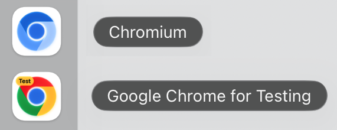

import Tabs from '@theme/Tabs';
import TabItem from '@theme/TabItem';
import HTMLCard from '@site/src/components/HTMLCard';

import LiteYouTube from '@site/src/components/LiteYouTube';

## Версия 1.65

### 🧾 Код локатора на Python

Локатор, полученный с помощью [locator.normalize()](/api/class-locator.mdx#locator-normalize), теперь преобразуется в строку с кодом Python. Используйте его вместе с [page.get_by_ref()](/api/class-page.mdx#page-get-by-ref), чтобы преобразовать элемент, выбранный агентом из [page.aria_snapshot()](/api/class-page.mdx#page-aria-snapshot) в режиме `"ai"`, в код для вашего теста:

```python
normalized = page.get_by_ref("e2").normalize()
print(str(normalized))
# get_by_role("button", name="Submit")
```

### Новые API
- Новый параметр [timeout](/api/class-cdpsession.mdx#cdp-session-send-option-timeout) в [cdp_session.send()](/api/class-cdpsession.mdx#cdp-session-send).

### Критические изменения ⚠️
- Действия, такие как [locator.click()](/api/class-locator.mdx#locator-click), [locator.check()](/api/class-locator.mdx#locator-check), [locator.tap()](/api/class-locator.mdx#locator-tap), [locator.fill()](/api/class-locator.mdx#locator-fill), [locator.clear()](/api/class-locator.mdx#locator-clear) и [locator.select_option()](/api/class-locator.mdx#locator-select-option), теперь ожидают, пока элемент [перестанет быть инертным](./actionability.mdx#not-inert). Действие над элементом с атрибутом `inert` или внутри такого элемента теперь завершается по тайм-ауту, если элемент остаётся инертным.
- Сопоставление файлов cookie теперь соответствует RFC 6265. При передаче URL методы [browser_context.cookies()](/api/class-browsercontext.mdx#browser-context-cookies) и [api_request_context.cookies()](/api/class-apirequestcontext.mdx#api-request-context-cookies) больше не возвращают файлы cookie, предназначенные только для конкретного хоста, для поддоменов или файлы cookie с `Path=/api` для `/apiv2`, а файл cookie с `Path=/foo/` не соответствует `/foo`. [APIRequestContext] отправляет файл cookie без имени как `Cookie: x` вместо `Cookie: =x` и сохраняет `Set-Cookie: token` как файл cookie без имени.
- Учётные данные прокси больше не отправляются веб-сайтам. Учётные данные из параметра [proxy](/api/class-browsertype.mdx#browser-type-launch-option-proxy) теперь используются только для ответа на запросы аутентификации прокси. Для аутентификации на веб-сайте используйте [http_credentials](/api/class-browser.mdx#browser-new-context-option-http-credentials).
- Текст, который браузер не отображает, например текст, не назначенный слоту, или текст непосредственно внутри закрытого `<details>`, больше не включается в доступные имена и ARIA-снимки. Это может изменить результаты [page.get_by_role()](/api/class-page.mdx#page-get-by-role) с указанием имени, [locator.aria_snapshot()](/api/class-locator.mdx#locator-aria-snapshot) и [expect(locator).to_match_aria_snapshot()](/api/class-locatorassertions.mdx#locator-assertions-to-match-aria-snapshot).
- Строковые значения параметра `params` в запросах [APIRequestContext] теперь добавляются к уже имеющейся в URL строке запроса, а не заменяют её.

### Версии браузеров
- Chromium 158.0.8127.18
- Mozilla Firefox 159.0
- WebKit 27.2

Эта версия также была протестирована со следующими стабильными каналами:
- Google Chrome 157
- Microsoft Edge 156

## Версия 1.64

### 🧰 WebMCP

Новые [page.webmcp](/api/class-page.mdx#page-webmcp) и [frame.webmcp](/api/class-frame.mdx#frame-webmcp) предоставляют доступ к инструментам, которые страница регистрирует через экспериментальный браузерный API [WebMCP](https://webmachinelearning.github.io/webmcp/), чтобы вы могли тестировать их, как любую другую часть приложения:

```python
browser = chromium.launch(args=["--enable-features=WebMCP"])
page = browser.new_page()
page.goto("https://example.com")

for tool in page.webmcp.tools():
    print(tool["name"], tool["description"])

result = page.webmcp.call_tool("add", {"a": 2, "b": 40})
print(result["content"][0]["text"])  # "42"
```

[Playwright MCP](./getting-started-mcp.mdx) также поддерживает WebMCP по умолчанию: инструменты, определённые страницей, предоставляются агенту под именами `webmcp_<tool>`. Для отключения передайте `--no-webmcp`.

[`playwright-cli`](./getting-started-cli.mdx) также предоставляет к ним доступ:

```bash
playwright-cli webmcp-list
playwright-cli webmcp-call search_catalog --params '{"query":"cats"}'
```

### 🎬 Улучшенная видеозапись

Теперь видео можно записывать с пользовательской частотой кадров, а оформление действий задаётся с помощью обычного CSS:

```python
page.screencast.start(path="video.webm", size={"width": 1920, "height": 1080}, fps=60)
page.screencast.show_actions(
    style={
        "point": "width: 20px; height: 20px; border-radius: 50%; background: red",
        "highlight": "outline: 2px solid #333; background: rgba(0, 128, 255, .15)",
        "title": "font-size: 16px",
    }
)
```

- Новый параметр [record_video_fps](/api/class-browser.mdx#browser-new-context-option-record-video-fps) и новый параметр [fps](/api/class-screencast.mdx#screencast-start-option-fps) в [screencast.start()](/api/class-screencast.mdx#screencast-start). Firefox и WebKit в настоящее время записывают до 25 кадров в секунду.
- Новый параметр [style](/api/class-screencast.mdx#screencast-show-actions-option-style) принимает CSS-объявления для маркера `point`, подсветки целевого элемента `highlight` и заголовка действия `title`. Он заменяет параметр `font_size`, который теперь считается устаревшим.
- Курсор остаётся видимым в точке последнего действия, сохраняется при переходах между страницами и перемещается по естественной траектории с плавным ускорением и замедлением.
- Видео кодируются с помощью VP9 вместо VP8, что снижает нагрузку на процессор и создаёт файлы меньшего размера с тем же или более высоким качеством.
- Все параметры видео также доступны в [Playwright MCP](./getting-started-mcp.mdx) и [`playwright-cli`](./getting-started-cli.mdx).

### 🪆 Locator.within()

Новый [locator.within()](/api/class-locator.mdx#locator-within) объединяет два уже имеющихся локатора в естественном порядке чтения — «эта кнопка внутри того диалогового окна»:

```python
save_button = page.get_by_role("button", name="Save")
dialog = page.get_by_test_id("settings-dialog")

save_button.within(dialog).click()
```

Относительные локаторы, такие как [locator.nth()](/api/class-locator.mdx#locator-nth) или [locator.first](/api/class-locator.mdx#locator-first), разрешаются отдельно внутри каждого родительского элемента, что упрощает запросы для выбора столбцов:

```python
# Третья ячейка каждой строки, а не третья ячейка таблицы.
third_column = page.get_by_role("cell").nth(2).within(page.get_by_role("row"))
expect(third_column).to_have_text(["Apple", "Banana", "Cherry"])
```

### Новые API
- Новый [page.get_by_ref()](/api/class-page.mdx#page-get-by-ref) находит элемент по его ARIA-ссылке, например `e2`, которую возвращает [page.aria_snapshot()](/api/class-page.mdx#page-aria-snapshot) в режиме `"ai"`.
- Новый параметр [include_shadow](/api/class-page.mdx#page-content-option-include-shadow) в [page.content()](/api/class-page.mdx#page-content) и [frame.content()](/api/class-frame.mdx#frame-content) сериализует открытые теневые корни в виде [декларативного теневого DOM](https://developer.mozilla.org/en-US/docs/Web/API/Web_components/Using_shadow_DOM#declaratively_with_html).
- Новый параметр [sign_count](/api/class-credentials.mdx#credentials-create-option-sign-count) задаёт начальное значение счётчика подписей для виртуальных учётных данных. [credentials.create()](/api/class-credentials.mdx#credentials-create) и [credentials.get()](/api/class-credentials.mdx#credentials-get) возвращают текущее значение `sign_count`, которое сохраняется и восстанавливается вместе с учётными данными в состоянии хранилища.
- Новые [api_request_context.add_cookies()](/api/class-apirequestcontext.mdx#api-request-context-add-cookies), [api_request_context.cookies()](/api/class-apirequestcontext.mdx#api-request-context-cookies) и [api_request_context.clear_cookies()](/api/class-apirequestcontext.mdx#api-request-context-clear-cookies) управляют файлами cookie контекста запросов аналогично методам [BrowserContext]:
  
  ```python
  request.add_cookies(
      [{"name": "session-id", "value": "42", "url": "https://example.com"}]
  )
  print(request.cookies("https://example.com"))
  request.clear_cookies(name="session-id")
  ```
  
### Критические изменения ⚠️
- Элементы внутри скрытых iframe считаются скрытыми. Элементы внутри невидимого iframe, например с `visibility: hidden`, теперь считаются скрытыми при выполнении действий, а также при вызовах [locator.is_visible()](/api/class-locator.mdx#locator-is-visible) и [expect(locator).to_be_visible()](/api/class-locatorassertions.mdx#locator-assertions-to-be-visible).

### Версии браузеров
- Chromium 156.0.8078.4
- Mozilla Firefox 157.0
- WebKit 27.2

Эта версия также была протестирована со следующими стабильными каналами:
- Google Chrome 155
- Microsoft Edge 155

## Версия 1.63

### 🪟 Поиск в разных фреймах

[page.frame_locator()](/api/class-page.mdx#page-frame-locator) и [frame.frame_locator()](/api/class-frame.mdx#frame-frame-locator), вызванные без селектора, выполняют поиск в любом фрейме поддерева, поэтому сначала находить iframe больше не требуется:

```python
# Находит кнопку в любом фрейме на странице.
page.frame_locator().get_by_role("button").click()
```

Оставшаяся часть локатора разрешается внутри одного фрейма, как и обычный локатор; если совпадающие элементы найдены в нескольких фреймах, возникает ошибка.

### 👁️ Локаторы только для видимых элементов

Новый [locator.visible](/api/class-locator.mdx#locator-visible) возвращает локатор, соответствующий только видимым элементам. Его рекомендуется использовать вместо CSS-псевдокласса `:visible`:

```python
page.locator("button").visible.click()
```

### 🖼️ ARIA-снимки и снимки экрана в трассировках

Новые параметры [aria_snapshots](/api/class-tracing.mdx#tracing-start-option-aria-snapshots) и [screen_snapshots](/api/class-tracing.mdx#tracing-start-option-screen-snapshots) метода [tracing.start()](/api/class-tracing.mdx#tracing-start) сохраняют ARIA-снимок и снимок экрана страницы при каждом действии:

```python
context.tracing.start(snapshots=True, aria_snapshots=True, screen_snapshots=True)
```

Если ARIA-снимки и снимки экрана записаны, новый режим **Display Aria** в просмотрщике трассировок показывает снимок экрана действия рядом с ARIA-снимком, а при наведении на ARIA-узел он подсвечивается на снимке экрана.

### Новые API

#### Браузер и контекст
- [http_credentials](/api/class-browser.mdx#browser-new-context-option-http-credentials) теперь также принимает массив учётных данных. Используется первая запись, соответствующая источнику запроса, а записи без указания источника соответствуют любому запросу.
- Новый параметр [opfs](/api/class-browsercontext.mdx#browser-context-storage-state-option-opfs) включает [закрытую файловую систему источника](https://developer.mozilla.org/en-US/docs/Web/API/File_System_API/Origin_private_file_system) в состояние хранилища, позволяя сохранять её и восстанавливать в последующих контекстах.
- Новые события [page.on("dialogclosed")](/api/class-page.mdx#page-event-dialog-closed) и [browser_context.on("dialogclosed")](/api/class-browsercontext.mdx#browser-context-event-dialog-closed) генерируются, когда диалоговое окно JavaScript принимается, отклоняется или закрывается пользователем.

#### Командная строка
- `playwright install --no-remove` сохраняет браузеры других установок Playwright вместо их удаления.
- `playwright codegen --http-credentials` записывает действия на страницах, защищённых HTTP-аутентификацией.

### Объявления
* ⚠️ Ubuntu 20.04 больше не поддерживается.
* 🐧 На Linux arm64 Playwright теперь загружает сборку Chromium [Chrome for Testing](https://developer.chrome.com/blog/chrome-for-testing) — ту же сборку, которая используется на всех остальных платформах.

### Версии браузеров
- Chromium 153.0.8010.12
- Mozilla Firefox 155.0
- WebKit 26.6

Эта версия также была протестирована со следующими стабильными каналами:
- Google Chrome 153
- Microsoft Edge 153

## Версия 1.62

### 🖼️ Снимки экрана в формате WebP

[page.screenshot()](/api/class-page.mdx#page-screenshot) и [locator.screenshot()](/api/class-locator.mdx#locator-screenshot) теперь могут создавать снимки экрана в формате WebP — Playwright определяет формат по расширению файла `.webp`, либо вы можете явно задать `type`. Качество `100` (по умолчанию) обеспечивает сжатие без потерь, а при меньших значениях используется сжатие с потерями:

```python
page.screenshot(path="homepage.webp", quality=50)
```

### Новые API
- Новый параметр `scroll` (`"auto"` | `"none"`) в действиях позволяет отключить автоматическую прокрутку Playwright для появления элемента в области видимости.
- Новый [locator.wait_for_function()](/api/class-locator.mdx#locator-wait-for-function) ожидает, пока функция, вызываемая с соответствующим элементом, не вернёт значение, приводимое к истине.
- Новый [api_response.timing](/api/class-apiresponse.mdx#api-response-timing) возвращает информацию о временных характеристиках загрузки ресурса для ответа API.

### Объявления
* 📋 В режиме без графического интерфейса буфер обмена теперь изолирован от операционной системы, поэтому тесты, использующие `navigator.clipboard`, больше не читают и не перезаписывают буфер обмена компьютера, на котором выполняются.
* ⚠️ Debian 11 больше не поддерживается.

### Версии браузеров
- Chromium 151.0.7922.34
- Mozilla Firefox 153.0
- WebKit 26.5

Эта версия также была протестирована со следующими стабильными каналами:
- Google Chrome 151
- Microsoft Edge 151

## Версия 1.61

### 🔑 Ключи доступа WebAuthn

Новый виртуальный аутентификатор [Credentials], доступный через [browser_context.credentials](/api/class-browsercontext.mdx#browser-context-credentials), позволяет тестам регистрировать ключи доступа и отвечать на запросы `navigator.credentials.create()` / `navigator.credentials.get()` на странице — без реального аппаратного ключа, во всех браузерах:

```python
context = browser.new_context()

# Добавьте ключ доступа, подготовленный сервером для тестового пользователя.
context.credentials.create("example.com",
    id=credential_id,
    user_handle=user_handle,
    private_key=private_key,
    public_key=public_key,
)
context.credentials.install()

page = context.new_page()
page.goto("https://example.com/login")
# На вызов navigator.credentials.get() страницы поступает ответ с добавленным ключом доступа.
```

Вы также можете позволить приложению один раз зарегистрировать ключ доступа в подготовительном тесте, прочитать его с помощью [credentials.get()](/api/class-credentials.mdx#credentials-get) и добавить его в последующие тесты — подробности см. в [Credentials].

### 🗃️ Web Storage

Новый API [WebStorage], доступный через [page.local_storage](/api/class-page.mdx#page-local-storage) и [page.session_storage](/api/class-page.mdx#page-session-storage), читает и записывает данные в хранилище страницы для текущего источника:

```python
page.local_storage.set_item("token", "abc")
token = page.local_storage.get_item("token")
items = page.session_storage.items()
```

### Новые API
- [api_response.security_details()](/api/class-apiresponse.mdx#api-response-security-details) и [api_response.server_addr()](/api/class-apiresponse.mdx#api-response-server-addr) аналогичны браузерным методам [response.security_details()](/api/class-response.mdx#response-security-details) и [response.server_addr()](/api/class-response.mdx#response-server-addr).
- Новый параметр `artifacts_dir` в [browser_type.connect_over_cdp()](/api/class-browsertype.mdx#browser-type-connect-over-cdp) управляет местом хранения артефактов, таких как трассировки и загрузки, при подключении к уже запущенному браузеру.
- Новый параметр `cursor` в [screencast.show_actions()](/api/class-screencast.mdx#screencast-show-actions) управляет отображением курсора при действиях указателя.
- Функция обратного вызова `on_frame` в [screencast.start()](/api/class-screencast.mdx#screencast-start) теперь получает `timestamp` — временную метку момента, когда браузер отобразил кадр.

### 🛠️ Другие улучшения
- Playwright теперь поддерживает Ubuntu 26.04.
- Записи HAR и трассировок теперь включают запросы WebSocket.

### Версии браузеров
- Chromium 149.0.7827.55
- Mozilla Firefox 151.0
- WebKit 26.5

Эта версия также была протестирована со следующими стабильными каналами:
- Google Chrome 149
- Microsoft Edge 149

## Версия 1.60

### 🌐 Запись HAR через Tracing

[tracing.start_har()](/api/class-tracing.mdx#tracing-start-har) / [tracing.stop_har()](/api/class-tracing.mdx#tracing-stop-har) предоставляют запись HAR как полноценную часть API трассировки с теми же параметрами `content`, `mode` и `url_filter`, что и у `record_har`:

```python
context.tracing.start_har("trace.har")
page = context.new_page()
page.goto("https://playwright.dev")
context.tracing.stop_har()
```

### 🪝 API Drop

Новый [locator.drop()](/api/class-locator.mdx#locator-drop) имитирует внешнее перетаскивание файлов или данных, подобных содержимому буфера обмена, на элемент. Playwright отправляет события `dragenter`, `dragover` и `drop` с синтетическим [DataTransfer] в контексте страницы — это работает во всех браузерах и отлично подходит для тестирования областей загрузки:

```python
page.locator("#dropzone").drop(
    files={"name": "note.txt", "mime_type": "text/plain", "buffer": b"hello"},
)

page.locator("#dropzone").drop(
    data={
        "text/plain": "hello world",
        "text/uri-list": "https://example.com",
    },
)
```

### 🎯 ARIA-снимки
- [expect(page).to_match_aria_snapshot()](/api/class-pageassertions.mdx#page-assertions-to-match-aria-snapshot) теперь работает с [Page], а не только с [Locator] — это эквивалентно проверке для `page.locator("body")`.
- Новый параметр `boxes` в [locator.aria_snapshot()](/api/class-locator.mdx#locator-aria-snapshot) / [page.aria_snapshot()](/api/class-page.mdx#page-aria-snapshot) добавляет ограничивающий прямоугольник каждого элемента в виде `[box=x,y,width,height]`, что полезно для обработки искусственным интеллектом.

### Новые API

#### Браузер, контекст и страница
- Событие [browser.on("context")](/api/class-browser.mdx#browser-event-context) — возникает при создании нового контекста в браузере.
- [BrowserContext] теперь дублирует события жизненного цикла своих страниц: [browser_context.on("download")](/api/class-browsercontext.mdx#browser-context-event-download), [browser_context.on("frameattached")](/api/class-browsercontext.mdx#browser-context-event-frame-attached), [browser_context.on("framedetached")](/api/class-browsercontext.mdx#browser-context-event-frame-detached), [browser_context.on("framenavigated")](/api/class-browsercontext.mdx#browser-context-event-frame-navigated), [browser_context.on("pageclose")](/api/class-browsercontext.mdx#browser-context-event-page-close), [browser_context.on("pageload")](/api/class-browsercontext.mdx#browser-context-event-page-load).

#### Локаторы и проверки
- Новый параметр `description` в [page.get_by_role()](/api/class-page.mdx#page-get-by-role) / [locator.get_by_role()](/api/class-locator.mdx#locator-get-by-role) / [frame.get_by_role()](/api/class-frame.mdx#frame-get-by-role) / [frame_locator.get_by_role()](/api/class-framelocator.mdx#frame-locator-get-by-role) для сопоставления по [доступному описанию](https://www.w3.org/TR/wai-aria-1.2/#dfn-accessible-description).
- Новый параметр `pseudo` в [expect(locator).to_have_css()](/api/class-locatorassertions.mdx#locator-assertions-to-have-css) считывает вычисленные стили `::before` или `::after`.
- Новый параметр `style` в [locator.highlight()](/api/class-locator.mdx#locator-highlight) применяет дополнительный встроенный CSS к слою подсветки, а новый [page.hide_highlight()](/api/class-page.mdx#page-hide-highlight) убирает всю подсветку.

#### Сеть
- [web_socket_route.protocols](/api/class-websocketroute.mdx#web-socket-route-protocols) возвращает подпротоколы WebSocket, запрошенные страницей.
- Новый параметр `no_defaults` в [browser_type.connect_over_cdp()](/api/class-browsertype.mdx#browser-type-connect-over-cdp) отключает стандартные переопределения Playwright в контексте по умолчанию (поведение загрузок, эмуляцию фокуса, эмуляцию медиапараметров), чтобы подключение к повседневному браузеру пользователя не нарушало его состояние.

#### Ошибки
- Новый [web_error.location](/api/class-weberror.mdx#web-error-location) аналогичен [console_message.location](/api/class-consolemessage.mdx#console-message-location).
- [console_message.location](/api/class-consolemessage.mdx#console-message-location) теперь предоставляет свойства `line` / `column` (`line_number` / `column_number` считаются устаревшими).

### 🛠️ Другие улучшения
- В просмотрщик трассировок добавлен переключатель форматирования тел запросов и ответов в формате JSON / данных форм на панели сведений о сети.

### Критические изменения ⚠️
- Удалён давно устаревший параметр `handle` в `BrowserContext.expose_binding` и `Page.expose_binding`.

### Версии браузеров
- Chromium 148.0.7778.96
- Mozilla Firefox 150.0.2
- WebKit 26.4

Эта версия также была протестирована со следующими стабильными каналами:
- Google Chrome 147
- Microsoft Edge 147

## Версия 1.59

### 🎬 Скринкаст

Новый API [page.screencast](/api/class-page.mdx#page-screencast) предоставляет единый интерфейс для захвата содержимого страницы со следующими возможностями:
- Запись скринкастов
- Аннотации действий
- Визуальные наложения
- Захват кадров в реальном времени
- Видеоподтверждения работы агентов

<center>


</center>

**Запись скринкастов** — записывайте видео с точным управлением началом и остановкой записи в качестве альтернативы параметру [record_video_dir](/api/class-browser.mdx#browser-new-context-option-record-video-dir):

```python
page.screencast.start(path="video.webm")
# ... выполните действия ...
page.screencast.stop()
```

**Аннотации действий** — включите встроенные визуальные аннотации, которые подсвечивают элементы, с которыми выполняется взаимодействие, и отображают заголовки действий во время записи:

```python
page.screencast.show_actions(position="top-right")
```

[screencast.show_actions()](/api/class-screencast.mdx#screencast-show-actions) принимает `position` (`'top-left'`, `'top'`, `'top-right'`, `'bottom-left'`, `'bottom'`, `'bottom-right'`), `duration` (длительность каждой аннотации в мс) и `font_size` (в пикселях). Возвращает объект, освобождение которого прекращает отображение действий.

**Визуальные наложения** — добавляйте заголовки глав и пользовательские HTML-наложения поверх страницы для более подробного пояснения происходящего:

```python
page.screencast.show_chapter("Adding TODOs",
    description="Type and press enter for each TODO",
    duration=1000,
)

page.screencast.show_overlay('<div style="color: red">Recording</div>')
```

**Захват кадров в реальном времени** — передавайте поток кадров в формате JPEG для собственной обработки: создания миниатюр, предварительного просмотра в реальном времени, компьютерного зрения на основе ИИ и других задач:

```python
page.screencast.start(
    on_frame=lambda frame: send_to_vision_model(frame["data"]),
)
```

**Видеоподтверждения работы агентов** — агенты программирования могут создавать видеодоказательства своей работы. После выполнения задачи агент может записать демонстрационное видео с подробными аннотациями для проверки человеком:

```python
page.screencast.start(path="receipt.webm")
page.screencast.show_actions(position="top-right")

page.screencast.show_chapter("Verifying checkout flow",
    description="Added coupon code support per ticket #1234",
)

# Агент выполняет шаги проверки...
page.locator("#coupon").fill("SAVE20")
page.locator("#apply-coupon").click()
expect(page.locator(".discount")).to_contain_text("20%")

page.screencast.show_chapter("Done",
    description="Coupon applied, discount reflected in total",
)

page.screencast.stop()
```

Полученное видео служит подтверждением работы: заголовки глав дают контекст, аннотации действий выделяют каждое взаимодействие, а просмотр наглядной демонстрации занимает меньше времени, чем чтение текстовых журналов.

### 🔍 Снимки и локаторы
- Метод [page.aria_snapshot()](/api/class-page.mdx#page-aria-snapshot) для получения ARIA-снимка страницы — эквивалентен `page.locator('body').aria_snapshot()`.
- Параметры `depth` и `mode` в [locator.aria_snapshot()](/api/class-locator.mdx#locator-aria-snapshot).
- Метод [locator.normalize()](/api/class-locator.mdx#locator-normalize) преобразует локатор в соответствии с рекомендуемыми практиками, такими как использование тестовых идентификаторов и ARIA-ролей.
- Метод [page.pick_locator()](/api/class-page.mdx#page-pick-locator) включает интерактивный режим, в котором при наведении на элементы они подсвечиваются и отображается соответствующий локатор. Нажмите на элемент, чтобы получить его [Locator]. Используйте [page.cancel_pick_locator()](/api/class-page.mdx#page-cancel-pick-locator) для отмены.

### Новые API

#### Скринкаст
- [page.screencast](/api/class-page.mdx#page-screencast) предоставляет запись видео, потоковую передачу кадров в реальном времени и управление наложениями.
- Методы [screencast.start()](/api/class-screencast.mdx#screencast-start) и [screencast.stop()](/api/class-screencast.mdx#screencast-stop) для записи и захвата кадров.
- Методы [screencast.show_actions()](/api/class-screencast.mdx#screencast-show-actions) и [screencast.hide_actions()](/api/class-screencast.mdx#screencast-hide-actions) для аннотаций действий.
- Методы [screencast.show_chapter()](/api/class-screencast.mdx#screencast-show-chapter) и [screencast.show_overlay()](/api/class-screencast.mdx#screencast-show-overlay) для визуальных наложений.
- Методы [screencast.show_overlays()](/api/class-screencast.mdx#screencast-show-overlays) и [screencast.hide_overlays()](/api/class-screencast.mdx#screencast-hide-overlays) для управления видимостью наложений.

#### Хранилище, консоль и ошибки
- Метод [browser_context.set_storage_state()](/api/class-browsercontext.mdx#browser-context-set-storage-state) очищает существующие файлы cookie, локальное хранилище и IndexedDB для всех источников и задаёт новое состояние хранилища — создавать новый контекст не требуется.
- Методы [page.clear_console_messages()](/api/class-page.mdx#page-clear-console-messages) и [page.clear_page_errors()](/api/class-page.mdx#page-clear-page-errors) для очистки сохранённых сообщений и ошибок.
- Параметр `filter` в [page.console_messages()](/api/class-page.mdx#page-console-messages) и [page.page_errors()](/api/class-page.mdx#page-page-errors) управляет тем, какие сообщения возвращаются.
- Метод [console_message.timestamp](/api/class-consolemessage.mdx#console-message-timestamp).

#### Прочее
- [browser_context.debugger](/api/class-browsercontext.mdx#browser-context-debugger) предоставляет программное управление отладчиком Playwright.
- Метод [browser_context.is_closed()](/api/class-browsercontext.mdx#browser-context-is-closed).
- Метод [request.existing_response](/api/class-request.mdx#request-existing-response) возвращает ответ без ожидания.
- Метод [response.http_version()](/api/class-response.mdx#response-http-version) возвращает версию HTTP, использованную в ответе.
- Параметр `live` в [tracing.start()](/api/class-tracing.mdx#tracing-start) для обновления трассировки в реальном времени.
- Параметр `artifacts_dir` в [browser_type.launch()](/api/class-browsertype.mdx#browser-type-launch) для настройки каталога артефактов.

### 🔗 Взаимодействие с другими инструментами

Новый API [browser.bind()](/api/class-browser.mdx#browser-bind) делает запущенный браузер доступным для подключения из `playwright-cli`, `@playwright/mcp` и других клиентов.

**Привязка браузера** — запустите браузер и привяжите его, чтобы к нему могли подключаться другие клиенты:

```python
server_info = await browser.bind("my-session",
    workspace_dir="/my/project",
)
```

**Подключение из playwright-cli** — подключитесь к работающему браузеру из вашего любимого агента программирования.

```bash
playwright-cli attach my-session
playwright-cli -s my-session snapshot
```

**Подключение из @playwright/mcp** — или направьте ваш MCP-сервер к работающему браузеру.

```bash
@playwright/mcp --endpoint=my-session
```

**Подключение из клиента Playwright** — используйте API для подключения к браузеру. Поддерживается одновременное подключение нескольких клиентов!

```python
browser = await chromium.connect(server_info["endpoint"])
```

Передайте параметры `host` и `port` для привязки через WebSocket вместо именованного канала:

```python
server_info = await browser.bind("my-session",
    host="localhost",
    port=0,
)
# server_info["endpoint"] — это URL вида ws://
```

Вызовите [browser.unbind()](/api/class-browser.mdx#browser-unbind), чтобы прекратить принимать новые подключения.

### 📊 Наблюдаемость

Выполните `playwright-cli show`, чтобы открыть панель управления, которая показывает все привязанные браузеры, их состояния и позволяет взаимодействовать с ними:
- Наблюдайте за действиями вашего агента в фоновых браузерах
- Открывайте сеансы для ручного вмешательства
- Открывайте DevTools для исследования страниц фоновых браузеров.

<center>


</center>
- `playwright-cli` автоматически привязывает все свои браузеры, чтобы вы могли видеть, что делают ваши агенты.
- Передайте переменную окружения `PLAYWRIGHT_DASHBOARD=1`, чтобы видеть все браузеры `@playwright/test` на панели управления.

### Критические изменения ⚠️
- Удалена поддержка macOS 14 для WebKit. Рекомендуем обновить версию macOS или продолжать использовать более старую версию Playwright.

### Версии браузеров
- Chromium 147.0.7727.15
- Mozilla Firefox 148.0.2
- WebKit 26.4

Эта версия также была протестирована со следующими стабильными каналами:
- Google Chrome 146
- Microsoft Edge 146

## Версия 1.58

### Улучшения режима UI и просмотрщика трассировок
- Новый вариант темы 'system' следует настройке тёмного/светлого режима вашей ОС
- В редакторах кода теперь доступен поиск (Cmd/Ctrl+F)
- Панель сведений о сети реорганизована для более удобного использования
- Ответы JSON теперь автоматически форматируются для удобства чтения

Спасибо [@cpAdm](https://github.com/cpAdm) за вклад в эти улучшения!

### Прочее

[browser_type.connect_over_cdp()](/api/class-browsertype.mdx#browser-type-connect-over-cdp) теперь принимает параметр `is_local`. Значение `True` сообщает Playwright, что он работает на том же хосте, что и CDP-сервер, позволяя применять оптимизации файловой системы.

### Критические изменения ⚠️
- Удалены селекторы `_react` и `_vue`. Альтернативы см. в [руководстве по локаторам](./locators.mdx).
- Удалён суффикс движка селекторов `:light`. Вместо него используйте стандартные CSS-селекторы.
- Удалён параметр `devtools` из [browser_type.launch()](/api/class-browsertype.mdx#browser-type-launch). Вместо него используйте `args=['--auto-open-devtools-for-tabs']`.
- Удалена поддержка macOS 13 для WebKit. Рекомендуем обновить версию macOS или продолжать использовать более старую версию Playwright.

### Версии браузеров
- Chromium 145.0.7632.6
- Mozilla Firefox 146.0.1
- WebKit 26.0

Эта версия также была протестирована со следующими стабильными каналами:
- Google Chrome 144
- Microsoft Edge 144

## Версия 1.57

### Chrome for Testing

Playwright теперь работает на сборках [Chrome for Testing](https://googlechromelabs.github.io/chrome-for-testing/), а не Chromium. В режиме с графическим интерфейсом используется `chrome`, а в режиме без графического интерфейса — `chrome-headless-shell`. Существующие тесты должны продолжить успешно выполняться после обновления до v1.57.

Мы не ожидаем функциональных изменений в результате этого перехода. Самое заметное изменение — новая иконка и заголовок на панели инструментов.



Если вы всё же заметите неожиданное изменение поведения, пожалуйста, [создайте issue](https://github.com/microsoft/playwright/issues/new).

На Arm64 Linux Playwright продолжает использовать Chromium.

### Критическое изменение

После трёх лет в статусе устаревшего API мы удалили `page.accessibility` из нашего API. Если вам нужно тестировать доступность страниц, используйте другие библиотеки, например [Axe](https://www.deque.com/axe/). Интеграция с Axe описана в нашем [руководстве](https://playwright.dev/docs/accessibility-testing) для Node.js.

### Новые API
- Событие [worker.on("console")](/api/class-worker.mdx#worker-event-console) генерируется, когда JavaScript внутри воркера вызывает один из методов API консоли, например console.log или console.dir. Для ожидания этого события можно использовать [worker.expect_event()](/api/class-worker.mdx#worker-wait-for-event).
- [locator.description](/api/class-locator.mdx#locator-description) возвращает описание локатора, ранее заданное с помощью [locator.describe()](/api/class-locator.mdx#locator-describe).
- Новый параметр [steps](/api/class-locator.mdx#locator-click-option-steps) в [locator.click()](/api/class-locator.mdx#locator-click) и [locator.drag_to()](/api/class-locator.mdx#locator-drag-to) настраивает количество событий `mousemove`, генерируемых при перемещении указателя мыши к целевому элементу.
- Сетевые запросы, отправляемые [Service Workers](./service-workers.mdx#network-events-and-routing), теперь отслеживаются и могут маршрутизироваться через [BrowserContext](./api/class-browsercontext.mdx), только в Chromium. Это поведение можно отключить с помощью переменной окружения `PLAYWRIGHT_DISABLE_SERVICE_WORKER_NETWORK`.
- Сообщения консоли от Service Workers передаются через [worker.on("console")](/api/class-worker.mdx#worker-event-console). Это поведение можно отключить с помощью переменной окружения `PLAYWRIGHT_DISABLE_SERVICE_WORKER_CONSOLE`.

### Версии браузеров
- Chromium 143.0.7499.4
- Mozilla Firefox 144.0.2
- WebKit 26.0

## Версия 1.56 {/* #version-156 */}

### Новые API {#new-apis}
- Новые методы [page.console_messages()](/api/class-page.mdx#page-console-messages) и [page.page_errors()](/api/class-page.mdx#page-page-errors) для получения самых последних сообщений консоли со страницы
- Новый метод [page.requests()](/api/class-page.mdx#page-requests) для получения самых последних сетевых запросов со страницы

### Несовместимые изменения {#breaking-changes}
- Событие [browser_context.on("backgroundpage")](/api/class-browsercontext.mdx#browser-context-event-background-page) объявлено устаревшим и больше не будет испускаться. Метод [browser_context.background_pages](/api/class-browsercontext.mdx#browser-context-background-pages) будет возвращать пустой список

### Другие изменения {#miscellaneous}
- Снимки Aria отображают и сравнивают `placeholder` у `input`

### Версии браузеров {#browser-versions}
- Chromium 141.0.7390.37
- Mozilla Firefox 142.0.1
- WebKit 26.0

## Версия 1.55 {#version-155}

### Генерация кода {#codegen}
- Автоматические проверки `to_be_visible()`: Codegen теперь может генерировать автоматические проверки `to_be_visible()` для распространённых UI-взаимодействий. Эту функцию можно включить в интерфейсе настроек Codegen.

### Несовместимые изменения {#breaking-changes-1}
- ⚠️ Прекращена поддержка манифеста расширений Chromium v2.

### Другие изменения {#miscellaneous-1}
- Добавлена поддержка Debian 13 «Trixie».

### Версии браузеров {#browser-versions-1}
- Chromium 140.0.7339.16
- Mozilla Firefox 141.0
- WebKit 26.0

Эта версия также была протестирована со следующими стабильными каналами:
- Google Chrome 139
- Microsoft Edge 139

## Версия 1.54 {#version-154}

### Основные моменты {#highlights}
- Новое свойство cookie `partition_key` в [browser_context.cookies()](/api/class-browsercontext.mdx#browser-context-cookies) и [browser_context.add_cookies()](/api/class-browsercontext.mdx#browser-context-add-cookies). Это свойство позволяет сохранять и восстанавливать разделённые cookies. Подробнее см. статью [CHIPS на MDN](https://developer.mozilla.org/en-US/docs/Web/Privacy/Guides/Privacy_sandbox/Partitioned_cookies). Обратите внимание, что браузеры по-разному поддерживают разделение cookies и имеют разные значения по умолчанию.
- Новая опция `--user-data-dir` в нескольких командах. Вы можете указать один и тот же каталог пользовательских данных, чтобы повторно использовать состояние браузинга, например аутентификацию, между сессиями.
  
  ```bash
  playwright codegen --user-data-dir=./user-data
  ```
  
- `playwright open` больше не открывает рекордер тестов. Вместо этого используйте `playwright codegen`.

### Версии браузеров {#browser-versions-2}
- Chromium 139.0.7258.5
- Mozilla Firefox 140.0.2
- WebKit 26.0

Эта версия также была протестирована со следующими стабильными каналами:
- Google Chrome 140
- Microsoft Edge 140

## Версия 1.53 {#version-153}

### Обновления Trace Viewer и HTML Reporter {#trace-viewer-and-html-reporter-updates}
- Новые шаги в Trace Viewer: 
- Новый метод [locator.describe()](/api/class-locator.mdx#locator-describe) для описания локатора. Используется в Trace Viewer.

### Обновления Trace Viewer и HTML-отчёта
- Новые шаги в Trace Viewer:
  
  
- Новый метод [locator.describe()](/api/class-locator.mdx#locator-describe) для добавления описания локатора. Это описание используется в Trace Viewer.
  ```python
  button = page.get_by_test_id("btn-sub").describe("Subscribe button")
  button.click()
  ```
  
- `python -m playwright install --list` теперь выводит список всех установленных браузеров, их версий и расположений.

### Версии браузеров {#browser-versions-3}
- Chromium 138.0.7204.4
- Mozilla Firefox 139.0
- WebKit 18.5

Эта версия также была протестирована со следующими стабильными каналами:
- Google Chrome 137
- Microsoft Edge 137

## Версия 1.52 {#version-152}

### Основные моменты {#highlights-1}
- Новый метод [expect(locator).to_contain_class()](/api/class-locatorassertions.mdx#locator-assertions-to-contain-class) для удобной проверки отдельных имён классов у элемента.
  
  ```python
    expect(page.get_by_role('listitem', name='Ship v1.52')).to_contain_class('done')
  ```
  
- В [ARIA-снимках](./aria-snapshots.mdx) появились два новых свойства: [`/children`](./aria-snapshots.mdx#strict-matching) для строгого сопоставления и [`/url`](./aria-snapshots.mdx#links) для ссылок.
  
  ```python
  expect(locator).to_match_aria_snapshot("""
    - list
      - /children: equal
      - listitem: Feature A
      - listitem:
        - link "Feature B":
          - /url: "https://playwright.dev"
  """)
  ```
  
### Разное {#miscellaneous-2}
- Новая опция [max_redirects](/api/class-apirequest.mdx#api-request-new-context-option-max-redirects) в [api_request.new_context()](/api/class-apirequest.mdx#api-request-new-context) для управления максимальным количеством редиректов.

### Несовместимые изменения {#breaking-changes-2}
- Шаблоны URL с glob в методах вроде [page.route()](/api/class-page.mdx#page-route) больше не поддерживают `?` и `[]`. Рекомендуем использовать регулярные выражения.
- Метод [route.continue_()](/api/class-route.mdx#route-continue) больше не позволяет переопределять заголовок `Cookie`. Если заголовок `Cookie` указан, он будет проигнорирован, а cookie будут загружены из хранилища cookies браузера. Чтобы установить пользовательские cookies, используйте [browser_context.add_cookies()](/api/class-browsercontext.mdx#browser-context-add-cookies).
- macOS 13 теперь объявлена устаревшей и больше не будет получать обновления WebKit. Пожалуйста, обновитесь до более новой версии macOS, чтобы продолжать пользоваться последними улучшениями WebKit.

### Версии браузеров {#browser-versions-4}
- Chromium 136.0.7103.25
- Mozilla Firefox 137.0
- WebKit 18.4

Эта версия также была протестирована со следующими стабильными каналами:
- Google Chrome 135
- Microsoft Edge 135

## Версия 1.51 {#version-151}

### Основные моменты {#highlights-2}
* Новая опция [indexed_db](/api/class-browsercontext.mdx#browser-context-storage-state-option-indexed-db) для [browser_context.storage_state()](/api/class-browsercontext.mdx#browser-context-storage-state) позволяет сохранять и восстанавливать содержимое IndexedDB. Полезно, когда ваше приложение использует [IndexedDB API](https://developer.mozilla.org/en-US/docs/Web/API/IndexedDB_API) для хранения токенов аутентификации, таких как Firebase Authentication.
  
  Вот пример, следующий [руководству по аутентификации](./auth.mdx#reusing-signed-in-state):
  
  ```python
  # Сохраните состояние хранилища в файл. Убедитесь, что IndexedDB включен.
  storage = await context.storage_state(path="state.json", indexed_db=True)
  
  # Создайте новый контекст с сохраненным состоянием хранилища.
  context = await browser.new_context(storage_state="state.json")
  ```
  
* Новая опция [visible](/api/class-locator.mdx#locator-filter-option-visible) для [locator.filter()](/api/class-locator.mdx#locator-filter) позволяет сопоставлять только видимые элементы.
  
  ```python
  # Игнорируйте невидимые элементы списка дел.
  todo_items = page.get_by_test_id("todo-item").filter(visible=True)
  # Проверьте, что их ровно 3 видимых.
  await expect(todo_items).to_have_count(3)
  ```
  
* Новая опция `contrast` для методов [page.emulate_media()](/api/class-page.mdx#page-emulate-media) и [browser.new_context()](/api/class-browser.mdx#browser-new-context) позволяет эмулировать медиа-функцию `prefers-contrast`.
* Новая опция [fail_on_status_code](/api/class-apirequest.mdx#api-request-new-context-option-fail-on-status-code) заставляет все запросы fetch, сделанные через [APIRequestContext], выбрасывать исключение на коды ответов, отличные от 2xx и 3xx.

### Версии браузеров {#browser-versions-5}
* Chromium 134.0.6998.35
* Mozilla Firefox 135.0
* WebKit 18.4

Эта версия также была протестирована на следующих стабильных каналах:
* Google Chrome 133
* Microsoft Edge 133

## Версия 1.50 {#version-150}

### Плагин Async Pytest {#async-pytest-plugin}
* [Плагин Pytest для Playwright](./test-runners.mdx) теперь поддерживает [асинхронные фикстуры](https://playwright.dev/python/docs/test-runners#async-fixtures).

### Разное {#miscellaneous-3}
* Добавлен метод [expect(locator).to_have_accessible_error_message()](/api/class-locatorassertions.mdx#locator-assertions-to-have-accessible-error-message) для утверждения, что локатор указывает на элемент с заданным [aria errormessage](https://w3c.github.io/aria/#aria-errormessage).

### Обновления UI {#ui-updates}
* Новая кнопка в Codegen для выбора элементов для создания снимков aria.
* Дополнительные детали (например, нажатые клавиши) теперь отображаются вместе с вызовами API действий в трассах.
* Отображение содержимого `canvas` в трассах подвержено ошибкам. Отображение теперь отключено по умолчанию и может быть включено через настройку UI `Display canvas content`.
* Панели `Call` и `Network` теперь отображают дополнительную информацию о времени.

### Изменения {#breaking}
* [expect(locator).to_be_editable()](/api/class-locatorassertions.mdx#locator-assertions-to-be-editable) и [locator.is_editable()](/api/class-locator.mdx#locator-is-editable) теперь выбрасывают исключение, если целевой элемент не является `<input>`, `<select>` или другим редактируемым элементом.

### Версии браузеров {#browser-versions-6}
* Chromium 133.0.6943.16
* Mozilla Firefox 134.0
* WebKit 18.2

Эта версия также была протестирована на следующих стабильных каналах:
* Google Chrome 132
* Microsoft Edge 132

## Версия 1.49 {#version-149}

### Снимки Aria {#aria-snapshots}

Новое утверждение [expect(locator).to_match_aria_snapshot()](/api/class-locatorassertions.mdx#locator-assertions-to-match-aria-snapshot) проверяет структуру страницы, сравнивая с ожидаемым деревом доступности, представленным в формате YAML.

```python
page.goto("https://playwright.dev")
expect(page.locator('body')).to_match_aria_snapshot('''
  - banner:
    - heading /Playwright enables reliable/ [level=1]
    - link "Get started"
    - link "Star microsoft/playwright on GitHub"
  - main:
    - img "Browsers (Chromium, Firefox, WebKit)"
    - heading "Any browser • Any platform • One API"
''')
```

Вы можете сгенерировать это утверждение с помощью [Генератора тестов](./codegen) или вызвав [locator.aria_snapshot()](/api/class-locator.mdx#locator-aria-snapshot).

Узнайте больше в [руководстве по снимкам aria](./aria-snapshots).

### Группы трассировки {#tracing-groups}

Новый метод [tracing.group()](/api/class-tracing.mdx#tracing-group) позволяет визуально группировать действия в просмотрщике трассировки.

```python
# Все действия между group и group_end
# будут показаны в просмотрщике трассировки как группа.
page.context.tracing.group("Open Playwright.dev > API")
page.goto("https://playwright.dev/")
page.get_by_role("link", name="API").click()
page.context.tracing.group_end()
```

### Изменения: каналы `chrome` и `msedge` переключаются на новый режим без головы {#breaking-chrome-and-msedge-channels-switch-to-new-headless-mode}

Это изменение затрагивает вас, если вы используете один из следующих каналов в вашем `playwright.config.ts`:
- `chrome`, `chrome-dev`, `chrome-beta` или `chrome-canary`
- `msedge`, `msedge-dev`, `msedge-beta` или `msedge-canary`

После обновления до Playwright v1.49 запустите ваш тестовый набор. Если он все еще проходит, вы в порядке. Если нет, вам, вероятно, потребуется обновить ваши снимки и адаптировать часть вашего тестового кода вокруг просмотрщиков PDF и расширений. См. [вопрос #33566](https://github.com/microsoft/playwright/issues/33566) для получения более подробной информации.

### Попробуйте новый режим без головы в Chromium {#try-new-chromium-headless}

Вы можете включить новый режим без головы, используя канал `'chromium'`. Как [говорится в официальной документации Chrome](https://developer.chrome.com/blog/chrome-headless-shell):

> Новый Headless, с другой стороны, это настоящий браузер Chrome, и поэтому он более аутентичен, надежен и предлагает больше функций. Это делает его более подходящим для высокоточных тестов веб-приложений от начала до конца или тестирования расширений браузера.

См. [вопрос #33566](https://github.com/microsoft/playwright/issues/33566) для списка возможных нарушений, с которыми вы можете столкнуться, и более подробной информации о Chromium headless. Пожалуйста, создайте вопрос, если вы заметите какие-либо проблемы после включения.

```bash
pytest test_login.py --browser-channel chromium
```

### Разное {#miscellaneous-4}
- Больше не будет обновлений для WebKit на Ubuntu 20.04 и Debian 11. Мы рекомендуем обновить вашу ОС до более поздней версии.
- Элементы `<canvas>` внутри снимка теперь рисуют предварительный просмотр.
- Python 3.8 больше не поддерживается.

### Версии браузеров {#browser-versions-7}
- Chromium 131.0.6778.33
- Mozilla Firefox 132.0
- WebKit 18.2

Эта версия также была протестирована на следующих стабильных каналах:
- Google Chrome 130
- Microsoft Edge 130

## Версия 1.48 {#version-148}

### Маршрутизация WebSocket {#websocket-routing}

Новые методы [page.route_web_socket()](/api/class-page.mdx#page-route-web-socket) и [browser_context.route_web_socket()](/api/class-browsercontext.mdx#browser-context-route-web-socket) позволяют перехватывать, изменять и имитировать соединения WebSocket, инициированные на странице. Ниже приведен простой пример, который имитирует общение по WebSocket, отвечая на `"request"` с `"response"`.

```python
def message_handler(ws: WebSocketRoute, message: Union[str, bytes]):
  if message == "request":
    ws.send("response")

page.route_web_socket("/ws", lambda ws: ws.on_message(
    lambda message: message_handler(ws, message)
))
```

См. [WebSocketRoute] для получения более подробной информации.

### Обновления UI {#ui-updates-1}
- Новые кнопки "копировать" для аннотаций и местоположения теста в HTML-отчете.
- Вызовы методов маршрутизации, таких как [route.fulfill()](/api/class-route.mdx#route-fulfill), больше не отображаются в отчете и просмотрщике трассировки. Вы можете увидеть, какие сетевые запросы были маршрутизированы, на вкладке сети.
- Новые кнопки "Копировать как cURL" и "Копировать как fetch" для запросов на вкладке сети.

### Разное {#miscellaneous-5}
- Новый метод [page.request_gc()](/api/class-page.mdx#page-request-gc) может помочь обнаружить утечки памяти.
- Запросы, сделанные [APIRequestContext], теперь записывают подробную информацию о времени и безопасности в HAR.

### Версии браузеров {#browser-versions-8}
- Chromium 130.0.6723.19
- Mozilla Firefox 130.0
- WebKit 18.0

Эта версия также была протестирована на следующих стабильных каналах:
- Google Chrome 129
- Microsoft Edge 129

## Версия 1.47 {#version-147}

### Улучшения вкладки сети {#network-tab-improvements}

Вкладка сети в просмотрщике трассировки получила несколько приятных улучшений:
- фильтрация по типу ресурса и URL
- лучшее отображение параметров строки запроса
- предварительный просмотр шрифтовых ресурсов


### Разное {#miscellaneous-6}
- `mcr.microsoft.com/playwright/python:v1.47.0` теперь предоставляет образ Playwright на основе Ubuntu 24.04 Noble. Чтобы использовать образ на основе 22.04 jammy, используйте `mcr.microsoft.com/playwright/python:v1.47.0-jammy`.
- Теги `:latest`/`:focal`/`:jammy` для образов Playwright Docker больше не публикуются. Закрепите на конкретной версии для лучшей стабильности и воспроизводимости.
- Клиентские сертификаты TLS теперь могут передаваться из памяти, передавая [client_certificates.cert](/api/class-browser.mdx#browser-new-context-option-client-certificates) и [client_certificates.key](/api/class-browser.mdx#browser-new-context-option-client-certificates) в виде байтов, а не путей к файлам.
- [no_wait_after](/api/class-locator.mdx#locator-select-option-option-no-wait-after) в [locator.select_option()](/api/class-locator.mdx#locator-select-option) был устаревшим.
- Мы видели сообщения о неправильной работе WebGL в Webkit на GitHub Actions `macos-13`. Мы рекомендуем обновить GitHub Actions до `macos-14`.

### Версии браузеров {#browser-versions-9}
- Chromium 129.0.6668.29
- Mozilla Firefox 130.0
- WebKit 18.0

Эта версия также была протестирована на следующих стабильных каналах:
- Google Chrome 128
- Microsoft Edge 128

## Версия 1.46 {#version-146}

### Клиентские сертификаты TLS {#tls-client-certificates}

Playwright теперь позволяет предоставлять клиентские сертификаты, чтобы сервер мог их проверить, как указано в аутентификации клиента TLS.

Вы можете предоставить клиентские сертификаты в качестве параметра [browser.new_context()](/api/class-browser.mdx#browser-new-context) и [api_request.new_context()](/api/class-apirequest.mdx#api-request-new-context). Следующий фрагмент кода настраивает клиентский сертификат для `https://example.com`:

```python
context = browser.new_context(
    client_certificates=[
        {
            "origin": "https://example.com",
            "certPath": "client-certificates/cert.pem",
            "keyPath": "client-certificates/key.pem",
        }
    ],
)
```

### Обновления просмотрщика трассировки {#trace-viewer-updates}
- Содержимое текстовых вложений теперь отображается в строке в панели вложений.
- Новая настройка для отображения/скрытия действий маршрутизации, таких как [route.continue_()](/api/class-route.mdx#route-continue).
- Метод запроса и статус отображаются на вкладке сетевых деталей.
- Новая кнопка для копирования местоположения исходного файла в буфер обмена.
- Панель метаданных теперь отображает `base_url`.

### Разное {#miscellaneous-7}
- Новая опция `maxRetries` в [api_request_context.fetch()](/api/class-apirequestcontext.mdx#api-request-context-fetch), которая повторяет попытки при сетевой ошибке `ECONNRESET`.

### Версии браузеров {#browser-versions-10}
- Chromium 128.0.6613.18
- Mozilla Firefox 128.0
- WebKit 18.0

Эта версия также была протестирована на следующих стабильных каналах:
- Google Chrome 127
- Microsoft Edge 127

## Версия 1.45 {#version-145}

### Часы {#clock}

Использование нового API [Clock] позволяет манипулировать и контролировать время в тестах для проверки поведения, связанного со временем. Этот API охватывает многие распространенные сценарии, включая:
* тестирование с предопределенным временем;
* поддержание согласованного времени и таймеров;
* мониторинг бездействия;
* ручное продвижение времени.

```python
# Инициализируйте часы с некоторым временем до тестового времени и позвольте странице загрузиться
# естественно. `Date.now` будет прогрессировать по мере срабатывания таймеров.
page.clock.install(time=datetime.datetime(2024, 2, 2, 8, 0, 0))
page.goto("http://localhost:3333")

# Притворитесь, что пользователь закрыл крышку ноутбука и снова открыл ее в 10 утра.
# Приостановите время, как только оно достигнет этой точки.
page.clock.pause_at(datetime.datetime(2024, 2, 2, 10, 0, 0))

# Утвердите состояние страницы.
expect(page.get_by_test_id("current-time")).to_have_text("2/2/2024, 10:00:00 AM")

# Снова закройте крышку ноутбука и откройте ее в 10:30 утра.
page.clock.fast_forward("30:00")
expect(page.get_by_test_id("current-time")).to_have_text("2/2/2024, 10:30:00 AM")
```

См. [руководство по часам](./clock.mdx) для получения более подробной информации.

### Разное {#miscellaneous-8}
- Метод [locator.set_input_files()](/api/class-locator.mdx#locator-set-input-files) теперь поддерживает загрузку каталога для элементов `<input type=file webkitdirectory>`.
  
  ```python
  page.get_by_label("Upload directory").set_input_files('mydir')
  ```
  
- Несколько методов, таких как [locator.click()](/api/class-locator.mdx#locator-click) или [locator.press()](/api/class-locator.mdx#locator-press), теперь поддерживают модификаторную клавишу `ControlOrMeta`. Эта клавиша отображается как `Meta` на macOS и как `Control` на Windows и Linux.
  
  ```python
  # Нажмите общую комбинацию клавиш Control+S или Meta+S, чтобы вызвать операцию "Сохранить".
  page.keyboard.press("ControlOrMeta+S")
  ```
  
- Новое свойство `httpCredentials.send` в [api_request.new_context()](/api/class-apirequest.mdx#api-request-new-context), которое позволяет либо всегда отправлять заголовок `Authorization`, либо отправлять его только в ответ на `401 Unauthorized`.
- Playwright теперь поддерживает Chromium, Firefox и WebKit на Ubuntu 24.04.
- v1.45 - это последний выпуск, который получит обновление WebKit для macOS 12 Monterey. Пожалуйста, обновите macOS, чтобы продолжать использовать последний WebKit.

### Версии браузеров {#browser-versions-11}
* Chromium 127.0.6533.5
* Mozilla Firefox 127.0
* WebKit 17.4

Эта версия также была протестирована на следующих стабильных каналах:
* Google Chrome 126
* Microsoft Edge 126

## Версия 1.44 {#version-144}

### Новые API {#new-apis-1}

**Утверждения доступности**
- [expect(locator).to_have_accessible_name()](/api/class-locatorassertions.mdx#locator-assertions-to-have-accessible-name) проверяет, имеет ли элемент указанное доступное имя:
  
  ```python
  locator = page.get_by_role("button")
  expect(locator).to_have_accessible_name("Submit")
  ```
  
- [expect(locator).to_have_accessible_description()](/api/class-locatorassertions.mdx#locator-assertions-to-have-accessible-description) проверяет, имеет ли элемент указанное доступное описание:
  
  ```python
  locator = page.get_by_role("button")
  expect(locator).to_have_accessible_description("Upload a photo")
  ```
  
- [expect(locator).to_have_role()](/api/class-locatorassertions.mdx#locator-assertions-to-have-role) проверяет, имеет ли элемент указанную роль ARIA:
  
  ```python
  locator = page.get_by_test_id("save-button")
  expect(locator).to_have_role("button")
  ```
  
**Обработчик локатора**
- После выполнения обработчика, добавленного с помощью [page.add_locator_handler()](/api/class-page.mdx#page-add-locator-handler), Playwright теперь будет ждать, пока оверлей, который вызвал обработчик, больше не будет виден. Вы можете отказаться от этого поведения с помощью новой опции `no_wait_after`.
- Вы можете использовать новую опцию `times` в [page.add_locator_handler()](/api/class-page.mdx#page-add-locator-handler), чтобы указать максимальное количество раз, которое обработчик должен быть выполнен.
- Обработчик в [page.add_locator_handler()](/api/class-page.mdx#page-add-locator-handler) теперь принимает локатор в качестве аргумента.
- Новый метод [page.remove_locator_handler()](/api/class-page.mdx#page-remove-locator-handler) для удаления ранее добавленных обработчиков локаторов.

```python
locator = page.get_by_text("This interstitial covers the button")
page.add_locator_handler(locator, lambda overlay: overlay.locator("#close").click(), times=3, no_wait_after=True)
# Запустите ваши тесты, которые могут быть прерваны оверлеем.
# ...
page.remove_locator_handler(locator)
```

**Разные опции**
- [expect(page).to_have_url()](/api/class-pageassertions.mdx#page-assertions-to-have-url) теперь поддерживает [опцию](./api/class-pageassertions#page-assertions-to-have-url-option-ignore-case) `ignore_case`.

### Версии браузеров {#browser-versions-12}
* Chromium 125.0.6422.14
* Mozilla Firefox 125.0.1
* WebKit 17.4

Эта версия также была протестирована на следующих стабильных каналах:
* Google Chrome 124
* Microsoft Edge 124

## Версия 1.43 {#version-143}

### Новые API {#new-apis-2}
- Метод [browser_context.clear_cookies()](/api/class-browsercontext.mdx#browser-context-clear-cookies) теперь поддерживает фильтры для удаления только некоторых файлов cookie.
  
  ```python
  # Очистить все файлы cookie.
  context.clear_cookies()
  # Новое: очистить файлы cookie с определенным именем.
  context.clear_cookies(name="session-id")
  # Новое: очистить файлы cookie для определенного домена.
  context.clear_cookies(domain="my-origin.com")
  ```
  
- Новый метод [locator.content_frame](/api/class-locator.mdx#locator-content-frame) преобразует объект [Locator] в [FrameLocator]. Это может быть полезно, когда у вас есть объект [Locator], полученный где-то, и позже вы хотите взаимодействовать с содержимым внутри фрейма.
  
  ```python
  locator = page.locator("iframe[name='embedded']")
  # ...
  frame_locator = locator.content_frame
  frame_locator.getByRole("button").click()
  ```
  
- Новый метод [frame_locator.owner](/api/class-framelocator.mdx#frame-locator-owner) преобразует объект [FrameLocator] в [Locator]. Это может быть полезно, когда у вас есть объект [FrameLocator], полученный где-то, и позже вы хотите взаимодействовать с элементом `iframe`.
  
  ```python
  frame_locator = page.frame_locator("iframe[name='embedded']")
  # ...
  locator = frame_locator.owner
  expect(locator).to_be_visible()
  ```
  
- Сборки Conda теперь публикуются для macOS-arm64 и Linux-arm64.

### Версии браузеров {#browser-versions-13}
* Chromium 124.0.6367.8
* Mozilla Firefox 124.0
* WebKit 17.4

Эта версия также была протестирована на следующих стабильных каналах:
* Google Chrome 123
* Microsoft Edge 123

## Версия 1.42 {#version-142}

### Новый обработчик локаторов {#new-locator-handler}

Новый метод [page.add_locator_handler()](/api/class-page.mdx#page-add-locator-handler) регистрирует обратный вызов, который будет вызван, когда указанный элемент станет видимым и может блокировать действия Playwright. Обратный вызов может избавиться от оверлея. Вот пример, который закрывает диалоговое окно cookie, когда оно появляется.

```python
# Настройте обработчик.
page.add_locator_handler(
    page.get_by_role("heading", name="Hej! You are in control of your cookies."),
    lambda: page.get_by_role("button", name="Accept all").click(),
)
# Напишите тест как обычно.
page.goto("https://www.ikea.com/")
page.get_by_role("link", name="Collection of blue and white").click()
expect(page.get_by_role("heading", name="Light and easy")).to_be_visible()
```

### Новые API {#new-apis-3}
- [page.pdf()](/api/class-page.mdx#page-pdf) принимает две новые опции [tagged](/api/class-page.mdx#page-pdf-option-tagged) и [outline](/api/class-page.mdx#page-pdf-option-outline).

### Объявления {#announcements}
* ⚠️ Ubuntu 18 больше не поддерживается.

### Версии браузеров {#browser-versions-14}
* Chromium 123.0.6312.4
* Mozilla Firefox 123.0
* WebKit 17.4

Эта версия также была протестирована на следующих стабильных каналах:
* Google Chrome 122
* Microsoft Edge 123

## Версия 1.41 {#version-141}

### Новые API {#new-apis-4}
- Новый метод [page.unroute_all()](/api/class-page.mdx#page-unroute-all) удаляет все маршруты, зарегистрированные с помощью [page.route()](/api/class-page.mdx#page-route) и [page.route_from_har()](/api/class-page.mdx#page-route-from-har). Опционально позволяет дождаться завершения текущих маршрутов или игнорировать любые ошибки от них.
- Новый метод [browser_context.unroute_all()](/api/class-browsercontext.mdx#browser-context-unroute-all) удаляет все маршруты, зарегистрированные с помощью [browser_context.route()](/api/class-browsercontext.mdx#browser-context-route) и [browser_context.route_from_har()](/api/class-browsercontext.mdx#browser-context-route-from-har). Опционально позволяет дождаться завершения текущих маршрутов или игнорировать любые ошибки от них.
- Новые опции [style](/api/class-page.mdx#page-screenshot-option-style) в [page.screenshot()](/api/class-page.mdx#page-screenshot) и [style](/api/class-locator.mdx#locator-screenshot-option-style) в [locator.screenshot()](/api/class-locator.mdx#locator-screenshot) для добавления пользовательского CSS на страницу перед созданием снимка экрана.

### Версии браузеров {#browser-versions-15}
* Chromium 121.0.6167.57
* Mozilla Firefox 121.0
* WebKit 17.4

Эта версия также была протестирована на следующих стабильных каналах:
* Google Chrome 120
* Microsoft Edge 120

## Версия 1.40 {#version-140}

### Обновление генератора тестов {#test-generator-update}


Новые инструменты для генерации утверждений:
- Инструмент "Assert visibility" генерирует [expect(locator).to_be_visible()](/api/class-locatorassertions.mdx#locator-assertions-to-be-visible).
- Инструмент "Assert value" генерирует [expect(locator).to_have_value()](/api/class-locatorassertions.mdx#locator-assertions-to-have-value).
- Инструмент "Assert text" генерирует [expect(locator).to_contain_text()](/api/class-locatorassertions.mdx#locator-assertions-to-contain-text).

Вот пример сгенерированного теста с утверждениями:

```python
from playwright.sync_api import Page, expect

def test_example(page: Page) -> None:
    page.goto("https://playwright.dev/")
    page.get_by_role("link", name="Get started").click()
    expect(page.get_by_label("Breadcrumbs").get_by_role("list")).to_contain_text("Installation")
    expect(page.get_by_label("Search")).to_be_visible()
    page.get_by_label("Search").click()
    page.get_by_placeholder("Search docs").fill("locator")
    expect(page.get_by_placeholder("Search docs")).to_have_value("locator");
```

### Новые API {#new-apis-5}
- Опции [reason](/api/class-page.mdx#page-close-option-reason) в [page.close()](/api/class-page.mdx#page-close), [reason](/api/class-browsercontext.mdx#browser-context-close-option-reason) в [browser_context.close()](/api/class-browsercontext.mdx#browser-context-close) и [reason](/api/class-browser.mdx#browser-close-option-reason) в [browser.close()](/api/class-browser.mdx#browser-close). Причина закрытия сообщается для всех операций, прерванных закрытием.
- Опция [firefox_user_prefs](/api/class-browsertype.mdx#browser-type-launch-persistent-context-option-firefox-user-prefs) в [browser_type.launch_persistent_context()](/api/class-browsertype.mdx#browser-type-launch-persistent-context).

### Другие изменения {#other-changes}
- Метод [download.path()](/api/class-download.mdx#download-path) выбрасывает ошибку для неудачных и отмененных загрузок.

### Версии браузеров {#browser-versions-16}
* Chromium 120.0.6099.28
* Mozilla Firefox 119.0
* WebKit 17.4

Эта версия также была протестирована на следующих стабильных каналах:
* Google Chrome 119
* Microsoft Edge 119

## Версия 1.39 {#version-139}

Обновление evergreen браузеров.

### Версии браузеров {#browser-versions-17}
* Chromium 119.0.6045.9
* Mozilla Firefox 118.0.1
* WebKit 17.4

Эта версия также была протестирована на следующих стабильных каналах:
* Google Chrome 118
* Microsoft Edge 118

## Версия 1.38 {#version-138}

### Обновления просмотрщика трассировки {#trace-viewer-updates-1}


1. Масштабирование выбранного временного диапазона.
1. Обновлённый дизайн панели сетевых запросов.

### Новые API {#new-apis-6}
- [browser_context.on("weberror")](/api/class-browsercontext.mdx#browser-context-event-web-error)
- [locator.press_sequentially()](/api/class-locator.mdx#locator-press-sequentially)

### Устаревшие {#deprecations}
* Следующие методы были устаревшими: [page.type()](/api/class-page.mdx#page-type), [frame.type()](/api/class-frame.mdx#frame-type), [locator.type()](/api/class-locator.mdx#locator-type) и [element_handle.type()](/api/class-elementhandle.mdx#element-handle-type). Пожалуйста, используйте [locator.fill()](/api/class-locator.mdx#locator-fill) вместо них, так как это гораздо быстрее. Используйте [locator.press_sequentially()](/api/class-locator.mdx#locator-press-sequentially) только если на странице есть специальная обработка клавиатуры, и вам нужно нажимать клавиши по одной.

### Версии браузеров {#browser-versions-18}
* Chromium 117.0.5938.62
* Mozilla Firefox 117.0
* WebKit 17.0

Эта версия также была протестирована на следующих стабильных каналах:
* Google Chrome 116
* Microsoft Edge 116

## Версия 1.37 {#version-137}

### Основные моменты {#highlights-3}
* Новый флаг командной строки [--full-page-screenshot](./test-runners.mdx#cli-arguments) позволяет делать скриншот всей страницы при сбое.
* Теперь можно переопределить параметры контекста для одного теста, используя маркер [browser_context_args](./test-runners.mdx#fixtures).
* `pytest-playwright` теперь также публикуется [на Anaconda](https://anaconda.org/Microsoft/pytest-playwright/).

### 📚 Поддержка Debian 12 Bookworm {#debian-12-bookworm-support}

Playwright теперь поддерживает Debian 12 Bookworm на x86_64 и arm64 для Chromium, Firefox и WebKit. Сообщите нам, если у вас возникнут какие-либо проблемы!

Поддержка Linux выглядит следующим образом:

|          | Ubuntu 20.04 | Ubuntu 22.04 | Debian 11 | Debian 12 |
| :--- | :---: | :---: | :---: | :---: |
| Chromium | ✅ | ✅ | ✅ | ✅ |
| WebKit | ✅ | ✅ | ✅ | ✅ |
| Firefox | ✅ | ✅ | ✅ | ✅ |

### Версии браузеров {#browser-versions-19}
* Chromium 116.0.5845.82
* Mozilla Firefox 115.0
* WebKit 17.0

Эта версия также была протестирована на следующих стабильных каналах:
* Google Chrome 115
* Microsoft Edge 115

## Версия 1.36 {#version-136}

🏝️ Летний выпуск по техническому обслуживанию.

### Версии браузеров {#browser-versions-20}
* Chromium 115.0.5790.75
* Mozilla Firefox 115.0
* WebKit 17.0

Эта версия также была протестирована на следующих стабильных каналах:
* Google Chrome 114
* Microsoft Edge 114

## Версия 1.35 {#version-135}

### Основные моменты {#highlights-4}
* Новая опция `mask_color` для методов [page.screenshot()](/api/class-page.mdx#page-screenshot) и [locator.screenshot()](/api/class-locator.mdx#locator-screenshot) для изменения цвета маски по умолчанию.
* Новая команда CLI `uninstall` для удаления бинарных файлов браузера:
  
  ```bash
  $ playwright uninstall # удалить браузеры, установленные этой установкой
  $ playwright uninstall --all # удалить все когда-либо установленные браузеры Playwright
  ```
  
### Версии браузеров {#browser-versions-21}
* Chromium 115.0.5790.13
* Mozilla Firefox 113.0
* WebKit 16.4

Эта версия также была протестирована на следующих стабильных каналах:
* Google Chrome 114
* Microsoft Edge 114

## Версия 1.34 {#version-134}

### Основные моменты {#highlights-5}
* Новый [locator.and_()](/api/class-locator.mdx#locator-and) для создания локатора, который соответствует обоим локаторам.
  
  ```python
  button = page.get_by_role("button").and_(page.get_by_title("Subscribe"))
  ```
  
* Новые события [browser_context.on("console")](/api/class-browsercontext.mdx#browser-context-event-console) и [browser_context.on("dialog")](/api/class-browsercontext.mdx#browser-context-event-dialog) для подписки на любые диалоги и сообщения консоли с любой страницы из данного контекста браузера. Используйте новые методы [console_message.page](/api/class-consolemessage.mdx#console-message-page) и [dialog.page](/api/class-dialog.mdx#dialog-page) для определения источника события.

### Версии браузеров {#browser-versions-22}
* Chromium 114.0.5735.26
* Mozilla Firefox 113.0
* WebKit 16.4

Эта версия также была протестирована на следующих стабильных каналах:
* Google Chrome 113
* Microsoft Edge 113

## Версия 1.33 {#version-133}

### Обновление локаторов {#locators-update}
* Используйте [locator.or_()](/api/class-locator.mdx#locator-or) для создания локатора, который соответствует любому из двух локаторов. Рассмотрите сценарий, когда вы хотите нажать на кнопку "Новое письмо", но иногда вместо этого появляется диалоговое окно настроек безопасности. В этом случае вы можете ожидать либо кнопку "Новое письмо", либо диалог и действовать соответственно:
  
  ```python
  new_email = page.get_by_role("button", name="New email")
  dialog = page.get_by_text("Confirm security settings")
  expect(new_email.or_(dialog)).is_visible()
  if (dialog.is_visible()):
    page.get_by_role("button", name="Dismiss").click()
  new_email.click()
  ```
  
* Используйте новые опции [has_not](/api/class-locator.mdx#locator-filter-option-has-not) и [has_not_text](/api/class-locator.mdx#locator-filter-option-has-not-text) в [locator.filter()](/api/class-locator.mdx#locator-filter) для поиска элементов, которые **не соответствуют** определенным условиям.
  
  ```python
  row_locator = page.locator("tr")
  row_locator.filter(has_not_text="text in column 1").filter(
      has_not=page.get_by_role("button", name="column 2 button")
  ).screenshot()
  ```
  
* Используйте новое утверждение web-first [expect(locator).to_be_attached()](/api/class-locatorassertions.mdx#locator-assertions-to-be-attached) для обеспечения того, что элемент присутствует в DOM страницы. Не путайте с [expect(locator).to_be_visible()](/api/class-locatorassertions.mdx#locator-assertions-to-be-visible), которое гарантирует, что элемент как прикреплен, так и видим.

### Новые API {#new-apis-7}
- [locator.or_()](/api/class-locator.mdx#locator-or)
- Новая опция [has_not](/api/class-locator.mdx#locator-filter-option-has-not) в [locator.filter()](/api/class-locator.mdx#locator-filter)
- Новая опция [has_not_text](/api/class-locator.mdx#locator-filter-option-has-not-text) в [locator.filter()](/api/class-locator.mdx#locator-filter)
- [expect(locator).to_be_attached()](/api/class-locatorassertions.mdx#locator-assertions-to-be-attached)
- Новая опция [timeout](/api/class-route.mdx#route-fetch-option-timeout) в [route.fetch()](/api/class-route.mdx#route-fetch)

### ⚠️ Изменение, нарушающее совместимость {#breaking-change}
* `mcr.microsoft.com/playwright/python:v1.33.0` теперь предоставляет образ Playwright на основе Ubuntu Jammy. Чтобы использовать образ на основе focal, используйте `mcr.microsoft.com/playwright/python:v1.33.0-focal`.

### Версии браузеров {#browser-versions-23}
* Chromium 113.0.5672.53
* Mozilla Firefox 112.0
* WebKit 16.4

Эта версия также была протестирована на следующих стабильных каналах:
* Google Chrome 112
* Microsoft Edge 112

## Версия 1.32 {#version-132}

### Новые API {#new-apis-8}
- Пользовательское сообщение ожидания, см. [документацию по тестовым утверждениям](./test-assertions.mdx#custom-expect-message).
- Новые опции [update_mode](/api/class-page.mdx#page-route-from-har-option-update-mode) и [update_content](/api/class-page.mdx#page-route-from-har-option-update-content) в [page.route_from_har()](/api/class-page.mdx#page-route-from-har) и [browser_context.route_from_har()](/api/class-browsercontext.mdx#browser-context-route-from-har).
- Цепочка существующих объектов локаторов, см. [документацию по локаторам](./locators.mdx#matching-inside-a-locator) для подробностей.
- Новая опция [name](/api/class-tracing.mdx#tracing-start-chunk-option-name) в методе [tracing.start_chunk()](/api/class-tracing.mdx#tracing-start-chunk).

### Версии браузеров {#browser-versions-24}
* Chromium 112.0.5615.29
* Mozilla Firefox 111.0
* WebKit 16.4

Эта версия также была протестирована на следующих стабильных каналах:
* Google Chrome 111
* Microsoft Edge 111

## Версия 1.31 {#version-131}

### Новые API {#new-apis-9}
- Новое утверждение [expect(locator).to_be_in_viewport()](/api/class-locatorassertions.mdx#locator-assertions-to-be-in-viewport) гарантирует, что локатор указывает на элемент, который пересекает область просмотра, в соответствии с [API наблюдателя пересечений](https://developer.mozilla.org/en-US/docs/Web/API/Intersection_Observer_API).
  
  ```python
  from playwright.sync_api import expect
  
  locator = page.get_by_role("button")
  
  # Убедитесь, что хотя бы часть элемента пересекает область просмотра.
  expect(locator).to_be_in_viewport()
  
  # Убедитесь, что элемент полностью находится за пределами области просмотра.
  expect(locator).not_to_be_in_viewport()
  
  # Убедитесь, что хотя бы половина элемента пересекает область просмотра.
  expect(locator).to_be_in_viewport(ratio=0.5)
  ```
  
### Разное {#miscellaneous-9}
- Снимки DOM в просмотрщике трассировок теперь можно открывать в отдельном окне.
- Новая опция [max_redirects](/api/class-route.mdx#route-fetch-option-max-redirects) для метода [route.fetch()](/api/class-route.mdx#route-fetch).
- Playwright теперь поддерживает Debian 11 arm64.
- Официальные [docker-образы](./docker.mdx) теперь включают Node 18 вместо Node 16.

### Версии браузеров {#browser-versions-25}
* Chromium 111.0.5563.19
* Mozilla Firefox 109.0
* WebKit 16.4

Эта версия также была протестирована на следующих стабильных каналах:
* Google Chrome 110
* Microsoft Edge 110

## Версия 1.30 {#version-130}

### Версии браузеров {#browser-versions-26}
* Chromium 110.0.5481.38
* Mozilla Firefox 108.0.2
* WebKit 16.4

Эта версия также была протестирована на следующих стабильных каналах:
* Google Chrome 109
* Microsoft Edge 109

## Версия 1.29 {#version-129}

### Новые API {#new-apis-10}
- Новый метод [route.fetch()](/api/class-route.mdx#route-fetch) и новая опция `json` для [route.fulfill()](/api/class-route.mdx#route-fulfill):
  
  ```python
  def handle_route(route: Route):
    # Получить оригинальные настройки.
    response = route.fetch()
  
    # Установить тему настроек на предопределенное значение.
    json = response.json()
    json["theme"] = "Solorized"
  
    # Выполнить с измененными данными.
    route.fulfill(json=json)
  
  
  page.route("**/api/settings", handle_route)
  ```
  
- Новый метод [locator.all()](/api/class-locator.mdx#locator-all) для итерации по всем соответствующим элементам:
  
  ```python
  # Отметить все флажки!
  checkboxes = page.get_by_role("checkbox")
  for checkbox in checkboxes.all():
    checkbox.check()
  ```
  
- [locator.select_option()](/api/class-locator.mdx#locator-select-option) теперь соответствует по значению или метке:
  
  ```html
  <select multiple>
    <option value="red">Red</option>
    <option value="green">Green</option>
    <option value="blue">Blue</option>
  </select>
  ```
  
  ```python
  element.select_option("Red")
  ```
  
### Разное {#miscellaneous-10}
- Опция `postData` в методе [route.continue_()](/api/class-route.mdx#route-continue) теперь поддерживает значения [Serializable].

### Версии браузеров {#browser-versions-27}
* Chromium 109.0.5414.46
* Mozilla Firefox 107.0
* WebKit 16.4

Эта версия также была протестирована на следующих стабильных каналах:
* Google Chrome 108
* Microsoft Edge 108

## Версия 1.28 {#version-128}

### Инструменты Playwright {#playwright-tools}
* **Живые локаторы в CodeGen.** Генерируйте локатор для любого элемента на странице, используя инструмент "Explore".


### Новые API {#new-apis-11}
- [locator.blur()](/api/class-locator.mdx#locator-blur)
- [locator.clear()](/api/class-locator.mdx#locator-clear)

### Версии браузеров {#browser-versions-28}
* Chromium 108.0.5359.29
* Mozilla Firefox 106.0
* WebKit 16.4

Эта версия также была протестирована на следующих стабильных каналах:
* Google Chrome 107
* Microsoft Edge 107

## Версия 1.27 {#version-127}

### Локаторы {#locators}

С этими новыми API написание локаторов становится удовольствием:
- [page.get_by_text()](/api/class-page.mdx#page-get-by-text) для поиска по текстовому содержимому.
- [page.get_by_role()](/api/class-page.mdx#page-get-by-role) для поиска по [роли ARIA](https://www.w3.org/TR/wai-aria-1.2/#roles), [атрибутам ARIA](https://www.w3.org/TR/wai-aria-1.2/#aria-attributes) и [доступному имени](https://w3c.github.io/accname/#dfn-accessible-name).
- [page.get_by_label()](/api/class-page.mdx#page-get-by-label) для поиска элемента управления формой по тексту связанной метки.
- [page.get_by_test_id()](/api/class-page.mdx#page-get-by-test-id) для поиска элемента на основе его атрибута `data-testid` (можно настроить другой атрибут).
- [page.get_by_placeholder()](/api/class-page.mdx#page-get-by-placeholder) для поиска ввода по заполнителю.
- [page.get_by_alt_text()](/api/class-page.mdx#page-get-by-alt-text) для поиска элемента, обычно изображения, по его текстовой альтернативе.
- [page.get_by_title()](/api/class-page.mdx#page-get-by-title) для поиска элемента по его заголовку.

```python
page.get_by_label("User Name").fill("John")

page.get_by_label("Password").fill("secret-password")

page.get_by_role("button", name="Sign in").click()

expect(page.get_by_text("Welcome, John!")).to_be_visible()
```

Все те же методы также доступны в классах [Locator], [FrameLocator] и [Frame].

### Другие основные моменты {#other-highlights}
- Как было объявлено в версии 1.25, Ubuntu 18 не будет поддерживаться с декабря 2022 года. В дополнение к этому, не будет обновлений WebKit на Ubuntu 18, начиная со следующего выпуска Playwright.

### Изменения в поведении {#behavior-changes}
- [expect(locator).to_have_attribute()](/api/class-locatorassertions.mdx#locator-assertions-to-have-attribute) с пустым значением больше не соответствует отсутствующему атрибуту. Например, следующий фрагмент будет успешным, когда у `button` **нет** атрибута `disabled`.
  
  ```python
  expect(page.get_by_role("button")).to_have_attribute("disabled", "")
  ```
  
### Версии браузеров {#browser-versions-29}
* Chromium 107.0.5304.18
* Mozilla Firefox 105.0.1
* WebKit 16.0

Эта версия также была протестирована на следующих стабильных каналах:
* Google Chrome 106
* Microsoft Edge 106

## Версия 1.26 {#version-126}

### Утверждения {#assertions}
- Новая опция `enabled` для [expect(locator).to_be_enabled()](/api/class-locatorassertions.mdx#locator-assertions-to-be-enabled).
- [expect(locator).to_have_text()](/api/class-locatorassertions.mdx#locator-assertions-to-have-text) теперь проникает в открытые теневые корни.
- Новая опция `editable` для [expect(locator).to_be_editable()](/api/class-locatorassertions.mdx#locator-assertions-to-be-editable).
- Новая опция `visible` для [expect(locator).to_be_visible()](/api/class-locatorassertions.mdx#locator-assertions-to-be-visible).

### Другие основные моменты {#other-highlights-1}
- Новая опция `max_redirects` для [api_request_context.get()](/api/class-apirequestcontext.mdx#api-request-context-get) и других для ограничения количества перенаправлений.
- Теперь поддерживается Python 3.11.

### Изменение поведения {#behavior-change}

Множество API Playwright уже поддерживают опцию `wait_until: "domcontentloaded"`. Например:

```python
page.goto("https://playwright.dev", wait_until="domcontentloaded")
```

До версии 1.26 это ожидало, пока все фреймы не вызовут событие `DOMContentLoaded`.

Чтобы соответствовать веб-спецификации, значение `'domcontentloaded'` теперь ждет только, пока целевой фрейм не вызовет событие `'DOMContentLoaded'`. Используйте `wait_until="load"`, чтобы дождаться всех фреймов.

### Версии браузеров {#browser-versions-30}
* Chromium 106.0.5249.30
* Mozilla Firefox 104.0
* WebKit 16.0

Эта версия также была протестирована на следующих стабильных каналах:
* Google Chrome 105
* Microsoft Edge 105

## Версия 1.25 {#version-125}

### Объявления {#announcements-1}
* 🎁 Теперь мы поставляем образ Docker Ubuntu 22.04 Jammy Jellyfish: `mcr.microsoft.com/playwright/python:v1.34.0-jammy`.
* 🪦 Это последний выпуск с поддержкой macOS 10.15 (устарела с версии 1.21).
* ⚠️ Ubuntu 18 теперь устарела и не будет поддерживаться с декабря 2022 года.

### Версии браузеров {#browser-versions-31}
* Chromium 105.0.5195.19
* Mozilla Firefox 103.0
* WebKit 16.0

Эта версия также была протестирована на следующих стабильных каналах:
* Google Chrome 104
* Microsoft Edge 104

## Версия 1.24 {#version-124}

<LiteYouTube id="9F05o1shxcY" title="Playwright 1.24" />

### 🐂 Поддержка Debian 11 Bullseye {#debian-11-bullseye-support}

Playwright теперь поддерживает Debian 11 Bullseye на x86_64 для Chromium, Firefox и WebKit. Сообщите нам, если у вас возникнут какие-либо проблемы!

Поддержка Linux выглядит следующим образом:

|          | Ubuntu 20.04 | Ubuntu 22.04 | Debian 11
| :--- | :---: | :---: | :---: | :---: |
| Chromium | ✅ | ✅ | ✅ |
| WebKit | ✅ | ✅ | ✅ |
| Firefox | ✅ | ✅ | ✅ |

### Новые вводные документы {#new-introduction-docs}

Мы переписали наши документы по началу работы, чтобы они были более ориентированы на тестирование end-to-end. Ознакомьтесь с ними на [playwright.dev](https://playwright.dev/python/docs/intro).

## Версия 1.23 {#version-123}

### Воспроизведение сети {#network-replay}

Теперь вы можете записывать сетевой трафик в файл HAR и повторно использовать этот трафик в ваших тестах.

Чтобы записать сеть в файл HAR:

```bash
npx playwright open --save-har=github.har.zip https://github.com/microsoft
```

Кроме того, вы можете записать HAR программно:

<Tabs
  groupId="python-flavor"
  defaultValue="sync"
  values={[
    {label: 'Sync', value: 'sync'},
    {label: 'Async', value: 'async'}
  ]
}>
<TabItem value="sync">

```py
context = browser.new_context(record_har_path="github.har.zip")
# ... делайте что-то ...
context.close()
```

</TabItem>
<TabItem value="async">

```py
context = await browser.new_context(record_har_path="github.har.zip")
# ... делайте что-то ...
await context.close()
```

</TabItem>
</Tabs>

Используйте новые методы [page.route_from_har()](/api/class-page.mdx#page-route-from-har) или [browser_context.route_from_har()](/api/class-browsercontext.mdx#browser-context-route-from-har), чтобы обслуживать соответствующие ответы из файла [HAR](http://www.softwareishard.com/blog/har-12-spec/):

<Tabs
  groupId="python-flavor"
  defaultValue="sync"
  values={[
    {label: 'Sync', value: 'sync'},
    {label: 'Async', value: 'async'}
  ]
}>
<TabItem value="sync">

```py
context.route_from_har("github.har.zip")
```

</TabItem>
<TabItem value="async">

```py
await context.route_from_har("github.har.zip")
```

</TabItem>
</Tabs>

Подробнее читайте в [нашей документации](./mock.mdx#mocking-with-har-files).

### Расширенная маршрутизация {#advanced-routing}

Теперь вы можете использовать [route.fallback()](/api/class-route.mdx#route-fallback) для передачи маршрутизации другим обработчикам.

Рассмотрите следующий пример:

<Tabs
  groupId="python-flavor"
  defaultValue="sync"
  values={[
    {label: 'Sync', value: 'sync'},
    {label: 'Async', value: 'async'}
  ]
}>
<TabItem value="sync">

```py
# Удалить заголовок из всех запросов
def remove_header_handler(route: Route) -> None:
    headers = route.request.all_headers()
    if "if-none-match" in headers:
        del headers["if-none-match"]
    route.fallback(headers=headers)

page.route("**/*", remove_header_handler)

# Прервать все изображения
def abort_images_handler(route: Route) -> None:
    if route.request.resource_type == "image":
        route.abort()
    else:
        route.fallback()

page.route("**/*", abort_images_handler)
```

</TabItem>
<TabItem value="async">

```py
# Удалить заголовок из всех запросов
async def remove_header_handler(route: Route) -> None:
    headers = await route.request.all_headers()
    if "if-none-match" in headers:
        del headers["if-none-match"]
    await route.fallback(headers=headers)

await page.route("**/*", remove_header_handler)

# Прервать все изображения
async def abort_images_handler(route: Route) -> None:
    if route.request.resource_type == "image":
        await route.abort()
    else:
        await route.fallback()

await page.route("**/*", abort_images_handler)
```

</TabItem>
</Tabs>

Обратите внимание, что новые методы [page.route_from_har()](/api/class-page.mdx#page-route-from-har) и [browser_context.route_from_har()](/api/class-browsercontext.mdx#browser-context-route-from-har) также участвуют в маршрутизации и могут быть переданы.

### Обновление web-first утверждений {#web-first-assertions-update}
* Новый метод [expect(locator).to_have_values()](/api/class-locatorassertions.mdx#locator-assertions-to-have-values), который утверждает все выбранные значения элемента `<select multiple>`.
* Методы [expect(locator).to_contain_text()](/api/class-locatorassertions.mdx#locator-assertions-to-contain-text) и [expect(locator).to_have_text()](/api/class-locatorassertions.mdx#locator-assertions-to-have-text) теперь принимают опцию `ignore_case`.

### Разное {#miscellaneous-11}
* Если есть служебный работник, который мешает вам, теперь вы можете легко отключить его с помощью новой опции контекста `service_workers`:
  
  <Tabs
    groupId="python-flavor"
    defaultValue="sync"
    values={[
      {label: 'Sync', value: 'sync'},
      {label: 'Async', value: 'async'}
    ]
  }>
  <TabItem value="sync">
  
  ```py
  context = browser.new_context(service_workers="block")
  page = context.new_page()
  ```
  
  </TabItem>
  <TabItem value="async">
  
  ```py
  context = await browser.new_context(service_workers="block")
  page = await context.new_page()
  ```
  
  </TabItem>
  </Tabs>
* Использование пути `.zip` для опции контекста `recordHar` автоматически архивирует полученный HAR:
  
  <Tabs
    groupId="python-flavor"
    defaultValue="sync"
    values={[
      {label: 'Sync', value: 'sync'},
      {label: 'Async', value: 'async'}
    ]
  }>
  <TabItem value="sync">
  
  ```py
  context = browser.new_context(record_har_path="github.har.zip")
  ```
  
  </TabItem>
  <TabItem value="async">
  
  ```py
  context = await browser.new_context(record_har_path="github.har.zip")
  ```
  
  </TabItem>
  </Tabs>
* Если вы собираетесь редактировать HAR вручную, рассмотрите возможность использования режима записи HAR `"minimal"`, который записывает только информацию, необходимую для воспроизведения:
  
  <Tabs
    groupId="python-flavor"
    defaultValue="sync"
    values={[
      {label: 'Sync', value: 'sync'},
      {label: 'Async', value: 'async'}
    ]
  }>
  <TabItem value="sync">
  
  ```py
  context = browser.new_context(record_har_mode="minimal", record_har_path="har.har")
  ```
  
  </TabItem>
  <TabItem value="async">
  
  ```py
  context = await browser.new_context(record_har_mode="minimal", record_har_path="har.har")
  ```
  
  </TabItem>
  </Tabs>
* Playwright теперь работает на Ubuntu 22 amd64 и Ubuntu 22 arm64.

## Версия 1.22 {#version-122}

### Основные моменты {#highlights-6}
- Селекторы ролей, которые позволяют выбирать элементы по их [ARIA роли](https://www.w3.org/TR/wai-aria-1.2/#roles), [ARIA атрибутам](https://www.w3.org/TR/wai-aria-1.2/#aria-attributes) и [доступному имени](https://w3c.github.io/accname/#dfn-accessible-name).

  ```py
  # Нажмите кнопку с доступным именем "log in"
  page.locator("role=button[name='log in']").click()
  ```

  Подробнее читайте в [нашей документации](./locators.mdx#locate-by-role).
- Новый API [locator.filter()](/api/class-locator.mdx#locator-filter) для фильтрации существующего локатора

  ```py
  buttons = page.locator("role=button")
  # ...
  submit_button = buttons.filter(has_text="Submit")
  submit_button.click()
  ```
- Codegen теперь поддерживает генерацию тестов Pytest
  
  

## Версия 1.21 {#version-121}

### Основные моменты {#highlights-7}
- Новые селекторы ролей, которые позволяют выбирать элементы по их [ARIA роли](https://www.w3.org/TR/wai-aria-1.2/#roles), [ARIA атрибутам](https://www.w3.org/TR/wai-aria-1.2/#aria-attributes) и [доступному имени](https://w3c.github.io/accname/#dfn-accessible-name).

  <Tabs
    groupId="python-flavor"
    defaultValue="sync"
    values={[
      {label: 'Sync', value: 'sync'},
      {label: 'Async', value: 'async'}
    ]
  }>
  <TabItem value="sync">

  ```py
  # Нажмите кнопку с доступным именем "log in"
  page.locator("role=button[name='log in']").click()
  ```

  </TabItem>
  <TabItem value="async">

  ```py
  # Нажмите кнопку с доступным именем "log in"
  await page.locator("role=button[name='log in']").click()
  ```

  </TabItem>
  </Tabs>

  Подробнее читайте в [нашей документации](./locators.mdx#locate-by-role).
- Новый параметр `scale` в [page.screenshot()](/api/class-page.mdx#page-screenshot) для уменьшения размера скриншотов.
- Новый параметр `caret` в [page.screenshot()](/api/class-page.mdx#page-screenshot) для управления текстовым курсором. По умолчанию `"hide"`.

### Изменения в поведении {#behavior-changes-1}
- Docker-образ `mcr.microsoft.com/playwright` больше не содержит Python. Пожалуйста, используйте `mcr.microsoft.com/playwright/python` как готовый к использованию Docker-образ Playwright с предустановленным Python.
- Playwright теперь поддерживает загрузку больших файлов (сотни МБ) через API [locator.set_input_files()](/api/class-locator.mdx#locator-set-input-files).

### Версии браузеров {#browser-versions-32}
- Chromium 101.0.4951.26
- Mozilla Firefox 98.0.2
- WebKit 15.4

Эта версия также была протестирована на следующих стабильных каналах:
- Google Chrome 100
- Microsoft Edge 100

## Версия 1.20 {#version-120}

### Основные моменты {#highlights-8}
- Новые параметры для методов [page.screenshot()](/api/class-page.mdx#page-screenshot), [locator.screenshot()](/api/class-locator.mdx#locator-screenshot) и [element_handle.screenshot()](/api/class-elementhandle.mdx#element-handle-screenshot):
  * Параметр `animations: "disabled"` перематывает все CSS-анимации и переходы в согласованное состояние
  * Параметр `mask: Locator[]` маскирует указанные элементы, накладывая на них розовые блоки `#FF00FF`.
- [Trace Viewer](./trace-viewer) теперь показывает [запросы тестирования API](./api-testing).
- [locator.highlight()](/api/class-locator.mdx#locator-highlight) визуально выделяет элемент(ы) для упрощения отладки.

### Объявления {#announcements-2}
- Теперь мы поставляем специальный Docker-образ Python `mcr.microsoft.com/playwright/python`. Пожалуйста, переключитесь на него, если вы используете Python. Это последний выпуск, который включает Python внутри нашего JavaScript Docker-образа `mcr.microsoft.com/playwright`.
- v1.20 — это последний выпуск, получивший обновление WebKit для macOS 10.15 Catalina. Пожалуйста, обновите macOS, чтобы продолжать использовать последние и лучшие версии WebKit!

### Версии браузеров {#browser-versions-33}
- Chromium 101.0.4921.0
- Mozilla Firefox 97.0.1
- WebKit 15.4

Эта версия также была протестирована на следующих стабильных каналах:
- Google Chrome 99
- Microsoft Edge 99

## Версия 1.19 {#version-119}

### Основные моменты {#highlights-9}
- Локатор теперь поддерживает параметр `has`, который гарантирует, что он содержит другой локатор внутри:

  <Tabs
    groupId="python-flavor"
    defaultValue="sync"
    values={[
      {label: 'Sync', value: 'sync'},
      {label: 'Async', value: 'async'}
    ]
  }>
  <TabItem value="sync">

  ```py
  page.locator("article", has=page.locator(".highlight")).click()
  ```

  </TabItem>
  <TabItem value="async">

  ```py
  await page.locator("article", has=page.locator(".highlight")).click()
  ```

  </TabItem>
  </Tabs>

  Подробнее читайте в [документации по локаторам](./api/class-locator#locator-locator)
- Новый [locator.page](/api/class-locator.mdx#locator-page)
- [page.screenshot()](/api/class-page.mdx#page-screenshot) и [locator.screenshot()](/api/class-locator.mdx#locator-screenshot) теперь автоматически скрывают мигающий курсор
- Playwright Codegen теперь генерирует локаторы и локаторы фреймов

### Версии браузеров {#browser-versions-34}
- Chromium 100.0.4863.0
- Mozilla Firefox 96.0.1
- WebKit 15.4

Эта версия также была протестирована на следующих стабильных каналах:
- Google Chrome 98
- Microsoft Edge 98

## Версия 1.18 {#version-118}

### Тестирование API {#api-testing}

Playwright для Python 1.18 представляет новое [тестирование API](./api/class-apirequestcontext), которое позволяет отправлять запросы на сервер непосредственно из Python! Теперь вы можете:
- тестировать ваш серверный API
- подготавливать состояние на стороне сервера перед посещением веб-приложения в тесте
- проверять постусловия на стороне сервера после выполнения некоторых действий в браузере

Чтобы сделать запрос от имени страницы Playwright, используйте **новый API [page.request](/api/class-page.mdx#page-request)**:

<Tabs
  groupId="python-flavor"
  defaultValue="sync"
  values={[
    {label: 'Sync', value: 'sync'},
    {label: 'Async', value: 'async'}
  ]
}>
<TabItem value="sync">

```py
# Выполните GET-запрос от имени страницы
res = page.request.get("http://example.com/foo.json")
```

</TabItem>
<TabItem value="async">

```py
# Выполните GET-запрос от имени страницы
res = await page.request.get("http://example.com/foo.json")
```

</TabItem>
</Tabs>

Подробнее читайте в [нашей документации](./api/class-apirequestcontext).

### Web-First Assertions {#web-first-assertions}

Playwright для Python 1.18 представляет [Web-First Assertions](./test-assertions).

Рассмотрим следующий пример:

<Tabs
  groupId="python-flavor"
  defaultValue="sync"
  values={[
    {label: 'Sync', value: 'sync'},
    {label: 'Async', value: 'async'}
  ]
}>
<TabItem value="sync">

```py
from playwright.sync_api import Page, expect

def test_status_becomes_submitted(page: Page) -> None:
    # ..
    page.locator("#submit-button").click()
    expect(page.locator(".status")).to_have_text("Submitted")
```

</TabItem>
<TabItem value="async">

```py
from playwright.async_api import Page, expect

async def test_status_becomes_submitted(page: Page) -> None:
    # ..
    await page.locator("#submit-button").click()
    await expect(page.locator(".status")).to_have_text("Submitted")
```

</TabItem>
</Tabs>

Playwright будет повторно тестировать узел с селектором `.status`, пока извлеченный узел не будет содержать текст `"Submitted"`. Он будет повторно извлекать узел и проверять его снова и снова, пока условие не будет выполнено или не истечет время ожидания. Вы можете передать это время ожидания в качестве параметра.

Подробнее читайте в [нашей документации](./test-assertions).

### Улучшения локаторов {#locator-improvements}
- [locator.drag_to()](/api/class-locator.mdx#locator-drag-to)
- Каждый локатор теперь может быть дополнительно отфильтрован по тексту, который он содержит:

  <Tabs
    groupId="python-flavor"
    defaultValue="sync"
    values={[
      {label: 'Sync', value: 'sync'},
      {label: 'Async', value: 'async'}
    ]
  }>
  <TabItem value="sync">

  ```py
  page.locator("li", has_text="my item").locator("button").click()
  ```

  </TabItem>
  <TabItem value="async">

  ```py
  await page.locator("li", has_text="my item").locator("button").click()
  ```

  </TabItem>
  </Tabs>

  Подробнее читайте в [документации по локаторам](./api/class-locator#locator-locator)

### Новые API и изменения {#new-apis-changes}
- Параметр [`accept_downloads`](./api/class-browser#browser-new-context-option-accept-downloads) теперь по умолчанию равен `True`.
- Параметр [`sources`](./api/class-tracing#tracing-start-option-sources) для встраивания источников в трассы.

### Версии браузеров {#browser-versions-35}
- Chromium 99.0.4812.0
- Mozilla Firefox 95.0
- WebKit 15.4

Эта версия также была протестирована на следующих стабильных каналах:
- Google Chrome 97
- Microsoft Edge 97

## Версия 1.17 {#version-117}

### Локаторы фреймов {#frame-locators}

Playwright 1.17 представляет [локаторы фреймов](./api/class-framelocator) - локатор для iframe на странице. Локаторы фреймов захватывают логику, достаточную для получения `iframe`, а затем нахождения элементов в этом iframe. Локаторы фреймов по умолчанию строгие, будут ждать появления `iframe` и могут использоваться в Web-First утверждениях.


Локаторы фреймов могут быть созданы с помощью методов [page.frame_locator()](/api/class-page.mdx#page-frame-locator) или [locator.frame_locator()](/api/class-locator.mdx#locator-frame-locator).

```python
locator = page.frame_locator("my-frame").locator("text=Submit")
locator.click()
```

Подробнее читайте в [нашей документации](./api/class-framelocator).

### Обновление Trace Viewer {#trace-viewer-update}

Playwright Trace Viewer теперь **доступен онлайн** по адресу https://trace.playwright.dev! Просто перетащите ваш файл `trace.zip`, чтобы просмотреть его содержимое.

> **ПРИМЕЧАНИЕ**: файлы трасс не загружаются никуда; [trace.playwright.dev](https://trace.playwright.dev) - это [прогрессивное веб-приложение](https://web.dev/progressive-web-apps/), которое обрабатывает трассы локально.
- Трассы тестов Playwright теперь по умолчанию включают источники (их можно отключить с помощью параметра трассировки)
- Trace Viewer теперь показывает имя теста
- Новая вкладка метаданных трассы с деталями браузера
- Снимки теперь имеют адресную строку


### Обновление HTML отчета {#html-report-update}
- HTML отчет теперь поддерживает динамическую фильтрацию
- Отчет теперь представляет собой **один статический HTML файл**, который можно отправить по электронной почте или в виде вложения в Slack.


### Поддержка Ubuntu ARM64 и многое другое {#ubuntu-arm64-support-more}
- Playwright теперь поддерживает **Ubuntu 20.04 ARM64**. Теперь вы можете запускать тесты Playwright внутри Docker на Apple M1 и Raspberry Pi.
- Теперь вы можете использовать Playwright для установки стабильной версии Edge на Linux:

  ```bash
  npx playwright install msedge
  ```

### Новые API {#new-apis-12}
- Трассировка теперь поддерживает параметр [`'title'`](./api/class-tracing#tracing-start-option-title)
- Навигация по страницам поддерживает новый параметр ожидания [`'commit'`](./api/class-page#page-goto)

## Версия 1.16 {#version-116}

### 🎭 Библиотека Playwright {#playwright-library}

#### `locator.wait_for` {#locatorwait_for}

Ожидание, пока локатор не разрешится в один элемент с заданным состоянием. По умолчанию `state: 'visible'`.

Особенно полезно при работе со списками:

```python
order_sent = page.locator("#order-sent")
order_sent.wait_for()
```

Подробнее о [locator.wait_for()](/api/class-locator.mdx#locator-wait-for).

### Поддержка Docker для Arm64 {#docker-support-for-arm64}

Docker-образ Playwright теперь публикуется для Arm64, поэтому его можно использовать на Apple Silicon.

Подробнее о [интеграции Docker](./docker).

### 🎭 Playwright Trace Viewer {#playwright-trace-viewer}
- запустите просмотрщик трасс с помощью `npx playwright show-trace` и перетащите файлы трасс в PWA просмотрщика трасс
- лучшее визуальное отображение целей действий

Подробнее о [Trace Viewer](./trace-viewer).

### Версии браузеров {#browser-versions-36}
- Chromium 97.0.4666.0
- Mozilla Firefox 93.0
- WebKit 15.4

Эта версия Playwright также была протестирована на следующих стабильных каналах:
- Google Chrome 94
- Microsoft Edge 94

## Версия 1.15 {#version-115}

### 🖱️ Колесо мыши {#mouse-wheel}

С помощью [mouse.wheel()](/api/class-mouse.mdx#mouse-wheel) теперь можно прокручивать вертикально или горизонтально.

### 📜 Новый API заголовков {#new-headers-api}

Ранее было невозможно получить несколько значений заголовков ответа. Теперь это возможно, и доступны дополнительные вспомогательные функции:
- [request.all_headers()](/api/class-request.mdx#request-all-headers)
- [request.headers_array()](/api/class-request.mdx#request-headers-array)
- [request.header_value()](/api/class-request.mdx#request-header-value)
- [response.all_headers()](/api/class-response.mdx#response-all-headers)
- [response.headers_array()](/api/class-response.mdx#response-headers-array)
- [response.header_value()](/api/class-response.mdx#response-header-value)
- [response.header_values()](/api/class-response.mdx#response-header-values)

### 🌈 Эмуляция Forced-Colors {#forced-colors-emulation}

Теперь можно эмулировать CSS-медиафичу `forced-colors`, передавая ее в [browser.new_context()](/api/class-browser.mdx#browser-new-context) или вызывая [page.emulate_media()](/api/class-page.mdx#page-emulate-media).

### Новые API {#new-apis-13}
- [page.route()](/api/class-page.mdx#page-route) принимает новый параметр `times`, чтобы указать, сколько раз этот маршрут должен быть сопоставлен.
- [page.set_checked()](/api/class-page.mdx#page-set-checked) и [locator.set_checked()](/api/class-locator.mdx#locator-set-checked) были введены для установки состояния флажка.
- [request.sizes()](/api/class-request.mdx#request-sizes) Возвращает информацию о размере ресурса для данного HTTP-запроса.
- [tracing.start_chunk()](/api/class-tracing.mdx#tracing-start-chunk) - Начать новый фрагмент трассировки.
- [tracing.stop_chunk()](/api/class-tracing.mdx#tracing-stop-chunk) - Остановить новый фрагмент трассировки.

### Версии браузеров {#browser-versions-37}
- Chromium 96.0.4641.0
- Mozilla Firefox 92.0
- WebKit 15.0

## Версия 1.14 {#version-114}

#### ⚡️ Новый "строгий" режим {#new-strict-mode}

Неоднозначность селекторов - это распространенная проблема в автоматизированном тестировании. **"Строгий" режим** гарантирует, что ваш селектор указывает на один элемент и выдает ошибку в противном случае.

Передайте `strict=true` в ваши вызовы действий, чтобы включить его.

```py
# Это вызовет ошибку, если у вас больше одной кнопки!
page.click("button", strict=True)
```

#### 📍 Новый [**API локаторов**](./api/class-locator) {#new-locators-api}

Локатор представляет собой представление элемента(ов) на странице. Он захватывает логику, достаточную для получения элемента в любой момент времени.

Разница между [Locator](./api/class-locator) и [ElementHandle](./api/class-elementhandle) заключается в том, что последний указывает на конкретный элемент, в то время как [Locator](./api/class-locator) захватывает логику, как получить этот элемент.

Кроме того, локаторы по умолчанию **"строгие"**!

```py
locator = page.locator("button")
locator.click()
```

Узнайте больше в [документации](./api/class-locator).

#### 🧩 Экспериментальные движки селекторов [**React**](./other-locators.mdx) и [**Vue**](./other-locators.mdx)

Селекторы React и Vue позволяют выбирать элементы по имени их компонента и/или значениям свойств. Синтаксис очень похож на [селекторы атрибутов](https://developer.mozilla.org/en-US/docs/Web/CSS/Attribute_selectors) и поддерживает все операторы селекторов атрибутов.

```py
page.locator("_react=SubmitButton[enabled=true]").click()
page.locator("_vue=submit-button[enabled=true]").click()
```

Подробнее см. в [документации по селекторам React](./other-locators.mdx) и [документации по селекторам Vue](./other-locators.mdx).

#### ✨ Новые селекторные движки [**`nth`**](./other-locators.mdx#n-th-element-locator) и [**`visible`**](./other-locators.mdx#css-matching-only-visible-elements) {#new-nth-and-visible-selector-engines}
- [`nth`](./other-locators.mdx#n-th-element-locator) селекторный движок эквивалентен псевдоклассу `:nth-match`, но может быть комбинирован с другими селекторными движками.
- [`visible`](./other-locators.mdx#css-matching-only-visible-elements) селекторный движок эквивалентен псевдоклассу `:visible`, но может быть комбинирован с другими селекторными движками.

```py
# выберите первую кнопку среди всех кнопок
button.click("button >> nth=0")
# или если вы используете локаторы, вы можете использовать first, nth() и last
page.locator("button").first.click()

# нажмите видимую кнопку
button.click("button >> visible=true")
```

### Версии браузеров {#browser-versions-38}
- Chromium 94.0.4595.0
- Mozilla Firefox 91.0
- WebKit 15.0

## Версия 1.13 {#version-113}

#### Playwright {#playwright}
- **🖖 Программная поддержка drag-and-drop** через API [page.drag_and_drop()](/api/class-page.mdx#page-drag-and-drop).
- **🔎 Улучшенный HAR** с размерами тел для запросов и ответов. Используйте через параметр `recordHar` в [browser.new_context()](/api/class-browser.mdx#browser-new-context).

#### Инструменты {#tools}
- Playwright Trace Viewer теперь показывает параметры, возвращаемые значения и вызовы `console.log()`.

#### Новые и переработанные руководства {#new-and-overhauled-guides}
- [Введение](./intro.mdx)
- [Аутентификация](./auth.mdx)
- [Расширения Chrome](./chrome-extensions.mdx)

#### Версии браузеров {#browser-versions-39}
- Chromium 93.0.4576.0
- Mozilla Firefox 90.0
- WebKit 14.2

#### Новые API Playwright {#new-playwright-apis}
- новый параметр `baseURL` в [browser.new_context()](/api/class-browser.mdx#browser-new-context) и [browser.new_page()](/api/class-browser.mdx#browser-new-page)
- [response.security_details()](/api/class-response.mdx#response-security-details) и [response.server_addr()](/api/class-response.mdx#response-server-addr)
- [page.drag_and_drop()](/api/class-page.mdx#page-drag-and-drop) и [frame.drag_and_drop()](/api/class-frame.mdx#frame-drag-and-drop)
- [download.cancel()](/api/class-download.mdx#download-cancel)
- [page.input_value()](/api/class-page.mdx#page-input-value), [frame.input_value()](/api/class-frame.mdx#frame-input-value) и [element_handle.input_value()](/api/class-elementhandle.mdx#element-handle-input-value)
- новый параметр `force` в [page.fill()](/api/class-page.mdx#page-fill), [frame.fill()](/api/class-frame.mdx#frame-fill) и [element_handle.fill()](/api/class-elementhandle.mdx#element-handle-fill)
- новый параметр `force` в [page.select_option()](/api/class-page.mdx#page-select-option), [frame.select_option()](/api/class-frame.mdx#frame-select-option) и [element_handle.select_option()](/api/class-elementhandle.mdx#element-handle-select-option)

## Версия 1.12 {#version-112}

#### 🧟‍♂️ Представляем Playwright Trace Viewer {#introducing-playwright-trace-viewer}

[Playwright Trace Viewer](./trace-viewer.mdx) - это новый графический инструмент, который помогает исследовать записанные трассы Playwright после выполнения скрипта. Трассы Playwright позволяют вам изучать:
- DOM страницы до и после каждого действия Playwright
- рендеринг страницы до и после каждого действия Playwright
- сетевую активность браузера во время выполнения скрипта

Трассы записываются с использованием нового API [browser_context.tracing](/api/class-browsercontext.mdx#browser-context-tracing):

```python
browser = chromium.launch()
context = browser.new_context()

# Начать трассировку перед созданием/переходом на страницу.
context.tracing.start(screenshots=True, snapshots=True)

page.goto("https://playwright.dev")

# Остановить трассировку и экспортировать ее в zip-архив.
context.tracing.stop(path = "trace.zip")
```

Трассы исследуются позже с помощью CLI Playwright:

```sh
playwright show-trace trace.zip
```

Это откроет следующий графический интерфейс:


👉 Подробнее читайте в [документации по Trace Viewer](./trace-viewer.mdx).

#### Версии браузеров {#browser-versions-40}
- Chromium 93.0.4530.0
- Mozilla Firefox 89.0
- WebKit 14.2

Эта версия Playwright также была протестирована на следующих стабильных каналах:
- Google Chrome 91
- Microsoft Edge 91

#### Новые API {#new-apis-14}
- параметр `reducedMotion` в [page.emulate_media()](/api/class-page.mdx#page-emulate-media), [browser_type.launch_persistent_context()](/api/class-browsertype.mdx#browser-type-launch-persistent-context), [browser.new_context()](/api/class-browser.mdx#browser-new-context) и [browser.new_page()](/api/class-browser.mdx#browser-new-page)
- [browser_context.on("request")](/api/class-browsercontext.mdx#browser-context-event-request)
- [browser_context.on("requestfailed")](/api/class-browsercontext.mdx#browser-context-event-request-failed)
- [browser_context.on("requestfinished")](/api/class-browsercontext.mdx#browser-context-event-request-finished)
- [browser_context.on("response")](/api/class-browsercontext.mdx#browser-context-event-response)
- параметр `tracesDir` в [browser_type.launch()](/api/class-browsertype.mdx#browser-type-launch) и [browser_type.launch_persistent_context()](/api/class-browsertype.mdx#browser-type-launch-persistent-context)
- новый API пространства имен [browser_context.tracing](/api/class-browsercontext.mdx#browser-context-tracing)
- новый метод [download.page](/api/class-download.mdx#download-page)

## Версия 1.11 {#version-111}

🎥  Новое видео: [Playwright: A New Test Automation Framework for the Modern Web](https://youtu.be/_Jla6DyuEu4) ([презентация](https://docs.google.com/presentation/d/1xFhZIJrdHkVe2CuMKOrni92HoG2SWslo0DhJJQMR1DI/edit?usp=sharing))
- Мы говорили о Playwright
- Показали инженерную работу за кулисами
- Провели живые демонстрации с новыми функциями ✨
- **Особая благодарность** [applitools](http://applitools.com/) за проведение мероприятия и приглашение нас!

#### Версии браузеров {#browser-versions-41}
- Chromium 92.0.4498.0
- Mozilla Firefox 89.0b6
- WebKit 14.2

#### Новые API {#new-apis-15}
- поддержка **асинхронных предикатов** по всему API в методах, таких как [page.expect_request()](/api/class-page.mdx#page-wait-for-request) и других
- новые **устройства эмуляции**: Galaxy S8, Galaxy S9+, Galaxy Tab S4, Pixel 3, Pixel 4
- новые методы:
  * [page.wait_for_url()](/api/class-page.mdx#page-wait-for-url) для ожидания навигации к URL
  * [video.delete()](/api/class-video.mdx#video-delete) и [video.save_as()](/api/class-video.mdx#video-save-as) для управления записью экрана
- новые опции:
  * опция `screen` в методе [browser.new_context()](/api/class-browser.mdx#browser-new-context) для эмуляции размеров `window.screen`
  * опция `position` в методах [page.check()](/api/class-page.mdx#page-check) и [page.uncheck()](/api/class-page.mdx#page-uncheck)
  * опция `trial` для пробного выполнения действий в [page.check()](/api/class-page.mdx#page-check), [page.uncheck()](/api/class-page.mdx#page-uncheck), [page.click()](/api/class-page.mdx#page-click), [page.dblclick()](/api/class-page.mdx#page-dblclick), [page.hover()](/api/class-page.mdx#page-hover) и [page.tap()](/api/class-page.mdx#page-tap)

## Версия 1.10 {#version-110}
- [Playwright для Java v1.10](https://github.com/microsoft/playwright-java) теперь **стабильный**!
- Запускайте Playwright на **Google Chrome** и **Microsoft Edge** стабильных каналах с помощью [нового API каналов](./browsers).
- Скриншоты Chromium **быстрые** на Mac и Windows.

#### Встроенные версии браузеров {#bundled-browser-versions}
- Chromium 90.0.4430.0
- Mozilla Firefox 87.0b10
- WebKit 14.2

Эта версия Playwright также была протестирована на следующих стабильных каналах:
- Google Chrome 89
- Microsoft Edge 89

#### Новые API {#new-apis-16}
- [browser_type.launch()](/api/class-browsertype.mdx#browser-type-launch) теперь принимает новую опцию `'channel'`. Подробнее читайте в [нашей документации](./browsers).

## Версия 1.9 {#version-19}
- [Playwright Inspector](./debug.mdx) это **новый графический инструмент** для создания и отладки ваших тестов.
  - **Пошаговая отладка** ваших скриптов Playwright с возможностью воспроизведения, паузы и пошагового выполнения.
  - Создавайте новые скрипты, **записывая действия пользователя**.
  - **Генерируйте селекторы элементов** для вашего скрипта, наводя курсор на элементы.
  - Установите переменную окружения `PWDEBUG=1`, чтобы запустить Inspector
- **Приостановка выполнения скрипта** с помощью [page.pause()](/api/class-page.mdx#page-pause) в режиме с заголовком. Приостановка страницы запускает [Playwright Inspector](./debug.mdx) для отладки.
- **Новый псевдокласс has-text** для CSS селекторов. `:has-text("example")` соответствует любому элементу, содержащему `"example"` где-то внутри, возможно, в дочернем или потомке. Смотрите [больше примеров](./other-locators.mdx#css-matching-by-text).
- **Диалоги страницы теперь автоматически отклоняются** во время выполнения, если не настроен слушатель для события `dialog`. [Узнайте больше](./dialogs.mdx) об этом.
- [Playwright для Python](https://github.com/microsoft/playwright-python) теперь **стабильный** с идиоматическим API в стиле snake case и предустановленным [образом Docker](./docker.mdx) для запуска тестов в CI/CD.

#### Версии браузеров {#browser-versions-42}
- Chromium 90.0.4421.0
- Mozilla Firefox 86.0b10
- WebKit 14.1

#### Новые API {#new-apis-17}
- [page.pause()](/api/class-page.mdx#page-pause).

## Версия 1.8 {#version-18}
- [Выбор элементов на основе макета](./other-locators.mdx#css-matching-elements-based-on-layout) с помощью `:left-of()`, `:right-of()`, `:above()` и `:below()`.
- Playwright теперь включает интерфейс командной строки, бывший playwright-cli.
  
  ```bash
  playwright --help
  ```
  
- [page.select_option()](/api/class-page.mdx#page-select-option) теперь ожидает, пока опции будут доступны.
- Новые методы для [проверки состояния элемента](./actionability#assertions), такие как [page.is_editable()](/api/class-page.mdx#page-is-editable).

#### Новые API {#new-apis-18}
- [element_handle.is_checked()](/api/class-elementhandle.mdx#element-handle-is-checked).
- [element_handle.is_disabled()](/api/class-elementhandle.mdx#element-handle-is-disabled).
- [element_handle.is_editable()](/api/class-elementhandle.mdx#element-handle-is-editable).
- [element_handle.is_enabled()](/api/class-elementhandle.mdx#element-handle-is-enabled).
- [element_handle.is_hidden()](/api/class-elementhandle.mdx#element-handle-is-hidden).
- [element_handle.is_visible()](/api/class-elementhandle.mdx#element-handle-is-visible).
- [page.is_checked()](/api/class-page.mdx#page-is-checked).
- [page.is_disabled()](/api/class-page.mdx#page-is-disabled).
- [page.is_editable()](/api/class-page.mdx#page-is-editable).
- [page.is_enabled()](/api/class-page.mdx#page-is-enabled).
- [page.is_hidden()](/api/class-page.mdx#page-is-hidden).
- [page.is_visible()](/api/class-page.mdx#page-is-visible).
- Новая опция `'editable'` в [element_handle.wait_for_element_state()](/api/class-elementhandle.mdx#element-handle-wait-for-element-state).

#### Версии браузеров {#browser-versions-43}
- Chromium 90.0.4392.0
- Mozilla Firefox 85.0b5
- WebKit 14.1

## Версия 1.7 {#version-17}
- **Новый SDK для Java**: [Playwright для Java](https://github.com/microsoft/playwright-java) теперь наравне с [JavaScript](https://github.com/microsoft/playwright), [Python](https://github.com/microsoft/playwright-python) и [.NET bindings](https://github.com/microsoft/playwright-dotnet).
- **API хранения браузера**: Новые удобные API для сохранения и загрузки состояния хранения браузера (куки, локальное хранилище) для упрощения сценариев автоматизации с аутентификацией.
- **Новые CSS селекторы**: Мы услышали ваши отзывы о более гибких селекторах и обновили реализацию селекторов. Playwright 1.7 представляет [новые расширения CSS](./other-locators.mdx#css-locator), и вскоре появится больше.
- **Новый веб-сайт**: Веб-сайт документации на [playwright.dev](https://playwright.dev/) был обновлен и теперь построен с использованием [Docusaurus](https://v2.docusaurus.io/).
- **Поддержка Apple Silicon**: Бинарные файлы браузера Playwright для WebKit и Chromium теперь собраны для Apple Silicon.

#### Новые API {#new-apis-19}
- [browser_context.storage_state()](/api/class-browsercontext.mdx#browser-context-storage-state) для получения текущего состояния для последующего использования.
- опция `storageState` в [browser.new_context()](/api/class-browser.mdx#browser-new-context) и [browser.new_page()](/api/class-browser.mdx#browser-new-page) для настройки состояния контекста браузера.

#### Версии браузеров {#browser-versions-44}
- Chromium 89.0.4344.0
- Mozilla Firefox 84.0b9
- WebKit 14.1


[APIRequest]: /api/class-apirequest.mdx "APIRequest"
[APIRequestContext]: /api/class-apirequestcontext.mdx "APIRequestContext"
[APIResponse]: /api/class-apiresponse.mdx "APIResponse"
[APIResponseAssertions]: /api/class-apiresponseassertions.mdx "APIResponseAssertions"
[Browser]: /api/class-browser.mdx "Browser"
[BrowserContext]: /api/class-browsercontext.mdx "BrowserContext"
[BrowserType]: /api/class-browsertype.mdx "BrowserType"
[CDPSession]: /api/class-cdpsession.mdx "CDPSession"
[Clock]: /api/class-clock.mdx "Clock"
[ConsoleMessage]: /api/class-consolemessage.mdx "ConsoleMessage"
[Credentials]: /api/class-credentials.mdx "Credentials"
[Debugger]: /api/class-debugger.mdx "Debugger"
[Dialog]: /api/class-dialog.mdx "Dialog"
[Disposable]: /api/class-disposable.mdx "Disposable"
[Download]: /api/class-download.mdx "Download"
[ElementHandle]: /api/class-elementhandle.mdx "ElementHandle"
[Error]: /api/class-error.mdx "Error"
[FileChooser]: /api/class-filechooser.mdx "FileChooser"
[FormData]: /api/class-formdata.mdx "FormData"
[Frame]: /api/class-frame.mdx "Frame"
[FrameLocator]: /api/class-framelocator.mdx "FrameLocator"
[JSHandle]: /api/class-jshandle.mdx "JSHandle"
[Keyboard]: /api/class-keyboard.mdx "Keyboard"
[Locator]: /api/class-locator.mdx "Locator"
[LocatorAssertions]: /api/class-locatorassertions.mdx "LocatorAssertions"
[Mouse]: /api/class-mouse.mdx "Mouse"
[Page]: /api/class-page.mdx "Page"
[PageAssertions]: /api/class-pageassertions.mdx "PageAssertions"
[Playwright]: /api/class-playwright.mdx "Playwright"
[Request]: /api/class-request.mdx "Request"
[Response]: /api/class-response.mdx "Response"
[Route]: /api/class-route.mdx "Route"
[Screencast]: /api/class-screencast.mdx "Screencast"
[Selectors]: /api/class-selectors.mdx "Selectors"
[TimeoutError]: /api/class-timeouterror.mdx "TimeoutError"
[Touchscreen]: /api/class-touchscreen.mdx "Touchscreen"
[Tracing]: /api/class-tracing.mdx "Tracing"
[Video]: /api/class-video.mdx "Video"
[WebError]: /api/class-weberror.mdx "WebError"
[WebMCP]: /api/class-webmcp.mdx "WebMCP"
[WebSocket]: /api/class-websocket.mdx "WebSocket"
[WebSocketRoute]: /api/class-websocketroute.mdx "WebSocketRoute"
[WebStorage]: /api/class-webstorage.mdx "WebStorage"
[Worker]: /api/class-worker.mdx "Worker"
[Element]: https://developer.mozilla.org/en-US/docs/Web/API/element "Element"
[EvaluationArgument]: /evaluating.mdx#evaluation-argument "EvaluationArgument"
[Promise]: https://developer.mozilla.org/en-US/docs/Web/JavaScript/Reference/Global_Objects/Promise "Promise"
[iterator]: https://developer.mozilla.org/en-US/docs/Web/JavaScript/Reference/Iteration_protocols "Iterator"
[origin]: https://developer.mozilla.org/en-US/docs/Glossary/Origin "Origin"
[selector]: https://developer.mozilla.org/en-US/docs/Web/CSS/CSS_Selectors "selector"
[Serializable]: https://developer.mozilla.org/en-US/docs/Web/JavaScript/Reference/Global_Objects/JSON/stringify#Description "Serializable"
[UIEvent.detail]: https://developer.mozilla.org/en-US/docs/Web/API/UIEvent/detail "UIEvent.detail"
[UnixTime]: https://en.wikipedia.org/wiki/Unix_time "Unix Time"
[xpath]: https://developer.mozilla.org/en-US/docs/Web/XPath "xpath"

[Any]: https://docs.python.org/3/library/typing.html#typing.Any "Any"
[bool]: https://docs.python.org/3/library/stdtypes.html "bool"
[bytes]: https://docs.python.org/3/library/stdtypes.html#bytes "bytes"
[Callable]: https://docs.python.org/3/library/typing.html#typing.Callable "Callable"
[EventContextManager]: https://docs.python.org/3/reference/datamodel.html#context-managers "Event context manager"
[EventEmitter]: https://pyee.readthedocs.io/en/latest/#pyee.BaseEventEmitter "EventEmitter"
[Exception]: https://docs.python.org/3/library/exceptions.html#Exception "Exception"
[Dict]: https://docs.python.org/3/library/typing.html#typing.Dict "Dict"
[float]: https://docs.python.org/3/library/stdtypes.html#numeric-types-int-float-complex "float"
[int]: https://docs.python.org/3/library/stdtypes.html#numeric-types-int-float-complex "int"
[List]: https://docs.python.org/3/library/typing.html#typing.List "List"
[NoneType]: https://docs.python.org/3/library/constants.html#None "None"
[Pattern]: https://docs.python.org/3/library/re.html "Pattern"
[URL]: https://en.wikipedia.org/wiki/URL "URL"
[pathlib.Path]: https://realpython.com/python-pathlib/ "pathlib.Path"
[str]: https://docs.python.org/3/library/stdtypes.html#text-sequence-type-str "str"
[Union]: https://docs.python.org/3/library/typing.html#typing.Union "Union"
[datetime]: https://docs.python.org/3/library/datetime.html#datetime.datetime "datetime"

[все доступные теги образов]: https://mcr.microsoft.com/en-us/product/playwright/python/about "все доступные теги образов"
[Microsoft Artifact Registry]: https://mcr.microsoft.com/en-us/product/playwright/python/about "Microsoft Artifact Registry"
[Dockerfile.noble]: https://github.com/microsoft/playwright-python/blob/main/utils/docker/Dockerfile.noble "Dockerfile.noble"
